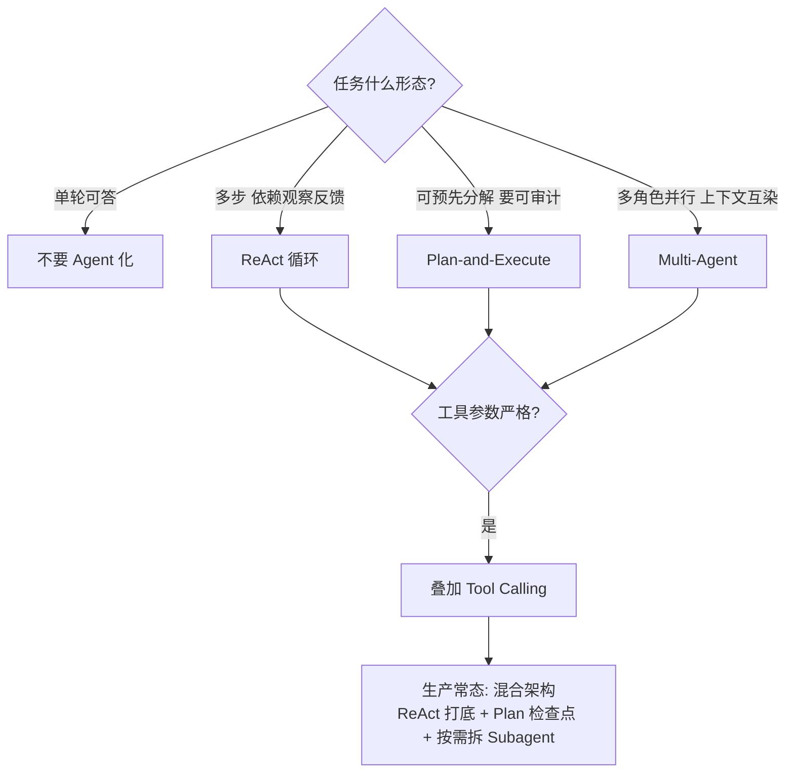
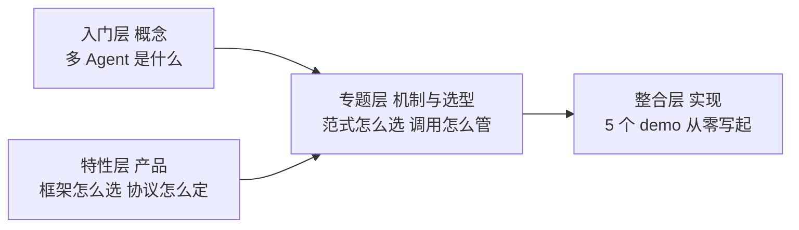
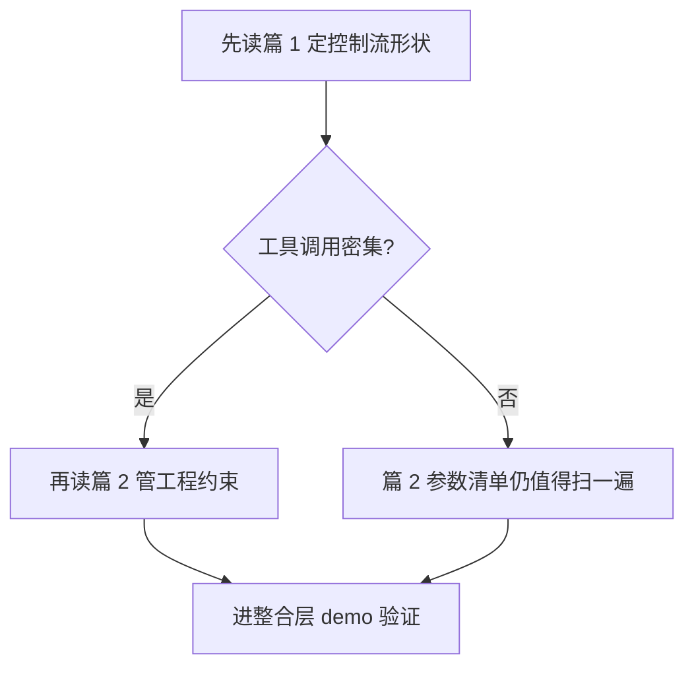

# Agent 架构范式专题 · 系列导读

> 全景导读：本专题 2 篇正文回答两个问题——四种 Agent 架构范式怎么选（篇 1），工具调用的工程约束怎么落地（篇 2）。读前看选型一张图，读时对照四层边界表，读后按阅读路径进阶。

## 系列导航

| 篇目 | 核心问题 | 读完能做什么 |
|---|---|---|
| [1 四种范式与选型决策](1_四种范式与选型决策-专题.md) | ReAct/Plan-and-Execute/Tool Calling/Multi-Agent 四种控制流形状怎么选 | 按任务形态走决策树定控制流，按量级三档配工程设施 |
| [2 工具调用与上下文隔离机制](2_工具调用与上下文隔离机制-专题.md) | 工具调用的工程约束怎么落地 | schema 场景裁剪、上下文隔离的 token 账、兜底状态机与参数级配置清单 |

## 范式选型一张图

## 两篇的分工与衔接

## 与相邻层的边界

| 层 | 篇目 | 讲什么 | 不讲什么 |
|---|---|---|---|
| 入门层 | 篇 12 多 Agent 与 Subagent | 多 Agent 概念与何时拆 | 状态分解与上下文隔离的机制 |
| 特性层 | 篇 1-2 编排引擎横评与状态管理 | 框架产品怎么选 | 范式机制本身 |
| 特性层 | 篇 3-4 MCP 协议两篇 | 工具协议 spec 与生态选型 | 调用工程约束与 token 账 |
| 专题层 | 本专题 2 篇 | 范式机制与选型 + 工具调用工程约束 | 框架实现细节、demo 从零写起 |
| 整合层 | agent 目录下 5 个 demo | 从零实现一个 Agent | 选型方法论 |

## 专题定位图

## 阅读路径

三条入口按现场选：选架构的从篇 1 决策树进；管工具调用的直接进篇 2 的六环节与参数清单；已经踩过坑的从篇 2 事故推演进——三段「发现-定位-止损」对照自己的现场复盘。

## 📌 数据与事实声明

- 写于 2026-10-14（专题层 · Agent 架构范式专题导读）；导读只做导航与边界，机制论述以 2 篇正文为准
- 边界表按本仓库现有目录划分；涉及公开报道的数字（如 OpenRouter 份额）均在正文标注口径与日期

## 📚 参考资料

| 类型 | 标题 | 链接 |
|---|---|---|
| 系列内 | 篇 1：四种范式与选型决策 | [1_四种范式与选型决策-专题.md](1_四种范式与选型决策-专题.md) |
| 系列内 | 篇 2：工具调用与上下文隔离机制 | [2_工具调用与上下文隔离机制-专题.md](2_工具调用与上下文隔离机制-专题.md) |
| 系列内 | 特性层篇 1：四家编排引擎架构横评 | [../../特性层/深入理解Agent工程化特性系列/1_四家编排引擎架构横评-深度.md](../../特性层/深入理解Agent工程化特性系列/1_四家编排引擎架构横评-深度.md) |
| 系列内 | 特性层篇 3：MCP 协议设计思想与 spec 演进 | [../../特性层/深入理解Agent工程化特性系列/3_MCP协议设计思想与spec演进-深度.md](../../特性层/深入理解Agent工程化特性系列/3_MCP协议设计思想与spec演进-深度.md) |
| 系列内 | 入门层篇 12：多 Agent 与 Subagent | [../../入门层/从零开始认识AI系列/12_多Agent与Subagent.md](../../入门层/从零开始认识AI系列/12_多Agent与Subagent.md) |
| 系列内 | 入门层篇 9：Harness 是什么 | [../../入门层/从零开始认识AI系列/9_Harness是什么.md](../../入门层/从零开始认识AI系列/9_Harness是什么.md) |
