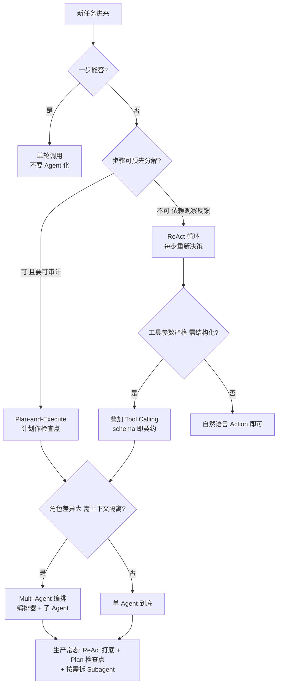
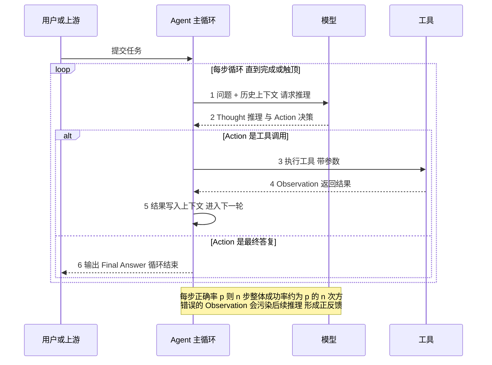
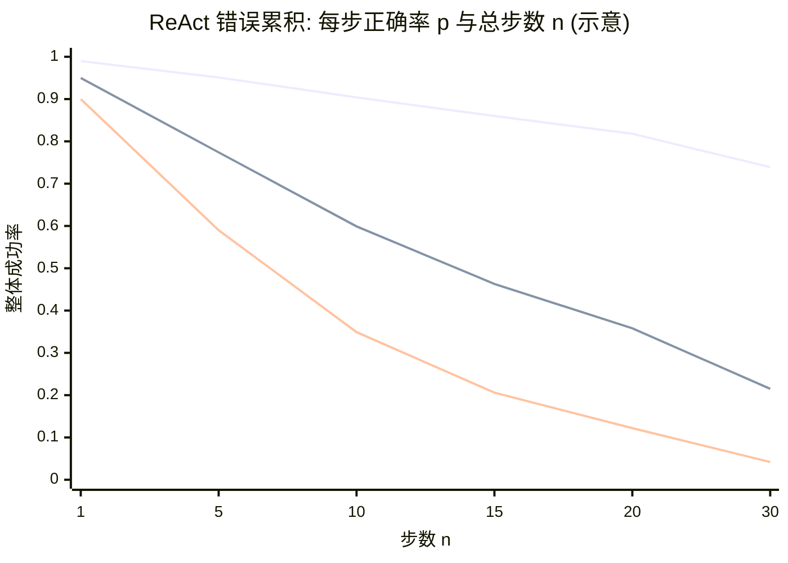
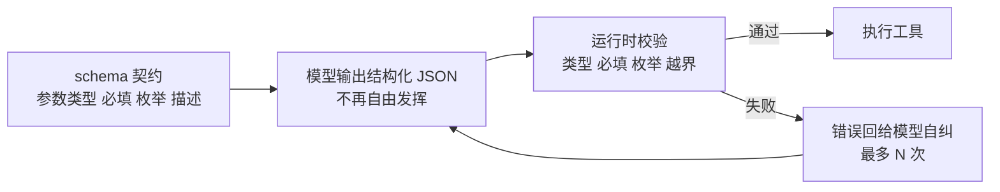
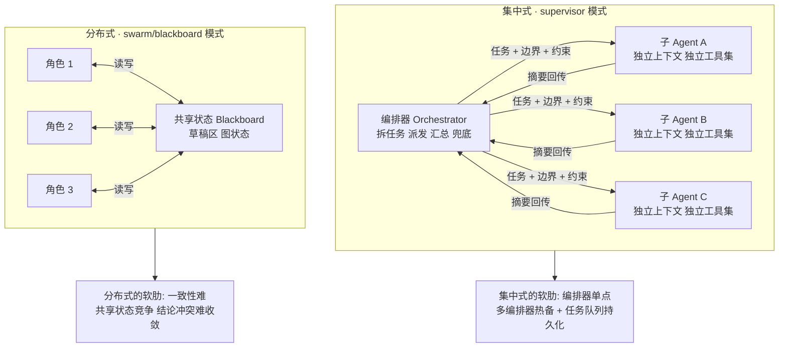
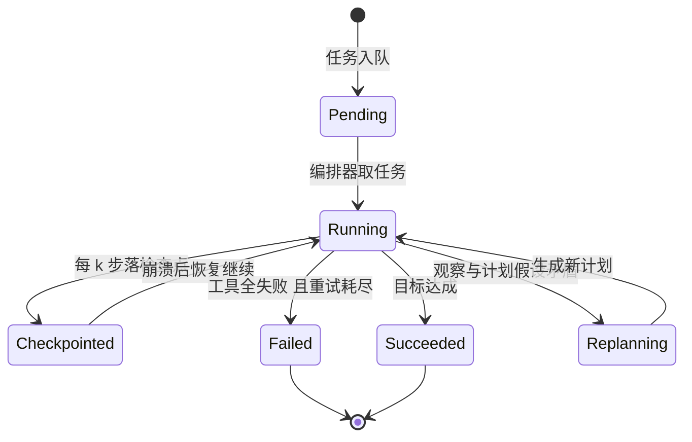
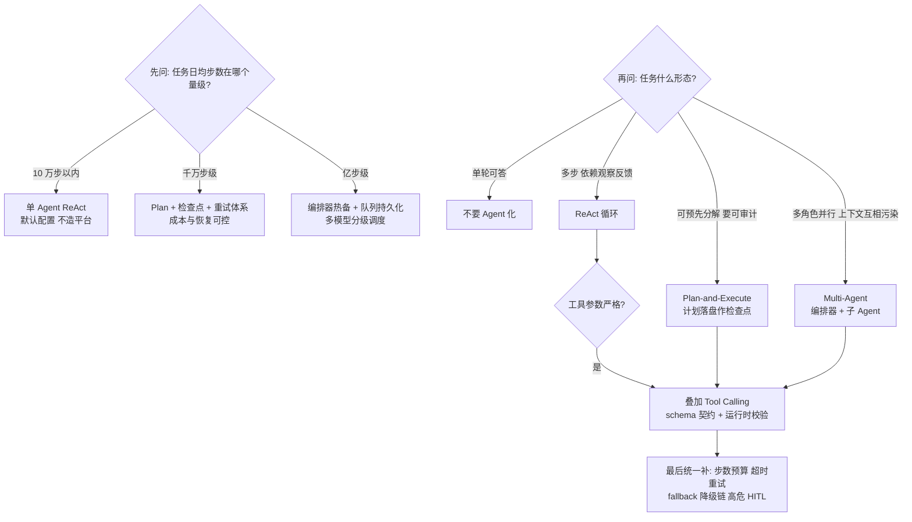

# 四种 Agent 架构范式与选型决策：ReAct、Plan-and-Execute、Tool Calling 与 Multi-Agent

> 一句话摘要：四种主流范式不是四种产品，而是四种控制流形状——ReAct 用循环换简单、Plan-and-Execute 用计划换可审计、Tool Calling 用契约换精确、Multi-Agent 用隔离换质量；选型的本质是让控制流形状匹配任务形态，生产常态是混合架构：ReAct 打底、Plan 设检查点、按需拆 Subagent。

## 🎯 本文核心

四种范式的本质分歧只有一个问题：**下一步由谁决定**。ReAct 把决定权每一步都交给模型（循环内实时决策）；Plan-and-Execute 把决定权提前到一次计划生成（批处理式决策）；Tool Calling 不决定下一步，只约束决定的形式（结构化契约）；Multi-Agent 把决定权分层——编排器定任务边界，子 Agent 在边界内自主。四者共享同一条机制链：**理解任务 → 决策下一步 → 执行 → 观察 → 修正或继续**，差别只在「决策点埋在哪、上下文怎么流、失败怎么兜底」。机制链一句话：**任务进来 → 控制流形状选型 → 每步决策与执行 → 观察回注 → 检查点与兜底 → 交付或止损**。

## 一图看懂：四种范式的控制流形状

```mermaid
flowchart TB
    ROOT["四种范式的本质分歧: 谁决定下一步 上下文怎么流 失败怎么兜底"]
    subgraph S1["ReAct · 单 Agent 循环"]
        direction LR
        A1["Thought 思考下一步"]
        A2["Action 调工具或答复"]
        A3["Observation 读结果"]
        A1 --> A2 --> A3 --> A1
    end
    subgraph S2["Plan-and-Execute · 两阶段批处理"]
        direction LR
        B1["Planner 一次生成完整计划"]
        B2["Executor 按序执行"]
        B3["观察与计划不符 触发 Replan"]
        B1 --> B2 --> B3
        B3 -.-> B1
    end
    subgraph S3["Tool Calling · 结构化契约"]
        direction LR
        C1["schema 描述工具契约"]
        C2["模型输出结构化 JSON"]
        C3["运行时校验后执行"]
        C1 --> C2 --> C3
    end
    subgraph S4["Multi-Agent · 状态分解"]
        direction LR
        D1["编排器拆任务 派发"]
        D2["子 Agent 独立上下文"]
        D3["摘要回传 汇总"]
        D1 --> D2 --> D3
    end
    ROOT --> S1
    ROOT --> S2
    ROOT --> S3
    ROOT --> S4
    ROOT --> OK["核心结论: 没有银弹范式<br/>任务形态决定控制流形状<br/>混合架构才是生产常态"]
    classDef rootc fill:#a8e6a3,stroke:#388e3c,stroke-width:2px
    classDef s1c fill:#e3f2fd,stroke:#1976d2
    classDef s2c fill:#fff3e0,stroke:#f57c00
    classDef s3c fill:#f3e5f5,stroke:#7b1fa2
    classDef s4c fill:#fce4ec,stroke:#c62828
    classDef okc fill:#a8e6a3,stroke:#388e3c,stroke-width:2px
    class ROOT rootc
    class S1 s1c
    class S2 s2c
    class S3 s3c
    class S4 s4c
    class OK okc
```

**读图三步**：四个子图是四种控制流形状的并排对照——差别不在「能不能完成任务」，在「决策点埋在哪」；蓝每步都决策、橙决策提前到计划、紫只约束形式、红分层决策。**范式是工具不是信仰，混合使用是常态。**

## 5W 速记卡

| 维度 | 一句话 |
|---|---|
| What | 四种控制流形状：ReAct 循环、Plan 两阶段、Tool Calling 契约、Multi-Agent 编排 |
| Why | 任务形态决定控制流形状——步数预算、可分解性、参数严格度、角色隔离需求各不相同 |
| When | 新 Agent 立项选架构、存量 Agent 失败率抬升要归因、多 Agent 拆分前先过基线 |
| Where | ReAct 用于反馈依赖型多步任务；Plan 用于可预先分解的长任务；FC 用于参数严格的工具调用；Multi-Agent 用于角色差异大的协作 |
| How | 混合架构：ReAct + Tool Calling 打底，Plan 设检查点，确需隔离才拆 Subagent |

## 〇、边界：相邻篇目讲过什么，本文讲什么

- 特性层《四家编排引擎架构横评》等两篇讲**产品与框架层**——LangGraph/CrewAI/AutoGen/OpenAI Agents SDK 的架构模型与状态管理选型，是「用谁实现」；本文讲**范式与机制层**——四种控制流的内在机制与选型逻辑，是「控制流形状怎么定」。范式定形状，框架落形状。
- 特性层 MCP 两篇讲**工具协议 spec**；本文只把 MCP 当「工具协议」的一个坐标（与 A2A 任务协议对照一句话带过），协议细节不展开。
- 入门层《多 Agent 与 Subagent》讲**概念与何时拆**；本文不重讲概念，讲状态分解与上下文隔离的机制、与微服务编排的同构性，以及拆分前的基线纪律。
- 整合层 `docs/ai/整合层/agent/` 下五个 demo 是**从零实现**视角；本文是选型与机制视角。

## 一、为什么有四种范式：任务形态决定控制流形状

过去五年 Agent 技术的演进有一条清晰主线：控制流形状从「一步一议的循环」长到「预先计划的批处理」，再长出「结构化契约」与「分层编排」——2022 年 ReAct 论文、2023 年 Function Calling 与 Plan-and-Solve 类工作、2024-2025 年 MCP 与 A2A，每一次都对应一类任务形态。**每一次演进都是被一类任务形态逼出来的。**

四种范式回答的是同一个控制流三问：**下一步由谁决定、上下文怎么流动、失败怎么兜底**。任务形态不同，三问的答案就不同：

**设计思想**：控制流形状的本质是「决策点的密度与位置」。ReAct 把决策点铺满每一步（密度最高、位置最灵活）；Plan 把决策点压缩到开头一次（密度最低、可审计性最高）；Tool Calling 不改决策点，只改决策的表达（从自然语言到结构化契约）；Multi-Agent 把决策点分层（编排器定边界、子 Agent 定细节）。**选型的第一个动作不是选框架，是数清楚任务里的决策点该密还是该疏。**

## 二、ReAct 机制穿透：循环三态与错误累积的数学

ReAct 的机制简单到一张时序图能装完：每轮把「问题 + 历史」塞给模型，模型输出 Thought 与 Action；Action 是工具调用就执行并把 Observation 写回上下文，是最终答复就结束。

ReAct 的真正约束不在机制在数学：**每步正确率 p，n 步之后整体成功率约为 p 的 n 次方**。这条公式是 ReAct 选型的硬边界：

曲线的工程含义很直白：每步 95% 正确率的 Agent，20 步后只剩三分之一强的整体成功率；每步 99% 也撑不到 30 步。**更悲观的是，独立假设是乐观估计**——错误的 Observation 会污染后续 Thought 形成正反馈，实际曲线比图里衰减更快。所以 ReAct 的工程纪律是三条：**步数预算**（max_steps 硬顶）、**检查点**（每 k 步可恢复）、**观察校验**（Observation 先过 sanity check 再入上下文）。

### 追问链：从循环到错误的三个层次

**追问一：循环里为什么必须保留 Thought，不让模型直接输出 Action？**因为 Thought 把「为什么下一步这么做」显式化——既是推理缓存，也是审计轨迹。去掉 Thought 的裸 Action 循环，模型在长任务里更容易原地打转。这是 ReAct 相对早期「直接调工具」方案的关键改进。

**再追问：既然错误累积是数学必然，为什么不干脆全用 Plan-and-Execute？**因为计划的前提是「步骤可预先分解」，而大量真实任务（排障、调研、开放式编码）的下一步依赖上一步观察，预先分解不了。Plan 解不了反馈依赖型任务，ReAct 解不了可分解型任务的可审计性——这是范式并存的原因，不是优劣问题。

**打破砂锅：错误累积能不能靠更强模型根治？**能缓解不能根治。模型能力提升抬高 p，但 p 永远小于 1，n 变大时 p 的 n 次方照样趋零。根治要靠控制流：步数预算、检查点、并行分支投票（self-consistency 思路）、把长任务拆短。**模型买的是 p，控制流买的是 n——两笔账分开算。**

## 三、Plan-and-Execute：计划作为可审计中间产物

Plan-and-Execute 把 ReAct 的「每步一议」改成「先议后做」：Planner 一次生成完整计划（有序子目标列表），Executor 按序执行，观察与计划不符时触发 Replan。它与 ReAct 的关系一句话概括：**Plan-and-Execute 是批处理版的 ReAct**——把多次 Thought 合并成一次 Plan，循环粒度从「步」放大到「计划段」。

计划的真正价值不是「想清楚再做」，而是**计划是一个可审计、可 diff、可中断恢复的中间产物**：任务还没执行就能审「它打算干嘛」（HITL 挂点）；Replan 时新旧计划一比就知道模型为什么改主意；崩溃后从下一个未完成项继续，不用重跑。

代价同样明确：**计划错误会放大**——计划阶段的一个错误子目标，会带着执行器闷头走完整个计划段才在观察端暴露；且执行期没有实时反思，Executor 是「按单做菜」不是「边做边想」。所以生产里的 Plan-and-Execute 必须配 replan 触发条件（工具连续失败、观察与关键假设矛盾、预算过半进度不足）与执行器内的局部 ReAct。

**反方案分析：为什么不「永远持续 replan」？**replan 的代价是重新生成完整计划（token + 延迟 + 可能引入新错误）。频繁 replan 的 Plan-and-Execute 会退化成「每步 replan 的 ReAct」，还多付一份计划 token。正确姿势是**分级 replan**：子目标内部失败就地重试，子目标之间失败才 replan，全局假设崩塌才整体 replan。

## 四、Tool Calling / FC：schema 即契约

Tool Calling（Function Calling）在范式谱系里位置特殊：它不决定下一步做什么，只约束「调用工具」这一步的表达形式——模型必须按 schema 输出结构化 JSON（工具名 + 参数），运行时校验通过才执行。底层机制可以是 JSON mode、约束解码或供应商原生支持，公开文档口径各家不同，契约语义一致。

**schema 即契约**的三层含义：对模型，schema 是「这个工具怎么调」的唯一权威描述（描述写歪了模型就调歪）；对运行时，schema 是校验与默认值的来源；对上下游，schema 是工具提供方与消费方之间的版本化接口（改 schema 等于发版）。与 ReAct 的组合关系是正交叠加：ReAct 定循环，Tool Calling 定循环里 Action 的表达——两者是「控制流 × 表达层」的乘积，不是竞品。

**反方案分析一：为什么不继续用自然语言 Action，让执行层去解析？**自然语言解析不可校验——「查一下昨天的订单」传什么日期格式、什么状态枚举，猜错就是运行时事故。schema 把「猜」变成「契约」，参数错误从执行期提前到生成期，校验失败还能回喂给模型自纠。**用一次格式约束，买掉一整类参数歧义事故。**

**反方案分析二：为什么不把业务规则全塞进 schema 描述里？**schema 描述是给模型读的 prompt，不是给编译器读的代码。塞太多，schema 体积膨胀拉低选择准确率（系列第 2 篇量化），规则改了模型行为还漂移。正确姿势是 schema 只描述契约，业务规则放系统 prompt 或代码，执行期兜底。

## 五、Multi-Agent 编排：状态分解与上下文隔离

Multi-Agent 的机制本质只有八个字：**状态分解 + 上下文隔离**。主 Agent 的上下文是有限资源，塞满中间推理与大段工具输出后，模型注意力被稀释、token 成本线性上涨。Multi-Agent 把任务状态拆到多个子 Agent，每个子 Agent 拥有独立上下文窗口，只把**摘要**回传协调者——用「摘要损耗」换「主上下文干净」。

这套机制与微服务编排高度同构：**编排器 = 服务编排层**（拆任务、派发、汇总），**子 Agent = 领域服务**（独立状态、独立工具集、独立失败域），**摘要回传 = 接口契约**（跨边界只传结论不传过程），**任务队列 = 可靠消息**（持久化才能重放）。想清楚这一点，Multi-Agent 的工程问题就全是老朋友：单点怎么办（热备）、状态丢了怎么办（检查点）、下游打挂了怎么办（熔断退避）、链路怎么追（trace 贯穿）。

**token 的账要摊开算**：子 Agent 独立上下文让中间过程不进主上下文、主上下文只增摘要，但每个子 Agent 要重建系统提示与任务描述、汇总还要多一轮编排器推理——一省一花。业内公开讨论的经验口径：多 Agent 拆分带来约一个数量级的 token 成本上升（常被引用为 ×15 量级），换来接近单 Agent 上限的质量（约 90% 量级）——**这是公开经验口径不是实测承诺**，但它解释了为什么「能不多 Agent 就不多 Agent」成为生产共识：隔离是手段，质量净收益才是目的，拆之前必须先有单 Agent 基线作对照。

协议坐标一句话：**MCP 是工具协议**（Agent 怎么发现和调用工具，特性层篇 3/4 已讲 spec 与生态），**A2A 是任务协议**（Agent 之间怎么互派任务，2025 年公开）——前者管「手」，后者管「活」，本篇只借这个坐标划边界。**反方案分析：为什么不 all-in Multi-Agent，把每个能力都拆成角色？**三个反噬：token 成本约一个数量级上升；编排层成为新的单点与新的故障域；上下文隔离隔掉了「主 Agent 本可需要的中间细节」。入门层篇 12 的纪律在这里依然成立：**先单 Agent 基线，按测量拆分，不按想象拆分。**

## 六、选型决策树：范式是乘积不是互斥

把前五节压成一张决策树。叶节点不是四选一而是「叠加项」——Tool Calling 几乎总要叠，Plan 与 Multi-Agent 按需：

**落地前置条件**（任何范式都逃不掉的三条）：① 任务有明确的完成定义（否则循环没有终止判据）；② 工具调用有 trace（否则事故无法归因）；③ 有 token 与步数的预算上限（否则失控没有闸门）。

## 七、不同量级的思考：约束来源决定解法

范式选好后，量级决定同一套范式要配多厚的工程设施。三档约束来源完全不同，每一档的核心问题是不同的问题：

### 十万级：单 Agent ReAct 就够（10 万步/天）

约束来源是**模型能力与任务定义质量**——编排层的可用性与成本都排不进主要矛盾，prompt 与 schema 写得好坏直接决定成败。这一档的核心问题是「任务定义与 schema 契约清不清楚」，而不是「编排框架选哪个、要不要热备」；思考方式是**语义驱动**——ReAct + Tool Calling 打底，max_steps 给默认值，监控只看完成率与 token 均值。反模式是这个量级就引入多 Agent 与自建编排平台：token 成本约一个数量级上升，买不到可测量的质量净收益。

### 千万级：Plan + 检查点 + 重试体系

约束来源是**长任务的错误累积与成本曲线**——日千万步意味着长任务成为常态，p 的 n 次方开始咬人，单次任务的 token 成本开始可算。这一档的核心问题是「失败可恢复与成本可控」，而不是「再多加一个 Agent 或换更重的框架」；思考方式是**检查点驱动**——计划落盘、每 k 步 checkpoint、子目标级 replan、重试带退避与熔断、token 按任务分账。千万级是「工程设施」从可选变必选的拐点：没有检查点，一次崩溃重跑整个长任务；没有分账，成本优化没有抓手。

### 亿级：编排器热备 + 队列持久化 + 多模型分级调度

约束来源是**编排层自身的 SLA 与单位经济**——日亿步时，编排器停一分钟就是上万任务停摆，编排层从「任务的一部分」变成「生产系统的一部分」，可用性、成本、多租户公平全部进入承诺范围。这一档的核心问题是「编排层自身的可用性与单位成本」，而不是「单个任务成功率再优化几个点」；思考方式是**平台驱动**——多编排器热备 + 任务队列持久化（崩溃可重放）、多模型分级调度（简单步走小模型、关键步走大模型）、按租户的配额与熔断。亿级还会逼出一个架构决策：编排层与业务系统解耦（独立部署、独立扩缩），因为它的负载特征（长时程、有状态）与无状态 API 完全不同。

**自下而上与触发升级**：三个实测值定档——日步数与长任务步数分布（p 的 n 次方咬不咬人）、单任务 token 成本分位（成本曲线在哪拐）、崩溃恢复重跑时长（检查点体系值不值）。触发升级的信号：「token 预算爆了」说明该上检查点与分级调度；「编排器一挂全线停」说明该上热备与队列持久化；「多租户互相挤占」说明该上配额治理。**量级不是步数总数，是「最长的那条任务链」与「编排层停一分钟的损失」——范式的账永远按最坏任务算。**

## 八、事故推演：三个高频场景的发现-定位-止损

### 推演一：ReAct 死循环烧 token

**现象**：某调研类 Agent 夜间批量任务，token 消耗半夜翘尾，日账单涨三倍，完成率反而降。**定位**：拉 trace 看步数分布，一批任务卡在 40-60 步之间反复调用同一个搜索工具——Observation 高度重复，Thought 每轮换个说法问同一个问题；根因是缺终止判据加缺步数硬顶。**止损**：加 max_steps=25 与「Observation 与上轮相似度超阈值即早停」的双闸，已跑任务按 trace 截断。**复盘**：循环型范式的失控不是 bug 是数学——没有步数预算的 ReAct 等于没有预算的循环；监控三件套：步数分位、token 分位、Observation 重复率。

### 推演二：计划执行一半工具全失败

**现象**：某报告生成 Agent（Plan-and-Execute）成功率从九成掉到三成，集中在午间。**定位**：按阶段归因——Planner 输出正常，Executor 在第 3-5 个子目标集体失败，错误码全是下游 API 5xx；是下游故障不是计划故障，但 Executor 没有 fail-fast，每个子目标重试满配额才善后，把故障拖长了半小时。**止损**：熔断下游调用、未完成任务按计划检查点挂起，下游恢复后从断点续跑。**复盘**：计划范式的风险是「计划正确但世界错了」——执行期必须持续校验「观察与计划的关键假设还成立吗」，假设崩塌要整体 replan 而不是闷头重试。教训一句话：**重试是对付抖动的，不是对付故障的——故障要靠熔断与 replan。**

### 推演三：编排器单点故障

**现象**：某多 Agent 协作系统发布后偶发「所有任务停摆十分钟」，无错误只有超时。**定位**：编排器进程重启后，内存里的任务状态与派发表全部蒸发，正在跑的几十个长任务变成孤儿——Worker 回传摘要找不到接收方；根因是编排器无状态设计缺位，任务队列与检查点都在内存。**止损**：紧急回滚到上一版，停掉长任务批量提交。**复盘**：Multi-Agent 把任务状态从「一个循环的局部变量」升级成「跨进程的生产数据」，就必须按生产数据对待——任务队列持久化（崩溃可重放）、编排器多实例热备、检查点外存。**编排层迟早要为自己的 SLA 负责，区别只在被动还是主动。**

## Trade-off：范式复杂度与可控性的交换

四种范式是同一条光谱上的四个点，横轴是**范式复杂度**，纵轴是**可控性**：

- **ReAct**：用「零前期设计」换「长任务错误累积」——实现最简、可解释性最好（每步有 Trace），但 p 的 n 次方决定它是短任务范式；超过约 20-30 步必须叠加检查点与早停，否则 token 账单先于任务完成爆炸。
- **Plan-and-Execute**：用「计划 token 与 replan 成本」换「可审计性与可恢复性」——计划落盘让 HITL 与断点恢复成为可能，代价是计划错误放大、执行期反思变弱；replan 频率是核心调优旋钮。
- **Tool Calling**：用「schema 维护成本与候选空间稀释」换「参数精确与可校验」——契约把参数歧义事故变成生成期可自纠的校验失败，但 schema 膨胀会拉低选择准确率（第 2 篇量化），工具库稍大就必须场景裁剪。
- **Multi-Agent**：用「约一个数量级的 token 成本与编排复杂度」换「上下文隔离与质量上限」——隔离隔掉污染也隔掉细节（摘要损耗），编排器成为新单点；它是唯一「引入的新问题可能多于解决的问题」的范式，必须有单 Agent 基线作对照才动手。

跨周期看这条演进脉络：范式的演进方向始终是「把决策点从模型手里拿回工程手里」——ReAct 全交模型，Plan 拿回计划权，Tool Calling 拿回参数权，Multi-Agent 拿回结构权。2025-2026 年的公开趋势（Harness 成为实际约束、开源模型在 Agent 工作流规模化使用）说明下一步的变量在「执行环境与模型分级」，不在「再发明第五种范式」。**先给任务画像（步数、可分解性、角色差异），画像清楚，光谱上的位置自己会说话。**

## 💡 实战提示

- 💡 任务进来先数决策点：有反馈依赖用 ReAct，可预先分解用 Plan，参数严格叠 Tool Calling，角色互染才拆 Multi-Agent
- 💡 ReAct 上线三件套先于调 prompt：max_steps 硬顶、每 k 步 checkpoint、Observation 相似度早停——p 的 n 次方不认 prompt 玄学
- 💡 计划必须落盘、拆 Multi-Agent 前先跑单 Agent 基线：没有基线，拆分收益不可证，token 成本约一个数量级的上涨不可辩

## 你们可能会问

**Q1：既然 Multi-Agent 能隔离上下文，为什么不一开始就拆？**因为拆分的收益不可先验——隔离换来「质量上限提升」，付出「约一个数量级 token 成本 + 编排复杂度 + 摘要损耗」。纪律与入门层篇 12 一致：先跑单 Agent 基线，测出它败在上下文污染还是能力不足，前者才拆。按想象拆分是多 Agent 被过度开方的头号原因。

**Q2：Plan-and-Execute 和 ReAct 能不能混用？**能，生产标配就是混用：标准形状是「宏观 Plan、微观 ReAct」——Planner 出子目标列表，每个子目标内部是 ReAct 循环，子目标之间才 replan。判断标准：replan 的层级与「假设崩塌的层级」对齐。

**Q3：Tool Calling 是独立范式还是 ReAct 的一部分？**是正交的表达层，不是竞品。ReAct 定「循环与控制」，Tool Calling 定「Action 长什么样」；没有 Tool Calling 的 ReAct 用自然语言 Action（解析不可校验），没有 ReAct 的 Tool Calling 更接近工具编排脚本。选型时它们在不同维度，应该同时选。

**Q4：小模型做 Agent，范式选择要变吗？**要变，且变更集中：小模型的 p 低、p 的 n 次方掉得快，第一纪律是**压短链路**（子目标切小、步数预算收紧、能用单轮解决的不要 Agent 化）；第二是把 schema 写短写清楚；第三才考虑 Multi-Agent——小模型场景拆多 Agent 往往得不偿失，摘要损耗对推理质量的伤害更大。公开报道口径（2026-09）显示开源模型已在 Agent 工作流规模化使用（OpenRouter 平台 shell execution 类目调用份额第一为 DeepSeek V4.1 Flash，19.9%，2026-09 下旬 7 天窗口；multi-step planning 类目 14.0% 同样第一）——「小模型 + 短链路 + 严契约」已是可用的生产组合。

## 开放问题

- **范式自动路由**：让模型根据任务画像自己选控制流形状（循环/计划/编排），meta-Agent 思路已有公开雏形，但「选错了谁发现」没有答案——可能要靠任务完成率的事后归因反哺路由策略。
- **计划的形式化验证**：计划落盘后可审计，但「审计」目前靠人读。计划的结构化校验（子目标依赖无环、资源预算守恒、工具调用前置条件满足）能走多远，社区没有共识。
- **长上下文普及后的错误累积**：上下文窗口变大直接缓解「主上下文污染」，ReAct 的 n 上限被拉长，Multi-Agent 的隔离收益被稀释——长上下文与多 Agent 的边界会不会因此重画，仍在观察期。

## 🎯 核心带走

- **一图一句**：四种范式 = 四种控制流形状，本质分歧是「下一步由谁决定」；没有银弹，混合架构（ReAct 打底 + Plan 检查点 + 按需 Subagent）才是生产常态
- **ReAct 的命门是数学**：每步正确率 p，n 步整体成功率约为 p 的 n 次方；工程三件套是步数预算、检查点、观察校验——模型买 p，控制流买 n
- **Plan 的价值在中间产物**：计划可审计、可 diff、可恢复；风险在计划错误放大与执行期无反思，必须配分级 replan 与执行器内局部 ReAct
- **Tool Calling 是契约不是范式**：schema 即契约——对模型、对运行时、对上下游三层含义；schema 膨胀拉低选择准确率，大工具库必须场景裁剪（第 2 篇）
- **Multi-Agent 是同构不是新问题**：状态分解 + 上下文隔离，与微服务编排同构；token 成本约一个数量级上升换质量净收益，先基线后拆分
- **量级主线**：十万级语义驱动（单 Agent 就够）→ 千万级检查点驱动（Plan+重试体系）→ 亿级平台驱动（热备+持久化+分级调度）；账按最坏任务链与编排层停摆损失算

## 📌 数据与事实声明

- 写于 2026-10-14（专题层 · Agent 架构范式专题第 1 篇）；机制描述基于公开论文与各供应商公开文档的通用口径，不指向任何特定公司的内部实现
- ReAct 出自 2022 年公开论文（Yao et al.）；Plan-and-Solve、Function Calling 的公开进展集中在 2023 年；MCP 于 2024-11 进入公开视野；A2A 于 2025 年公开——均为公开时间线，具体版本以官方文档为准
- 「多 Agent token 成本约 ×15、质量约 90%」为业内公开讨论的经验口径，非实测承诺
- OpenRouter 平台份额数据（DeepSeek V4.1 Flash，shell execution 类目 19.9%、multi-step planning 类目 14.0%，2026-09 下旬 7 天窗口）为 2026-09 公开报道口径，非本仓库实测
- 事故推演三段均为公开技术社区高频案例模式的匿名化复述，不含任何真实系统、公司与内部代号

## 📚 参考资料

| 类型 | 标题 | 来源 |
|---|---|---|
| 论文 | ReAct: Synergizing Reasoning and Acting in Language Models（2022） | arxiv.org/abs/2210.03629 |
| 官方文档 | Function Calling / Structured Outputs | platform.openai.com/docs |
| 官方文档 | Tool use（工具调用的契约与校验语义） | docs.anthropic.com |
| 官方文档 | Model Context Protocol（工具协议，特性层篇 3 已深拆） | modelcontextprotocol.io |
| 系列内 | 篇 3：MCP 协议设计思想与 spec 演进 | [../../特性层/深入理解Agent工程化特性系列/3_MCP协议设计思想与spec演进-深度.md](../../特性层/深入理解Agent工程化特性系列/3_MCP协议设计思想与spec演进-深度.md) |
| 系列内 | 篇 1：四家编排引擎架构横评（产品层选型） | [../../特性层/深入理解Agent工程化特性系列/1_四家编排引擎架构横评-深度.md](../../特性层/深入理解Agent工程化特性系列/1_四家编排引擎架构横评-深度.md) |
| 系列内 | 篇 12：多 Agent 与 Subagent（概念层） | [../../入门层/从零开始认识AI系列/12_多Agent与Subagent.md](../../入门层/从零开始认识AI系列/12_多Agent与Subagent.md) |
| 系列内 | 篇 9：Harness 是什么（执行环境概念） | [../../入门层/从零开始认识AI系列/9_Harness是什么.md](../../入门层/从零开始认识AI系列/9_Harness是什么.md) |
| 系列内 | 篇 2：工具调用与上下文隔离机制（本专题下一篇） | [2_工具调用与上下文隔离机制-专题.md](2_工具调用与上下文隔离机制-专题.md) |
