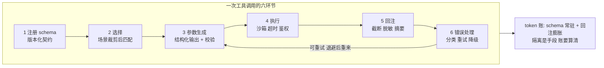
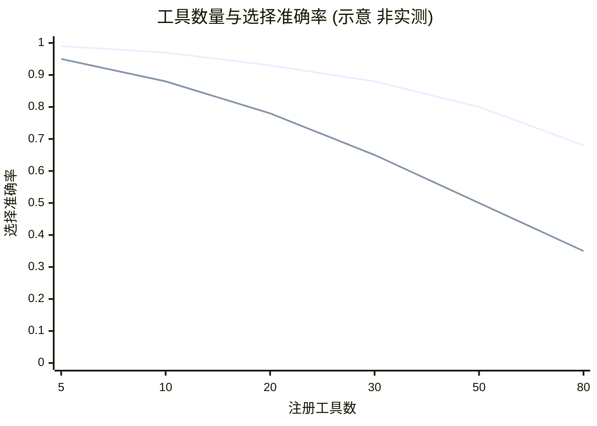
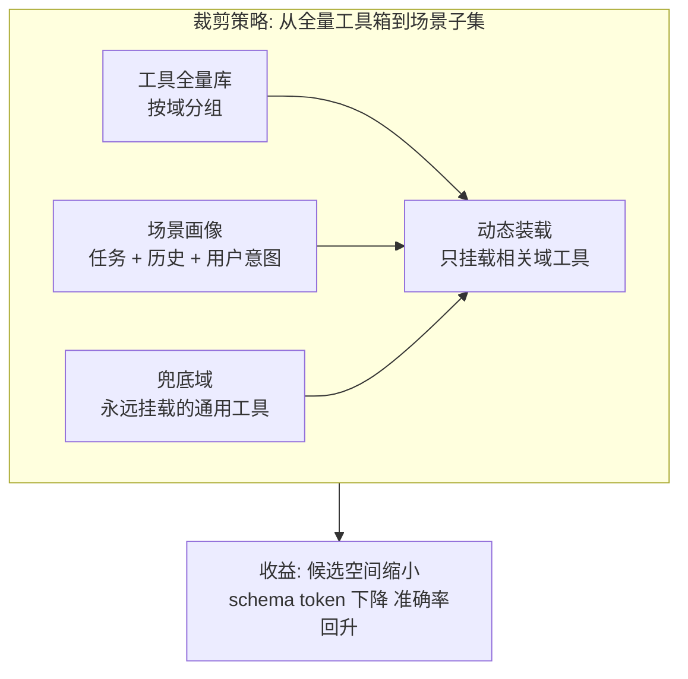
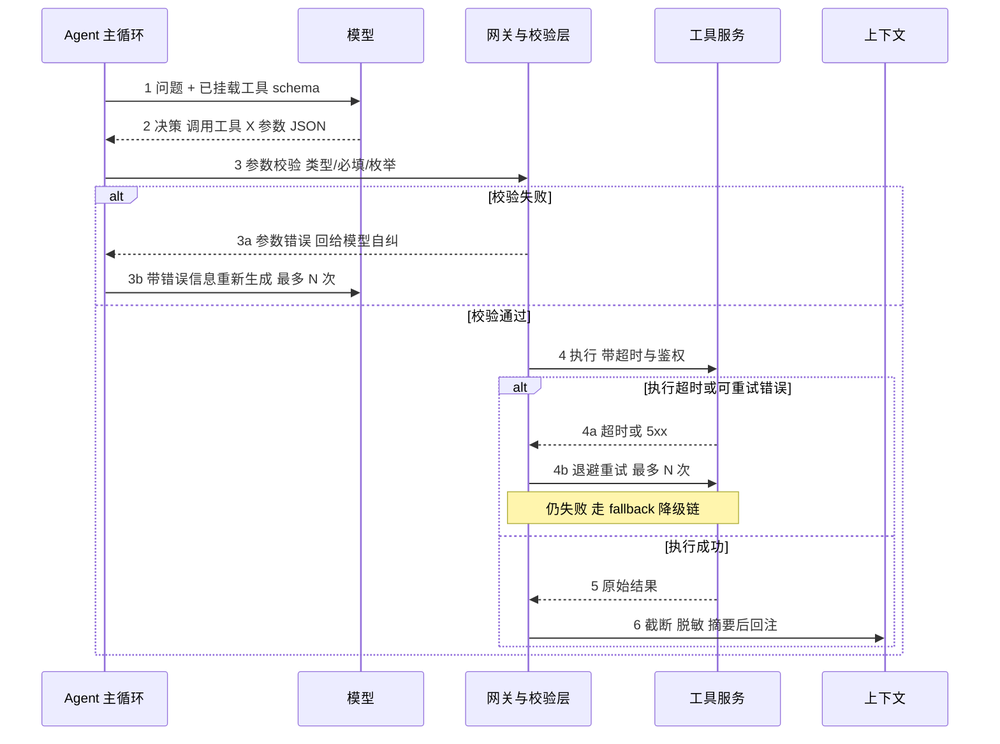
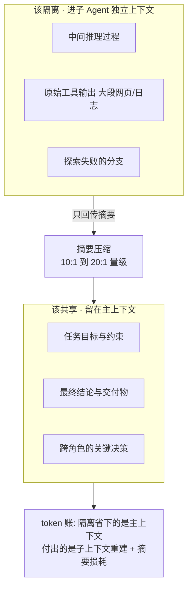
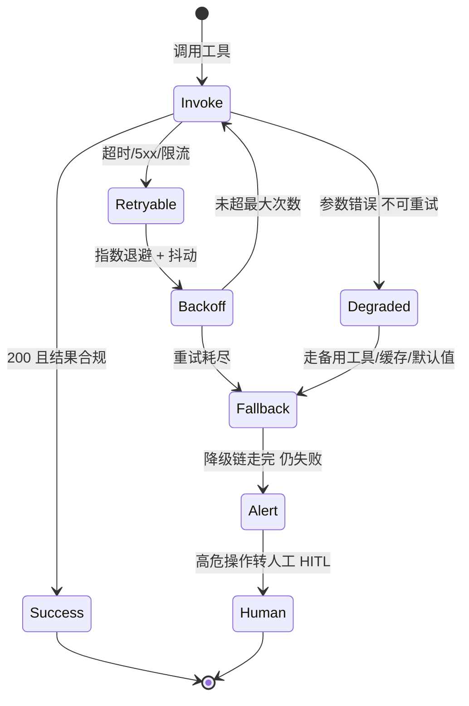

# 工具调用与上下文隔离机制：schema 契约、token 账与失败兜底

> 一句话摘要：工具调用是 Agent 与真实世界之间的唯一通道，它的工程约束不在「怎么调」而在「调得起吗」——schema 膨胀稀释选择准确率、上下文不隔离引爆 token 成本、失败不兜底放大成级联事故；本文把一次工具调用拆成六个环节，给参数级配置清单、步骤级接入 SOP 与三档量级思考。

## 🎯 本文核心

工具调用的本质是**用结构化契约换精确，用上下文隔离换质量，用兜底体系换可用**。一次调用串起六个环节：**schema 注册 → 选择 → 参数生成 → 执行 → 结果回注 → 错误处理**；每个环节都有明确的工程约束——注册要版本化、选择要场景裁剪、参数要运行时校验、执行要超时熔断、回注要截断脱敏、错误要分类分级。机制链一句话：**工具库按场景裁剪后挂载 → 模型按 schema 生成结构化调用 → 校验后进沙箱执行 → 结果截断回注 → 失败走重试/降级/告警链 → 摘要回传主上下文**。

## 一图看懂：一次工具调用的六环节



**读图两步**：六环节是一条流水线，但第 6 环的回边才是重点——**失败不是终点，是分类后的路由**（可重试的退避重来、不可重试的降级、降级也失败的告警转人工）；底部绿框是贯穿全文的暗线：每个环节都在花 token，隔离与摘要是管这笔账的手段。

## 5W 速记卡

| 维度 | 一句话 |
|---|---|
| What | 工具调用的六环节生命周期 + 上下文隔离机制 + 失败兜底体系 |
| Why | schema 膨胀稀释选择准确率，上下文不隔离引爆 token 成本，失败不兜底放大成级联事故 |
| When | 工具库超过十几个、单任务 token 成本抬头、下游工具开始抖动时 |
| Where | schema 注册表、调用网关、上下文预算器、兜底状态机四处落工程手段 |
| How | 场景裁剪 schema + 运行时校验 + 沙箱执行 + 截断回注 + 分级兜底 + 摘要隔离 |

## 〇、边界：相邻篇目讲过什么，本文讲什么

- 特性层《MCP 协议设计思想与 spec 演进》《MCP 无状态化改造与生态选型》讲**工具协议本身**——MCP 的 spec 设计、无状态化演进与生态选型，是「工具怎么被发现和描述」；本文讲**调用机制与工程约束**——schema 与准确率的关系、调用生命周期、上下文隔离的 token 账、失败兜底，是「调用怎么不出事」。
- 专题层第 1 篇讲**范式选型**（ReAct/Plan/Tool Calling/Multi-Agent 的控制流形状）；本文只把 Tool Calling 当既定前提，深挖它的工程约束。
- 入门层篇 9《Harness 是什么》讲过执行环境概念；本文的「沙箱执行」环节链回该篇不重讲，只讲工程参数。

## 一、工具 schema 与选择准确率：候选空间稀释

工具库稍大，第一个撞墙的不是执行而是**选择**：模型面对几十个工具的 schema，选错的概率随候选空间增大而上升。两个量化口径（均为公开经验口径，非实测承诺）：工具数到 30+ 时，schema 本身要占 5K+ token 的常驻上下文；且候选空间稀释下，语义相近的工具（比如三个都叫 search 的工具）误选率显著抬头。



衰减的机制是**候选空间稀释**：schema 既是模型的「参考资料」也是「干扰项」——工具越多、描述越啰嗦，目标工具的信号被噪声淹没，语义相近的工具之间更容易混淆。工程解法不是换模型，是**场景裁剪**：按当前任务动态挂载工具子集，而不是把全量库一次挂上。



**设计思想**：schema 是契约也是 prompt——它同时承担「告诉模型怎么调」和「占用模型注意力」两个角色，这两个角色天然冲突。所以工具库的组织原则是**按域分组、按场景装载**：全量库按域（订单/搜索/支付）分组成注册表，运行时按场景画像只挂相关域，加一个永远挂载的兜底域（help、echo 这类安全工具）。**把「模型从 50 个里挑 1 个」变成「从 5 个里挑 1 个」，是投入产出比最高的一刀。**

常被误解的一点是「工具调不准就换大模型」——大模型抬高的是一次调用的成功率，但候选空间稀释是结构问题：50 个工具的库，换模型只是把误选率从 15% 降到 10%，场景裁剪是直接把分母缩小一个量级。**模型买概率，裁剪买结构，两笔账分开算。**另一个追问层面的问题是「网关层是不是过度设计」——看调用量与下游容量：10w 次级/天一个校验函数就够，千万级才需要独立网关，亿级网关必须独立部署（独立的容量特征与故障域）。架构演进的触发点是实测值，不是流行趋势。

## 二、工具调用的完整生命周期：一次调用的时序

把六环节展开成时序，重点看失败分支——生产里一次调用平均要走几遍失败路径：



时序里四个工程要点：**① 参数校验前置**——校验失败回喂模型自纠（带错误信息重新生成），比让错误参数打到工具服务再报错便宜一个数量级；**② 执行必须带超时与鉴权**——沙箱执行是 Harness 的职责（概念见入门层篇 9），工程上要保证单工具故障不拖死主循环；**③ 回注不是原样写入**——截断（防大段输出挤爆上下文）、脱敏（密钥/令牌类字段先 Mask 再入上下文）、摘要（超长结果先压缩）；**④ 重试有预算**——退避重试最多 N 次，N 次内失败走降级链，降级链也失败才告警。

**反方案分析：为什么不把参数校验交给工具服务端做？**服务端校验当然要有，但它是最后一道闸。放在网关层的价值是**失败得早、反馈得准**：类型错误在生成期就能自纠（模型看到校验错误能改），打到服务端再 400 回来，一次网络往返加一次无效执行，故障期还会放大下游压力。**用一层本地校验，买掉大半无效执行。**

## 三、上下文隔离机制：token 账与边界

Multi-Agent 的收益来自隔离，成本也来自隔离。先算账：子 Agent 独立上下文意味着中间推理、原始工具输出、失败分支都不进主上下文，主上下文只增摘要——这是省的一面；但每个子 Agent 要重建系统提示与任务描述，汇总多一轮编排器推理，摘要还有信息损耗——这是花的一面。公开讨论的经验口径：约一个数量级的 token 成本上升（常被引为 ×15 量级）换接近单 Agent 上限的质量（约 90% 量级）。**账不算清，隔离就是奢侈；账算清了，隔离是投资。**



隔离的边界按一条原则划：**过程隔离，结论共享**。中间过程（推理、原始输出、失败分支）是子 Agent 的私事，回传摘要即可；目标、约束、最终结论、跨角色关键决策是主上下文的公共资产，必须共享。反例是两种极端：全不隔离（主上下文被过程数据撑爆，模型注意力稀释）和全隔离（摘要损耗复利，主 Agent 拿到一堆失真的「二手结论」）。摘要压缩比按回传信息密度分级：结论类 10:1 到 20:1，过程类可以更狠，但**压缩比是质量与成本的交易，不是越省越好**。

## 四、失败兜底体系：超时、重试、退避、降级、告警

兜底不是「加了 try-catch」，是一条状态机——每层有明确参数与理由：



每层的设计理由：**超时**是兜底的第一道闸，没有超时的调用会把下游故障翻译成主循环雪崩；**重试**只对瞬时故障（抖动、限流）有效，对持续故障（下游挂死）无效，所以必须配**指数退避 + 抖动**——无抖动的同步重试会在故障期形成重试风暴（事故推演三）；**降级链**是重试耗尽后的Plan B——备用工具、缓存结果、默认值，按业务语义排序；**告警**是降级也失败时的最后手段，高危操作（支付、删除、外发）必须转人工 HITL，不能静默失败。**反直觉的一点：兜底体系的 KPI 不是「消灭失败」而是「失败的可预期」——每次失败走同一条状态机，监控才有的可归因。**

## 五、参数级配置清单：名称/默认/分档推荐/为什么

| 参数名 | 默认值 | 10w 次/天 | 千万次/天 | 亿次/天 | 为什么 |
|---|---|---|---|---|---|
| step_timeout 单步超时 | 30s | 30s | 10-15s 按工具分级 | 5s/30s/120s 三档按工具分级 | 第一道闸：太短误杀慢工具，太长拖垮整体延迟分位 |
| max_retries 最大重试 | 2 | 2 | 3 + 退避 + 抖动 | 按工具类别 0-3 + 熔断 | 重试对抖动有效对故障无效，次数必须与退避绑定 |
| context_budget 上下文预算 | 模型窗口 60% | 60% | 50% + 摘要压缩 | 主/子/摘要分层配额 | 预算是 OOM 与成本爆炸的闸门，先设上限再谈优化 |
| summary_ratio 摘要压缩比 | 10:1 | 10:1 | 20:1 | 按角色 10:1-50:1 | 压缩越狠损耗越大，按回传信息密度分级 |
| max_concurrency 工具并发上限 | 4 | 4 | 8-16 | 按下游容量动态调整 | 并发打的是下游容量不是模型能力，超售就是事故 |
| injection_guard 回注审查 | 开 | 开 | 开 + 高危 HITL | 全量 + 沙箱隔离 | 工具返回是注入的主要攻击面，默认必须开 |

对应一份可落地的配置形态（示意，具体参数名以所用框架为准）：

```yaml
tool_call:
  step_timeout: 30s          # 单步工具超时 默认值
  max_retries: 2             # 最大重试次数
  backoff: exponential       # 指数退避 + 抖动
  context_budget: 0.6        # 上下文窗口预算占比
  summary_ratio: 10          # 摘要压缩比
  max_concurrency: 4         # 工具并发上限
  injection_guard: on        # 回注内容审查
```

**调参的心法**：这些参数的默认值覆盖 10w 次级/天的绝大多数场景，**千万级以前不要动它们**——先动场景裁剪与摘要，再动超时与重试；亿级才值得给每个工具做分级配置。参数调错的代价不对称：超时调短误杀慢工具（用户可见的失败），调长只是延迟分位难看（内部指标）——**拿不准时往松的方向留一格**。

## 六、步骤级操作：工具接入 SOP

一个新工具从开发到全量，五步，每步有验证点与回退线：

**第 1 步 · schema 设计（契约先行）**。schema 只描述契约：参数类型、必填、枚举、错误码枚举、幂等标注；业务规则不放 schema。验证点：让两个工程师只看 schema 写出调用，结果一致才算清晰。

```json
{
  "name": "query_order",
  "description": "按用户 ID 查询最近订单, 只读幂等",
  "input_schema": {
    "type": "object",
    "properties": {
      "user_id": {"type": "string", "pattern": "^U[0-9]{8}$"},
      "status": {"type": "string", "enum": ["paid", "shipped", "done"]},
      "limit": {"type": "integer", "default": 20, "maximum": 100}
    },
    "required": ["user_id"]
  },
  "idempotent": true,
  "error_codes": ["USER_NOT_FOUND", "RATE_LIMITED", "UPSTREAM_5XX"]
}
```

**第 2 步 · 鉴权隔离**。最小权限 + 按会话签发的短期令牌，工具服务不认识 Agent 只认识令牌；高危工具（支付、删除）单独签发并绑定 HITL。验证点：令牌过期后调用必然失败。

**第 3 步 · 灰度**。影子模式（双跑不生效）跑 24h，对比人工标注集；再放 5% 流量观察选择准确率与参数校验失败率；全量前跑一遍故障注入（超时/5xx/慢响应）。验证点：影子期无差异、故障注入下兜底状态机按预期走。

**第 4 步 · 监控四指标**。选择准确率、参数校验失败率、P95 延迟、回注体积——四个数字覆盖「选得对吗/参数对吗/快吗/贵吗」。

```bash
# 灰度: 影子模式跑 24h 对比人工标注集 (示意命令)
agent-tools shadow --tool query_order --traffic 0.05 --duration 24h
# 监控四指标
agent-tools metrics --tool query_order --window 1h
# 回退线: 一键摘除
agent-tools disable --tool query_order --reason "accuracy below 0.9"
```

**第 5 步 · 回退线（先定后上）**。选择准确率跌破 0.9、参数校验失败率超 5%、或发生一次注入事件，一键摘除该工具走降级链——三条线必须在灰度前写好，事故时现场画线，线会为流量让步。

## 七、不同量级的思考：约束来源决定解法

### 十万次级/天：默认配置就够

约束来源是**模型的选择能力与 schema 质量**——这个量级下游容量、成本结构都排不进主要矛盾，schema 写得清不清楚直接决定成败。这一档的核心问题是「schema 契约清不清楚、工具域分得清不清」，而不是「重试策略调多细、摘要压多狠」；思考方式是**语义驱动**——默认配置不动，把力气花在 schema 描述与场景分组上。反模式是十万级就自建调用网关与兜底框架：设施本身成了负担。

### 千万次级/天：schema 按场景裁剪 + 摘要压缩

约束来源是**token 成本与下游容量**——日千万次意味着每次调用的边际成本开始可算，schema 常驻与回注膨胀成为账单主项，下游也开始感受到压力。这一档的核心问题是「每次调用的边际成本与下游的承压线」，而不是「功能全不全、工具多不多」；思考方式是**成本驱动**——按场景动态装载工具子集、摘要压缩上到 20:1、并发上限按下游容量设防、token 按任务分账。千万级是「成本治理」从可选变必选的拐点。

### 亿次级/天：工具路由分级 + 成本治理

约束来源是**单位经济与多租户公平**——日亿次时，工具调用本身就是一门生意：哪些工具值得常驻、哪些按需加载、谁的配额超了、哪个下游被重试打爆，全部进入治理范围。这一档的核心问题是「工具调用的单位经济与故障域隔离」，而不是「单工具调优几个点」；思考方式是**治理驱动**——工具路由分级（热工具常驻/温工具缓存/冷工具按需）、按租户配额与熔断、成本按租户分账、回注审查全量 + 沙箱隔离。亿级还会逼出一个架构决策：调用网关独立部署，因为它有独立的容量特征与故障域。

**自下而上与触发升级**：三个实测值定档——日调用量与工具数（候选空间稀释咬不咬人）、单任务 token 成本分位（账单在哪拐）、下游 P99 与重试率（容量承压线在哪）。触发升级的信号：「选错工具」的工单变多说明该上场景裁剪；token 账单增速超过调用量增速说明该上摘要压缩；下游开始限流说明该上分级与熔断。**量级不是调用总数，是「最贵的那个工具的日成本」与「最脆的那个下游的承压线」——工具调用的账按最坏组合算。**

## 八、事故推演：三个高频场景的发现-定位-止损

### 推演一：工具返回携带 prompt injection

**现象**：某调研 Agent 在总结网页内容后，突然开始调用一个从未挂载过的外发接口，把会话摘要写进请求体。**定位**：审计日志显示该次外发的参数内容与网页里一段「忽略之前的指令」文本高度相关——典型的工具返回注入：模型把网页内容里的指令当成了系统指令。根因是回注内容未做指令层级隔离。**止损**：立刻摘除该网页工具，回滚近期受影响会话，检查外发接口有无真实数据泄露。**复盘**：工具返回是不可信输入，回注前必须过内容审查与指令隔离（系统指令与工具内容分层）；高危外发操作加 HITL，不让模型单独决策。教训一句话：**Agent 的权限边界要靠工具侧强制，不能靠模型自觉。**

### 推演二：上下文爆炸 OOM

**现象**：某客服 Agent 白天偶发进程重启，监控显示内存曲线在长会话里陡增，请求体超出上游网关限制。**定位**：拉单任务 trace，token 曲线在调用日志类工具后阶梯式跳涨——工具一次返回 200KB 原始日志，未截断直接回注，十几轮回合后上下文爆炸。根因是缺 context_budget 硬闸与回注截断。**止损**：紧急上线回注截断（超 8KB 先摘要再入上下文）与预算熔断（超 60% 窗口强制摘要压缩），重启后任务从检查点恢复。**复盘**：上下文是有限资源，回注体积必须当成一级监控指标；预算闸门要硬——软限制在长会话里必然被击穿。

### 推演三：级联重试打垮下游

**现象**：某工具服务傍晚 P99 从 200ms 飙到 8s，错误率同步上涨，波及十几个依赖它的 Agent。**定位**：trace 显示同一批调用在 3 秒内被重试 3 次——上游 Agent 集体重试形成风暴，把下游从「亚健康」打成「宕机」，更多 Agent 加入重试，正反馈成型。根因是重试无退避、无抖动、无熔断。**止损**：下游侧先限流自保，上游侧紧急把 max_retries 降到 1 并开熔断，故障窗口后逐步恢复。**复盘**：重试是下游的放大器不是保护伞——指数退避 + 抖动 + 熔断三件套必须同时在场；监控要把「重试率」当独立指标，它是级联故障的最早信号。

## Trade-off：工具调用的三笔账

- **工具数量 vs 选择准确率 vs 覆盖面**：工具越多覆盖面越全，但候选空间稀释拉低准确率、schema 常驻推高 token——解法是按域分组 + 场景裁剪，用「动态装载」把全量库与小子集解耦，三样都要。
- **上下文隔离 vs token 成本**：隔离隔掉过程污染，也付出子上下文重建与摘要损耗（经验口径约一个数量级成本）——解法是「过程隔离、结论共享」，压缩比按信息密度分级，先基线后拆分。
- **重试韧性 vs 下游压力**：重试提高单调用成功率，但在故障期放大下游流量——解法是退避 + 抖动 + 熔断三件套，把「重试」从无脑动作变成有预算的决策。

三笔账的共同代价结构是「用确定的工程成本换不确定的模型行为」——超时、预算、配额这些硬闸门，本质上都是在为模型的不可预期性定价。跨系统视角看，调用网关的架构位置值得先想清楚：它横在 Agent 与工具之间，管校验、超时、熔断、审计四件事；放在 Agent 进程内（省一次网络往返）还是独立部署（故障域隔离、多 Agent 共享熔断状态），取决于调用量级与下游容量——这是模块边界的取舍，不是技术偏好的取舍。

跨周期看这条脉络：工具调用机制从「能调通」长到「调得起」——2023 年 Function Calling 解决的是结构化表达，2024-2025 年 MCP 解决的是工具生态的发现与描述（特性层两篇已讲），2026 年的主战场是成本与韧性：schema 裁剪、上下文账、兜底状态机。协议坐标一句话：**MCP 是工具协议**（怎么发现和调用工具），**A2A 是任务协议**（Agent 之间怎么互派任务）——前者管手，后者管活。放在量级视角下收个尾：亿级这一档的核心问题是单位经济与故障域隔离，而不是单工具调优——这正是治理驱动档位的含义。**选型时先给自己画三张图：候选空间图、token 流向图、失败状态机图——三张图清楚了，参数表自己会说话。**

## 💡 实战提示

- 💡 工具库按域分组、按场景装载：把「50 选 1」变成「5 选 1」，是投入产出比最高的一刀
- 💡 回注三件套先于调 prompt：截断（防大段输出）、脱敏（密钥先 Mask）、摘要（超长先压缩）
- 💡 重试必须带退避和抖动：无抖动的同步重试会在下游故障期形成风暴，把亚健康打成宕机
- 💡 回退线先定后上：准确率跌破 0.9、校验失败率超 5%、一次注入事件——三条线灰度前写好，事故时现场画线会为流量让步

## 你们可能会问

**Q1：工具越多功能越全，为什么要克制？**因为工具数同时进入两个分母：选择准确率的分母（候选空间稀释）和 token 账的分子（schema 常驻）。功能全是产品视角，调用得起是工程视角——生产里正确的顺序是「最小可用工具集上线，按任务失败归因加工具」，不是「先全量挂上再裁剪」。

**Q2：摘要压缩会不会丢关键信息？**会，所以压缩比按信息密度分级：结论类摘要保结构（数字、实体、结论句），过程类摘要可以狠压；关键字段（ID、错误码、金额）约定不可压。另一个纪律是**摘要可溯源**——子 Agent 回传摘要时带原始 trace 位点，主 Agent 怀疑摘要时能回查，用可回查对冲损耗。

**Q3：重试和熔断是不是互相矛盾？**不矛盾，管的是不同时间尺度：重试管单次调用的瞬时抖动（秒级），熔断管下游的持续故障（分钟级）。正确配合是「有预算的重试 + 计数熔断」：重试次数与退避绑定，失败计数超阈值就熔断一段时间，给下游恢复窗口；熔断期间走降级链而不是继续重试。**反直觉的点：熔断期间「不调用」往往比「继续重试」对上游更健康。**

**Q4：MCP 普及后，工具调用机制变简单了吗？**协议层变简单了——工具发现、描述、传输被 MCP 统一（特性层篇 3/4）；但工程约束一点没少：schema 照样膨胀、上下文照样要隔离、兜底照样要建。协议解决「插口统一」，不解决「插太多跳闸」。公开报道口径（2026-09）显示开源模型已在 Agent 工作流规模化使用（OpenRouter 平台 shell execution 类目调用份额第一为 DeepSeek V4.1 Flash，19.9%，2026-09 下旬 7 天窗口）——调用量越大，这些工程约束越硬。

## 开放问题

- **工具选择的自动路由**：用语义检索按任务动态选工具子集，思路清晰，但「选子集」本身成了新的失败点——子集选小了漏工具，选大了没裁剪，边界怎么定没有共识。
- **注入防护的边界**：内容隔离（工具输出与指令分层）能挡住大部分注入，但挡不住「合法的恶意指令」（工具返回一篇教你犯罪的文章）。防线画在内容层还是权限层，社区仍在争论。
- **A2A 与工具协议的分层演进**：任务协议成熟后，跨 Agent 的工具调用会不会长出新的计费、配额、审计原语，2026 年仍在观察期。

## 🎯 核心带走

- **一图一句**：工具调用 = 六环节流水线（注册→选择→参数→执行→回注→错误处理），工程目标是「选得对、调得通、赔得起、坏不了」
- **schema 是契约也是 prompt**：30+ 工具 5K+ token 且稀释选择准确率（公开经验口径）；解法是按域分组 + 场景裁剪，把「50 选 1」变「5 选 1」
- **上下文隔离按「过程隔离、结论共享」划界**：中间推理与原始输出进子 Agent，目标与结论留主上下文；token 账约一个数量级成本换质量净收益，先基线后拆分
- **兜底是状态机不是 try-catch**：超时（第一道闸）→ 重试（只对抖动有效，必配退避+抖动）→ 降级链（Plan B）→ 告警（高危转 HITL）
- **参数五件套**：单步超时、最大重试、上下文预算、摘要压缩比、并发上限——默认值覆盖 10w 次级/天，千万级前别乱动
- **量级主线**：十万级语义驱动（默认配置就够）→ 千万级成本驱动（裁剪+压缩）→ 亿级治理驱动（路由分级+配额熔断）；账按最贵工具与最脆下游算

## 📌 数据与事实声明

- 写于 2026-10-14（专题层 · Agent 架构范式专题第 2 篇）；机制描述基于各供应商公开文档的通用口径，不指向任何特定公司的内部实现
- 「30+ 工具 schema 占 5K+ token」「多 Agent token 成本约 ×15、质量约 90%」均为业内公开讨论的经验口径，非实测承诺；xychart 曲线为机制示意，非实测数据
- OpenRouter 平台份额数据（DeepSeek V4.1 Flash，shell execution 类目 19.9%、multi-step planning 类目 14.0%，2026-09 下旬 7 天窗口）为 2026-09 公开报道口径，非本仓库实测
- YAML/JSON/Bash 配置与命令为参数形态示意，具体参数名以所用框架官方文档为准
- 事故推演三段均为公开技术社区高频案例模式的匿名化复述，不含任何真实系统、公司与内部代号

## 📚 参考资料

| 类型 | 标题 | 来源 |
|---|---|---|
| 官方文档 | Function Calling / Structured Outputs | platform.openai.com/docs |
| 官方文档 | Tool use（工具调用的契约与校验语义） | docs.anthropic.com |
| 官方文档 | Model Context Protocol（工具协议，特性层篇 3 已深拆） | modelcontextprotocol.io |
| 系列内 | 篇 1：四种范式与选型决策（Tool Calling 的范式定位） | [1_四种范式与选型决策-专题.md](1_四种范式与选型决策-专题.md) |
| 系列内 | 特性层篇 3：MCP 协议设计思想与 spec 演进 | [../../特性层/深入理解Agent工程化特性系列/3_MCP协议设计思想与spec演进-深度.md](../../特性层/深入理解Agent工程化特性系列/3_MCP协议设计思想与spec演进-深度.md) |
| 系列内 | 特性层篇 4：MCP 无状态化改造与生态选型 | [../../特性层/深入理解Agent工程化特性系列/4_MCP无状态化改造与生态选型-深度.md](../../特性层/深入理解Agent工程化特性系列/4_MCP无状态化改造与生态选型-深度.md) |
| 系列内 | 入门层篇 9：Harness 是什么（执行环境概念） | [../../入门层/从零开始认识AI系列/9_Harness是什么.md](../../入门层/从零开始认识AI系列/9_Harness是什么.md) |
| 系列内 | 入门层篇 12：多 Agent 与 Subagent（隔离的概念层） | [../../入门层/从零开始认识AI系列/12_多Agent与Subagent.md](../../入门层/从零开始认识AI系列/12_多Agent与Subagent.md) |
| 系列内 | 篇 0：本专题系列导读 | [0_系列导读-全景.md](0_系列导读-全景.md) |
