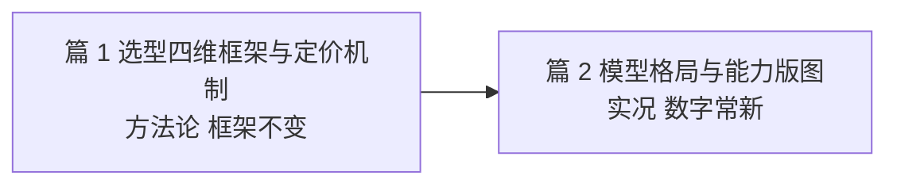
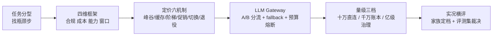
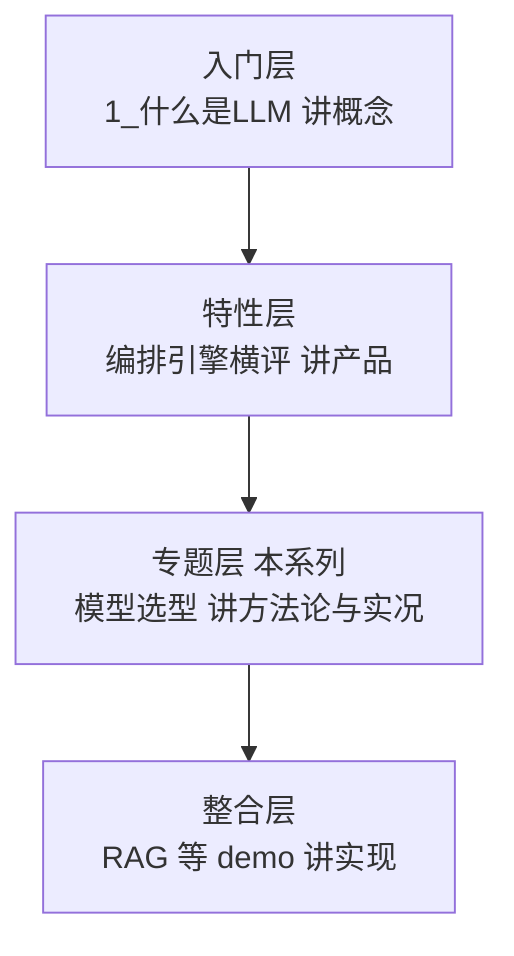
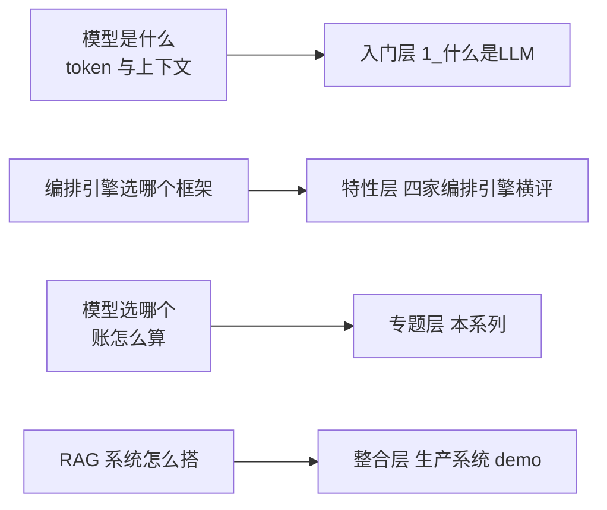

# 大模型选型专题 · 系列导读

> 两篇文章讲清一件事：模型选型选的是价格结构，不是标价；能力裁决靠自建评测集，不是基准分。先读篇 1 建立方法论，再读篇 2 看 2026-10 实况。

## 这个系列讲什么

大模型选型最常见的两个错误，代价都很大：按基准分排名选模型，是用通用分布的抽样代替业务的失败定义；按标价最低选模型，是无视峰谷、缓存、阶梯、促销、静默切换、退役六种定价机制造成的账本差异。本系列两篇分别纠正：篇 1 讲方法论——四维框架、定价机制穿透、Gateway 参数级配置；篇 2 讲实况——2026-10 四层价格带、能力五维的机制来源、开源与闭源路线。

## 系列导航

| 篇目 | 定位 | 怎么读 |
|---|---|---|
| 1_选型四维框架与定价机制 | 方法论：四维框架（合规 > 成本 > 能力 > 窗口）+ 定价六机制穿透 + Gateway 参数级配置清单 + 量级三档 + 事故推演 | 通读。选型前先建立约束排序思维，配置清单可直接借用 |
| 2_模型格局与能力版图 | 实况：2026-10 四层价格带 + 家族化命名 + 能力五维与机制三来源 + 开源 vs 闭源 + 自建评测集 | 当候选集速查手册读，每季度刷新数字；能力部分重点看机制来源 |

两篇是接力关系：篇 1 的框架与配置不过时，篇 2 的价格带与版本每季度会变——读的时候把篇 2 当「当前快照」，把篇 1 当「不变的方法」。

## 选型方法论一张图

读图：从左到右是选型的决策顺序——先分型找瓶颈步，再用四维框架排约束，接着按价格结构组织请求，Gateway 落地路由，最后按量级升级治理；最右端是篇 2 的实况横评（家族定档 + 评测集裁决）。

## 四层进阶路径

本系列是专题层，落在 AI 知识图谱的四层架构里；再往上是整合层的系统架构落地，往低是入门层的概念普及。四层各回答一个问题，按需取用，不必顺序通读。

建议阅读路径：概念不清先补入门层，要动手做系统看整合层 demo，本系列夹在中间回答「选哪个模型、为什么、多少钱」。

## 与其他篇目的边界

- 本系列所有价格、版本、日期均为 2026-10 公开报道口径，非实测；过去 5 年供给格局从「一个模型打天下」演进到四层价格带加开源阵营，这个演变方向还在继续——篇 2 的数字每季度会过时，方法论不会
- 面试向内容不沉淀在本仓库（PKG 与 interview 仓库的分工取舍），本系列只讲生产选型决策
- 篇 1 与篇 2 是方法论与实况的取舍分工：框架不变，数字常新
- 与相邻篇目的边界：概念归入门层，编排引擎的架构选型归特性层，RAG 系统实现归整合层，模型选型归本系列

## 📌 数据与事实声明

- 系列数字核验时点 2026-10-14，来源为各厂商官方定价页与公告的公开报道口径，具体以厂商最新公告为准
- mermaid 图为作者根据公开机制绘制；系列文章不含任何真实系统、公司与内部数据
