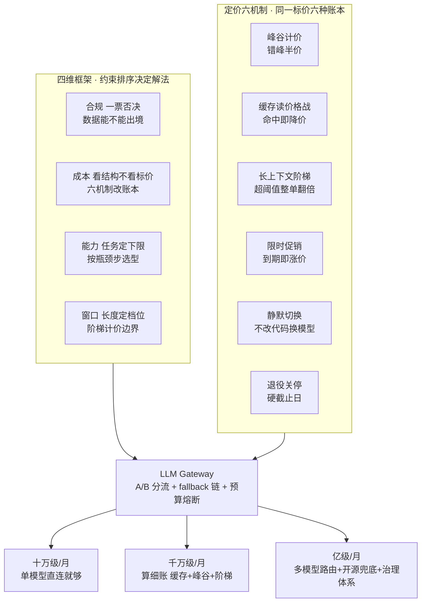
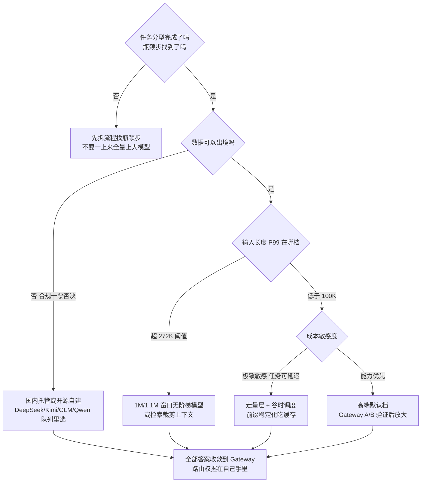
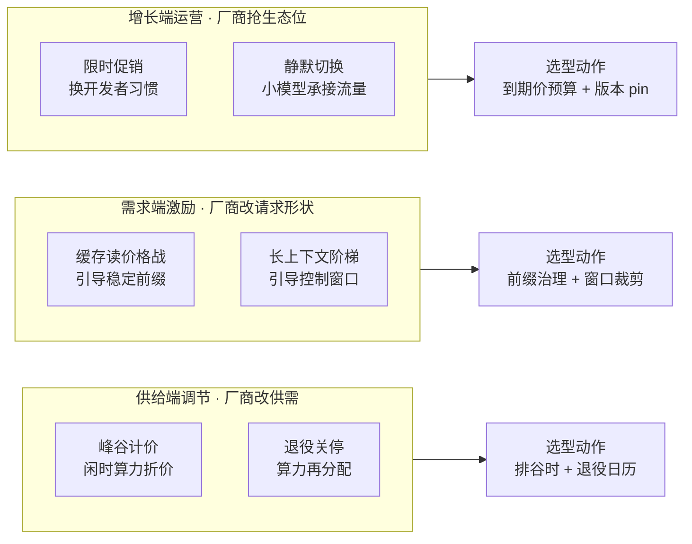
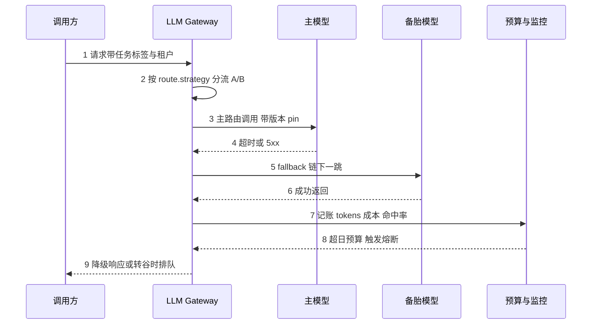
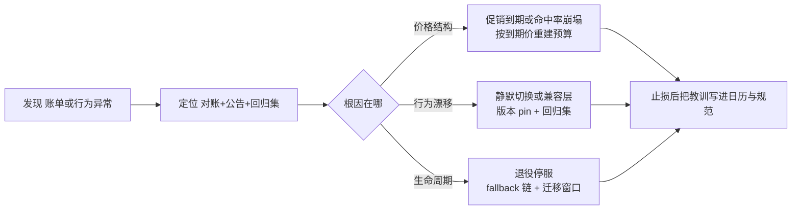

# 选型四维框架与定价机制穿透：模型选的是价格结构，不只是标价

> 一句话摘要：模型选型选的不只是「谁更强」，而是「价格结构」——峰谷计价、缓存读价格战、长上下文阶梯、限时促销、静默切换、退役关停六种定价机制，把同一份标价变成六种账本；四维框架（任务类型 × 上下文长度 × 成本预算 × 数据合规）的落点，是先排约束顺序（合规 > 成本 > 能力 > 窗口），再用 LLM Gateway 把路由权握在自己手里。量级决定解法：十万级请求/月直连就够，千万级算细账，亿级建治理体系。

## 🎯 本文核心

模型选型的本质是**在约束集合内做排除法，而不是给模型排名**。四维框架给出约束排序：数据合规是一票否决项——数据出不去，再强的模型也不能用；成本看的是价格结构而非标价——六种定价机制能让同一份标价差出数倍的实际账单；能力决定可用集合内的下限，按瓶颈步选型；窗口长度可以用工程手段补，排在最后。六种定价机制的共同底层逻辑：**厂商在用价格引导需求 shape**——错峰填谷时、稳定前缀吃缓存、短请求避开阶梯、促销换生态锁定。选型者的动作因此全部是「顺着价格结构重新组织请求」。机制链一句话：**任务分型 → 约束排序 → 按价格结构组织请求（前缀稳定化 / 谷时调度 / 窗口控制）→ Gateway 路由（A/B 分流 + fallback 链 + 预算熔断）→ 按量级升级治理**。

## 一图看懂：从四维框架到三档解法



**读图三步**：蓝框是四维框架——注意它的输出不是「选哪个模型」，而是「可用的模型集合与约束顺序」；橙框是定价六机制——它们不改变标价，改变的是「你的实际账单」，所以选型动作全部落在「按价格结构组织请求」上；绿框是三档解法——同一套 Gateway 架构，十万级只用它的 fallback，千万级用它的全部路由能力，亿级把治理体系建在它上面。

## 一句话摘要

选型四维框架 = 任务类型 × 上下文长度 × 成本预算 × 数据合规，优先序合规 > 成本 > 能力 > 窗口：合规划集合，成本看价格结构（六种定价机制），能力按瓶颈步选型，窗口用工程手段补。落地形态是 LLM Gateway：A/B 分流、fallback 链、预算熔断三件套，把「不一次性锁死模型」变成工程事实。所有价格与版本数字均为 2026-10 公开报道口径，标在正文与文末声明中。

## 5W 速记卡

| 维度 | 一句话 |
|---|---|
| What | 四维选型框架 + 定价六机制穿透 + Gateway 三件套配置 |
| Why | 模型标价不等于账单， API 是有生命周期的依赖，路由权必须握在自己手里 |
| When | 项目立项选模型、成本超支复盘、供应商公告（促销到期/静默切换/退役）出现时 |
| Where | LLM Gateway 路由层：A/B 分流、fallback 链、预算熔断、谷时调度 |
| How | 先任务分型排约束，再按价格结构组织请求，最后按量级（十万/千万/亿）升级治理 |

## 〇、边界：既有篇目讲过什么，本文讲什么

入门层《1_什么是LLM》讲概念——模型是什么、token 与上下文是什么，不涉及选哪个；特性层《四家编排引擎架构横评》讲产品——编排引擎（工作流框架）之间的对比，那是框架选型不是模型选型；整合层 RAG 生产系统 demo 讲实现——分块、检索、生成的工程落地。**本文是专题层第一篇，讲模型选型方法论：四维框架怎么用、六种定价机制怎么穿透、Gateway 参数怎么配。**下一篇《模型格局与能力版图》讲 2026-10 的实况横评——有哪些模型、能力差异的底层来源、开源路线怎么走。两篇是「方法论」与「实况」的接力，不是重复。

## 一、选型四维框架：先划集合，再排序

四维框架是旧稿留下的框架遗产，本篇把它落到价格结构上。四个维度不是加权打分项，而是**约束**：合规划集合，成本定经济可行性，能力定集合内下限，窗口定档位。

**任务类型：选型单位是「瓶颈步」，不是「系统」。**常见错误是一上来给全流程配旗舰模型。正确做法是先用小模型跑通全链路，找到质量不达标的那一步，只对瓶颈步升级——这一步可能只占全流程 token 的百分之几。Agent 场景的 token 消耗是普通聊天的数十倍（公开报道与社区共识口径），全流程大模型是最大的成本浪费：一个十步的 Agent 链路，九步用走量层、一步用高端默认档，账单可能只有全量旗舰的几分之一。

**上下文长度：看分布，不看最大值。**选型依据是输入长度的 P99，不是「我们最长的一条有多长」。OpenAI 对超过 272K 的输入整单双倍计价、Anthropic Haiku 对超过 100K 的输入按 $0.50/$2.50 计价（2026-10 公开报道口径）——阈值就是计价边界，P99 踩在阈值另一侧的模型，标价再低也算不过账。窗口内的一致性比标称窗口更值得关注：1M 窗口的模型在 80 万 token 处的实体检索准确率，和 10 万 token 处往往不是一回事，这是下一篇能力横评展开的点。

**成本预算：预算按到期价建，不按促销价建。**标价只是六种账本里的一种，缓存命中、峰谷窗口、阶梯阈值都能让实际单价差出数倍。隐性成本（重试、监控、网关自身运维）占比不大，但评审时要把它们列进 TCO 表，否则「API 很便宜」的结论会在第一个月账单面前失效。

**数据合规：一票否决项。**数据不能出境的场景，闭源旗舰模型直接出局，只剩国内托管与开源自建两条路（DeepSeek、Kimi、GLM、Qwen 队列）。合规不通过，后面三个维度不用看——这是四维框架把合规排第一的全部理由。

### 追问链：质疑者三连

**追问一：为什么不先看能力、先看基准分？**基准分是通用分布上的抽样，业务是窄分布——通用基准的第一名在你的任务上可能打不过专精模型。更关键的是顺序：能力排序只在「可用集合」内部进行，而合规先划集合。集合外的模型再强，讨论它都是浪费时间。

**追问二：为什么窗口排最后，能力排在它前面？**因为窗口能用工程手段补——检索裁剪、摘要链、分块映射都能把「长文档」问题改造成「短上下文」问题；而合规不能补，数据出不去没有任何工程技巧能绕过去。可补的约束排后，不可补的约束排前，这是排序逻辑的来源。

**打破砂锅：四维为什么是排序而不是加权打分？**因为四个维度不可通约——「合规 0.8 分、能力 0.9 分」这种表达没有意义，数据出境是二值的。一票否决项无法进加权公式，这是排除法优于打分法的根本原因。框架的设计思想可以概括成一句：**先划集合，再排序；否决项永远在排序项前面。**

### 决策树：四维框架怎么走



决策树的叶子全部指向同一个架构动作：**上 Gateway，把路由权握在自己手里**。四维框架的输出从来不是「某个模型的名字」，而是「一个路由配置」——这正是下一篇讲具体模型之前，必须先有方法论的原因。

## 二、定价机制穿透：六种机制，六种账本

六种定价机制按厂商动机分三类：**供给端调节**（厂商改供需）、**需求端激励**（厂商改你的请求形状）、**增长端运营**（厂商抢生态位）。穿透每一种机制，要回答三个问题：厂商为什么这样定价、这对选型意味着什么、选型动作是什么。



### 2.1 峰谷计价：错峰半价，白捡的折扣

DeepSeek V4.1 Flash 峰时 $0.30/$1.20、谷时 $0.15/$0.60（每 1M token，2026-10 公开报道口径）。厂商动机很直白：GPU 闲时利用率是纯边际成本，半价卖掉好过空转。对选型意味着：**批量离线任务的成本可以直接砍半，但实时链路吃不到这个折扣**。选型动作：把可延迟任务（报表生成、批量摘要、离线打标、数据归档）拆出来排进谷时窗口，延迟敏感的交互链路仍用峰时或走量层。注意谷时是「厂商定义的时段」，不同供应商窗口不同，跨供应商调度时要把窗口映射做进 Gateway 配置。

### 2.2 缓存读价格战：命中率是新的成本杠杆

Claude Sonnet 5.5 在 2026-10-07 把 cache read 砍半至 $0.10（每 1M token，公开报道口径），GPT-6 Sol 系 cache read 同为 $0.10，DeepSeek V4.1 Flash 更低至 $0.006。厂商动机：长 system prompt、重复文档前缀的推理，KV cache 命中后算力成本接近零，厂商用价差引导用户把 prompt 结构化。公开报道口径的测算：缓存命中率 80% 时，中端模型的月成本可以再降七成。对选型意味着：**prompt 的组织方式从「工程质量问题」升级为「成本结构问题」**。选型动作：静态指令与高频复用文档前置、动态内容（时间戳、用户 ID、检索结果）后置；把 cache hit rate 纳入一等监控指标——它的波动直接改账簿（事故三就是活例）。

### 2.3 长上下文阶梯计价：阈值是计价边界

OpenAI 对超过 272K 的输入整单双倍计价，Anthropic Haiku 超过 100K 阈值按 $0.50/$2.50 计价（2026-10 公开报道口径）。厂商动机：长上下文的注意力计算成本随长度超线性增长，阶梯是把超线性的成本转嫁给超长请求。对选型意味着：**「长文档场景」的标价不可比**——两个模型标价差三倍，实际账单可能反超，取决于你的输入长度分布踩在阈值哪侧。选型动作：先统计真实输入长度分布（P50/P99），超阈值比例高的场景换 1M/1.1M 窗口且无阶梯的模型（GPT-6 Sol 系 1.1M 上下文，公开报道口径），或用检索把上下文裁剪到阈值内。

### 2.4 限时促销：到期价才是预算基准

GPT-5.6 Sol 以促销价 $4/$20 供应至 2026-11-21，原价 $5/$30（2026-10 公开报道口径）。厂商动机：用三个月价格窗口换开发者习惯与生态锁定。对选型意味着：**促销价不是成本基准，是红利**——按促销价建的预算，到期那天就是事故（事故一）。选型动作：预算永远按到期价建；把促销到期日写进团队日历与路线图；促销模型可以进 A/B 实验臂，但不要当默认路由的唯一支点。

### 2.5 静默切换：你的端点会漂移

2026-09-14，DeepSeek 把 V4 Pro 的流量静默切换至 V4.1 Flash，官方口径「orderly retirement」，公开报道称不改代码可降本七到七成七。厂商动机：小模型承接流量是推理侧降本的主路径，通知你是情分，不改代码是设计目标。对选型意味着：**「API 不变」不等于「行为不变」**——你依赖的模型可能在你不知情时被换掉，能力、价格、输出风格都可能漂移。选型动作：显式版本 pin、维护一个小回归集（30-50 条业务样本）、对输出格式与账单做双监控。这件事的反面是：如果你本来就想用更便宜的新模型，静默切换帮你省掉了迁移——所以监控的价值不是阻止切换，而是**知道切换发生了什么**。

### 2.6 退役关停：依赖是有生命周期的

o4-mini 于 2026-10-23 关停（2026-10 公开报道口径）。厂商动机：算力再分配，老模型给新模型让路。对选型意味着：**每一个 API 端点都是有限寿命的依赖**，选型时就要问「它退役了怎么办」。选型动作：跟踪供应商退役日历；fallback 链常备且定期演练；把「迁移窗口」当常规运维项而不是应急项。

### 六机制速查表

| 机制 | 代表事实（2026-10 公开报道） | 厂商动机 | 对选型意味着什么 | 选型动作 |
|---|---|---|---|---|
| 峰谷计价 | V4.1 Flash 峰 $0.30/$1.20、谷 $0.15/$0.60 | 填闲时算力 | 批量任务成本砍半 | 可延迟任务排谷时窗口 |
| 缓存读价格战 | Sonnet 5.5 cache read $0.10；V4.1 Flash $0.006 | 引导 prompt 结构化 | 命中率是成本杠杆 | 静态前置 + hit rate 监控 |
| 长上下文阶梯 | OpenAI >272K 整单双倍；Haiku >100K $0.50/$2.50 | 转嫁超线性成本 | 长文档标价不可比 | 统计长度分布 + 检索裁剪 |
| 限时促销 | GPT-5.6 Sol 促销至 2026-11-21 | 抢生态位 | 促销价不是基准 | 按到期价建预算 |
| 静默切换 | V4 Pro 流量切至 V4.1 Flash | 小模型承接流量 | API 不变行为会变 | 版本 pin + 回归集 |
| 退役关停 | o4-mini 2026-10-23 关停 | 算力再分配 | 依赖有生命周期 | 退役日历 + fallback 演练 |

## 三、参数级配置清单：LLM Gateway 三件套

「不一次性锁死模型」不是态度，是配置。以下配置清单覆盖路由、容错、成本三条线，每一项给出名称、默认值、分档推荐与理由。

### 3.1 配置清单

| 参数 | 作用 | 默认值 | 10 万级推荐 | 千万级推荐 | 亿级推荐 | 为什么 |
|---|---|---|---|---|---|---|
| route.strategy | 路由策略 | single 直连 | single | weighted | rules 引擎 | 路由本身有复杂度成本，量级不够直连最稳 |
| route.ab_split | A/B 分流比 | 100:0 | 95:5 | 90:10 | 多臂动态调权 | 新模型先灰度，行为漂移可控 |
| route.version_pin | 版本钉死 | 跟随 latest | 建议开 | 开 | 开 + 灰度升级 | 防静默切换造成的无声漂移 |
| fallback.chain | 备胎链 | 空 | 两级 | 三级 | 多链跨供应商 | 退役、停服、限流都会发生 |
| budget.daily_limit | 日预算熔断 | 不设 | 月账单告警 | 日熔断 | 租户 × 场景配额 | 账单攻击比模型故障更常见 |
| cache.prefix_check | 前缀稳定化检查 | 无 | 无 | CI 强制 | CI 强制 + 监控 | 缓存价差可达十倍，前缀一改命中率崩塌 |
| schedule.off_peak | 谷时路由窗口 | 全时 | 不用 | 批量任务排谷 | 全量调度 | 峰谷半价是白捡的折扣 |
| request.max_tokens | 单请求输出上限 | 模型上限 | 业务合理值 | 业务合理值 | 分场景设置 | 防失控生成，也是成本闸口 |

### 3.2 最小可用配置

```yaml
# LLM Gateway 最小可用配置（三件套：分流 / 容错 / 成本）
gateway:
  route:
    strategy: weighted              # single / weighted / rules
    ab_split: "90:10"               # 主模型: challenger 流量比
    version_pin: true               # pin 显式版本 防静默切换漂移
  fallback:
    chain: [primary, sibling, oss]  # 三级链：主模型 / 同族备胎 / 开源兜底
    timeout_ms: 8000
    retry: { max: 1, backoff_ms: 200 }
  budget:
    daily_limit: 50000              # 日预算熔断（单位自定）
    per_request_max_tokens: 4096    # 单请求输出闸口
    tenant_quota: true              # 租户级配额（亿级档开启）
  cache:
    prefix_check: true              # CI 检查 prompt 前缀哈希
  schedule:
    off_peak_window: "01:00-07:00"  # 谷时路由窗口
    deferrable_tags: [batch-summary, offline-label]  # 可延迟任务标签
```

### 3.3 步骤级操作：从直连到 Gateway

**前置条件**：① 任务分型清单（哪个场景用什么能力档）；② 真实 token 分布统计（输入 P50/P99、输出均值）；③ 最小评测集（50 条业务样本 + 判分标准）；④ 预算基线（按到期价建）。四样不齐，先补数据再上架构。

**第 1 步 直连跑通**：单模型硬编码调用，记录三项基线——评测集通过率、每请求 token 成本、P99 延迟。没有基线，后面所有「优化」都无法证伪。

**第 2 步 引入 Gateway**：按 3.2 配置接入，流量 100:0 进主路由，先只开 fallback 与 budget 两件套，A/B 分流留 0。

**第 3 步 对账验证**：放 5-10% 流量进 challenger，对比三项——质量（评测集通过率差异）、成本（每请求 token 与账单对账）、缓存（hit rate 是否被前缀改动破坏）。任何一项劣化超过阈值就回滚分流比。

**第 4 步 接线治理**：熔断绝告警、退役日历订阅、谷时窗口打开。到此三件套闭环。

**回退路径**：Gateway 保留「绕过直连」应急开关（配置中心一个 flag 的事）；fallback 链末端挂静态降级（缓存答案或规则引擎）——网关自身也要无状态多实例部署，别让解药变成新单点。

### 路由与时序：一次请求在 Gateway 里怎么走



时序里最值得记住的是第 7 步：**记账不是可选项，是路由的输入**。没有 tokens、成本、命中率三项记账，熔断是盲的，谷时调度是空的，A/B 结论是猜的。

## 四、不同量级的思考：约束来源决定解法

- **十万级请求/月（单模型直连就够）**：约束来源是「变化速度远快于规模压力」——团队小、请求少，真正的瓶颈是选型速度与退路，而不是路由体系。这一档的核心问题是「选对模型并留好退路」，而不是「建 Gateway 与评测集」；思考方式是**直连驱动**：一个主力模型 + 一个 fallback 端点 + 月度账单复盘，其余都不值得先建。硬上 Gateway 是把复杂度花在不存在的问题上。
- **千万级请求/月（算细账的一档）**：约束来源是「价格结构开始主导账单」——缓存命中率、峰谷可调度比例、阶梯阈值踩线率三个数的波动，比换个更便宜的标价影响大得多。这一档的核心问题是「把账算细」，而不是「换模型」；思考方式是**账本驱动**：前缀稳定化、谷时调度、长度分布治理三件事做好，通常比任何一次模型替换省钱。Gateway 从「可选」变成「必选」，因为它同时是分流器、熔断器和记账器。
- **亿级请求/月（治理体系的一档）**：约束来源是「多团队多场景共享 + 供应商集中度」——几十条业务线共享路由，谁在烧预算、谁把前缀改坏了、单一供应商占比是否过半，成为账单与稳定性的主导变量。这一档的核心问题是「成本治理体系与供应商议价」，而不是「单点再调优一点」；思考方式是**治理驱动**：租户 × 场景 × 模型的三维配额、开源兜底链、跨供应商路由、退役演练常态化。
- **收尾两件套**：三个实测值定档——月账单与业务增速之比（账单涨得比业务快，说明价格结构没管）、缓存命中率水位（低于五成说明前缀治理缺位）、单一供应商请求占比（过半说明集中度风险该治理了）。触发升级的信号：账单增速持续超过业务增速，从直连驱动升到账本驱动；出现一次未预告的行为漂移或集中度过半，从账本驱动升到治理驱动。**量级不是请求总数，是「价格结构在账单里的话语权」**——话语权越大的量级，越需要把机制变成配置，把配置变成体系；换个说法，这一档的核心问题是「机制有没有变成配置」，而不是「模型有没有换对」。


## 五、事故推演：三个一定会遇到的坑

以下推演基于 2026-10 公开报道的机制事实做匿名化复演，每个都按「发现—定位—止损」三段走。

### 事故一：促销到期，账单翻倍

**发现**：某团队用促销价的 GPT-5.6 Sol 做默认路由，11 月账单环比上涨四分之一到一半，调用量没动。**定位**：对账发现单价恢复原价（$5/$30），查供应商公告确认促销窗口 2026-11-21 截止——预算按促销价建的那一刻就埋下了雷。**止损**：把促销模型从默认路由降为 A/B 实验臂；同时与供应商谈续约，按「续不下来」做预案；预算表按到期价重建。教训一句话：**促销是红利，到期价才是基准——按促销价建预算，等于把停机时间预设在日历上。**

### 事故二：静默切换，行为漂移

**发现**：某摘要服务评测集通过率一周内跌了几个点，用户反馈输出格式变化，但代码零改动。**定位**：供应商公告确认端点背后的模型已从 V4 Pro 切换为 V4.1 Flash（官方口径 orderly retirement，公开报道称此举降本七到七成七）——省钱的是厂商，承担质量回归的是你。**止损**：显式版本 pin 回旧版本止损，同时用回归集量化新旧差距，决定是跟随切换（顺便省成本）还是暂留；把「端点背后是谁」纳入供应商沟通清单。教训一句话：**「API 不变」是兼容性承诺，不是行为承诺——回归集是唯一能替你看住端点背后是谁的东西。**

### 事故三：缓存命中率崩塌

**发现**：调用量持平，账单上涨六成，输出质量无感。**定位**：cache hit rate 从 80% 跌到 15%——一次 prompt 模板改动把动态内容（时间戳、用户 ID）挪到了静态前缀前面，缓存整段失效。**止损**：回滚模板；把「静态在前、动态在后」写成前缀规范；CI 加前缀哈希检查，模板改动先过哈希对比再上线。教训一句话：**缓存读价差是最大的隐性成本杠杆，也是最大的隐性脆弱点——杠杆和脆弱是同一件事的两面。**



## 六、Trade-off 与反方案

### 锁死单一模型 vs 多模型路由

**为什么不锁死单一模型（反方案一）**：促销到期、静默切换、退役关停三件事，任何一件都能把「锁死」变成「被动」——锁死的本质是把供应商的生命周期决策权外包，且不收议价折让。**为什么不全量路由**：路由本身有复杂度成本（配置、对账、一致性），十万级直连就够。这条 Trade-off 的决策点是量级与集中度：请求量过千万、或单一供应商占比过半，才值得把路由做重。

### 追新 vs 追稳

追新吃促销与能力红利，代价是迁移成本与回归风险；追稳省迁移，代价是错过降价窗口与能力代差。跨期看，厂商的家族化命名（OpenAI 的 Astra-Sol-Luna、Anthropic 的 Opus-Sonnet-Haiku）给出的启示是：**追家族比追版本稳**——同一个 Sol，从 5.6 到 6 是代际升级，档位语义不变；每次发布会都换端点，等于把自己的迁移成本拉到最满。合理策略是「家族内追新、跨家族求稳」：主力家族跟随代际升级（有回归集护航），新家族进 A/B 臂观察一个季度再决定去留。

### 跨期视角：这条路五年内怎么变的

过去 5 年模型供给的演变，是从「一个模型打天下」到「价格带分层 + 家族化命名」：2022 年前后选型基本是 GPT-3.5 与 GPT-4 的二选一，标价结构简单；到 2025-2026，旗舰/高端/中端/走量四层价格带加开源阵营成为格局，定价机制从「单一标价」演化出峰谷、缓存、阶梯、促销、静默切换、退役六种形态。演进方向很清楚：**价格结构会越来越复杂，而四维框架与 Gateway 方法论不变**——这也是本系列把「方法论」与「实况」分两篇写的原因：实况会过时，方法论不会。

| 决策 | 选 A | 选 B | A 的代价 | B 的代价 | 决策点 |
|---|---|---|---|---|---|
| 路由 | 锁死单模型 | 多模型路由 | 被动接受供应商决策 | 路由复杂度与对账成本 | 请求量与集中度 |
| 版本 | 追新 | 追稳 | 迁移与回归风险 | 错过降价与能力代差 | 回归集是否就绪 |
| 前缀 | 稳定化吃缓存 | 动态个性化 | 个性化能力受限 | 账单可能翻数倍 | 个性化是否值这个价 |
| 谷时 | 批量任务排谷 | 全实时优先 | 任务延迟变大 | 放弃半价折扣 | 任务是否真可延迟 |
| 兜底 | 开源自建兜底 | 全托管 | GPU 运维成本 | 供应商集中度风险 | 数据合规与量级 |

## 你们可能会问

**Q1：为什么不直接选标价最低的模型？**标价只是六种账本里的一种。缓存读价差可达十倍、阶梯计价能让长文档场景的标价失效、谷时窗口能让批量任务再砍半——按标价选型，等于按菜单价格猜账单。且低价档位的能力下限可能根本覆盖不了瓶颈步，省下的钱不够质量回归的损失。

**Q2：峰谷计价是不是只对批量任务有用？**主要用途是批量，但交互式产品也可以把「可延迟的后处理」（摘要、打标、归档、报表）拆出来排进谷时窗口——这部分往往占 token 消耗的三成以上，白捡的折扣不要白不放。

**Q3：静默切换听起来很可怕，小团队怎么防？**三板斧就够：显式版本 pin、一个 30-50 条的回归集、账单与输出格式双监控。成本极低，但能兜住绝大多数漂移。防不住的部分（厂商就是不通知）靠 fallback 链兜底。

**Q4：Gateway 自己成了新单点怎么办？**会，所以三条纪律：Gateway 无状态多实例部署；配置版本化、可一键回滚；保留「绕过 Gateway 直连」的应急开关。解药不能变成新病，这是架构模块边界上的基本自觉。

**Q5：四维框架为什么把合规排第一而不是能力？**合规是一票否决项——数据出不去，再强的模型也不能用，讨论集合外的模型没有意义；能力是集合内的排序项。否决项永远排在排序项前面，这是排除法和打分法的分水岭。

## 思考：三个开放问题

- 版本 pin 防漂移与「不错过能力升级」是一对矛盾——刷新节奏怎么定？按家族代际走，还是按回归集分数走？
- 缓存价格战会不会让「前缀工程」成为新的技术债重灾区——当 prompt 模板为了命中率被冻结，业务个性化让路成本，这个平衡点在哪里？
- 开源模型能力持续逼近的背景下，闭源的溢价部分（服务稳定性、合规托管、生态工具）还值多少？这个数每个季度都在变。

## 💡 实战提示

- 💡 预算永远按到期价建，促销当红利不当基准——把供应商的到期日抄进自己的日历
- 💡 把 cache hit rate 当一等监控指标：它是唯一一个「改需求文档就能翻倍」的成本杠杆
- 💡 prompt 模板遵循「静态在前、动态在后」，CI 加前缀哈希检查，防患于未然
- 💡 版本 pin + 30 条回归集 + 账单监控，三样加起来不到一天工作量，能兜住绝大多数静默切换
- 💡 Gateway 先上 fallback 和 budget 两件套，A/B 分流等有基线数据再开——顺序反了会被噪声带偏

## 🎯 核心带走

- **一图一句**：选型 = 约束集合内做排除法——合规划集合、成本看价格结构、能力按瓶颈步、窗口用工程补，全部收敛到 Gateway 路由配置
- **六机制一张网**：峰谷/缓存/阶梯/促销/切换/退役，穿透方式是问三个问题——厂商为什么这样定价、对选型意味着什么、动作是什么
- **价格结构 > 标价**：同一份标价，命中率与阈值踩线能让实际账单差出数倍；预算按到期价建
- **Gateway 三件套**：A/B 分流（灰度验证）、fallback 链（抗生命周期）、预算熔断（防账单攻击）——路由权握在自己手里
- **量级主线**：直连驱动 → 账本驱动 → 治理驱动；档位由「价格结构在账单里的话语权」定，不由请求总数定
- **事故三件套**：发现靠对账与回归集、定位靠公告与版本对比、止损靠 pin 与回滚——最后一步是把教训写进日历和规范

## 📌 数据与事实声明

- 写于 2026-10-14（专题层 · 大模型选型专题第一篇）；所有价格、版本、日期均为 2026-10 公开报道口径（厂商官方定价页与公告），非实测数据，全文不含任何线上实测口径的断言
- 价格锚点（2026-10 公开报道）：DeepSeek V4.1 Flash 峰 $0.30/$1.20、谷 $0.15/$0.60、cache read $0.006；Claude Sonnet 5.5 $2/$10、cache read 2026-10-07 起 $0.10；GPT-5.6 Sol 促销 $4/$20 至 2026-11-21（原 $5/$30）；OpenAI >272K 输入整单双倍；Anthropic Haiku >100K 阈值 $0.50/$2.50；o4-mini 2026-10-23 关停
- 「缓存命中率 80% 时中端模型月成本可再降七成」「V4 Pro 至 V4.1 Flash 静默切换降本七到七成七」均为公开报道口径的测算值，具体以各厂商最新公告为准
- 事故推演为基于上述公开机制事实的匿名化复演，不含任何真实系统、公司与内部数据；mermaid 图为作者根据公开机制绘制
- 配置清单中的参数名与阈值为方法论示例（行业通行做法的归纳），落地时以所用 Gateway 产品的实际配置项为准

## 📚 参考资料

| 类型 | 标题 | 来源 |
|---|---|---|
| 官方定价页 | OpenAI / Anthropic / Google 模型定价与缓存计价文档 | 各厂商官网文档 |
| 官方公告 | DeepSeek V4.1 Flash 峰谷计价与 V4 Pro 流量切换公告 | 厂商官方渠道 |
| 官方公告 | o4-mini 退役公告（2026-10-23） | 厂商官方渠道 |
| 系列内 | 篇 2：模型格局与能力版图（2026-10 实况横评） | 本系列 |
| 关联篇目 | 四家编排引擎架构横评（特性层 · 产品选型视角） | docs/ai/特性层 |
| 方法论 | LLM Gateway 路由与 fallback 模式（A/B + 熔断） | 业界公开实践归纳 |
