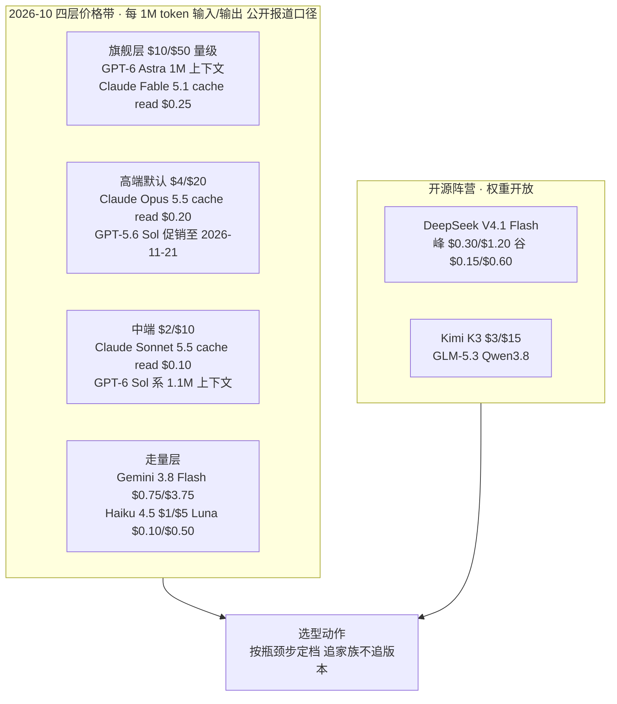
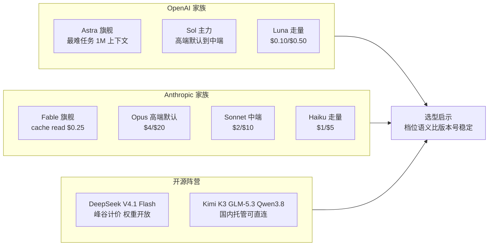
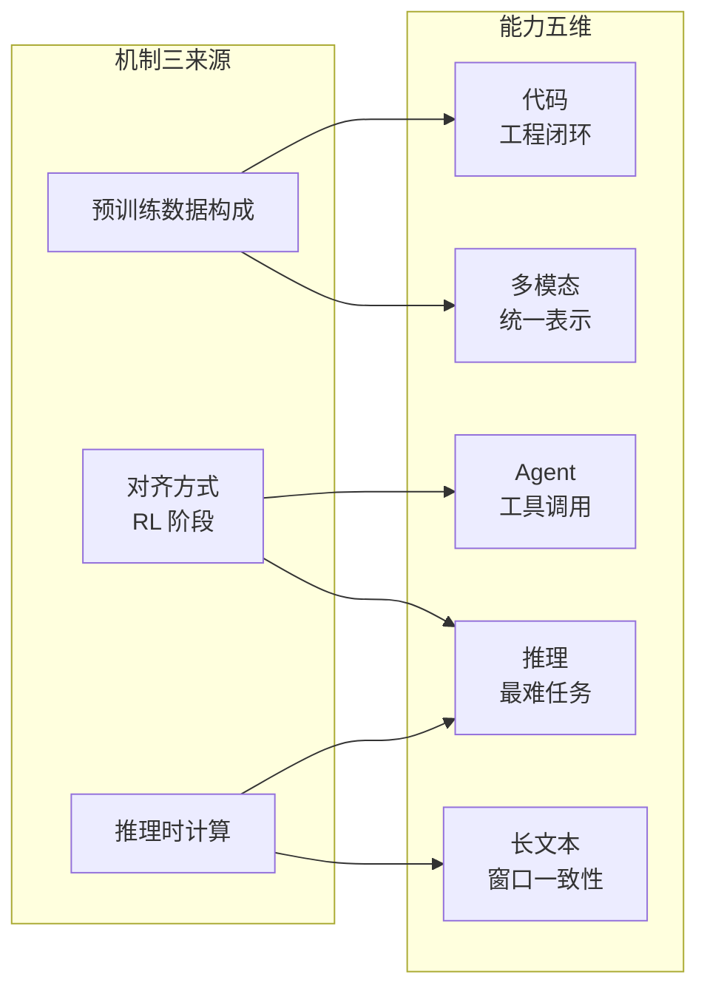
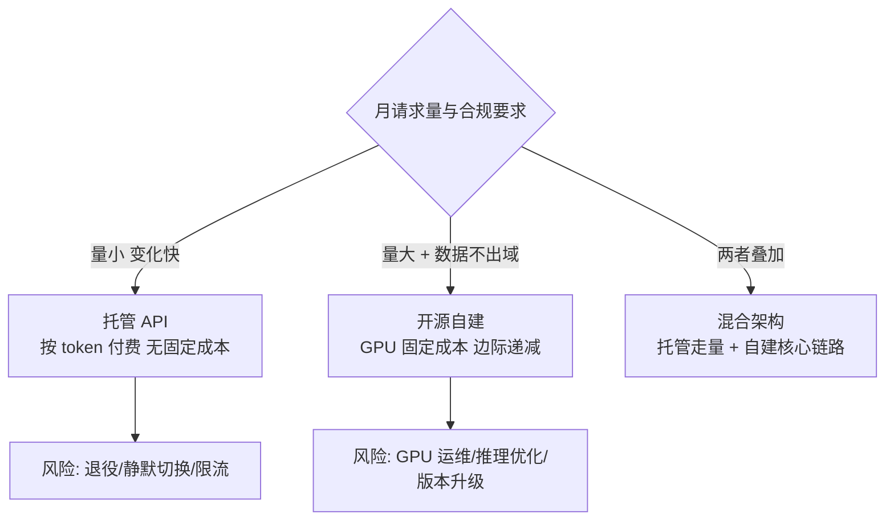
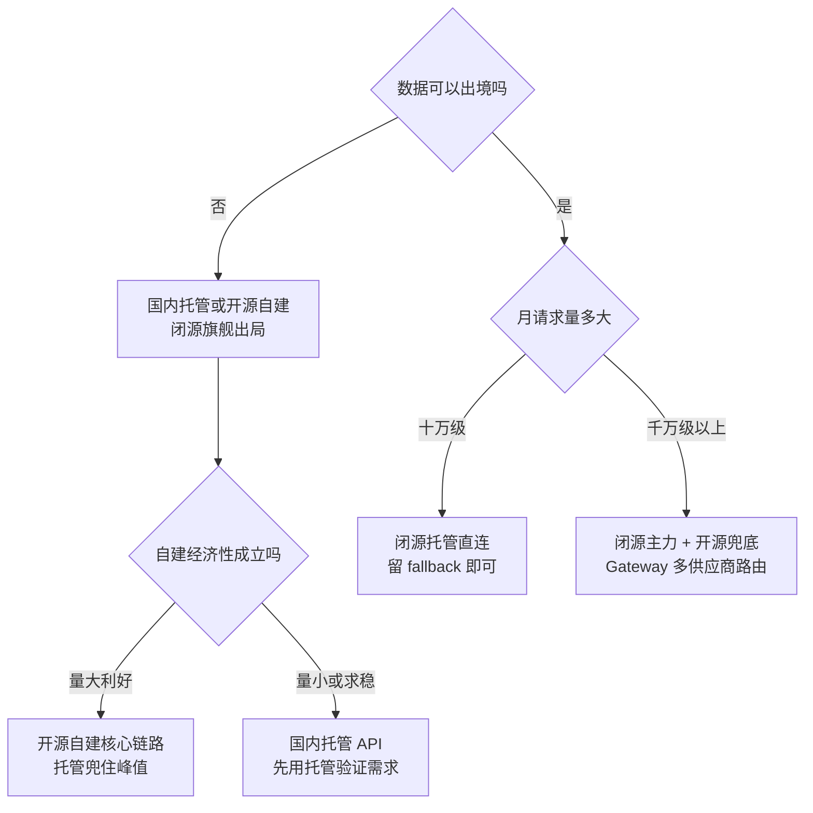
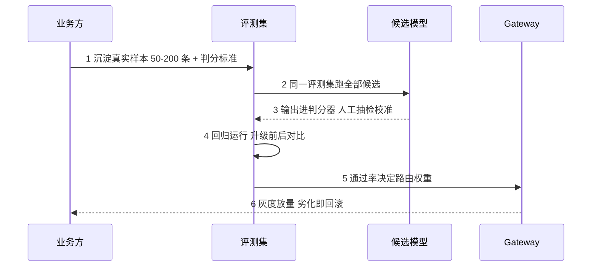
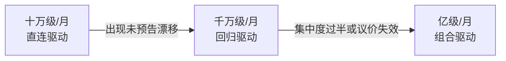

# 模型格局与能力版图：2026-10 四层价格带与开源路线辨析

> 一句话摘要：2026-10 的模型供给是「四层价格带 + 开源阵营」的格局——旗舰层 $10/$50 量级专攻最难任务，高端默认 $4/$20，中端 $2/$10，走量层低至 $0.10/$0.50，开源阵营以 DeepSeek V4.1 Flash 的峰谷计价把性价比打到极致；能力差异的底层来源只有三个（预训练数据构成、对齐方式、推理时计算），所以选型的正确姿势不是看基准分排名，而是用家族化命名定档位、用自建评测集做裁决。所有数字均为 2026-10 公开报道口径。

## 🎯 本文核心

模型格局的本质是**厂商把「能力档位」做成了可承诺的价格带**：OpenAI 用 Astra-Sol-Luna、Anthropic 用 Opus-Sonnet-Haiku 给出稳定的档位语义，选型者因此可以「追家族而不追版本」——同一个 Sol 从 5.6 到 6 是代际升级，档位承诺不变。能力五维（推理/代码/长文本/多模态/Agent 工具调用）的差异全部穿透到三个机制来源：预训练数据构成决定知识面与代码底子，对齐方式（RL 阶段）决定指令遵循与工具调用，推理时计算决定难题表现。由此推出本篇最重要的实务结论：**基准分是通用分布上的抽样，业务是窄分布——选型的裁决权必须交给自建评测集，公开基准只做入围参考。**机制链一句话：**定档位（价格带 + 家族命名）→ 按瓶颈步选能力档 → 用自建评测集裁决 → 按量级决定直连/回归/组合 → 开源与闭源按合规和成本结构分工**。

## 一图看懂：四层价格带与开源阵营

**读图两步**：价格带从上到下是「能力档位」而不是「新旧代际」——旗舰层不是最新的意思，是「最难任务专用」的意思，日常流量走中端与走量层才是常态；开源阵营横跨价格带存在，它的选型角色不是「更便宜的同一个东西」，而是「数据合规 + 权重可控 + 可自建」的另一条路线，这一点第三节展开。

## 一句话摘要

2026-10 格局：旗舰层 $10/$50 量级（GPT-6 Astra、Claude Fable 5.1），高端默认 $4/$20（Claude Opus 5.5、GPT-5.6 Sol 促销至 2026-11-21），中端 $2/$10（Claude Sonnet 5.5、GPT-6 Sol 系 1.1M 上下文），走量层 $0.10-$1 区间（GPT-6 Luna、Claude Haiku 4.5、Gemini 3.8 Flash）；开源阵营 DeepSeek V4.1 Flash 峰谷计价、Kimi K3、GLM-5.3、Qwen3.8。能力五维差异穿透到三个机制来源；选型用家族命名定档、用自建评测集裁决；开源与闭源按数据合规和成本结构分工。

## 5W 速记卡

| 维度 | 一句话 |
|---|---|
| What | 2026-10 模型格局实况：四层价格带 + 开源阵营 + 能力五维的机制来源 |
| Why | 数字时效性极强，选型决策需要「当前有什么、差异从哪来」的快照 |
| When | 选型入围、模型替换评估、开源路线论证——每季度刷新一次本文数字 |
| Where | 价格带表（定档位）、能力五维（定瓶颈步）、评测集（做裁决） |
| How | 家族命名定档位，瓶颈步选能力档，自建评测集裁决，量级决定路线 |

## 〇、边界声明

本篇是实况横评，**所有价格、版本、日期均为 2026-10-14 核验的公开报道口径**，本篇不提供「我们线上实测」数据；能力排序是公开报道与社区评测的综合印象，不是基准分精确排名。选型方法论——四维框架、六种定价机制、Gateway 配置清单——在篇 1，本篇不重复；本篇回答的是「候选集里有什么、差异的底层来源是什么、开源路线怎么走」。入门层《1_什么是LLM》讲概念，特性层《四家编排引擎架构横评》讲编排引擎产品，均不覆盖本篇内容。

## 一、格局总览：四层价格带与家族化命名

| 价格带 | 代表模型 | 价格锚点（每 1M token） | 定位 | 选型角色 |
|---|---|---|---|---|
| 旗舰层 | GPT-6 Astra / Claude Fable 5.1 | $10/$50 量级；Fable cache read $0.25 | 最难任务 | 瓶颈步专用，不做日常流量 |
| 高端默认 | Claude Opus 5.5 / GPT-5.6 Sol | $4/$20；Sol 促销至 2026-11-21（原 $5/$30）；Opus cache read $0.20 | 主力默认档 | 默认路由支点 |
| 中端 | Claude Sonnet 5.5 / GPT-6 Sol / GPT-6.1 Sol | $2/$10；cache read $0.10；Sol 系 1.1M 上下文 | 均衡量大 | A/B challenger 与主力 |
| 走量层 | Gemini 3.8 Flash / Claude Haiku 4.5 / GPT-6 Luna | $0.75/$3.75 / $1/$5 / $0.10/$0.50 | 高频简单任务 | 非瓶颈步的主力 |
| 开源托管 | DeepSeek V4.1 Flash / Kimi K3 / GLM-5.3 / Qwen3.8 | V4.1 Flash 峰 $0.30/$1.20、谷 $0.15/$0.60；K3 $3/$15 | 合规与性价比 | 兜底链与出境场景 |

（Gemini 3.8 Flash 的 $0.75/$3.75 为 introductory 价格，公开报道口径供应至 2026-12-31，2027-01-01 起涨至 $1.50/$7.50——又一个「到期价才是基准」的实例，机制分析见篇 1。）

**家族化命名是厂商给的档位承诺。**OpenAI 的 Astra（旗舰，1M 上下文，定位最难任务）→ Sol（主力，高端默认到中端）→ Luna（走量，$0.10/$0.50）三档；Anthropic 的 Fable（旗舰）→ Opus（高端默认）→ Sonnet（中端）→ Haiku（走量）四档。这套设计思想很直白：**把档位承诺产品化——型号名即服务等级，客户按名字定档，不必每次发布会重新尽调。**对选型者的价值在于：档位语义比版本号稳定。过去 5 年模型供给的演变很说明问题——2022 年前后选型基本是 GPT-3.5 与 GPT-4 的二选一，标价结构简单，也没有档位承诺；到 2025-2026，四层价格带加开源阵营成为格局，厂商用家族名把「这个型号适合干什么」写进了名字里。选型动作因此清晰了：**追家族不追版本**——主力家族跟随代际升级（有回归集护航），新家族进 A/B 臂观察一个季度再决定去留。

## 二、能力维度横评：五维能力，三个机制来源

能力横评最容易犯的错是「 benchmark 排名当结论」。本篇的横评方式是：每个能力维度给出机制解释（为什么这家强），再给选型注意（怎么验证到自己的场景）。综合印象为 2026-10 公开报道与社区评测口径，仅供入围参考。

| 维度 | 综合印象（2026-10 公开报道口径） | 机制来源 | 选型注意 |
|---|---|---|---|
| 推理 | 旗舰层专攻最难任务；中端靠蒸馏逼近常规题 | RL 阶段算力分配 + 推理时计算 | 难题才上旗舰，常规题中端足够 |
| 代码 | Claude 家族工程化口碑领先 | 语料构成 + agentic coding 数据回流 | 用自己仓库建评测集 |
| 长文本 | 1M/1.1M 窗口成为高端标配 | 训练时长文比例 + 位置编码 | 测「窗口内实体检索」而非标称窗口 |
| 多模态 | 原生统一架构领先后融合方案 | 统一 transformer 跨模态表示 | 先验证模态覆盖再谈质量 |
| Agent 工具调用 | 头部两家成熟度领先，MCP 生态最全 | 对齐阶段的工具轨迹数据 | 测参数编造率与长链漂移 |

### 2.1 推理：旗舰层的存在理由是「最难任务」

旗舰层（$10/$50 量级）的定位不是「日常更强」，而是「最难任务可解」——GPT-6 Astra 带 1M 上下文专攻这类任务（2026-10 公开报道口径）。机制穿透：推理能力的来源有三层——预训练数据的质量决定知识底子，RL 阶段的算力分配决定「难题上愿不愿意多想」，推理时计算（test-time compute）决定难题上的最终表现。中端模型的追赶路径是蒸馏：把旗舰的推理链压缩进小模型，常规题表现接近，成本只有几分之一，但最难的题目上仍有可见差距。选型注意：**按题目难度分流，而不是按场景分流**——同一产品里，常规请求走中端、难题判定走旗舰，是 Gateway 路由的典型规则（配置见篇 1）。

### 2.2 代码：口碑来自训练构成与工程闭环

Claude 家族在代码场景的口碑（公开报道与社区共识口径）有明确的机制解释：训练语料中代码占比高，且 agentic coding 工具的使用数据回流到对齐阶段——模型见过大量「读仓库→改代码→跑测试→看报错→再改」的完整轨迹，所以工程化闭环（工具调用、长上下文改代码、错误恢复）表现好。选型注意：代码能力是最「私有分布」的能力——公开基准上的代码分，和「能不能改好你的仓库」是两回事，必须用自己的仓库切片建评测集（第四节给步骤）。

### 2.3 长文本：标称窗口之外，看窗口内一致性

高端模型的窗口进入 1M（GPT-6 Astra）与 1.1M（GPT-6 Sol 系）时代（2026-10 公开报道口径），但选型不能只看标称值。机制穿透：长上下文表现取决于训练时长文样本的比例与位置编码的设计——窗口开得大但训练没跟上，就会出现「前面的指令后面忘」的衰减。选型注意：用「窗口内实体检索」测试——把关键事实埋在文档的不同深度，测召回率随深度的衰减曲线；同时长文本是价格结构问题：OpenAI >272K 输入整单双倍、Anthropic Haiku >100K 阈值 $0.50/$2.50（2026-10 公开报道口径），长文档场景的账要按分布算（篇 1 第 2.3 节）。

### 2.4 多模态：统一表示与后融合的路线差

多模态的机制分野在「原生统一」与「后融合」：统一架构用同一个 transformer 处理文本/图像/音视频，跨模态对齐在表示层完成；后融合方案是多个专精模型在外层拼装。前者的优势是跨模态推理（图表问答、视频描述）少一层信息损失，后者的优势是单模态可以各自追前沿。选型注意：先验证模态覆盖（你的产品要处理音频吗？视频帧率要求？），再比较质量——覆盖不够的模型，基准分再高也进不了候选集。

### 2.5 Agent 工具调用：对齐阶段注入的「使用轨迹」

工具调用能力的机制来源是对齐阶段的训练数据构成——注入大量「工具使用轨迹」（什么场景调什么工具、参数怎么填、失败怎么重试）的模型，tool calling 更稳。选型注意：测两个专有指标——**参数编造率**（工具签名里没有的参数被幻觉出来的比例）与**长链漂移**（十步以上任务中目标保持能力）。这两个指标公开基准不覆盖，只能自建（评测集一节展开；失败模式的系统梳理见特性层 Agent 系列）。

**读图**：五维能力背后只有三个机制来源的不同配比——这解释了两个选型常识：为什么「基准分高」不等于「你的任务上好」（三个来源的配比是厂商按通用分布调的，不是按你的业务调的）；为什么中端模型能快速逼近（蒸馏压缩的主要是推理时计算与对齐层，预训练构成的差距补不掉，所以代码与领域知识最难追）。

## 三、开源 vs 闭源路线：权重、托管与自建

### 3.1 开源阵营与权重开放的意义

| 模型 | 厂商 | 托管价格锚点（2026-10 公开报道） | 特点 |
|---|---|---|---|
| DeepSeek V4.1 Flash | 深度求索 | 峰 $0.30/$1.20、谷 $0.15/$0.60、cache $0.006 | 峰谷计价 + 权重开放，性价比标杆 |
| Kimi K3 | 月之暗面 | $3/$15 | 长上下文口碑 |
| GLM-5.3 | 智谱 | 本篇核验范围未覆盖统一锚点，以官网为准 | 国内生态完善 |
| Qwen3.8 | 阿里云 | 本篇核验范围未覆盖统一锚点，以官网为准 | 全尺寸家族，云生态绑定 |

权重开放的四重意义，每一条都直接改变选型逻辑：**数据不出域**（合规一票否决场景的唯一出路，权重在你手里，推理可以在自己 VPC 里发生）；**可微调**（领域知识可以蒸进权重，而不是每次塞进 prompt）；**可审计**（权重与部分训练细节公开，安全评估有抓手）；**低锁定**（不存在「端点退役」这种生命周期风险，只有「你自己升不升级」的问题）。还有一个常被忽略的点：开源阵营也在走「小模型承接流量」的路线——2026-09-14 DeepSeek 把 V4 Pro 流量静默切换至 V4.1 Flash（官方口径 orderly retirement，公开报道称降本七到七成七），说明推理优化不是闭源厂商的专利，这是篇 1 事故二的机制背景。

### 3.2 托管 vs 自建：成本结构决定分工

托管与自建不是信仰题，是成本结构题。托管的成本是「按 token 付费、无固定成本」，峰谷与缓存折扣是厂商替你做的优化；自建的成本是「GPU 固定成本 + 运维人力」，边际递减——请求量越大，摊到每 token 的成本越低，而峰谷计价在自建侧变成「你自己的 GPU 利用率」问题，折扣没人替你打。业内的主流答案因此是混合架构：**核心数据链路自建（合规 + 量大摊薄），峰值与长尾托管（弹性 + 省运维）**，Gateway 做两边路由（篇 1 配置清单）。

### 3.3 开源 vs 闭源决策树

## 四、机制穿透：基准分不等于业务体验

能力差异的三个来源（预训练数据构成、对齐方式、推理时计算）全部是厂商按**通用分布**调配的——这就是「基准分不等于业务体验」的机制根源。公开基准（MMLU/GSM8K/MT-Bench 一类）是在通用分布上抽样，你的业务是窄分布，而且有自己独特的失败定义：客服场景关心「该转人工时有没有转」，代码场景关心「改完测试过不过」。通用基准的第一名，完全可能在你的失败定义下打不过一个专精模型。同一个模型换个 system prompt，基准分都能差一截——分数是模型与评测条件的联合分布，不是模型的属性。

结论不是「别看基准」，而是**基准只做入围参考，裁决权交给自建评测集**。这里预埋三个追问，把机制讲到底。

**追问一：为什么不信基准分，信自己的 50 条样本？**因为基准是通用分布上的抽样，50 条业务样本是窄分布的定向覆盖——样本量小但分布对齐、判分标准在自己手里；基准样本量大但分布错位，判分标准是别人的。这不是「小数据打败大数据」，是「对齐的分布打败错位的分布」。

**追问二：为什么机制来源只有三个，能力维度却有五个？**因为五维是表象、三源是底层：代码能力主要是预训练数据构成的函数，工具调用主要是对齐方式的函数，难题表现主要是推理时计算的函数。追问到底，选型时该问的不是「这家代码强不强」，而是「它的强是哪种机制换来的」——语料占比换来的强，可以靠微调复制；对齐数据换来的强，要重走 RL；推理时计算换来的强，只是贵。

**打破砂锅：评测集这么重要，为什么很多团队不建？**因为建集的前置成本（沉淀样本、定判分标准）是一次性的，收益却摊在每一次选型上——典型的「重要不紧急」，总被优先级挤掉。破法是把判分标准嵌进现有 CI 流程，让建集成本趋近于零，收益当周兑现。步骤级做法：

**前置条件**：① 从真实流量沉淀 50-200 条业务样本（覆盖主要任务类型与已知 badcase）；② 为每类样本定判分标准（能自动化判的自动化，不能的人工抽检校准）；③ 确定三项对比指标——质量（通过率）、成本（每请求 token）、延迟（P99）。

**第 1 步 采集入库**：样本带版本管理，badcase 持续回填——评测集是活的，不是一次性工程。

**第 2 步 跑候选**：同一评测集跑全部候选模型，换模型不换题，保证可比。

**第 3 步 回归运行**：每次模型升级、prompt 改版、路由权重调整前后各跑一次，通过率劣化超阈值即回滚——这是防静默切换与版本漂移的主力装置（篇 1 事故二的止损工具）。

**第 4 步 路由决策**：通过率 + 成本 + 延迟三项输入 Gateway 路由权重，A/B 放量（篇 1 第 3.3 节）。

**回退路径**：评测集不过 → 路由权重切回原模型；判分标准本身有争议 → 人工抽检 20 条重新校准，标准错了一切白跑。

## 五、不同量级的思考：约束来源决定解法

- **十万级请求/月（直连驱动）**：约束来源是「团队时间远贵过算力」——这个量级省钱的空间有限，选错模型的代价也有限，真正的瓶颈是验证速度。这一档的核心问题是「快速选型并且不被锁死」，而不是「建评测体系与路由引擎」；思考方式是**直连驱动**：按家族命名定档位直连，留一个 fallback 端点，评测集用 20 条抽样跑跑就够。
- **千万级请求/月（回归驱动）**：约束来源是「行为漂移与替换风险」——量越大，一次未预告的静默切换或版本升级造成的质量回归越贵，模型替换从「试试看」变成「工程事件」。这一档的核心问题是「评测集与灰度替换的工程化」，而不是「追最新模型」；思考方式是**回归驱动**：评测集常态化运行、A/B 分流成为发布流程的一环、每个新家族先进观察臂。
- **亿级请求/月（组合驱动）**：约束来源是「供应商集中度与议价结构」——单供应商占比过半时，退役、限流、涨价任何一件事都是系统性风险，选型从「选模型」变成「管供应链」。这一档的核心问题是「多模型组合与开源兜底」，而不是「单模型再优化一点」；思考方式是**组合驱动**：跨供应商路由、开源兜底链常备、按价格带做流量分层（走量层扛量、旗舰层攻坚）。
- **收尾两件套**：三个实测值定档——评测集规模与回归频率（有没有常态化跑）、过去一年的漂移/替换事故次数（回归体系兜住过几次）、单一供应商请求占比（集中度风险水位）。触发升级的信号：出现一次未预告的行为漂移，从直连驱动升到回归驱动；集中度过半或议价失效，从回归驱动升到组合驱动。**量级不是请求总数，是「一次选错的质量回归有多贵」**——越贵的量级，越需要把裁决权从「感觉」交给「评测集」；换个说法，这一档的核心问题是「裁决权握在谁手里」，而不是「模型排名第几」。

## 六、事故推演：开源路线的三个坑

### 事故一：开源模型 API 兼容层漂移

**发现**：某团队用第三方托管的 OpenAI 兼容端点接开源模型，一次常规升级后部分请求报字段缺失，工具调用参数偶发丢失。**定位**：兼容层版本的 changelog 显示字段默认值变更——兼容层是「方言」不是「标准」，厂商没有义务保持方言稳定。**止损**：加适配层把兼容层字段收敛为自己的契约；锁定兼容层版本；关键字段加契约测试。教训一句话：**兼容层省掉的迁移成本，会在某次升级连本带利收回来——契约测试是唯一的刹车片。**

### 事故二：托管商停服

**发现**：某云厂商托管的模型端点无公告限流，随后服务整体迁走，端点 5xx。**定位**：托管商产品线调整，端点下线——托管端点也是依赖，而且生命周期比官方 API 更短。**止损**：流量切到官方 API 或其他托管；核心链路评估临时自建；fallback 链补上跨供应商一跳。教训一句话：**托管省的是运维，不是依赖管理——fallback 链要跨供应商，不能全押一家云。**

### 事故三：版本锁定，自建后不敢升级

**发现**：某团队自建开源模型半年不升级，业务反馈「别家都能答的问题我们答不了」，但没人敢动。**定位**：升级停滞——没有回归集护航，每次升级都是盲改，团队理性选择不变。**止损**：双轨运行（新旧版本并行，评测集对比通过再切流）；把「定期升级窗口」写进运维日历。教训一句话：**自建的代价不在部署那天，在之后的每一次升级——没有回归集的自建，是把一次性成本换成永久成本。**

## 七、Trade-off 与反方案

### 开源 vs 闭源：六个维度的账

| 维度 | 开源阵营 | 闭源旗舰 |
|---|---|---|
| 数据合规 | 数据不出域，可自建 | 受服务条款与出境约束 |
| 成本结构 | 固定 GPU 成本，边际递减 | 按 token 付费，无固定成本 |
| 能力前沿 | 中端档逼近，旗舰档有差距 | 最难任务的当前上限 |
| 运维负担 | GPU、推理优化、版本升级全自扛 | 零运维 |
| 生态工具 | 社区生态，工具链参差 | 官方工具链完整 |
| 生命周期 | 无退役风险，有不升级风险 | 退役/静默切换是常态（篇 1） |

**为什么不「全开源自建」（反方案一）**：运维成本是持续的，能力代差是最难任务上的可见差距——除非合规强制或量大利好，全自建是把运维团队绑死在推理优化上。**为什么不「全闭源托管」（反方案二）**：供应商集中度风险加合规硬约束，两件事任何一件都足以让「全托管」的架构在某个早晨集体失效。主流答案是混合：核心链路自建、峰值长尾托管，Gateway 管路由——设计思想上，这是「按成本结构分工，而不是按阵营站队」，和篇 1 的结论是同一条：**路由权握在自己手里，两端按成本结构分工。**

### 追新 vs 追稳

追新吃能力代差与降价窗口，代价是迁移与回归风险；追稳省迁移，代价是慢慢落后。家族化命名给了折中答案：家族内追新（代际升级有回归集护航），跨家族求稳（新家族观察一个季度）。这条 Trade-off 跨期看会更清晰——2022 年「追新」的代价是半年一次大迁移，2026 年家族化把迁移成本降到了「同档位内近乎零」，追新的性价比因此越来越高，但前提是回归集就绪。

## 你们可能会问

**Q1：开源模型能力到底追上闭源了吗？**分档看：走量与中端档差距在明显缩小（V4.1 Flash 能承接 V4 Pro 的流量是强信号），旗舰档「最难任务」仍有差距（2026-10 公开报道口径）。选型按瓶颈步定档，不按阵营站队——你的瓶颈步在中端档，开源就是主选；在最难任务上，旗舰闭源仍是当前上限。

**Q2：自建开源模型什么时候划算？**两个条件同时成立：数据合规要求不出域；月请求量把 GPU 固定成本摊到低于托管 token 价。只有前者没有后者，用国内托管 API；只有后者没有前者，托管更省。算账用「每千次请求的综合成本」，把运维人力按工时折进去。

**Q3：基准分到底看不看？**看，但只当入围参考——它回答「这个模型大面上行不行」，不回答「在你的任务上行不行」。裁决靠自建评测集（第四节步骤）。把基准分当选型结论，是用通用分布的抽样代替自己业务的失败定义。

**Q4：兼容层漂移和静默切换是一回事吗？**不是。静默切换是厂商把端点背后的模型换掉（API 不变、行为会变），防靠版本 pin 加回归集；兼容层漂移是第三方实现与官方 API 的字段/行为差异，防靠适配层加契约测试。前者是供应商决策，后者是生态方言——两个都要防，但防线不同。

**Q5：混合架构会不会两头不讨好？**会，如果模块边界没划清。清晰的边界是：核心数据链路自建（合规 + 成本），峰值与长尾托管（弹性），Gateway 管路由与对账。边界不清才会出现「自建的没人运维、托管的没人对账」的双倍成本。

## 思考：三个开放问题

- 权重开放加能力快速迭代，自建的版本节奏怎么定——跟上游社区节奏，还是按自己评测集的信号升级？
- 兼容层生态会不会成为新的锁定形式——从「锁定某个模型」变成「锁定某个方言」？
- 四层价格带还会继续分层吗？当走量层降到 $0.10 量级，下一层会是「按结果付费」之类的形态吗？

## 💡 实战提示

- 💡 选型先读篇 1 四维框架，本篇只回答「候选集里有什么」——顺序反了会陷入横评细节
- 💡 家族化命名是档位承诺：追家族不追版本，迁移成本差一个量级
- 💡 长文本先测「窗口内实体检索」衰减曲线，再信标称窗口数字
- 💡 评测集 50 条起步，判分标准比样本量更重要——标准错了样本越多越错
- 💡 自建前先算 GPU 摊薄账（含运维人力），再问合规要不要——两条件缺一不可

## 🎯 核心带走

- **一图一句**：格局 = 四层价格带 + 开源阵营；价格带是能力档位不是新旧代际，按瓶颈步定档、追家族不追版本
- **五维三源**：推理/代码/长文本/多模态/Agent 五维能力，全部穿透到预训练数据构成、对齐方式、推理时计算三个来源
- **基准分是入围参考**：通用分布的抽样代替不了业务的失败定义——裁决权交给自建评测集
- **开源四重意义**：数据不出域、可微调、可审计、低锁定；选型角色是合规与兜底，不是「更便宜的同一个东西」
- **托管 vs 自建**：成本结构题不是信仰题——托管按 token 无固定成本，自建边际递减但运维自扛，主流是混合架构
- **量级主线**：直连驱动 → 回归驱动 → 组合驱动；档位由「一次选错的质量回归有多贵」定

## 📌 数据与事实声明

- 写于 2026-10-14（专题层 · 大模型选型专题第二篇）；所有价格、版本、日期均为 2026-10 公开报道口径（厂商官方定价页与公告），非实测数据
- 价格锚点（2026-10 公开报道）：GPT-6 Astra 旗舰层 $10/$50 量级、1M 上下文；Claude Fable 5.1 cache read $0.25；Claude Opus 5.5 $4/$20、cache read $0.20；GPT-5.6 Sol 促销 $4/$20 至 2026-11-21（原 $5/$30）；Claude Sonnet 5.5 $2/$10、cache read 2026-10-07 起 $0.10；GPT-6 Sol / GPT-6.1 Sol 1.1M 上下文、cache $0.10；Gemini 3.8 Flash $0.75/$3.75（introductory 至 2026-12-31，2027-01-01 起 $1.50/$7.50）；Claude Haiku 4.5 $1/$5；GPT-6 Luna $0.10/$0.50；DeepSeek V4.1 Flash 峰 $0.30/$1.20、谷 $0.15/$0.60、cache $0.006；Kimi K3 $3/$15
- GLM-5.3、Qwen3.8 的本篇核验范围未覆盖统一价格锚点，正文未列数字，以各厂商官网为准
- 能力排序为公开报道与社区评测的综合印象（非基准分精确排名），「最难任务旗舰仍有差距」等同理；OpenAI >272K 整单双倍、Anthropic Haiku >100K 阈值 $0.50/$2.50 为公开报道的计价结构
- 事故推演为基于公开机制事实的匿名化复演，不含任何真实系统、公司与内部数据；mermaid 图为作者根据公开机制绘制

## 📚 参考资料

| 类型 | 标题 | 来源 |
|---|---|---|
| 官方定价页 | OpenAI / Anthropic / Google 模型定价与上下文规格 | 各厂商官网文档 |
| 官方公告 | DeepSeek V4.1 Flash 峰谷计价与 V4 Pro 流量切换公告 | 厂商官方渠道 |
| 开源社区 | DeepSeek / Moonshot / 智谱 / Qwen 模型卡与权重仓库 | 各开源社区官方仓库 |
| 系列内 | 篇 1：选型四维框架与定价机制（方法论与 Gateway 配置） | 本系列 |
| 关联篇目 | Agent 工程化特性系列（失败模式与 Eval 三层） | docs/ai/特性层 |
| 方法论 | 自建评测集与回归测试的业界实践 | 公开技术社区归纳 |
