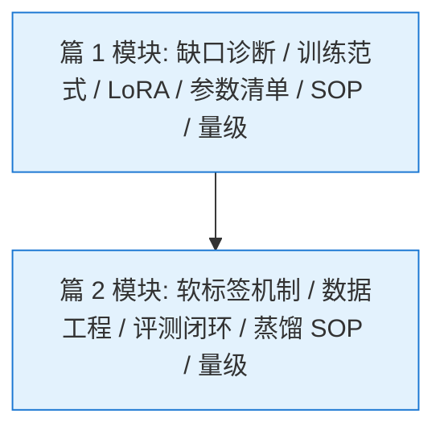
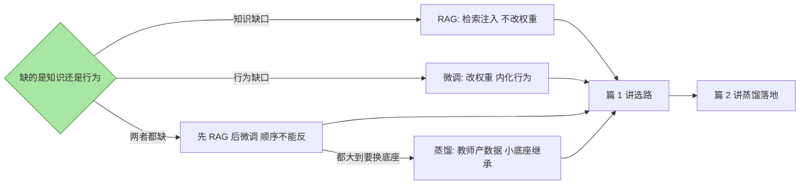
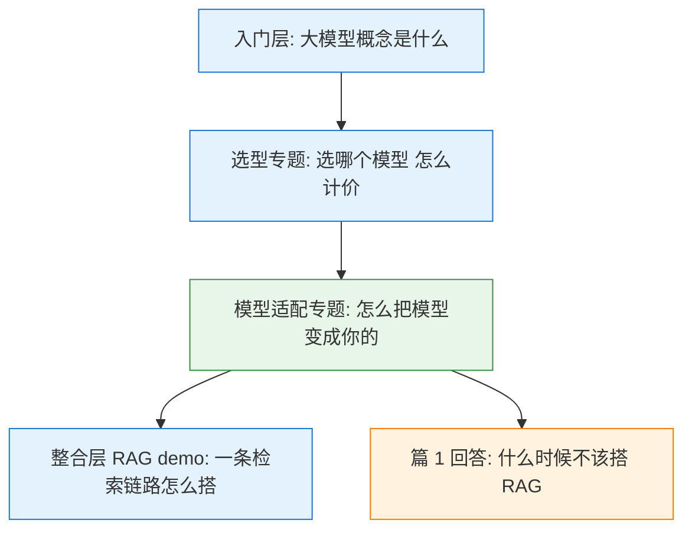
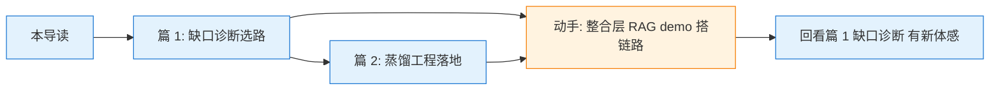

# 模型适配专题 · 系列导读-全景

> **一句话导读**：模型到位之后，怎么把它变成你的——先判缺口（知识/行为），再选路线（RAG/微调/蒸馏），两篇正文分别讲「怎么选」与「怎么落地」。

全景导读：本系列两篇正文，一张缺口诊断图。篇 1 是选路篇，篇 2 是落地篇；读法建议先篇 1 后篇 2，因为篇 2 的开工条件正是篇 1 的诊断结论。

## 系列导航

| 篇目 | 定位 | 核心内容 | 怎么读 |
|---|---|---|---|
| [1_缺口诊断与训练范式选型](1_缺口诊断与训练范式选型-专题.md) | 选路篇 | 缺口四象限、SFT/RLHF/DPO 穿透、LoRA/QLoRA、参数清单与微调 SOP | 先读：缺口诊断是后面一切的前置，选错路线成本以十倍计 |
| [2_蒸馏与模型压缩工程](2_蒸馏与模型压缩工程-专题.md) | 落地篇 | 软标签与温度机制、蒸馏数据工程、评测闭环 gap 分流、量化剪枝 | 后读：篇 1 结论指向蒸馏时再展开 |

两篇的模块索引：篇 1 六个模块（诊断、范式、LoRA、参数、SOP、量级），篇 2 五个模块（机制、数据、评测、SOP、量级）——「量级」两篇都有，是专题层的固定收尾件。

## 缺口诊断一张图

这张图是全系列的最小骨架：诊断是因、路线是果。判据只有一句——把业务 prompt 改写成公开领域的等价任务，改写后正常是知识缺口，否则是行为缺口；展开在篇 1 第一节。

## 与相邻篇目的边界

三条边界一句话各表：与[选型专题](../大模型选型专题/0_系列导读-全景.md)的边界——那边选模型与算价，本专题改模型与适配；与[整合层 RAG demo](../../整合层/agent/从零开始写一个RAG生产系统/5_实现方案与思考.md)的边界——那边讲「怎么搭 RAG」，本专题讲「什么时候不该搭」，2025 之后行业公开报道口径是 RAG 优先、微调补行为，本篇把这个口径的决策树画了出来；与篇 2 的边界——篇 1 讲「选不选蒸馏」，篇 2 讲「蒸馏怎么工程化落地」。

## 阅读路径与进阶

进阶路径按分层走：入门层建概念，特性层看单点机制，专题层（本系列）练选型决策，整合层用 demo 把手弄脏——这是一条从概念到架构实践的完整路径。建议动作：读完篇 1 后去整合层把 RAG demo 跑一遍，再带着「我当时会怎么诊断这个需求」回看篇 1；选型决策的权衡只有对着真实需求做过一次，诊断框架才算长进去。

## 数据与事实声明

- 本导读写于 2026-10-14；系列定位与边界划分依据本仓库分层规约（入门/特性/专题/整合）
- 系列内的机制描述、量级口径与超参默认值，以各篇正文的「数据与事实声明」为准（行业公开报道/业界通用经验口径）
- 关联篇目链接均为本仓库既有文件，死链由写后自检脚本校验
