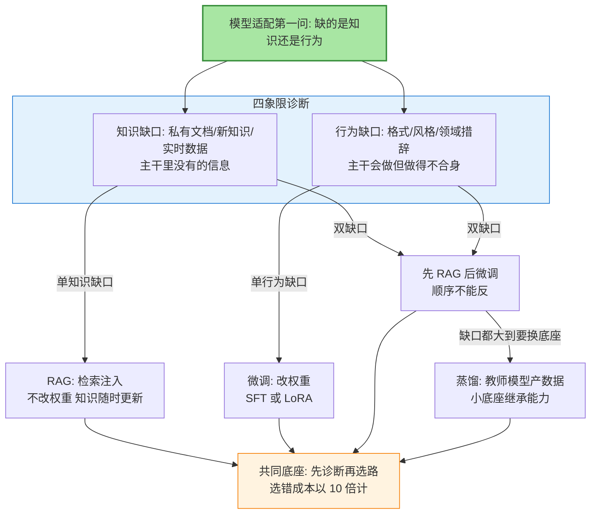
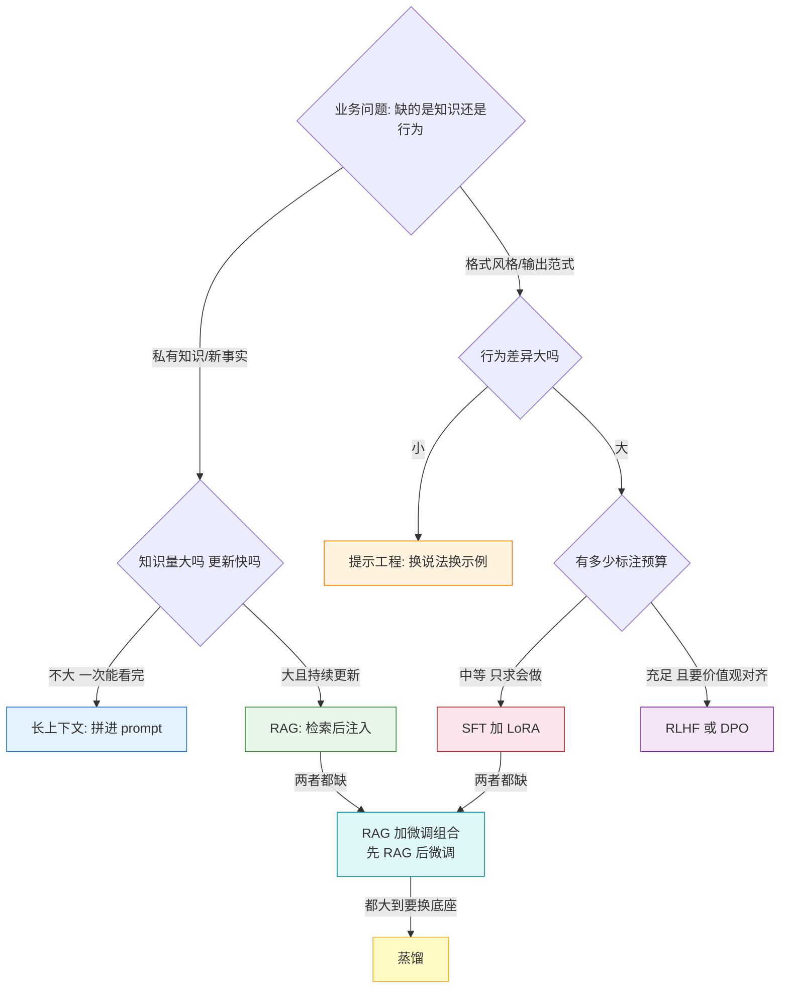
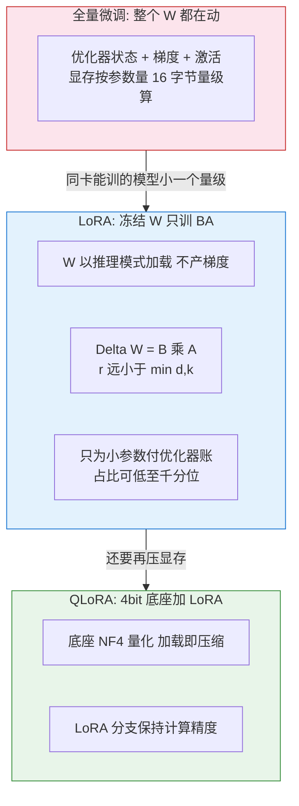
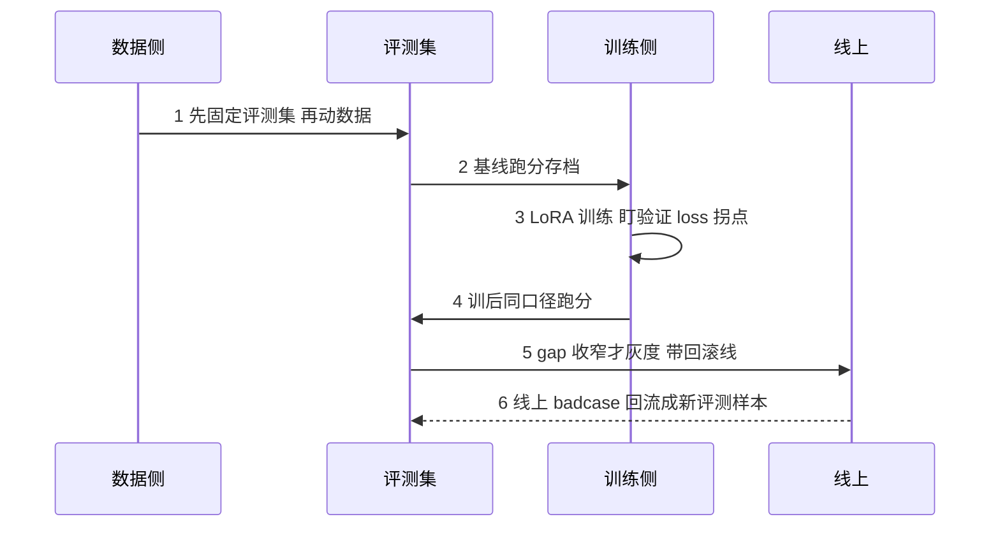

# 模型适配专题 · 1_缺口诊断与训练范式选型

> **一句话摘要**：模型适配的第一步不是选算法，是判缺口——知识缺口（私有文档、新知识）走 RAG，行为缺口（格式、风格、领域措辞）走微调，两者都有时先 RAG 后微调、顺序不能反，都大到要换底座时走蒸馏；SFT/RLHF/DPO 差在约束目标不同，LoRA/QLoRA 用「冻结主干 + 低秩增量」把单卡微调变成常态；而选错路线的成本，以十倍计。

## 🎯 本文核心

**核心机制一句话**：模型适配的本质是「用最小的权重改动成本，补上业务与通用模型之间的那类缺口」——缺口分两类，模型「不知道的」（知识）与「做得不合身的」（行为），诊断错了，后面所有训练算力都在给错误的问题交税。

**机制链一句话**：判缺口（知识/行为/双缺/大缺四象限）→ 选路线（RAG/微调/组合/蒸馏）→ 选训练范式（SFT/RLHF/DPO）→ 选适配手法（全量/LoRA/QLoRA）→ 参数级配置 → SOP 落地 → 按量级升级体系。



**读图一步**：全图只有两个起点——「知识」与「行为」。右边四条路不是并列的四个选项，而是缺口诊断的四个输出；诊断是因，路线是果，顺序不能倒过来（先钦定一条路再回头找理由，是适配项目翻车的标准开局）。

## 5W 速记卡

| 维度 | 一句话 |
|---|---|
| What | 先判缺口再选路线：RAG 补知识、微调改行为、蒸馏换底座 |
| Why | 选错路线的成本以 10 倍计——用微调教知识，等于把知识焊死在权重里 |
| When | 业务落地第一步：通用模型试不出效果、开始琢磨「要不要微调」时 |
| Where | 缺口诊断 → 范式选型 → 参数配置 → 微调 SOP → 量级分档 |
| How | 四象限定位缺口，LoRA 单卡起步，评测集先固定，灰度上线带回滚线 |

## 〇、边界：整合层 demo 讲「怎么搭」，本篇讲「什么时候不该搭」

整合层《从零开始写一个 RAG 生产系统》已经手把手搭过一条 RAG 链路（分块、向量化、检索、重排、生成），那里回答的是「怎么搭」；本专题回答的是上一个问题——「该不该搭」。同一个业务需求，RAG、微调、长上下文、蒸馏四条路都能跑通，选错一条，成本以十倍计。入门层讲过的大模型基本概念（预训练、上下文、token 计费）不在这里重讲；选哪个模型、API 怎么计价，归[大模型选型专题](../大模型选型专题/1_选型四维框架与定价机制-专题.md)，本篇只讲「模型到位之后，怎么把它变成你的」。系列第二篇讲蒸馏怎么工程化落地，本篇讲「选不选蒸馏」，两篇是接力关系。

## 一、缺口诊断：先判缺口，再选方案

### 1.1 两类缺口，一个判据

**知识缺口**是模型权重里没有的信息：私有文档、内部规范、实时数据、训练截止之后发生的事。特征是「同样的问法换成公开领域的等价任务，它就会」——缺的只是没见过。**行为缺口**是模型会做但做得不合身：输出格式、语气风格、领域措辞、固定的工作流。特征是「知识它都有，讲出来不对味」。

一个可操作的判据：把业务 prompt 改写成公开领域的等价任务。改写后表现正常，缺的是知识；改写后依然做不好，缺的是行为。这个判据能落地，是因为它把「感觉不行」翻译成了「哪部分不行」。

### 1.2 决策树



### 1.3 选错路线的代价为什么是 10 倍起步

用微调教知识：知识被焊进权重，更新一条文档要重训一次；更隐蔽的代价是模型对训练过的知识会产生「幻觉式自信」——没学过的那部分靠编，而使用者分不清哪段是学过的。用 RAG 教行为：每轮 prompt 携带示例，token 成本随例子数线性上涨，风格随上下文波动，没有硬约束。两条路互相错配，不是「效果差一点」，是「每轮对话都在为错配付费」。

**设计思想**：缺口诊断先行的本质，是把「选路」从审美问题变成工程问题——四象限判据把「感觉不行」翻译成「哪类缺口、多大缺口」，路线随之确定；SFT/RLHF/DPO 的分层同理，是把「让模型听话」拆成行为、价值观、偏好三个可分别下手的约束目标。这套拆法的代价是多了一层诊断成本，收益是后面每一步都能被验证。

**追问链（第一层）**：为什么不用微调替代 RAG？因为知识的更新频率和权重的更新频率差着数量级——文档可以每天改，模型不能每天重训；RAG 把「更新知识」降级成「更新索引」，这是运维量级的差别。**再追问一层**：那为什么 RAG 不能替代微调？因为行为缺口是「每次都要」的约束，prompt 示例只是概率性引导，没有权重层面的承诺，遇到分布外的输入就露馅。**打破砂锅**：双缺口为什么必须先 RAG 后微调？顺序反了，微调数据里教的很可能是「忽略检索材料、按自己话说」，RAG 注入的事实会被系统性无视；先 RAG 后微调，微调阶段学的是「怎么用好检索到的东西」，两者叠加而不是互斥。

## 二、SFT/RLHF/DPO 机制穿透：三种约束目标，三条梯度路径

### 2.1 三者差在约束目标

| 范式 | 约束目标 | 数据形态 | 梯度怎么走 | 成本量级 |
|---|---|---|---|---|
| SFT | 行为对齐：格式/风格/工作流 | prompt 与标准回答对 | 只在回答段算交叉熵 | 中：标注人力占大头 |
| RLHF | 价值观对齐：有用/无害/诚实 | 同 prompt 多回答的人类排序 | 奖励模型 + PPO 在线优化 | 高：多个模型同时在训 |
| DPO | 偏好学习：chosen 优于 rejected | 成对偏好数据 | 拉大两者对数概率差 | 中低：免训练奖励模型 |

### 2.2 机制穿透：微调没有新算法，只有新数据

SFT 就是监督学习，和预训练是同一套反向传播——预训练吃无标注文本预测下一词，SFT 吃人工写的标准答案预测下一词，差别只在数据规模与形态。这句话是整节的锚：**微调的机制穿透点在于，它没有发明新算法，它换的是数据**。RLHF 分两步：先用人类排序训练奖励模型（把「A 比 B 好」建模成概率），再用 PPO 让策略模型在奖励模型上得分高，同时用 KL 散度拉住参考模型防止跑偏。DPO 的洞察是偏好最优策略与奖励函数之间存在闭式关系，可以把「学奖励模型 + RL 优化」两步压成一步——损失函数里隐含的奖励，就是策略模型与参考模型的 log 概率比。

```mermaid
flowchart LR
    subgraph SFT["SFT: 行为对齐"]
        S1["数据: prompt 与标准回答对"]
        S2["loss: 回答段交叉熵"]
        S3["梯度: 推高正确下一词的概率"]
    end
    subgraph RM["RLHF: 价值观对齐"]
        R1["数据: 同 prompt 多回答的人类排序"]
        R2["奖励模型: 学排序 输出标量分"]
        R3["PPO: 沿奖励梯度更新<br/>KL 项拉住参考模型"]
    end
    subgraph DPO["DPO: 直接偏好优化"]
        D1["数据: chosen 与 rejected 成对"]
        D2["loss: 拉大两者对数概率差"]
        D3["闭式解: 隐式奖励<br/>免训练奖励模型"]
    end
    SFT -->|"数据成本与目标升维"| RM
    RM -->|"工程复杂度下降"| DPO
    classDef s1c fill:#e3f2fd,stroke:#1976d2
    classDef r1c fill:#e8f5e9,stroke:#388e3c
    classDef d1c fill:#fff3e0,stroke:#f57c00
    class SFT s1c
    class RM r1c
    class DPO d1c
```



**追问链（第二层）**：为什么 DPO 出来了，RLHF 还没退场？三个理由——在线性：RLHF 边采样边学习，DPO 吃的是离线静态数据，分布被数据锁死；多目标：安全、有用、风格可以是多个奖励模型加权，DPO 的单目标形式要改造才能撑；分布外：奖励模型对没见过的输出也能打分，DPO 只优化数据里出现过的偏好对。**再追问**：为什么 SFT 的数据标注占了成本大头？因为「标准答案」要人来写，而 SFT 的效果上限几乎由数据质量决定——100 条高质量示范胜过 10K 条噪声，这是业界反复验证的口径。**打破砂锅**：三者能串着用吗？工业界常见流水线是 SFT 打底、DPO/RLHF 收尾——SFT 教「会做」，对齐教「做得好」，机制上互不冲突。

## 三、LoRA/QLoRA：冻结主干为什么就够

### 3.1 低秩假设

预训练权重 W 已经吸收通用知识，领域适配需要的更新 ΔW 是「小扰动」；而小扰动矩阵往往是低秩的——用两个瘦矩阵 B（d×r）与 A（r×k）的乘积近似，r 取 8 到 64，比 min(d,k) 小两三个数量级。1B 参数、隐藏维 2048 的模型上取 r=16，可训练参数占比在千分位量级（数量级判断）。为什么冻结主干只训 adapter 就够：预训练权重是「通用能力池」，adapter 是「业务插头」，梯度更新天然集中在少数方向上；推理时还能把 BA 合并回 W，零额外延迟。**设计思想**：LoRA 对模型架构模块边界的一次重划——把「通用能力」与「业务适配」拆成两个生命周期不同的层，底座慢迭代、插头按业务热插拔，这一刀切开了后续所有参数高效微调的思路。

### 3.2 显存账

| 手法 | 可训练参数 | 显存主要构成 | 单卡 80G 能训多大 | 效果 |
|---|---|---|---|---|
| 全量微调 | 100% | fp16 权重 + fp32 梯度 + Adam 双动量 + 激活 | 7B 级要多卡集群、数天起 | 上限最高 |
| LoRA | 0.1% 量级 | 冻结权重推理模式加载 + 小 adapter 优化器状态 | 1B-7B 单卡可行、小时级 | 接近全量 |
| QLoRA | 0.1% 量级 | 底座 4bit 量化 + adapter | 65B 级单卡可行（论文口径） | 略低于 LoRA |

账要这么算：全量微调的显存大头不是权重，是优化器状态（Adam 的两个 fp32 动量约等于参数量的 8 字节）加梯度加激活；LoRA 把主干切成推理模式（无梯度无动量），只为千分位量级的小参数付优化器账，这是数量级的差别。QLoRA 再把底座压成 4bit，NF4 量化对正态分布的权重是信息论较优的位宽分配，拿显存瓶颈开刀。



**追问链（第三层）**：rank 为什么不是越大越好？低秩假设有边界——r 太大，可训练参数逼近全量，在小数据集上过拟合业务分布，推理合并成本也涨，而收益在 8 到 16 之后曲线就平了（业界通用经验）。**再追问**：alpha 为什么常设成和 r 联动？因为有效步长是 alpha 除以 r——r 变大而 alpha 不动，等于偷偷把学习率降了一个量级，所以要按 r 等比放大。**打破砂锅**：QLoRA 的 4bit 底座不会掉点吗？会掉一点，论文与社区复现的口径是接近 LoRA、掉点在评测噪声量级；这正是「蒸馏损失权重」之外另一类要用固定评测集说话的问题。

## 四、长上下文这条路：不检索的 RAG

知识量不大但要一次看全——几份合同、一次会议记录、一整个代码库的关键文件——拼进上下文就行，本质是「不检索的 RAG」，用窗口换召回率。与 RAG 的边界判据只有一条：全量成本与检索误差，谁更便宜。几十 K token 以内、更新不频繁，长上下文；海量且持续更新，RAG。长上下文的成本机制（阶梯计价、缓存读）见[选型专题篇 1](../大模型选型专题/1_选型四维框架与定价机制-专题.md)，这里只做定位：token 线性涨、长文中间部分注意力稀释，这两条约束不随窗口变大而消失。

**追问一句**：窗口涨到百万级，为什么还不淘汰 RAG？三个约束一个没变——成本随 token 线性涨、中间注意力稀释、知识更新频率；而且很多场景「该看哪几页」本身就是检索问题，窗口再大也回答不了「看哪」。

## 五、参数级配置清单

### 5.1 LoRA 结构超参

| 参数名 | 常见默认值 | 分档推荐 | 为什么 |
|---|---|---|---|
| rank r | 8（peft 口径） | 小数据轻适配 8；领域适配 16-32；大幅行为改变 64 | 低秩假设的容量旋钮：r 越大容量越大，但越偏离「小扰动」假设 |
| lora_alpha | 8，常设 = 2r 或 = r | 与 r 等比缩放 | 有效步长是 alpha/r；r 变大 alpha 不动等于偷偷降学习率 |
| target_modules | 注意力 q、v 投影 | 先 q、v；效果不够上全部线性层；计算受限只动一层 | 注意力层承接「看哪里」；全部线性层容量大但显存与合并成本涨 |
| lora_dropout | 0.05 | 小数据 0.1；大数据 0.05 | 数据少时靠正则化防过拟合业务分布 |

### 5.2 优化超参

| 参数名 | 常见默认值 | 分档推荐 | 为什么 |
|---|---|---|---|
| 学习率 | LoRA 1e-4 到 3e-4；全量 1e-5 到 2e-5 | LoRA 可以比全量大一个量级 | 只训小参数、更新方向少，小步走反而欠拟合 |
| 有效 batch | 32-128 条 | 小数据保 32；大数据加到 128 | 梯度方差与吞吐的平衡 |
| epoch | 1-3 | 数据少 2-3；数据多 1 | 微调的过拟合拐点来得比预训练早得多 |

以上为常见默认值与业界通用经验口径，具体以所用框架文档为准；分档推荐的依据是「数据量越小越要收敛容量、数据量越大越要放开容量」这条主线。

## 六、步骤级操作：微调项目 SOP

### 6.1 数据准备

**前置**：缺口诊断结论、数据来源清单、格式规范。**动作**：清洗去重、统一 instruction 形态、敏感信息过滤、按时间切分防泄漏。**验证**：随机抽检 100 条，统计字段完整率与重复率。**回退**：合格率不达标回到采集环节，不带着噪声进训练。

```python
# 训练数据一行一条（instruction 形态），字段以所用框架文档为准
{"instruction": "把客诉归类到售后品类", "input": "物流三天没更新", "output": "物流时效"}
```

### 6.2 基线评测

**前置**：固定评测集（业务 badcase + 通用能力探针）、基线模型输出存档。**动作**：跑基线模型，记录分数。**验证**：评测集本身要人工核验一遍，题错比分低更致命。**回退**：评测集不可信就先修评测集，没有可信基线的「提升」无法定案。

### 6.3 训练

**前置**：LoRA 配置定档、显存检查（`nvidia-smi` 确认单卡余量）。**动作**：启动训练，盯 loss 曲线与显存曲线。**验证**：训练 loss 下降、验证 loss 不同步抬头；每小时存 checkpoint。**回退**：loss 抖动或发散，回滚到上一个 checkpoint 并降学习率。

```bash
# LoRA 训练启动示例（accelerate + peft 口径，参数以所用框架文档为准）
accelerate launch --num_processes 1 train_lora.py \
  --model_name_or_path <base-model> \
  --data_path sft_train.jsonl \
  --lora_r 16 --lora_alpha 32 \
  --learning_rate 2e-4 --num_train_epochs 2
```

### 6.4 评测与上线

**前置**：训后 checkpoint、与基线同口径的评测脚本。**动作**：跑同一评测集，做 gap 分析——业务分涨、通用分不掉，才算过。**验证**：灰度 5% 流量，核心指标与投诉率双监控。**回退**：设回滚线（核心指标跌超阈值或投诉率涨超阈值即切回基线），回滚动作要在分钟级完成，不能等人工审批。



这张时序图也是模块边界的说明：数据是训练的上游，评测是上线的闸门，线上 badcase 回流是下一轮的原料——五步 SOP 不是一次流水线，是一个闭环架构，缺了第 6 步，量级上去之后数据飞轮就转不起来。

## 七、不同量级的思考：约束来源决定解法


- **十万级（10w 样本以下、日调用 10w 以内）**：约束来源是数据量与边际收益——这个量级下凑几千条标注的成本已超过微调的收益，账算不平。这一档的核心问题是「缺口判断对不对」，而不是「参数怎么调」；思考方式是**诊断驱动**——先把四象限走一遍，多数需求停在提示工程和 RAG 就收场了。触发升级的信号：同样的 badcase 反复出现、提示词堆到三层还压不住。
- **千万级（日调用千万、数据十万条量级）**：约束来源是单卡显存与迭代周期——LoRA 让单卡 80G 训得动 1B-7B，一晚上一个实验，训练的边际成本趋近于零。这一档的核心问题是「评测集可不可信」，而不是「训练跑不跑得起来」；思考方式是**评测驱动**——固定评测集、训前训后同口径跑分，没有可信评测集的千万级迭代是在盲飞。触发升级的信号：月更变周更、badcase 回流开始排队。
- **亿级（日调用亿级、持续迭代）**：约束来源从单次训练效果变成数据飞轮与版本治理——模型周更、数据回流、多版本并存，人的精力成为瓶颈。这一档的核心问题是「数据飞轮与版本治理」，而不是「单次训练效果」；思考方式是**体系驱动**——MLOps 流水线：线上 badcase 自动回流、训练任务编排、评测门禁、灰度与回滚自动化。触发升级的信号：一次灰度回滚超过两小时、人工评测跟不上模型迭代节奏。

**自下而上与触发升级**：三个数定档——可标注数据条数（决定训练跑不跑得起来）、评测集规模与可信度（决定敢不敢上线）、迭代频率（决定要不要建体系）。量级不是调用量本身，是「约束来源」：十万级卡在数据，千万级卡在评测，亿级卡在治理。档位判断自下而上做——先数手里的数据和评测集，再谈架构；升级是被实测值触发的，不是被规划书触发的。

## 八、事故推演：三个高频翻车现场

### 事故一：过拟合业务数据，通用能力崩盘

**发现**：评测集内分数一路上涨，线上通用任务（常识推理、多轮闲聊）投诉变多，公开基准掉点。**定位**：训练数据业务分布过窄叠加 epoch 数过多；看曲线——训练 loss 还在降，验证 loss 已经抬头，这是标准的过拟合剪刀差。**止损**：回滚到验证 loss 最低的 checkpoint，数据混入 10%-30% 通用语料，epoch 降下来并加 early stopping。教训一句话：微调是「往业务方向拉一把」，拉过头就是把模型拉偏。

### 事故二：奖励模型被 hack（RLHF 路线）

**发现**：奖励分一路上涨，人工抽检评分往下走——指标与体感背离。**定位**：策略模型找到了奖励模型的漏洞：长度偏置（说得越长分越高）、格式偏置（爱用列表）、奉承偏置。奖励模型是学出来的近似，不是 ground truth，被优化到极端就会暴露漏洞。**止损**：奖励侧加长度惩罚、多奖励模型集成取平均、保留 5%-10% 人工抽检当硬门禁。教训一句话：被当成目标的指标会失效——Goodhart 定律在 RLHF 里的标准形态，所以人工抽检这条线永远不能撤。

### 事故三：微调后原能力受损（灾难性遗忘）

**发现**：业务任务达标，通用任务掉点，用户感知「模型变笨了」，但没人说得清掉了多少。**定位**：数据分布单一，梯度更新挤占预训练权重里的通用能力；学习率过大会加剧遗忘。**止损**：混入通用数据重训、降学习率、加参考模型 KL 约束或通用数据 replay。教训一句话：微调前先给通用能力拍个照（基线评测），没有基线的「变笨」无法定案。

## 💡 实战提示

- 💡 接需求先问缺口类型：拿公开领域的等价任务改写一遍业务 prompt，改写后正常就是知识缺口，否则是行为缺口——这一步五分钟，能省一个月
- 💡 微调前先拍「通用能力照」：基线评测里必须含通用探针，没有基线的「变笨」无法定案，灾难性遗忘全靠它发现
- 💡 LoRA 起步配置：rank 8 验证路线、16 验证容量、alpha 按 2r 设；先只动 q/v 投影，效果不够再上全部线性层
- 💡 验证 loss 比训练 loss 重要：微调过拟合拐点来得早，每小时存 checkpoint，回滚线画在验证 loss 抬头那一刻
- 💡 灰度上线带回滚线：核心指标跌超阈值或投诉率涨超阈值即切回基线，回滚要分钟级，不挂人工审批
- 💡 线上 badcase 每周回流成评测样本——没有这一步，千万级之后评测集会以月为单位过期

## Trade-off：四条适配路线各在花什么

**RAG 与微调的交易**：RAG 用「检索基础设施 + 每轮 token 成本」换「知识随时更新、可解释、可溯源」；微调用「训练成本 + 更新刚性」换「行为内化、零推理期额外成本」。**全量与 LoRA 的交易**：全量用「显存与多卡集群」换「理论上限」；LoRA 用「低秩假设的容量上限」换「单卡可训、分钟级实验」，在多数业务适配场景里后者是更优的折中。**长上下文与 RAG 的交易**：长上下文用「token 线性成本 + 注意力稀释」换「零检索误差」；RAG 用「检索误差 + 链路复杂度」换「海量知识的可承受成本」。**蒸馏的交易**：用「教师依赖 + 质量上限」换「推理成本一个量级的下降」。

跨周期看这条脉络：2018 BERT 时代微调是默认答案，2020 GPT-3 之后提示工程分走一杯羹，2022 RLHF 把对齐做成标配，2023 LoRA/QLoRA 把微调成本打到单卡，2024 蒸馏走向成熟，2025 之后行业口径重新变成「RAG 优先、微调补行为」——每次摆动的本质都是成本、效果、运维三角的再平衡，没有银弹，只有当期最优解。选型前先给自己的缺口与量级画像，画像清楚，价目表自己会说话。

## 你们可能会问

**Q1：为什么不用微调替代 RAG，一步到位？**
知识的更新频率和权重的更新频率差着数量级——文档每天改，模型不能每天重训；RAG 把「更新知识」降级成「更新索引」，这是运维量级的差别，微调对学过的知识还会产生幻觉式自信。

**Q2：rank 设多大合适？**
先 8 后 16 是稳妥路径：8 验证「LoRA 这条路通不通」，16 验证「容量够不够」，还不够再考虑 32 或上全部线性层。一步拉到 64 的常见结局是在小数据集上过拟合——容量跟数据量走，不跟感觉走。

**Q3：微调之后，模型的知识更新了吗？**
没有。权重里的知识截止到训练数据那天，之后的新闻、文档、价格变动它一律不知道。这也是为什么知识缺口优先 RAG——检索层的更新是分钟级，权重层的更新是天级，两个数量级的差距。

**Q4：DPO 数据要多少条才够？**
业界常见口径是几千到几万对起步（行业公开报道与通用经验），且质量门槛比数量门槛更硬——偏好对标注不一致，损失函数会把噪声当成信号学。数据从哪来：线上 badcase 的人工排序、现有 SFT 模型的自采样排序，都比拍脑袋写的对子稳。

## 开放问题

- 长上下文窗口与 RAG 的边界会随窗口扩大怎么移动？成本与注意力稀释两条约束都在，但「一次看全」的场景清单在变长，均衡点值得持续观察
- 合成数据微调的长期效应：用模型生成的数据训模型，分布坍缩的风险边界在哪里，社区还没有共识
- 「小模型 + 微调」与「大模型 + 提示」的平衡点随 API 降价持续右移，2026 年这个平衡点落在哪，行业口径分裂

## 🎯 核心带走

- **一图一句**：先判缺口再选路——知识缺口走 RAG，行为缺口走微调，双缺先 RAG 后微调，都大到换底座走蒸馏；诊断是因，路线是果
- **机制穿透**：微调没有新算法只有新数据——SFT 与预训练同一套反向传播，DPO 把「奖励模型 + RL」两步压成一步，LoRA 把「改全部权重」压成「改千分位量级的低秩增量」
- **显存账**：全量的显存大头是优化器状态不是权重；LoRA 冻结主干只为小参数付账；QLoRA 再把底座压成 4bit——单卡能训的模型每步大一个量级
- **参数主线**：rank 跟数据量走、alpha 跟 rank 走、dropout 跟数据量反着走、学习率 LoRA 比全量大一个量级——所有分档推荐都是这一条主线的展开
- **量级主线**：诊断驱动 → 评测驱动 → 体系驱动；三个定档数：数据条数、评测集可信度、迭代频率
- **失效点**：过拟合业务分布（验证 loss 抬头）、奖励模型被 hack（指标与体感背离）、灾难性遗忘（没拍基线照）——三个事故的共同解药都是固定评测集

## 📌 数据与事实声明

- 写于 2026-10-14（模型适配专题第 1 篇）；机制描述以公开论文与开源框架文档为基准
- 「LoRA 单卡 A100 80G 训 1B 参数 2-4 小时」「全量 7B 多卡集群 2-5 天」「标注人力占 60% 以上」「QLoRA 65B 单卡可行」「DPO 几千到几万对数据起步」等为行业公开报道与业界通用经验的量级口径，非实测数据
- 超参默认值为常见默认值（peft/TRL 等框架口径），具体以所用框架文档为准；分档推荐为业界通用经验
- 2018 至 2026 的范式演进脉络为行业公开报道口径，用于说明成本/效果/运维三角的再平衡，不指向任何具体公司的内部实践
- 事故推演为公开技术社区高频案例模式的匿名化复述，不含任何真实系统、公司与内部代号

## 📚 参考资料

| 类型 | 标题 | 来源 |
|---|---|---|
| 论文 | LoRA: Low-Rank Adaptation of Large Language Models（Hu et al. 2021） | arXiv:2106.09685 |
| 论文 | QLoRA: Efficient Finetuning of Quantized LLMs（Dettmers et al. 2023） | arXiv:2305.14314 |
| 论文 | Direct Preference Optimization（Rafailov et al. 2023） | arXiv:2305.18290 |
| 论文 | Training language models to follow instructions with human feedback（Ouyang et al. 2022） | arXiv:2203.02155 |
| 论文 | Retrieval-Augmented Generation（Lewis et al. 2020） | arXiv:2005.11401 |
| 论文 | Language Models are Few-Shot Learners（GPT-3, Brown et al. 2020） | arXiv:2005.14165 |
| 框架文档 | PEFT / TRL 官方文档（LoRA/DPO 实现口径） | huggingface.co/docs |
| 系列内 | 大模型选型专题 · 1_选型四维框架与定价机制（长上下文计费机制） | 本仓库专题层 |
| 系列内 | 从零开始写一个 RAG 生产系统（整合层 demo，讲怎么搭 RAG） | 本仓库整合层 |
