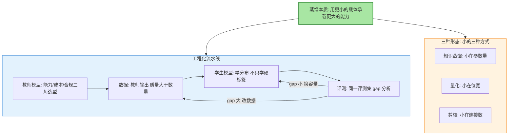
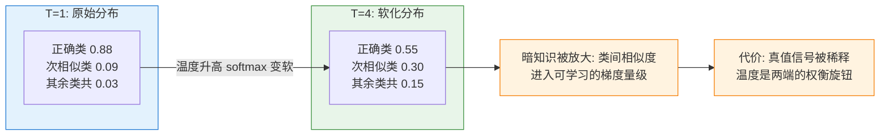
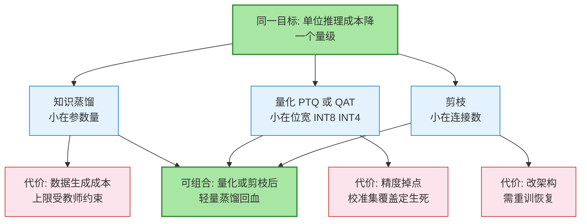
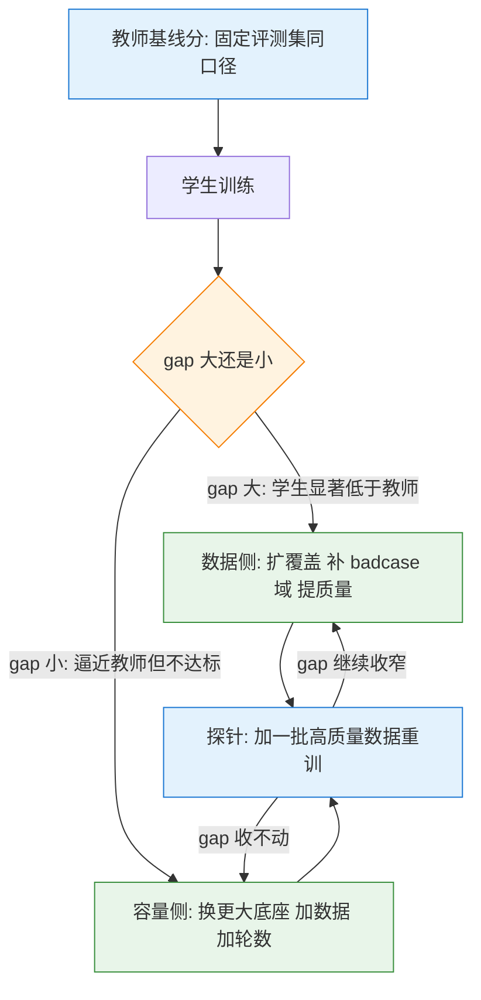
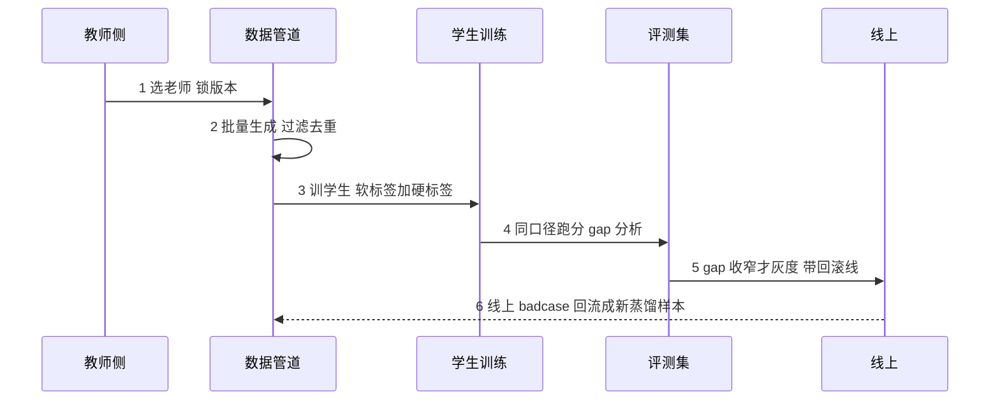

# 模型适配专题 · 2_蒸馏与模型压缩工程

> **一句话摘要**：蒸馏是把大模型的能力压缩进小载体的工程——机制层是软标签（概率分布携带类间相似度这类暗知识）与温度参数（软化分布让暗知识进入可学习的梯度量级）；工程层是三件事——数据质量大于数量、评测闭环分「gap 大改数据/gap 小换容量」、老师模型按能力/成本/合规三角选；量化与剪枝是同一主线的另外两种「小法」，三者可组合使用。

## 🎯 本文核心

**核心机制一句话**：蒸馏的本质是「小模型从大模型的输出分布里学，而不是从硬标签里学」——硬标签只留了正确答案，软标签留下了「正确答案与其他答案的相似度关系」，这份暗知识是小模型能用少得多的参数逼近教师表现的信息来源。

**机制链一句话**：选老师（能力/成本/合规）→ 产数据（教师输出、质量大于数量）→ 训学生（软标签 + 硬标签加权）→ 评测（同一评测集 gap 分析，大改数据、小换容量）→ 灰度上线带回滚线 → badcase 回流成下一轮数据。



**读图一步**：上图有两半——左半是流水线（五步一个闭环，第 6 步 badcase 回流在正文展开），右半是三形态。流水线回答「怎么落地」，三形态回答「小在哪」；两个视角共享同一条主线：**能力可以换载体，但每一层转换都要用评测集结算**。

## 5W 速记卡

| 维度 | 一句话 |
|---|---|
| What | 教师模型产数据、学生模型学分布、评测集把关的压缩工程 |
| Why | 推理成本降一个量级的账，多数场景值得用工程复杂度换 |
| When | 篇 1 缺口诊断指向「换底座」，或 API 账单与延迟压不住时 |
| Where | 数据管道 + 训练配置 + 评测闭环 + 灰度回滚线 |
| How | 锁老师版本、保数据质量、gap 分流定位病因、按量级上体系 |

## 〇、边界声明：篇 1 讲「选不选」，本篇讲「怎么落地」

[篇 1](1_缺口诊断与训练范式选型-专题.md) 回答「什么时候走蒸馏」——缺口都大到要换底座、或推理成本压不下来时，蒸馏才上场；本篇回答「蒸馏怎么工程化落地」：软标签的机制、数据工程的账、评测闭环的分流逻辑、参数与 SOP。量化与剪枝放在同一篇讲，因为它们和蒸馏共享一条主线——**用更小的模型承载更大的能力**，只是「小」的方式不同：蒸馏小在参数量，量化小在位宽，剪枝小在连接数。篇 1 的缺口诊断框架不在这里重讲。

## 一、知识蒸馏机制穿透：软标签与温度参数

### 1.1 软标签：硬标签丢掉的暗知识

教师模型对每个输入输出的是整个概率分布，不是 argmax 后的 one-hot。为什么概率分布比硬标签值钱：硬标签只告诉你「这是猫」，软标签告诉你「这像猫，但也有点像汽车、不太像狗」——**类间相似度就是暗知识**，它编码在非最大类的小概率里。小模型参数少，最缺的不是「正确答案是什么」（那个 data 里都有），而是「正确答案与邻居的关系长什么样」——这份关系让它能在没见过的输入上做对泛化。

### 1.2 温度参数：把暗知识放大到可学的量级

温度 T 作用在教师 softmax 上：T 大于 1 时分布被软化——最大值被压小、非最大类被抬升，类间差异被放大到学生能学的梯度量级；T 等于 1 是原始分布；T 趋大分布趋均匀。训练损失里通常带一个 T 平方量级的因子，补偿软化后梯度幅值的缩放（Hinton 口径）。**设计思想**：温度是一个「暗知识增益 vs 真值信号」的权衡旋钮——T 越高，类间关系学得越多，但正确答案的监督信号被稀释得越狠；所以它不是越大越好的参数，而是和 alpha（软硬标签权重）配对使用的另一半。



LLM 蒸馏的特殊性在于蒸馏对象的迁移：分类蒸馏蒸的是类间相似度，生成模型蒸的是「输出质量与推理链」——逐 token 的分布对齐或序列级对齐。2025 年以来行业公开报道的主流打法之一，是把推理模型的推理链压缩进小模型（DeepSeek 路线口径），蒸馏对象从「答案分布」变成了「思维过程」——这也是推理模型时代蒸馏重新变成显学的原因：思维链是显式的、可监督的，比隐式的「风格」好蒸得多。

**追问链（第一层）**：温度参数为什么存在，直接学硬标签不行吗？硬标签在 one-hot 里把类间关系清零了，小模型拿不到泛化所需的相似度结构；且硬标签对正确类的监督在训练几个 epoch 后就进入「背答案」模式。**再追问**：温度调到无穷大会怎样？分布趋均匀，暗知识还在，但真值信号被稀释到接近噪声——蒸馏就退化成了「学一团和气的平均分布」，学生什么都不会。**打破砂锅**：推理时也用这个温度吗？不用。温度只是训练时软化教师的工具，学生上线用标准采样参数；两个温度是一件事的两半，混用是经典事故源。

## 二、蒸馏三种形态：小的三种方式

| 形态 | 机制 | 适用场景 | 代价 | 恢复手段 |
|---|---|---|---|---|
| 知识蒸馏 | 学生学教师的软标签/输出分布 | 大模型能力压进小模型、推理链继承 | 数据生成成本；质量上限受教师约束 | 扩数据、换学生容量 |
| 量化蒸馏 | PTQ 训练后压到 INT8/INT4；或 QAT 训练时感知量化 | 部署降本、显存减半再减半 | 精度掉点，长尾类别首伤 | 扩校准集覆盖、混合精度、QAT |
| 剪枝蒸馏 | 砍掉不重要权重/通道后重训恢复 | 端侧、延迟敏感场景 | 结构化剪枝直接改架构 | 剪后轻量蒸馏回血 |

三者的共同主线是「换载体」，差异在小的方式。PTQ 与 QAT 的设计取舍：PTQ 零训练、当天上线，但掉点多少全看校准集覆不覆盖；QAT 掉点小，但要付训练成本。INT4 不是免费午餐——GPTQ、AWQ、SmoothQuant 各有一套补偿机制（公开论文口径），选型时看的是「掉点换延迟」的交换比。



**追问一句**：为什么量化、剪枝之后常常还要再蒸馏？因为这两种手法掉的那点精度，很多时候能用「原模型的软标签轻训几个 epoch」补回来——剪掉的连接留下的能力空洞，软标签正好能填。这是三形态组合使用的理由，也是本篇把三者放在一起讲的原因：它们是同一条压缩主线的三个工位。

## 三、蒸馏数据工程：质量大于数量的梯度账

### 3.1 为什么质量大于数量

学生学的是教师输出，教师输出的噪声（错误、格式崩坏、幻觉）会原样进入训练数据。小数据量时，坏样本的梯度占比高、方向还往往与正确方向相反——这不是「学得慢」，是「被带偏」。所以「100 条高质量胜过 10K 条噪声」不是修辞，是梯度账：**模型的错误是系统性的，不是零均值随机误差，靠数量摊不平**。

### 3.2 老师模型选择：能力/成本/合规三角

能力上，教师的下限是学生的天花板——信息瓶颈决定学生只能从教师输出里学，没见过教师背后的知识；成本上，生成数据要么付 API 账单，要么付自建推理开销，试算口径是「生成 N 条样本的总成本」；合规上，2026-10 行业公开报道口径：开源权重模型（DeepSeek V4.1 Flash 一类）的普及，让「蒸馏数据来自哪个老师」同时成为合规与成本的双重决策点——闭源 API 生成的训练数据受服务条款约束，开源权重自建则要把推理算力算进账。三条边各让一步，才是可落地的老师选型。

### 3.3 数据配比与清洗

通用数据防遗忘、领域数据提能力，典型思路是通用占大头、领域按目标缺口配比；去重、格式过滤、敏感信息清洗是前置动作不是可选项——蒸馏数据管道里的每一条噪声，都会在学生的权重里留下痕迹。

**追问一层**：那为什么不随机采样海量数据、靠数量覆盖？因为系统性错误摊不平——同一类幻觉会成片出现，采样再多也只是把噪声复制了更多份。**再追问**：老师越强越好吗？不一定。教师太强，软标签的类间关系超出学生的容量能表达的范围，反而学崩；行业常见口径是「教师比学生强 1-2 个档位」是甜点区（业界通用经验）。

## 四、评测闭环：gap 大改数据，gap 小换容量

蒸馏项目唯一的地基是固定评测集：覆盖核心任务、含人工标注子集、跑在同一口径上。gap 分析是分流逻辑——蒸馏前后在同一评测集上的分差，指向两个完全不同的病因：

- **gap 大（学生显著低于教师）**：先怀疑数据——覆盖不全、质量噪声、分布偏离；动作在数据侧：扩覆盖、补 badcase 域、提质量。
- **gap 小（学生逼近教师但仍不达标）**：怀疑容量——学生装不下；动作在容量侧：换更大底座、加数据、加训练轮数。

两个方向的止损动作完全不同：数据侧改管道，容量侧换底座，方向判断错一次，一周算力打水漂。区分两种病因有一个探针：**加一批高质量数据重训，gap 继续收窄是数据问题，收不动了是容量问题**。



**追问一句**：为什么 gap 分析值得单独立一节？因为它是整个蒸馏工程里唯一「把病因和药方绑定」的环节——其他环节错了只是效果差，这一节错了是「用数据侧的努力去救容量侧的病」，越努力越亏。这也是评测闭环的设计哲学：把「学生为什么不如教师」这个模糊问题，拆成两个可执行、可验证、可回滚的方向，而不是留一个「再训一版试试」的玄学出口。

## 五、参数级配置清单

| 参数名 | 常见默认值 | 分档推荐 | 为什么 |
|---|---|---|---|
| 温度 T | 2.0 量级（分类蒸馏常见 2-8；LLM 生成蒸馏常见 1-2） | 类间关系重要拉高；只求答案保真拉低 | 软化教师分布、放大暗知识增益；过高会稀释真值信号 |
| alpha 软硬标签权重 | 0.5-0.9 | 软标签主导 0.7-0.9；硬标签纠偏 0.3-0.5 | 软标签承载类间暗知识，硬标签保证真值锚点，权重是两者话语权分配 |
| 蒸馏损失权重 | 0.5-1.0（与任务损失加权） | 防遗忘场景拉到任务损失主导 | 学生同时学教师与任务标签，权重决定两边的比例 |
| 恢复性训练轮数 | 轻量恢复、几个 epoch 量级 | 量化/剪枝后 1-3 epoch | 恢复性训练过拟合风险高，小步收敛即可 |

以上为常见默认值与业界通用经验口径，具体以所用框架文档为准；分档的主线是「越怕忘真值、硬标签与任务损失的话语权越重；越想学关系、软标签权重越高」。

## 六、步骤级操作：蒸馏项目 SOP

### 6.1 选老师与产数据

**前置**：任务清单、候选老师能力矩阵、预算口径、提示词模板与采样参数。**动作**：benchmark 加成本试算（生成 N 条样本的账单），锁定老师版本后批量生成，过滤去重。**验证**：质量抽检加分布统计（长度、格式、类别覆盖三维）。**回退**：不过滤就进训练是数据事故的标准入口；过滤规则不达标，整批重采，别带病下游。

```python
# 蒸馏数据生成与过滤的最小骨架（伪代码，接口以所用框架文档为准）
samples = []
for prompt in prompts:
    out = teacher.generate(prompt, temperature=0.7)
    if quality_filter(out) and not is_dup(out, samples):
        samples.append({"prompt": prompt, "response": out})
```

### 6.2 训学生与评测

**前置**：学生基座、训练配置、教师输出已缓存、固定评测集与教师基线分。**动作**：启动训练，软标签与硬标签加权。**验证**：loss 下降加中间评测；gap 分析按第四节分流。**回退**：checkpoint 回滚，参数回退到上一档。

```bash
# 蒸馏训练启动示例（接口与参数以所用框架文档为准）
torchrun --nproc_per_node 1 train_distill.py \
  --student <student-model> --teacher <teacher-model> \
  --data distill_train.jsonl --temperature 2.0 --alpha 0.7
```

### 6.3 灰度上线

**前置**：gap 收窄的评测结论。**动作**：灰度 5% 流量，核心指标与投诉率双监控。**验证**：观察期指标不跌。**回退**：回滚线（核心指标跌超阈值即切回教师侧或原方案），回滚分钟级完成。



这张时序图也是模块边界的说明：教师侧、数据管道、训练侧、评测集、线上五方各是一个可独立回滚的模块；第 6 步的回流链路是蒸馏项目从「一次性交付」长成「持续流水线」的分界，也是第七节亿级档的开工信号。

## 七、不同量级的思考：约束来源决定解法

- **十万级（日调用 10w 以内）**：约束来源是调用量与单价的乘积还小——这一档蒸馏的固定成本（数据生成加训练加评测体系）根本收不回来。这一档的核心问题是「调用量有没有到盈亏平衡线」，而不是「模型能不能再小」；思考方式是**成本核算驱动**——直接调 API，精力花在提示词与缓存上。触发升级的信号：月账单持续超线、且任务形态稳定可批量。
- **千万级（日调用千万）**：约束来源是 API 账单与延迟——行业公开报道的常见口径是同类任务蒸馏后单位成本可降一个量级（10 倍量级，视师生价差与 gap 而定）。这一档的核心问题是「学生模型 gap 收得够不够窄」，而不是「训练省了多少钱」；思考方式是**账本驱动**——gap 的业务损失与降本收益放同一张账上算，只算省的钱是自欺。触发升级的信号：账单继续涨、gap 连续两次收敛不到位。
- **亿级（日调用亿级）**：约束来源是自建推理集群的利用率与模型迭代节奏——蒸馏从一次性项目变成持续流水线。这一档的核心问题是「重蒸馏流水线与模型版本治理」，而不是「单次蒸馏效果」；思考方式是**流水线驱动**——数据生成、训练、评测、灰度全部编排化，老师版本与学生版本成对管理。触发升级的信号：多个学生版本并存、人工评测跟不上迭代节奏。

**自下而上与触发升级**：三个数定档——月 API 账单（决定蒸不蒸）、学生与教师的 gap（决定敢不敢换）、任务形态稳定性（决定值不值得）。档位判断自下而上做：先数账单和 gap，再谈集群；升级是被账单和 gap 触发的，不是被技术热情触发的。量级不是调用量本身，是「约束来源」——十万级卡在平衡线，千万级卡在 gap，亿级卡在流水线。

## 八、事故推演：三个高频翻车现场

### 事故一：学生模型静默劣化

**发现**：线上指标缓慢漂移，没有突变、没有告警——静默是关键词；等发现时往往已经漂了数周。**定位**：两种病因——学生容量不足（训练早期就饱和，加数据无用）或数据分布漂移（新业务形态没进蒸馏数据）；区分方法是用新分布样本单独评测。**止损**：固定评测集周跑加回归门禁，数据侧补新分布。教训一句话：蒸馏的劣化是慢变量，唯一对策是把「周跑同一评测集」设成制度，不依赖人记得。

### 事故二：老师模型版本切换，分布漂移

**发现**：同 prompt 输出风格突变（长度、格式、措辞），线上指标无规律抖动。**定位**：老师 API 静默升级——蒸馏数据用的是旧版本输出，而新数据的生成或线上评测受新版本影响，训练数据与推理不同源。**止损**：锁老师版本（版本锁定或自托管权重）、数据与推理同源校验、双版本并行评测后再切。教训一句话：蒸馏系统的隐式依赖是老师版本，它不在你的代码里，在别人的发布计划里。

### 事故三：量化精度掉点

**发现**：整体指标小跌，但特定类别崩——数字、稀有 token、专有名词是重灾区。**定位**：PTQ 校准集不覆盖该分布，缩放因子按校准集统计定，长尾类别被平均掉了。**止损**：扩校准集覆盖长尾、该类别保留更高精度（混合精度）、必要时上 QAT。教训一句话：量化掉点从来不是均匀掉，是「校准集没覆盖的地方掉」——评测集必须按类别分层看，只看总分别被平均骗了。

## 💡 实战提示

- 💡 接蒸馏需求先算账：月 API 账单乘以上线的量级差，够不上固定成本就别开工，提示词和缓存先榨一遍
- 💡 老师版本必须锁：API 默认升级是隐形事故源，锁版本或自托管，数据与推理同源
- 💡 gap 分流别猜：加一批高质量数据重训，收窄是数据问题、收不动是容量问题，一个探针定方向
- 💡 温度不是越大越好：软标签权重拉高的同时，真值信号在稀释——alpha 与温度配对调，单拧一个必翻车
- 💡 量化评测分层看：总分别骗人，数字/专有名词/长尾类别单独拉一张表
- 💡 回滚线先画再灰度：学生侧切不回教师侧的灰度，等于把回退权交给了运气

## Trade-off：蒸馏 vs 直接用大模型 API 的盈亏平衡点

自建蒸馏的成本是「训练一次性投入 + 推理集群持续成本 + 数据生成成本 + 人力运维」；直接用 API 是「按调用量线性、零固定成本」。盈亏平衡点的算式很直白：**调用量 ×（API 单价 − 自建单位成本）> 固定成本**，蒸馏才开始回本；这还没扣「gap 的业务损失」——学生不如教师的那部分体验，是隐性成本。跨期看两个方向的力都在拽这个平衡点：API 持续降价把平衡点右移，有些场景可能永远等不到平衡点；而推理模型把思维链拉长、单价权重上升，又把平衡点左移。所以这笔账要按季度重算，不是一次决策终身有效——这也是为什么篇 1 把蒸馏排在缺口诊断的最后一档：它是四条路里唯一「经济决策权重高于技术决策」的一条。

## 你们可能会问

**Q1：蒸馏出来的学生为什么超不过老师？**
信息瓶颈：学生只从教师输出学习，没见过教师背后的知识，上限被教师锁死。要突破上限只有一条路——引入教师之外的额外数据，但那就不是纯蒸馏，是联合训练，成本结构完全不同。

**Q2：温度参数推理时用吗？**
不用。温度是训练时软化教师的工具，学生上线用标准采样参数。两个温度是一件事的两半：训练温度管「学什么分布」，采样温度管「怎么用分布」，混用是经典事故源。

**Q3：INT4 量化一定能用吗？**
不一定。掉点取决于任务对量化噪声的敏感度和校准集覆盖：精确计算、稀有 token、专有名词是重灾区。敏感任务先 INT8 或混合精度，让分层评测说话，别信「INT4 无损」的宣传口径。

**Q4：小模型加微调 和 蒸馏怎么选？**
微调是「用自己的数据改行为」，蒸馏是「用老师的能力换成本」，两者不互斥还可以叠加——先蒸馏拿到能力底座，再轻量微调贴业务。选型顺序仍回到篇 1 的缺口诊断：行为缺口微调、成本缺口蒸馏，两个都占就分两步走。

## 开放问题

- 合成数据占比的上限：教师生成数据训学生、学生的学生再训——分布坍缩（模型自噬）的边界在哪，社区没有共识
- 推理链蒸馏的合规边界：开源权重自建与闭源 API 生成两条路，2026 年的服务条款与开源许可还在演化，「数据来自哪个老师」的答案会漂移
- 端到端多模态蒸馏的形态：文本蒸馏的经验能否平移到语音/视觉，公开方法论还薄

## 🎯 核心带走

- **一图一句**：蒸馏 = 用更小的载体承载更大的能力——教师产数据、学生学分布、评测集把关；三形态（蒸馏/量化/剪枝）只是「小」的三种方式
- **软标签机制**：概率分布的暗知识在非最大类里；温度是「暗知识增益 vs 真值信号」的权衡旋钮；训练用的温度，推理不用
- **数据账**：质量大于数量，因为噪声的梯度是系统性偏差不是随机误差；老师按能力/成本/合规三角选，版本必须锁
- **评测账**：gap 大改数据、gap 小换容量；「加一批数据看 gap 是否继续收窄」是区分两种病因的探针
- **量级主线**：成本核算驱动 → 账本驱动 → 流水线驱动；三个定档数：月账单、gap、任务形态稳定性
- **失效点**：静默劣化（周跑评测集）、老师版本漂移（锁版本）、量化长尾掉点（分层评测）——三个事故的共同解药都是固定评测集

## 📌 数据与事实声明

- 写于 2026-10-14（模型适配专题第 2 篇）；机制描述以公开论文与开源框架文档为基准
- 「同类任务蒸馏后单位成本降 10 倍量级」「教师比学生强 1-2 个档位是甜点区」等为行业公开报道与业界通用经验口径，非实测数据
- 超参默认值为常见默认值口径，具体以所用框架文档为准；分档推荐为业界通用经验
- 「推理模型蒸馏压缩推理链成开源阵营主流打法」「开源权重模型让老师模型选择成为合规与成本双重决策点」为 2026-10 行业公开报道口径
- 事故推演为公开技术社区高频案例模式的匿名化复述，不含任何真实系统、公司与内部代号

## 📚 参考资料

| 类型 | 标题 | 来源 |
|---|---|---|
| 论文 | Distilling the Knowledge in a Neural Network（Hinton et al. 2015） | arXiv:1503.02531 |
| 论文 | QLoRA: Efficient Finetuning of Quantized LLMs（Dettmers et al. 2023） | arXiv:2305.14314 |
| 论文 | GPTQ: Accurate Post-Training Quantization（Frantar et al. 2022） | arXiv:2210.17323 |
| 论文 | AWQ: Activation-aware Weight Quantization（Lin et al. 2023） | arXiv:2306.00978 |
| 论文 | SmoothQuant: Accurate and Efficient Post-Training Quantization（Xiao et al. 2022） | arXiv:2211.10438 |
| 论文 | DeepSeek-R1: Incentivizing Reasoning Capability via RL（2025，推理蒸馏路线） | arXiv:2501.12948 |
| 论文 | Llama 2: Open Foundation Models（Touvron et al. 2023） | arXiv:2307.09288 |
| 系列内 | 模型适配专题 · 1_缺口诊断与训练范式选型（什么时候选蒸馏） | 本仓库专题层 |
