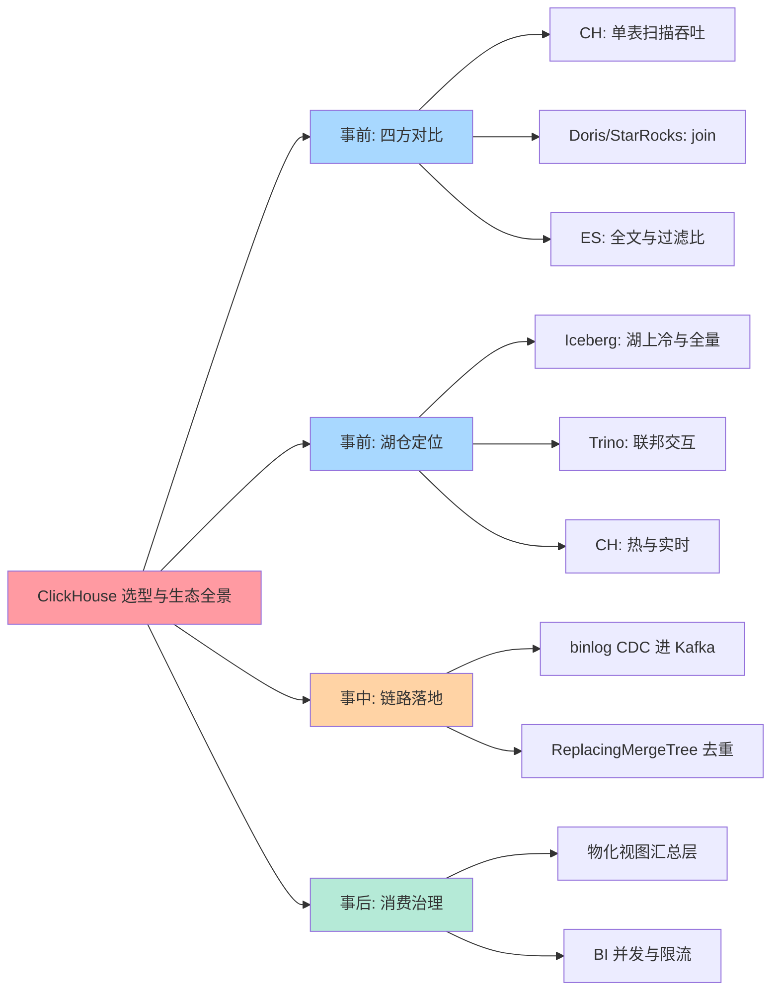
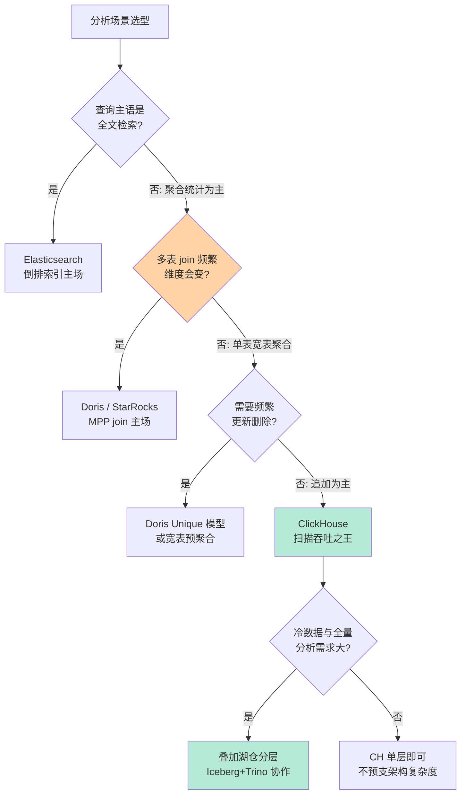
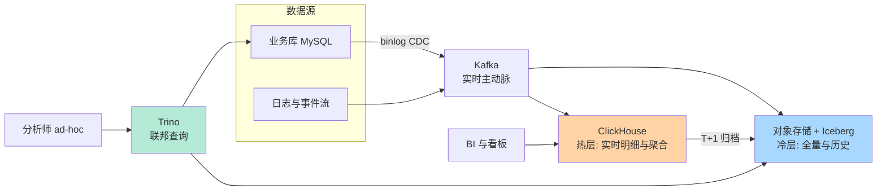
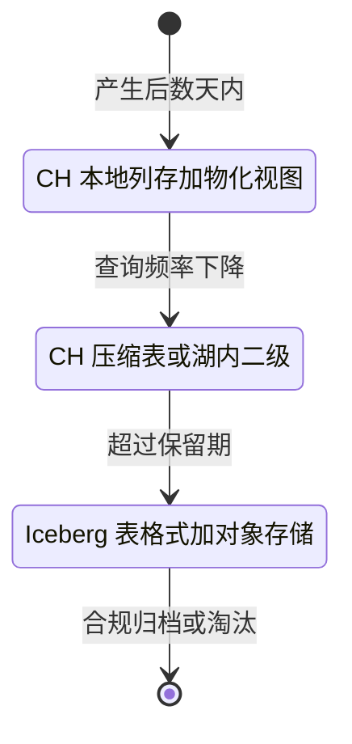
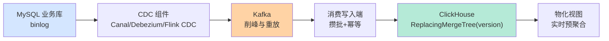
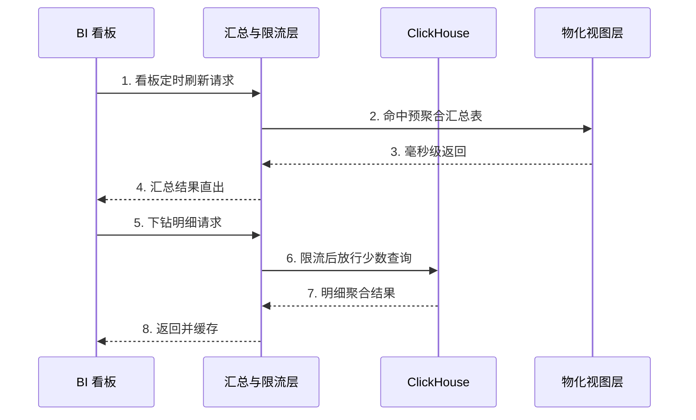

# ClickHouse 选型与生态全景：单表之王的位置与湖仓时代的分工

> 一句话：分析型选型的判断锚在「查询形态」——单表宽表极限扫描选 ClickHouse、多表 join 为主的即席分析看 Doris/StarRocks、全文检索加高过滤比看 ES；而湖仓时代的正解不是四选一，是分层分工：湖（Iceberg）管冷与全量、CH 管热与实时、Trino 管联邦与交互，从 MySQL 到 CH 的 CDC 链路是把这套分工落地的主动脉。

## 🎯 本文核心

**核心一句话：选 ClickHouse 不是选「最快的数据库」，是选「扫描吞吐优先」这套设计契约——判断主线是查询形态（单表宽表聚合还是多表 join）× 更新语义（追加为主还是要频繁改）× 并发画像（少数分析师还是几百个 BI 用户），而湖仓架构给 CH 的定位是「热的实时明细与聚合层」：冷数据归湖、联邦查询归 Trino、同步靠 CDC，各层各守各的契约。**

组织主线（本篇五段全挂这条线）：四方对比 → 湖仓定位 → CDC 链路 → BI 对接 → 量级验证。

## 一句话摘要

CH 的主场是**单表宽表的极限聚合**：列存 + 稀疏索引 + 向量化执行让扫描吞吐高出行存引擎一到两个数量级（业内认知），代价是 join 弱、并发低、更新删除昂贵——这是一套「扫描吞吐优先」的契约。Doris/StarRocks 用 MPP 架构把多表 join 做成主战场（StarRocks 为 Doris 体系的延续与演进，公开口径），ES 用倒排索引统治全文检索与高过滤比场景但深聚合成本高。湖仓时代四者不是替代关系：Iceberg 表格式管湖上的冷与全量，Trino 管跨源联邦与交互式探索，CH 管热的实时明细与预聚合——数据从 MySQL 经 binlog CDC 进 Kafka 再落 CH 构成实时主动脉。BI 对接的真问题是并发：CH 天生低并发高吞吐，解法是物化视图汇总层 + 连接层限流，而不是硬扛。本篇给出四方对比表、湖仓协作图、CDC 链路的事故复盘（重复计数、Too many parts、BI 打挂）与四个量级档的思考方式。

## 一、全景脑图：选型的四层展开

按方法论主线展开成一张全景脑图——从事前对比出发，经湖仓定位、链路落地，最终到消费端：

读图方法：事前（对比/定位）决定「谁上哪个位置」，事中（链路）决定「数据怎么流进来」，事后（消费治理）决定「业务用得爽不爽」——分析平台的事故七成发生在后两层，选型评审却把九成时间花在第一层（业内常见现象）。

入门层的原理与边界见 [ClickHouse 是什么与 OLAP 革命](../../入门层/从零开始认识ClickHouse系列/1_ClickHouse是什么与OLAP革命-入门.md) 与 [场景选型与边界](../../入门层/从零开始认识ClickHouse系列/3_场景选型与边界-入门.md)，本篇在其上收束为全景决策。

## 二、四方对比：CH vs Doris vs StarRocks vs ES

### 代价模型先于功能清单

追问一层：为什么分析引擎的选型不能看功能清单而要看代价模型？因为四者的差异不在「能不能做」，在「哪种查询便宜哪种贵」——机制穿透到底层：CH 的 MergeTree 用稀疏索引跳过整段数据、列存只读需要的列、向量化按批处理，三者叠加让单表扫描的每字节成本极低（机制见 [查询执行与向量化引擎](../../特性层/深入理解MergeTree与查询引擎系列/2_查询执行与向量化引擎-特性.md)）；但 join 要物化右表进内存、mutation（改删）是重排后台任务、并发受调度模型限制。Doris/StarRocks 的 MPP 分布式 join 把多表关联做成主战场；ES 的倒排索引让「从十亿文档里找出包含这几个词的千分之一」极便宜，但深聚合要靠 doc_values 列式回读，成本曲线在深层次聚合上远陡于列存引擎。

### 四方对比表

| 维度 | ClickHouse | Doris / StarRocks | Elasticsearch |
|---|---|---|---|
| 主战场 | 单表宽表极限聚合 | 多表 join 即席分析（公开口径） | 全文检索 + 高过滤比筛选 |
| 架构 | 列存 + 稀疏索引 + 向量化 | MPP 分布式执行 | 倒排索引 + doc_values |
| join 能力 | 弱项，大表 join 谨慎 | 强项，分布式 shuffle join | 弱项，靠宽表冗余 |
| 更新删除 | mutation 昂贵且异步 | Unique/upsert 模型原生支持（公开口径） | 文档级更新自然 |
| 查询并发 | 低并发高吞吐 | 并发能力较好 | 中等，受堆内存约束 |
| 数据 Freshness | 秒级写入可见（追加语义） | 秒级，支持部分更新 | 近实时（刷新间隔） |
| 典型坑 | Too many parts、FINAL 语义 | 数据分布与导入事务 | 深聚合超时与成本 |

选型解读一句话版：**查询是「宽表扫 + 极限聚合」选 CH；是「多表 join 的灵活即席」选 Doris/StarRocks；是「找几篇文档 + 按条件筛」选 ES；三者全都要，回到湖仓分层而不是找一个全能引擎。**

再追问一层：四方对比的分数会随版本演进漂移（CH 在补 join、MPP 系在补单点扫描、ES 在降聚合成本），那对比表两年后还有效吗？有效——因为漂移的是实现，不漂移的是**架构契约**：列存与行存的扫描代价模型、MPP 的 shuffle join 代价、倒排与列存的检索/聚合分工，这些由架构路线决定的契约差是十年尺度的。所以选型的正确姿势是记住每家的契约边界，把版本演进当作边界的缓慢移动来每年重估，而不是每年重学一遍选型。

反方案分析：为什么不用「MySQL 从库直接跑报表」？行存引擎做全表聚合要把所有列从磁盘搬进内存再丢弃大部分，同一份聚合在列存引擎上只读两三个列段——量级一小看不出差距，量级一大是十倍到百倍的扫描成本差（业内认知）；从库方案的真实适用域是「聚合维度单一 + 数据量千万以内 + 不想加组件」。再补一个反方案：为什么不用 Trino 直接当实时分析层？Trino 的强项是联邦与交互探索，但它查询时现拉数据，没有本地的列存热缓存，秒级实时明细加高频聚合的负载放在 Trino 上会把上游存储打疼——联邦引擎和实时引擎的契约不同，混用是常见的架构错位。

### 决策树

## 三、湖仓架构中的 CH 定位：与 Iceberg、Trino 的协作

### 分层协作图

三层的契约各不相同：**湖（Iceberg）管存**——开放表格式让数据不被任何引擎锁死，成本低但查询延迟高；**CH 管热**——本地列存加物化视图把秒级明细与高频聚合接住，代价是存储贵、保留期短；**Trino 管联**——一条 SQL 同时查湖、查业务库、查 CH（联邦能力，公开口径），延迟中等但不落副本。设计思想（为什么这套分层成立）：它的底层哲学是**数据温度决定存储介质与引擎**——数据的查询频率随时间指数衰减，把十年历史和今天早上放在同一个引擎里，要么贵的引擎被冷数据撑爆成本，要么便宜的引擎拖垮热查询；分层让每份数据在生命周期里向更冷的层迁移。

读图要点：温区迁移是单向的时间函数，判据是「最近 N 天还有没有查询命中」——用查询日志而不是拍脑袋定保留期，是冷热分层最容易被跳过、也最影响成本的一步。CH 读取湖上 Iceberg 数据的能力在持续演进（公开的引擎能力），当前工程口径仍建议「热层在 CH、重历史分析下推 Trino 查湖」，而不是让 CH 直接扫全量湖。

追问一层：为什么不把所有数据都常驻 CH 省掉 Trino 这一层？机制上看成本曲线：CH 的存储与内存成本随保留期线性上涨，而湖上对象存储每 TB 成本低一个量级（公开口径）；常驻方案省掉的是一个组件，买到的是全量数据的成本乘数与引擎绑定——联邦层的价值就是把「偶尔才查的历史长尾」以十分之一的成本留在开放格式里。

## 四、从 MySQL 同步到 CH：CDC 链路与事故复盘

### 链路架构

链路设计的三条纪律：一是**走 binlog 不走双写**——业务代码双写必然漏写且无重放能力，binlog CDC 天然完整可重放；二是**Kafka 挡在中间**——削峰、重放、多消费解耦三件事一个组件全包；三是**写入端攒批 + 幂等**——CH 的合并模型决定了小批量高频写是毒药（机制见 [MergeTree 写入与合并路径深度](../../特性层/深入理解MergeTree与查询引擎系列/1_MergeTree写入与合并路径深度-特性.md)），幂等靠ReplacingMergeTree 的版本列让乱序与重复可收敛。

### 步骤级操作：链路上线的最小闭环

每一步都有独立的前置条件、验证动作与回退路径，任何一步验证不过关就停在原地排查，不带着缺口进下一步：

| 步骤 | 命令/动作 | 前置条件 | 验证 | 回退 |
|---|---|---|---|---|
| 1. 建表与口径 | 目标表按版本列建 ReplacingMergeTree，建口径视图与物化视图 | 表结构与源库映射评审过 | 抽样写入后口径视图收敛正确 | 重建表脚本 |
| 2. 历史回填 | 源库快照批量导入（攒批窗口执行） | 实时写入未开启 | 行数与校验值核对一致 | 幂等重跑 |
| 3. 追增量 | Kafka 位点追平，开启实时消费 | 回填已完成且位点已标记 | 延迟监控秒级稳定 | 位点回拨重放 |
| 4. 乱序重放演练 | 注入乱序与重复消息、重放历史窗口 | 消费端幂等逻辑就绪 | 收敛后口径视图无重复 | 修复消费端再演练 |
| 5. 对账上线 | 周期比对源库与 CH 关键指标 | 步骤 4 通过 | 对账差异为零 | 修数任务兜底 |
| 6. 切流量 | 看板与下游逐步切到口径视图 | 对账连续多周期为零 | 报表数字与旧口径一致 | 切回旧查询路径 |

更新语义是这条链路的全部难点：MySQL 的 UPDATE 到了 CH 要翻译成「同主键新版本行」，查询侧要么带 FINAL 语义要么按 argMax 取最新版本——**去重是异步合并完成的**，合并没跑完之前重复行对外可见。这个机制性缝隙是本链路事故的第一来源。

三段业内常见复盘（匿名化）：一是**报表数字翻倍**——下游用 MergeTree 明细表的 count 做报表，ReplacingMergeTree 尚未合并完，重复版本被重复计数；结论：凡进报表的聚合，要么查时 argMax 收敛，要么走物化视图在写入时收敛，绝不裸查明细表的 count。二是 **Too many parts 写入被拒**——上游为图省事按行流式写入，parts 数量冲过阈值（公开口径默认数百量级）后写入直接报错，业务侧表现为「报表突然断了」；结论：写入端必须攒批（秒级窗口 + 批量上限），Too many parts 的防线写在消费端而不是引擎端。三是 **BI 高并发打挂 CH**——看板放开给全公司后并发冲穿引擎上限，内存超限查询互相挤兑；结论：BI 与 CH 之间必须有汇总层与限流层（下一节展开）。三段事故的共同根因：**把行存库的使用直觉平移到了列存引擎**——契约不同，直觉每平移一次就埋一颗雷。

💡 **实战提示 1**：同步链路上线前先做「乱序与重放」演练——把 Kafka 分区内的消息乱序注入、把某个小时的消息重放一遍，验证版本列与幂等写入能否收敛；演练不做的链路，第一次重放就是生产事故。

💡 **实战提示 2**：每张同步表都明确「权威口径视图」——argMax 收敛后的最新视图、物化视图的预聚合层，BI 与应用一律读口径视图不裸读明细表；口径视图是防止重复计数事故的制度化防线。

💡 **实战提示 3**：大表回填（历史数据初始化）与实时写入分开窗口执行——回填是批量顺序任务，实时是持续小批任务，两者混跑会互相推高 parts 数量；先回填后追增量，追平点用 Kafka 位点标记。

## 五、BI 工具对接：并发才是真问题

### 对接时序

对接的方式本身不难：CH 原生支持 HTTP 与 JDBC，MySQL 协议接口让多数 BI 工具把它当「一个很快的 MySQL」直连（公开能力），Grafana/Superset 类工具均有原生支持。难的是并发契约——BI 看板的并发画像（几百人同时刷新、定时全量刷新风暴）与 CH 的低并发高吞吐契约天然错位，解法按优先级：**写入时预聚合**（物化视图把明细折叠成汇总表，看板九成查询打在汇总层）；**连接层限流与排队**（保护引擎不被刷新风暴冲穿）；**结果缓存**（同一张看板同一分钟内的刷新合并为一次真实查询）。把明细查询留给少数分析师的下钻场景，才是 CH 并发预算的正确花法。

追问一层：物化视图会不会让口径漂移（同一指标多处定义）？会，这正是它的管理成本——每个物化视图是一条固化的口径，指标定义变更时要同步重建。纪律是**指标口径单一来源**：物化视图由指标平台统一生成与管理，禁止业务侧私自建视图当口径；宁可汇总层薄一点，也不要十处口径对不上。

## 六、不同量级的思考：架构约束驱动解法

- **十万级（单机余量内）**：这一档的核心问题是「这个量级值得引入专用 OLAP 吗」，而不是「哪个引擎更快」。约束来源是单机关系型的宽裕度：MySQL 直接聚合甚至导出表格工具都够用，提前引入 CH 买来的是一整套从未被需要的运维面。思考方式是「克制引入」。
- **百万级（查询形态核对）**：这一档的核心问题是「聚合查询是单表宽表还是多表 join」，而不是「要不要分布式」。约束来源是查询形态的契约差异：单表聚合 CH 单机就极快；join 密集则 Doris/StarRocks 起步更顺。思考方式是「形态驱动」——按查询契约分流而不是按榜单选型。
- **千万级（链路账本）**：这一档的核心问题是「数据从业务库到分析库的链路有几跳、谁兜底」，而不是「引擎参数怎么调」。约束来源是同步链路的一致性缝隙与运维带宽：CDC 攒批、幂等、对账三件套在这一档成为必需品，链路的复杂度开始超过引擎本身。思考方式是「链路驱动」——把链路当一等公民设计。
- **亿级（分层与组织）**：这一档的核心问题是「冷热分层与联邦层的架构路线定了没有、谁对整个平台的成本负责」，而不是「单机还能不能再优化」。约束来源是存储成本乘数与组织带宽：湖 + 热层 + 联邦的分层架构与平台化团队在这一档是必需品，这一档的失败多数是路线与组织的失败。思考方式是「路线匹配」。

思考方式总结：十万级靠「克制引入」，百万级靠「形态驱动」，千万级靠「链路驱动」，亿级靠「路线匹配」——约束来源从单机余量一路走到存储成本与组织带宽，思考方式必须跟着换挡。

**自下而上与触发升级**：先测档位再定结论——数据量、查询形态分布、更新频率、BI 并发画像四个实测值决定实际站在哪一档，不预支上一档的架构复杂度，也不滞留在下一档的单机侥幸里。触发升级的信号：聚合查询 P95 超标、join 需求占比上升、写入频率逼近 parts 阈值、BI 并发冲穿限流线——任一信号出现，先回链路层治理，治理不动再回选型层重估；锚点始终是约束来源，业务增长只是信号。

## 七、参数级配置清单

上线与 PoC 前就要定下的关键配置（默认值为公开口径，以所用版本官方文档为准；上线前锁定为基线）：

| 配置项 | 默认值 | 分档推荐 | 为什么进清单 |
|---|---|---|---|
| max_threads | CPU 核数（公开口径） | BI 高并发下调小 | 单查询并发度与总吞吐的跷跷板 |
| max_memory_usage | 约数十 GB 上限（公开口径） | 按内存预算显式设置 | 单查询内存闸，防 BI 大查询挤兑 |
| max_concurrent_queries | 百量级（公开口径） | BI 场景显式收紧 | 引擎并发上限，配限流层而不是裸放 |
| parts_to_throw_insert | 数百量级（公开口径） | 保持默认 + 监控告警 | Too many parts 的熔断闸，写入端纪律的观测点 |
| max_insert_block_size | 百万行量级（公开口径） | 消费端攒批对齐 | 批量大小决定 parts 生成速率 |
| index_granularity | 8192（公开口径） | 一般不动 | 稀疏索引粒度，影响跳数与点查效率 |

## Trade-off：每条路线都在交换什么

选 CH 交换的是「通用性换扫描吞吐」——放弃 join 自由、更新自由与高并发，换单表聚合的极限性能；选 Doris/StarRocks 交换的是「单点极限换 join 自由」——极限扫描略让，换来即席关联的灵活；选 ES 交换的是「聚合成本换检索能力」；上湖仓交换的是「架构简单换成本与开放性」——多两层组件，换来冷数据的成本乘数下降与引擎解耦；BI 直连交换的是「链路简单换并发风险」——汇总层与限流层是拿复杂度买稳定性。没有全能引擎，只有「你的查询契约最值钱的是什么」的匹配题。

## 开放问题与我的判断

值得讨论的未定论方向：一是 CH 的 join 能力持续增强（公开的引擎演进方向）会不会吞掉 Doris/StarRocks 的主场——我的判断是「能用」与「契约主场」之间隔着执行代价模型，多表即席分析的主战场中期仍属 MPP 系；二是湖上格式（Iceberg 等）成为事实标准后，各引擎「直接扫湖」的能力会拉平多少层与层之间的边界——方向明确，但热层的本地列存优势不会消失；三是存算分离形态（公开的引擎演进路线）会不会改变 CH 的成本曲线与保留期经济账——值得每年重估一次分层策略。

## 你们可能会问

**Q1：已经上了 ES，日志分析场景还要再上 CH 吗？**
按查询契约拆：「检索 + 筛选 + 浅聚合」留在 ES；「全量扫描 + 深度多维聚合 + 长周期趋势」迁 CH。两类负载混在 ES 上的代价是深聚合把集群堆内存打满、连检索一起抖动——拆开后两边都回到舒适区，多数团队的痛点不是缺引擎，是负载放错了引擎。

**Q2：ReplacingMergeTree 查询都要带 FINAL 吗？**
不要。FINAL 语义在查询时做合并收敛，代价随数据量上涨；工程口径是「明细探索允许看到未合并的重复，报表与看板一律走 argMax 口径视图或物化视图」——把收敛成本从查询时挪到写入时，是这条链路最重要的性能决策。

**Q3：从 MySQL 同步能不能用定时全量覆盖代替 CDC？**
量级小（百万行内、更新频率低）时全量覆盖完全成立，链路简单是真实收益；量级一大，全量窗口变长、源库导出压力变大、上游改了下游没跟上的窗口漏洞都会出现。判据是「增量窗口是否已经短于业务对时效的要求」——是的话留在全量，不是的话上 CDC。

**Q4：BI 直连 CH 和中间加一层，怎么选？**
并发画像决定：十几个内部用户的报表直连没问题；全公司开放的看板必须中间加汇总与限流层。判断信号很简单——看板刷新高峰时 CH 的并发查询数逼近引擎上限，就是加层的时机；等到打挂再加，事故已经发生。

## 5W 速记卡

| 维度 | 一句话 |
|---|---|
| What | CH = 扫描吞吐优先的列存引擎，单表宽表极限聚合之王 |
| Why | 列存 + 稀疏索引 + 向量化把单表扫描的每字节成本压到最低 |
| When | 追加为主、宽表聚合、少数分析师高吞吐探索的场景 |
| Where | 湖仓分层的热层：冷归 Iceberg、联邦归 Trino、实时明细归 CH |
| Who | 愿意守「攒批写入 + 口径视图 + 汇总层」三条纪律的团队 |

## 自测三问

1. 四方引擎的选型主锚是什么？（答：查询契约——单表聚合 CH、多表 join Doris/StarRocks、全文检索 ES）
2. MySQL 到 CH 链路的事故第一来源是什么？（答：ReplacingMergeTree 异步去重的可见性缝隙——裸查明细表 count 导致重复计数）
3. BI 对接的真问题是什么？（答：并发契约错位——解法是物化视图汇总层 + 限流 + 结果缓存）

## 🎯 核心带走

- **选型看契约不看功能清单**：宽表扫描选 CH、即席 join 选 Doris/StarRocks、全文检索选 ES——契约错配是分析平台事故的总根源
- **湖仓不是四选一是分工**：湖管冷与全量、CH 管热与实时、Trino 管联邦；数据温度决定引擎，保留期按查询日志定
- **CDC 链路三条纪律**：走 binlog 不双写、Kafka 挡中间、写入端攒批加幂等；报表一律读口径视图防重复计数
- **BI 的真问题是并发**：预聚合扛九成流量，明细留给下钻；限流层保护引擎不被刷新风暴冲穿
- **失效点**：行存直觉平移到列存、裸查明细表做报表、看板不限流直连引擎——三个最贵的错误

## 📌 数据与事实声明

- 引擎能力对比、参数默认值、并发量级均为公开文档与业内认知口径，具体随版本演进变化，以官方文档为准
- 性能差距的量级表述（十倍/百倍）为经验参考线（业内认知），实际以真实数据分布压测为准
- ClickHouse、Doris、StarRocks、Elasticsearch、Iceberg、Trino、Kafka 均为开源项目名，非商业推荐；StarRocks 与 Doris 的体系关系为公开资料口径

## 📚 参考资料

| 资料 | 说明 |
|---|---|
| ClickHouse 官方文档 | 参数默认值、合并语义与 MySQL 协议接口的权威口径 |
| Apache Doris / StarRocks 官方文档 | MPP 架构与 Unique 模型能力口径 |
| Apache Iceberg / Trino 官方文档 | 湖上表格式与联邦查询能力口径 |
| Elasticsearch 官方文档 | 倒排索引与聚合代价模型 |
| 本仓库 ClickHouse 入门层/特性层系列 | 机制细节的正源（MergeTree/向量化/分布式表） |
