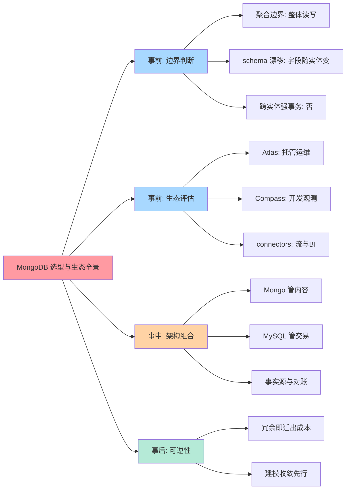
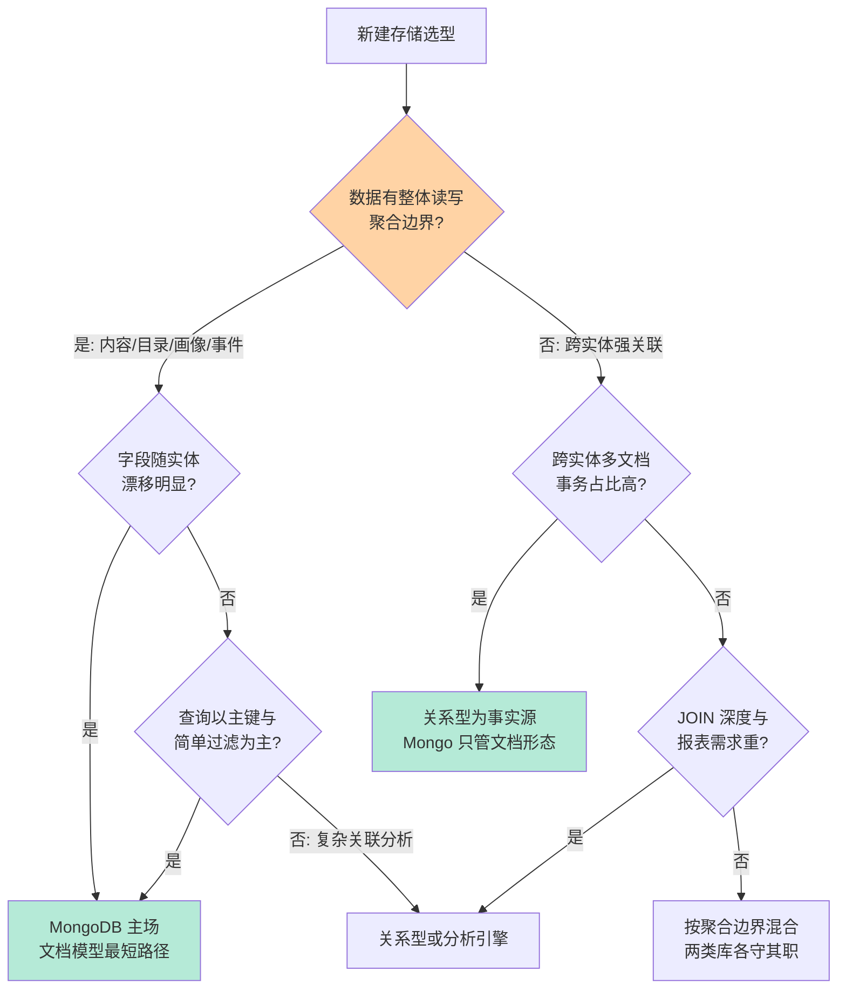
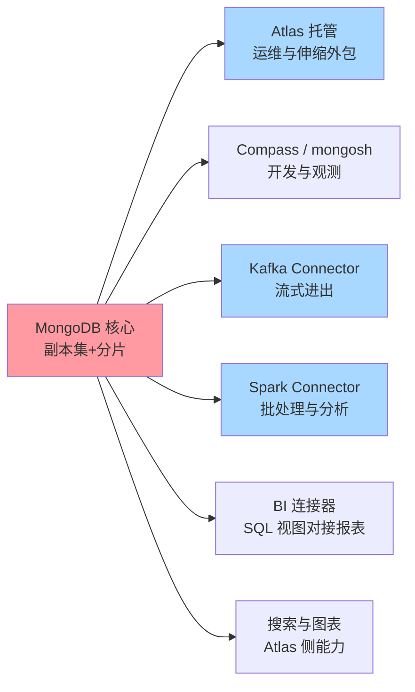
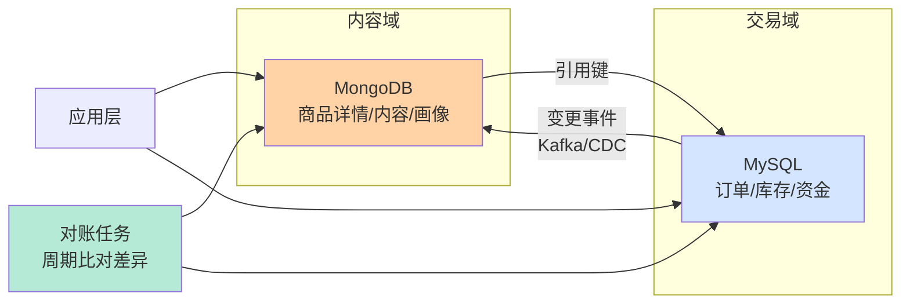
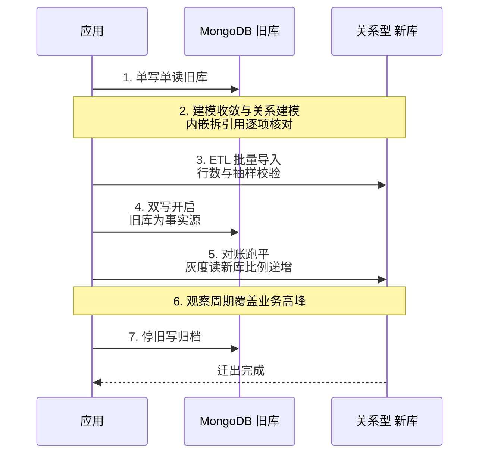
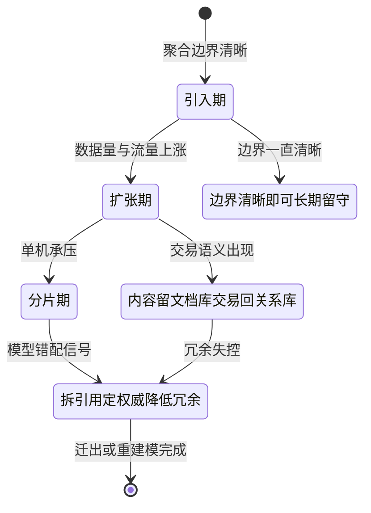

# MongoDB 选型与生态全景：什么时候选它，什么时候迁出去

> 一句话：MongoDB 的选型判断锚在「聚合边界」四个字——数据有天然的整体读写边界（内容、目录、画像、事件流）时文档模型是最短路径；跨实体强事务、复杂 JOIN、报表分析是关系型的主场；而混合持久化（Mongo 管内容 + MySQL 管交易）让「选它」与「选它但不全押它」成为两个独立决策，迁出路径的可逆性从选型第一天就该设计。

## 🎯 本文核心

**核心一句话：选 MongoDB 不是选「不用建模」，是把建模从运行期的 JOIN 挪到写入期的结构设计——判断主线是聚合边界（数据是否整体读写）× 事务形态（跨实体强事务占比）× 生态配套（托管与连接器能不能接住运维账），而混合持久化架构让文档库与关系库各守各的宪法，选错时的迁出成本取决于建模时的冗余设计。**

组织主线（本篇五段全挂这条线）：文档模型适用边界 → 决策树 → 生态全景 → 混合持久化 → 迁出路径与量级验证。

## 一句话摘要

MongoDB 的主场是**聚合导向的数据形态**：商品详情、内容正文、用户画像、行为事件——这类数据有天然的整体读写边界、字段随实体漂移、一次读要整块取回，文档模型在写入期完成结构设计，把关系型的运行期 JOIN 成本前置成建模成本。它的边界同样清晰：跨实体多文档事务虽然可用但有代价（公开口径，4.0 起支持）、$lookup 的 JOIN 代价随数据量陡增、BI 报表与复杂分析不是它的主场。生态层面，Atlas 托管、Compass 图形界面、Kafka/Spark 连接器与各语言 driver 构成完整配套。工程上最重要的架构决策是**混合持久化**：Mongo 管内容形态、MySQL 管交易与资金，以关系库为事实源加对账兜底——而一旦判断选错，迁出路径（建模收敛、ETL 重组、双写灰度）的成本上限，在选型时建模的那一刻就已经写定。

## 一、全景脑图：选型的四层展开

按方法论主线展开成一张全景脑图——从边界判断出发，经生态评估、混合架构，最终落到可逆性：

读图方法：事前（边界/生态）决定「选不选」，事中（混合架构）决定「怎么组合」，事后（可逆性）决定「错了能不能退」——第三层混合持久化是本文的核心观点：**它不是妥协，是让两类数据库各守各的宪法的正确姿势**。

入门层的边界讨论见 [场景选型与边界](../../入门层/从零开始认识MongoDB系列/4_场景选型与边界-入门.md)，本篇在其上收束为全景决策。

## 二、Mongo vs 关系型：决策树与适用边界

### 文档模型的适用边界

- **聚合边界清晰**：一次业务读写围绕一个整体（一篇内容、一个商品、一份画像），文档内嵌把「一次读」变成一次取回——关系型要把这类数据拆成多表再 JOIN 回来，每一次读都在为拆分交税。
- **字段随实体漂移**：不同实体的字段集合差异大（商品品类间属性天差地别），关系型的稀疏列与频繁 DDL 是慢性成本，文档的动态 schema 天然吸收。
- **写入期的结构设计**：文档建模的核心动作是**按查询模式内嵌或引用**——高频一起读的内嵌，会被独立更新与无界增长的引用。这个动作的机制代价在 WiredTiger 的文档级写入与索引维护上（见 [WiredTiger 存储引擎深度](../../特性层/深入理解MongoDB核心机制系列/1_WiredTiger存储引擎深度-特性.md)）。

设计思想（文档模型为什么「鼓励冗余」）：关系型的设计哲学是范式化——一份事实存一处，一致性靠约束与事务；文档模型的设计哲学是**读写模式优先**——数据按「怎么被读」组织，冗余是手段不是原罪，代价由应用层的一致性纪律承担。两种哲学没有对错，选择取决于你的一致性需求是「数据库强制」还是「应用可管」。

### 选型决策树

追问一层：多文档事务已经支持了，为什么「跨实体强事务占比高」仍要否决文档库单扛？机制穿透看代价模型：多文档事务需要协调多个文档的锁与快照，长事务会碰生命周期上限（默认值公开口径见第七节清单），冲突随并发陡增——单行/单文档原子是文档库的舒适区，跨实体 ACID 是关系型的宪法领地，把资金与库存这类强一致语义放进文档事务，是用短板接主力负载。再追问一层：那「文档内嵌 + 关系外键」混在一个系统里会不会精神分裂？不会——分裂的判断标准是**同一份数据的两个事实源**，只要每份数据有唯一权威方（订单事实在 MySQL，商品展示形态在 Mongo），混合就是清晰分工而非分裂。

反方案分析：「为什么不用 MongoDB 单扛全部（含交易）」——不是不行，是把两套宪法塞进一个引擎：交易侧要放弃关系约束与成熟事务生态，内容侧要背上交易库的分片与一致性包袱；两边各让一步的结果是两边都不舒服。单一技术栈的运维简洁是真实的收益，但只在小量级、交易语义很轻的场景成立。

## 三、Mongo 生态全景：托管、观测与连接器

### 生态地图

| 生态件 | 解决什么 | 使用要点 |
|---|---|---|
| Atlas（云托管） | 部署/备份/伸缩/监控外包 | 新项目默认起点，注意云 API 绑定的迁出账 |
| Compass / mongosh | schema 可视化、索引与执行计划分析 | 开发期建模核对与慢查询排查的第一入口 |
| Kafka Connector | 变更流向消息队列或反向写入 | 混合持久化同步链路的标配 |
| Spark Connector | 批处理与离线分析直读 | 报表需求重时的卸载通道 |
| BI 连接器 | 用 SQL 语义对接报表工具 | 聚合管道翻译成 SQL 视图，重报表仍有上限 |
| 各语言 driver | 应用接入 | 连接池与读写偏好配置是正确性的组成部分 |

选型解读：生态件的共同主题是**把 Mongo 的文档世界翻译给外面的世界**——Kafka 翻译成流、Spark 翻译成批、BI 连接器翻译成 SQL。翻译层越厚，语义损耗与运维面越大，所以生态件的采用纪律与扩展清单同理：每接一个都要进运维台账，能少一个就少一个。生态件的演进也值得每年看一眼：翻译层的语义损耗在收窄（公开的产品演进方向），但「翻译就有损耗」这个机制性约束不会消失。

追问一层：Atlas 的「运维归零」是免费的吗？穿透到底层看：托管买走的是部署、备份、伸缩的操作负担，买不走的是**建模决策的正确性责任**——shard key 选错、无界内嵌、缺索引的聚合，托管平台照单全收也照单全慢。托管的正确用法是把省下的操作时间投进建模评审，而不是把建模责任一起外包。

## 四、混合持久化：Mongo 管内容，MySQL 管交易

### 架构图

分工原则三句话：**交易与资金进关系库**（强事务、强约束、成熟生态）；**内容与形态进文档库**（聚合读写、schema 漂移、展示态冗余）；**事实源唯一**——交易事实以 MySQL 为权威，文档库里的冗余字段是「缓存语义」，允许短暂不一致但不允许成为权威。

一致性管理是这套架构的全部难点，三条纪律：一是同步走**变更事件**（CDC 或双写经访问层收敛），不用应用层手动双写——散落的手写双写必然漏写；二是**对账兜底**——周期比对两侧关键键值，差异进修复队列，同步链路的健康定义是「目标端数据完备」而不是「同步进程存活」；三是**读路径容忍窗口**——展示类读可以容忍秒级陈旧，凡是「以谁为准」有争议的读，一律回事实源。

一段业内常见复盘（匿名化）：某内容平台早期用文档库单扛内容与交易，订单嵌在用户文档里，三个月后出现两个症状——单文档无界增长逼近尺寸上限（公开文档口径为 16 MB），以及「改一个订单状态要精确定位数组第 N 个元素」的更新语句越写越恐怖。最终把交易拆回关系库，动因不是性能是**模型一开始就错了**：订单与用户是引用关系不是内嵌关系，建模时的内嵌决定把运行期的每一次更新都变成了雷。复盘结论入档：内嵌还是引用的判断口诀是「会被独立更新、会无界增长的，必须引用」。

💡 **实战提示 1**：建模评审时把「读写模式清单」当第一交付物——每个文档被哪些查询读、以什么粒度读、多久更新一次，三问过完内嵌还是引用是客观结论；没有清单的内嵌决定都是直觉赌注，赌输的兑付期在流量上来之后。

💡 **实战提示 2**：混合持久化的对账任务要监控「目标端数据完备」而不是「同步进程存活」——同步链路表面健康实际断流的静默故障，是这类架构最常见的线上事故形态；端到端的周期比对是唯一可信的健康定义。

💡 **实战提示 3**：引入 Mongo 前先写「退出方案」一页纸——权威数据清单（哪些数据的事实源在别处）、导出格式与映射表、双写通道的改造点；退出成本在选型时最便宜，选完之后只贵不便宜。

## 五、从 MongoDB 迁出：选错了怎么办

迁出不是一个动作，是一条流水线，四步各有独立的验证与回退点：

| 步骤 | 命令/动作 | 验证 | 回退 |
|---|---|---|---|
| 1. 建模收敛 | 内嵌拆引用、无界数组外移 | 文档尺寸与更新形态达标 | 调整收敛方案 |
| 2. 关系建模 | 文档结构映射为表结构 | 字段清单逐项有归属 | 映射表修订 |
| 3. ETL 重组 | 导出转换批量导入（公开工具或自研脚本） | 行数与抽样校验一致 | 幂等重导 |
| 4. 双写灰度 | 旧库为事实源，对账跑平后灰度读 | 差异为零且延迟达标 | 切回单写旧库 |

追问一层：为什么迁出的第一步是「建模收敛」而不是直接建表？因为文档库里的**冗余就是迁出的成本**——同一份字段内嵌在多个文档里，ETL 要决定哪个副本是权威、冲突怎么合并；先收敛（拆引用、定权威）再迁移，ETL 的映射才能一对一。冗余度在建模时写下，迁出成本在那一刻就定了——这就是「可逆性从选型第一天设计」的含义。再追问一层：迁出后 schema 灵活性丢失怎么办？答案是把约束显式化：文档库时代靠「没有约束」吸收的字段漂移，迁回关系库后要用显式机制承接（JSON 列承接长尾属性 + 常用字段独立成列），灵活性不会消失，只是从「默认自由」变成「按需设计」。

两段业内常见复盘（匿名化）：一是 **shard key 选错导致迁出雪上加霜**——分片键按「当时的查询模式」选了低基数字段，两年后热点集中无法均衡，而早期版本的改键成本极高（新版本的重分片能力是后来才有的，公开口径），最终借一次大迁移动手；结论：分片键决策要按「未来两年的查询模式」而不是当下（分片机制见 [分片架构与 chunk 治理深度](../../特性层/深入理解MongoDB核心机制系列/3_分片架构与chunk治理深度-特性.md)）。二是 **$lookup 翻车**——用聚合管道在两个大集合间做类 JOIN，数据量过阈值后耗时失控，本质是把关系型的运行期 JOIN 问题原样搬进了文档库（代价机制见 [聚合管道性能与索引协同](../../特性层/深入理解MongoDB核心机制系列/4_聚合管道性能与索引协同-特性.md)）；结论：跨集合深度关联高频出现，本身就是「该拆库或该改建模」的选型信号，不是该加索引的信号。

把单个文档库的完整生命周期画成状态图，每个状态迁移都有明确的触发信号与退出路径——「选错了怎么办」的答案不是一次大迁移，而是每个阶段保持可逆：

读图要点：收敛期是所有错误路径的汇合点——无论从哪条路走进来（模型错配、冗余失控、混合失败），动作都是同一组：拆引用、定权威、降冗余；收敛完成后才具备迁出或重建模的条件，跳过收敛直接迁，就是把混乱原样搬进新库。

## 六、不同量级的思考：架构约束驱动解法

- **十万级（单机余量内）**：这一档的核心问题是「这个量级值得引入第二套存储吗」，而不是「文档模型好不好」。约束来源是单机关系型的宽裕度：MySQL 一张 JSON 字段表就能吸收轻度形态漂移，提前引入 Mongo 是负优化。思考方式是「克制引入」。
- **百万级（聚合边界核对）**：这一档的核心问题是「数据有没有清晰的整体读写边界」，而不是「要不要分片」。约束来源是访问模式的形态：聚合边界清晰的内容型数据在 Mongo 上起步舒适；边界模糊的高关联数据留在关系型。思考方式是「边界驱动」——按聚合边界而不是按技术偏好分流。
- **千万级（分片键与索引账）**：这一档的核心问题是「分片键按未来两年选对了吗」，而不是「现在性能够不够」。约束来源是重分片代价与索引内存：分片键错了改的不是一个参数而是数据分布，索引总量开始挤占内存预算（WiredTiger 缓存机制见特性层）。思考方式是「前瞻驱动」——用未来两年的访问模式倒推今天的键选择。
- **亿级（组织与托管的匹配）**：这一档的核心问题是「团队有没有人对分片集群的深夜告警负责」，而不是「还能不能压榨性能」。约束来源是组织带宽与物理集群总量：自建分片要专职团队兜底，否则托管是理性答案——这一档的失败多数不是技术失败，是没有人手的组织失败。思考方式是「组织匹配」。

思考方式总结：十万级靠「克制引入」，百万级靠「聚合边界核对」，千万级靠「分片键前瞻」，亿级靠「组织匹配」——约束来源从单机余量一路走到组织带宽，思考方式必须跟着换挡。

**自下而上与触发升级**：先测档位再定结论——数据量、聚合边界清晰度、schema 漂移频率、运维人力四个实测值决定实际站在哪一档。触发升级的信号：单文档逼近尺寸上限、无界数组出现、跨集合 $lookup 高频化、分片热点告警——任一信号出现，先回建模层收敛，收敛不动再回选型层重估；锚点始终是约束来源，业务增长只是信号。

## 七、参数级配置清单

上线与 PoC 前就要定下的关键配置（默认值为公开口径，以所用版本官方文档为准；上线前锁定为基线）：

| 配置项 | 默认值 | 分档推荐 | 为什么进清单 |
|---|---|---|---|
| wiredTigerCacheSizeGB | 约 (内存-1GB) 的 50%（公开口径） | 专机保持默认或上调 | 缓存决定工作集命中率，配错全链路变慢 |
| oplog 尺寸 | 空闲磁盘的 5%（公开口径） | 大批量写入场景调大 | oplog 被冲掉从节点同步中断，窗口要覆盖最慢节点 |
| transactionLifetimeLimitSeconds | 60 秒（公开口径） | 保持默认拆分长事务 | 多文档事务生命周期上限，超时回滚 |
| writeConcern | w:1（公开口径） | 资金相邻写用 majority | 确认级别决定故障时的写入丢失面 |
| readConcern | local（公开口径） | 展示读 local，一致读 majority | 读级别与写级别配对，避免读到回滚数据 |
| chunkSize | 128 MB（公开口径，4.2 起） | 一般不动 | chunk 尺寸影响均衡粒度与 jumbo 概率 |

## Trade-off：每条路线都在交换什么

选 MongoDB 交换的是「关系约束换建模自由」——放弃数据库强制的完整性与成熟事务生态，换写入期的结构设计权与 schema 漂移吸收力；坚持关系型交换的是「建模自由换确定性」；混合持久化交换的是「单一技术栈换各守宪法」——多一套运维、一条同步链路，换来两边的舒适区；托管交换的是「控制权换运维归零」，代价是云 API 的迁移锁；文档内嵌交换的是「读性能换迁出成本」——冗余越多，可逆性越差。选型没有全能答案，只有「你手里的约束最缺什么」的匹配题。

## 开放问题与我的判断

值得讨论的未定论方向：一是文档库的查询能力持续增强（公开的产品演进方向）会不会逐步吃掉轻分析场景——我的判断是「够用」与「主场」之间隔着并发与代价模型，重报表仍会留在分析引擎；二是可查询加密与文档级安全能力（公开方向）会不会改变混合持久化的边界——如果文档库的安全能力追平关系型，「交易放文档库」的禁忌会松动；三是 Serverless 形态的按请求计费对中小量级选型的冲击——成本曲线在稳定流量下未必占优，值得每年重估一次。

## 你们可能会问

**Q1：项目初期字段天天变，是不是必须上 MongoDB？**
不一定。先分清「字段变」是形态漂移还是设计未定——设计未定的问题换数据库解决不了，上什么库 schema 都会乱；真正的形态漂移（不同实体字段集合天然不同）才是文档模型的用武之地。关系型的 JSON 字段列也能吸收轻度漂移，先核对决策树再动手。

**Q2：混合持久化两套数据库，运维成本会不会翻倍？**
增加是确定的，翻倍不一定。两套库的运维面可以收敛：托管把部署备份外包、访问层把连接与熔断收口、对账任务把一致性兜底自动化。真正翻倍的不是运维，是**心智**——两套建模语言、两套故障语义，团队要真有人分别懂。人手不够时，宁可单库加约束也别硬上混合。

**Q3：怎么判断「该从 MongoDB 迁出去了」？**
三个选型级信号：跨集合关联高频化（$lookup 变成常规武器）、交易语义侵入内容库（订单嵌进用户文档）、单文档逼近上限与无界数组泛滥。三个信号共同的本质是**数据的真实模型是关系型而建模做成了文档型**——加索引和扩容都解决不了模型错配，只有迁出或重建模。

**Q4：多文档事务能不能让 MongoDB 当交易库用？**
能力上有，代价上不划算（公开口径：事务跨副本集与分片的协调成本、生命周期上限、并发冲突模型）。资金与库存这类强一致主力负载放关系型，文档库处理交易侧的「非交易形态」（订单的展示快照、物流轨迹）——分工而不是替代。

## 5W 速记卡

| 维度 | 一句话 |
|---|---|
| What | MongoDB = 聚合导向的文档库，写入期建模换取读路径最短 |
| Why | 聚合边界清晰 + schema 漂移的数据，文档模型是最短路径 |
| When | 内容/目录/画像/事件流形态；跨实体强事务与重报表不进 |
| Where | 与关系型混合持久化各守宪法；托管或自建分片按组织定 |
| Who | 愿意在建模评审上投入（内嵌 vs 引用、分片键前瞻）的团队 |

## 自测三问

1. 内嵌还是引用的判断口诀是什么？（答：会被独立更新、会无界增长的必须引用）
2. 混合持久化的事实源原则是什么？（答：交易事实归关系库，文档库冗余是缓存语义，对账兜底）
3. 迁出为什么先建模收敛再 ETL？（答：冗余即迁出成本，收敛定权威后映射才能一对一）

## 🎯 核心带走

- **聚合边界是选型的第一问**：整体读写、字段漂移的内容形态进文档库；跨实体强事务、深关联、重报表归关系型
- **文档建模是把 JOIN 挪到写入期**：内嵌 vs 引用的口诀——独立更新、无界增长必须引用；冗余是手段，代价由应用纪律承担
- **混合持久化不是妥协是分工**：Mongo 管内容、MySQL 管交易、事实源唯一、对账兜底、读容忍窗口
- **可逆性从第一天设计**：内嵌冗余度就是迁出成本，分片键按未来两年选，托管的迁移锁要事前估值
- **失效点**：交易嵌进内容库、$lookup 当常规武器、把 schema 未定当形态漂移——三个最贵的错误

## 📌 数据与事实声明

- 多文档事务支持范围、参数默认值、文档尺寸上限均为公开文档口径，具体随版本变化，以官方文档为准
- 量级阈值与场景判断为经验参考线（业内认知），实际以团队技能与压测结果为准
- MongoDB、Atlas、Compass、Kafka、Spark 等均为开源项目或产品名，非商业推荐

## 📚 参考资料

| 资料 | 说明 |
|---|---|
| MongoDB 官方文档 | 事务、参数默认值与分片机制的权威口径 |
| MongoDB Connector 官方文档（Kafka/Spark/BI） | 生态连接器的能力边界 |
| Martin Fowler《Polyglot Persistence》公开论述 | 混合持久化的概念源头 |
| 《Designing Data-Intensive Applications》 | 存储模型与一致性的系统化框架 |
| 本仓库 MongoDB 入门层/特性层系列 | 机制细节的正源（WiredTiger/oplog/分片/聚合） |
