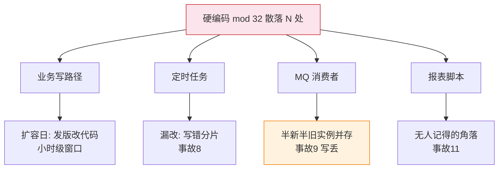
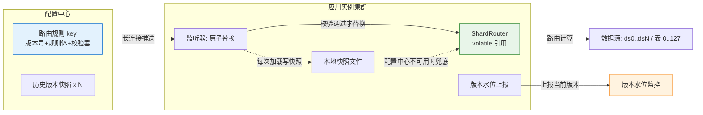
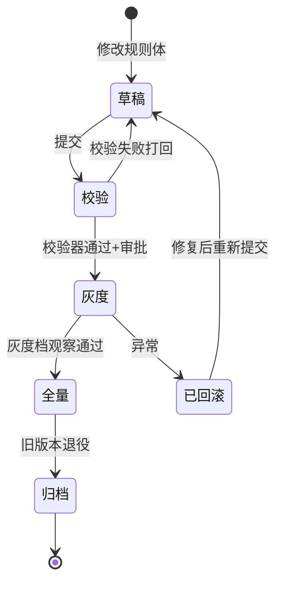
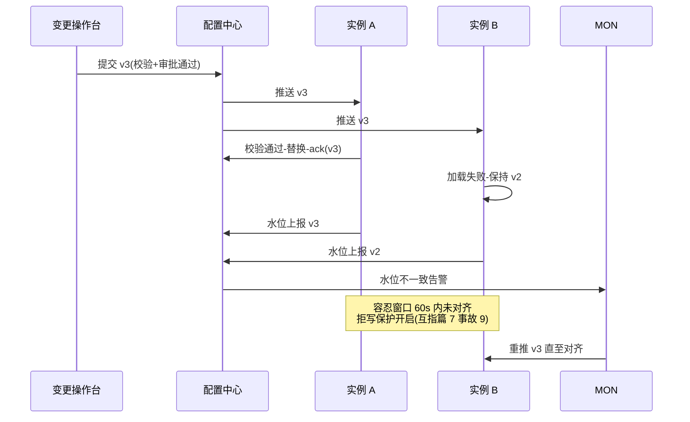

# 分片路由中间件改造：从硬编码到配置中心热切换

> 篇 5 说翻倍扩容「路由只改一行掩码」——但前提是**这行掩码真的只存在于一处**。现实是 `% 32` 散落在业务代码、定时任务、MQ 消费者、报表脚本里，扩容时改不完、改不齐、改了发版要几小时。篇 7 的事故 11（硬编码分片）与事故 9（多实例版本不一致）的根子都在这。本篇给出完整改造方案：**路由规则版本化 + 配置中心热切换 + 版本对齐保护**，让扩容路由切换从「发版小时级」变成「推送秒级」。

> **本文核心**：路由改造的本质是把「分片算法」从代码资产变成**受版本管理的运行时配置**，核心机制链是——规则对象化（版本号 + 规则内容 + 校验器）→ 配置中心单 key 原子下发 → 应用 volatile 引用原子替换（本地快照兜底）→ 版本水位上报与对齐保护。**原子性靠「单 key 整对象 + 加载前校验」保证，一致性靠「版本水位 + 未对齐拒写」保证，回滚靠「保留 N 版快照 + 秒级回切」保证**——三者缺一，热切换就是热事故。

## 一句话摘要

分片路由从硬编码 `% 32` 改造为配置中心热切换的完整路径分五步：①路由收敛（所有入口统一走 ShardRouter，消灭散落的硬编码）②规则对象化（RouteRule 含 modCount/dataNodes/版本号，内置合法性校验）③配置中心托管（单 key 整对象下发，禁止拆多 key，监听器 volatile 原子替换 + 本地快照兜底）④版本管理与灰度（单调版本号 + 按实例标签/机房灰度推送）⑤一致性保护（实例版本水位上报、集群未对齐时拒写或告警）。配合 ShardingSphere-JDBC 时，用动态数据源刷新托管 actual-data-nodes 与算法表达式。扩容切换因此变成：数据就绪（篇 6）→ 推送新版本 → 秒级全集群生效 → 旧版本一键回滚。

## 🎯 本文核心

**组织主线**：硬编码的故障面（为什么必须改）→ 目标架构（版本化 + 热切换 + 快照兜底）→ 核心代码（Router/Rule/Holder 三件套）→ ShardingSphere-JDBC 托管姿势 → 版本灰度与多实例一致性 → 推送原子性与回滚（事故反推的机制设计）。

## 5W 速记卡

| 维度 | 一句话 |
|---|---|
| What | 路由从硬编码模数到配置中心版本化热切换的中间件改造 |
| Why | 扩容路由切换要秒级原子 + 全实例一致——发版做不到，硬编码更做不到 |
| When | 首次扩容（32→64）之前就必须完成；多应用多入口场景越早越便宜 |
| Where | 应用内 ShardRouter + 配置中心 + 本地快照 + 版本水位监控 |
| How | 规则对象化 → 单 key 下发 → 原子替换 → 灰度推送 → 水位对齐 → 快照回滚 |

## 一、问题的形状：硬编码路由的三宗罪

### 1.1 故障面全景

硬编码 `% 32` 的真正代价不在「写它」，在**它扩散到所有数据入口**：业务写路径、定时任务、MQ 消费者、后台管理、报表脚本、数据订正工具。每一处都是扩容时必须找到并改掉的点，漏一处就是篇 7 事故 8（路由覆盖不完整）——旧库退役后某定时任务还在按 mod 32 路由，写入不存在的分片。



### 1.2 三宗罪与改造目标

| 罪状 | 表现 | 改造后的对应能力 |
|---|---|---|
| 改不完 | 入口散落，扩容靠 grep 全仓库 | 路由收敛：唯一 ShardRouter 入口 |
| 改不齐 | 滚动发布窗口新旧实例并存 | 版本水位对齐 + 未对齐拒写 |
| 改得慢 | 发版小时级，回滚再发版 | 配置中心推送秒级 + 快照回滚 |

**设计思想**：改造的目标不是「把模数挪个地方」，是**把路由切换从「部署行为」降级为「配置行为」**——部署是小时级、有状态、难回滚的；配置是秒级、无状态、可瞬间回退的。切换速度决定了篇 6 灰度切读阶段敢不敢真正逐级放大。回看路由载体十来年的演进——从代码常量到 properties 文件再到配置中心——每一代都在提高「变更速度」与「变更安全」的上限，这一代的答案是版本化热切换。

## 二、目标架构：版本化 + 热切换 + 快照兜底

### 2.1 总体架构图



三个不可妥协的原则：**规则版本化**（无版本号 = 无从对齐与回滚）、**原子替换**（volatile 引用整体换，绝不允许运行中半新半旧）、**快照兜底**（配置中心抖动时保 last-known-good，保住的是可用性底线）。

### 2.2 核心代码：Router / Rule / Holder 三件套

```java
/**
 * 分片路由规则（不可变对象，整体替换）
 */
public final class ShardRouteRule {
    private final long version;          // 单调递增版本号
    private final int shardCount;        // 分片总数, 必须为 2 的幂(篇 5 约束)
    private final int mask;              // shardCount - 1, 位运算掩码
    private final String dataNodes;      // 数据节点表达式 ds_${0..7}.t_order_${0..127}

    private ShardRouteRule(long version, int shardCount, String dataNodes) {
        if (Integer.bitCount(shardCount) != 1) {
            throw new IllegalArgumentException("shardCount 必须为 2 的幂: " + shardCount);
        }
        this.version = version;
        this.shardCount = shardCount;
        this.mask = shardCount - 1;
        this.dataNodes = dataNodes;
    }
    /** 反序列化后先校验再发布——非法配置拒绝进入运行时 */
    public static ShardRouteRule parse(String json) { /* 解析 + 校验 */ return null; }
    public int route(String bizId) { return murmur(bizId) & mask; }
    public long getVersion() { return version; }
}

/**
 * 路由持有器：volatile 原子替换, 读路径无锁
 */
public class RouteRuleHolder {
    private static volatile ShardRouteRule current;   // 引用整体替换 = 原子切换

    /** 配置中心回调: 校验失败的配置直接拒载, 保住旧版本 */
    public static void onConfigArrived(String json) {
        ShardRouteRule next = ShardRouteRule.parse(json);   // 内含 2 的幂/节点表一致性校验
        if (next == null) { alarm.report("路由规则校验失败, 拒载"); return; }
        if (next.getVersion() <= current.getVersion()) { return; }   // 乱序/重复推送幂等丢弃
        current = next;
        SnapshotWriter.persist(json);      // 同步写本地快照兜底
    }
    static ShardRouteRule loadOrSnapshot() { /* 启动序: 先快照后连配置中心 */ return current; }
}
```

**为什么这么设计**：`volatile` 引用替换是 JVM 层面的原子操作——所有线程要么看到旧规则、要么看到新规则，不存在「模数已变、节点表未变」的中间态。这是整个热切换机制的原子性基石，比任何「分布式锁保护配置更新」的方案都简单可靠。

### 2.3 步骤级操作：改造最小执行序

改造必须在下一次扩容窗口之前完成，按以下步骤推进（每步独立可验收、可回退）：

| 步骤 | 操作 | 验证 | 回退 |
|---|---|---|---|
| 前置条件 | 盘点全部数据入口，grep 硬编码清单建档 | 入口清单覆盖业务写/定时任务/MQ/报表 | 不动现网 |
| 第 1 步 | 建 ShardRouteRule/Holder 三件套，路由收敛到单入口 | 硬编码扫描（grep mod 32 与 mod 64 等）命中为 0 | 三件套摘除，回旧入口 |
| 第 2 步 | 规则 JSON 托管配置中心（单 key）+ 校验器 + 本地快照 | 故意推非法规则确认拒载 | 应用回退读本地默认 |
| 第 3 步 | 版本水位上报与大盘上线 | 杀一个实例的推送链路，60s 内告警可见 | 关闭上报（仅降级监控） |
| 第 4 步 | 预发演练推送与回滚计时 | 回滚耗时 <30s | 保持旧版本号不动 |
| 第 5 步 | 与扩容窗口合流：按篇 6 灰度节奏推送新版本 | 每档观察水位对齐 + 读延迟持平 | 推回上一版本号秒级生效 |

## 三、ShardingSphere-JDBC 的路由配置最佳实践

### 3.1 托管姿势：让中间件消费版本化规则

用 ShardingSphere-JDBC 时不要让它的配置成为「第二份硬编码」——把 actual-data-nodes 与算法表达式纳入同一套配置中心管控，改造期用 its API 动态刷新数据源：

```yaml
# ShardingSphere-JDBC 5.x 关键路由配置(公开口径)
mode:
  type: Cluster            # 集群模式: 元数据变更可编排
  repository:
    type: ZooKeeper
rules:
  sharding:
    tables:
      t_order:
        actualDataNodes: ds_${0..7}.t_order_${0..127}
        tableStrategy:
          standard:
            shardingColumn: user_id
            shardingAlgorithmName: order-mod
    shardingAlgorithms:
      order-mod:
        type: INLINE
        props:
          algorithm-expression: t_order_${user_id & 127}   # 掩码表达式, 与自研路由同构
props:
  sql-show: false            # 灰度切流期间临时 true, 验证后关闭
  max-connections-size-per-query: 1   # 归并查询逐档调大
```

### 3.2 与自研路由的边界

- 已有 ShardingSphere 存量 → 走「配置中心 + 动态刷新」托管它，不推翻重来
- 简单模数路由 + 强定制诉求（灰度租户路由、读写分离联动）→ 自研三件套更轻
- 两者并存期用**同一份规则 JSON** 做单一事实源，绝不允许两套配置各自为政

### 3.3 参数级配置清单

| 配置项 | 默认值参考 | 分档推荐 | 为什么 |
|---|---|---|---|
| 路由规则 data-id | shard-route-rule | 按库拆分 data-id | 单库切换不牵连全站 |
| 推送超时 timeout-ms | 5000 | 核心库 3000 | 超时快速暴露推送链路问题 |
| 保留历史版本数 | 5 | 资金库 10 | 回滚窗口覆盖整个灰度周期 |
| 校验器 strict | true | 一律 true | 非法配置宁可拒载不可上线 |
| 本地快照路径 | 应用目录 snapshot/ | 挂载持久盘 | Pod 重建后仍可兜底 |
| 水位对齐容忍窗口 | 60s | 灰度期 30s | 未对齐超窗即告警/拒写 |
| sql-show | false | 灰度期抽样开 | 验证真实路由命中 |

## 四、路由版本管理与灰度发布

### 4.1 版本生命周期



版本号**单调递增**且只在配置中心生成（应用侧只读）——乱序推送靠版本比较幂等丢弃（代码里的 `next.getVersion() <= current.getVersion()` 检查）。灰度维度按优先级：白名单租户 → 单实例标签 → 同机房一半实例 → 全量，每档观察 ≥24h（与篇 6 灰度切读同一节奏，两者绑定推进）。

### 4.2 推送时序与水位对齐



**多实例一致性保证**的核心不是「让推送必然成功」，是**承认推送可能失败，并为失败期间建保护**：每个实例启动与每次替换后上报版本水位；监控侧维护集群版本视图；灰度切流类的高危变更在「容忍窗口未对齐」时触发拒写保护——宁可短暂拒绝写入，不允许新旧路由并存的写丢。

## 五、配置推送的原子性与回滚机制

### 5.1 原子性三原则

1. **单 key 整对象下发**：模数、节点表、灰度标记全部装进一个 JSON——拆成多个 key 就有半版本状态，这是把原子性问题亲手制造出来
2. **加载前校验，失败拒载**：校验器在应用侧执行（2 的幂、节点表与模数一致、版本单调），非法配置到不了运行时
3. **引用级原子替换**：volatile 整体换，运行中的请求永远拿到完整一致的规则

### 5.2 回滚机制

保留最近 N 版规则快照（配置中心侧 + 应用本地快照双份），回滚 = 推送上一版本号，秒级生效。回滚不是应急发明，是**每次灰度前的必演动作**：切流前在预发环境实际执行一次回滚并计时，回滚耗时超过 30s 就先修推送链路再切流。

### 5.3 三则实践叙事（业内高频模式的匿名化归纳）

**叙事一：拆 key 造成的半版本事故。** 某平台早期把分片数与数据节点表存在两个配置 key，一次扩容运维只改了分片数（64）没改节点表（仍是 32 个节点）——一半请求路由到不存在的分片，报错率瞬间冲高。排查：应用日志大量 UnknownDataSource + 两 key 的版本 diff 时间差 3 分钟。修复：合并为单 key 整对象 + 加载前一致性校验。复盘结论：**原子性不是推送通道给的，是规则建模给的——多 key 就是多故障点**。

**叙事二：快照缺失放大的配置中心抖动。** 某系统配置中心集群抖动 30 秒，恰好一批 Pod 因节点漂移重建，启动时拉不到路由配置，用内置默认值 mod 32 路由——而线上早已是 mod 64，新实例写入全部落错。排查：报错实例全部是「抖动窗口内重建」的 Pod；修复：本地快照兜底 + 启动顺序改为「先读快照再连配置中心」，快照缺失则拒绝启动而不是降级默认值。复盘结论：**默认值是最危险的配置——last-known-good 永远优于 first-known-wrong**。

**叙事三：灰度只推了一半实例。** 某团队按机房标签灰度推送 v3，标签选择器写错导致只覆盖一半实例，新旧路由并存 40 分钟：新实例按 mod 64 写入新片，旧实例按 mod 32 读旧片，用户侧出现「下单成功、查不到订单」。排查：版本水位大盘发现双版本共存；修复：补推 v3 + 对窗口期订单做补偿核对。复盘结论：**水位对齐监控必须在灰度之前上线——它不是可观测性增强项，是灰度的准入条件**。

## 六、追问链（质疑者三连）

- **追问一**：配置中心本身就是单点，热切换岂不是把命门交给了它？——配置中心是**可用性依赖**而不是正确性依赖：它挂了，应用靠本地快照按 last-known-good 继续路由（读路径完全无感，写路径维持现状），只是暂时不能「切换」。「不能切换」是能力暂缺，「路由错乱」是事故——两件事的严重性差一个量级。
- **再追问**：推送乱序或重复时，怎么保证实例不会拿到旧版本？——版本号单调递增 + 应用侧 `新版本号必须大于当前` 才替换，乱序/重复推送被幂等丢弃。版本比较在应用侧做而不是推送通道做——**通道只保证送达，正确性校验永远在接收端**，这是分布式系统「不信任网络」原则的落地。
- **打破砂锅**：既然要版本化，为什么不干脆把路由规则也做成数据库表，启动时加载 + 定时轮询？——轮询有秒到分钟级的收敛延迟，且数据库本身可能就在被迁移的对象里（自我引用）；配置中心长连接推送是秒级且与业务库解耦。轮询方案的真正死穴在收敛速度——**扩容切换窗口的每一秒延迟都是双写窗口的延长**，与篇 6 的共存窗口管理目标直接冲突。

## 七、反方案对照：为什么不用它们

- **为什么不用「数据库配置表 + 定时轮询」**：收敛慢（轮询间隔即切换延迟）、业务库自我引用（迁移对象管着迁移自己的路由）、无推送能力（回滚同样慢）。仅适合对切换速度无要求的边缘系统。
- **为什么不用「每次改路由直接发版」**：发版 30 分钟起、滚动窗口内新旧版本天然并存（正是事故 9 的形态）、回滚同样要发版。发版适合代码变更，**路由切换是配置变更——用发版管配置是速度与安全双输**。
- **为什么不用「重启加载最新配置」**：重启 = 流量抖动 + 启动风暴 + 实例间生效时间进一步拉散，比发版更糟。热切换的全部意义就是**不重启**。

## 八、不同量级的思考

- **十万级（单应用 / 日请求百万以内）**：这一档的核心问题是「路由要不要收敛到单入口」，而不是「热切换」——一个应用一套代码，硬编码改一轮也就半天，约束来源是**改造收益比**，思考方式是**诊断驱动**：先 grep 硬编码数量，少于三处可以先不动。
- **百万级（多应用 / 日请求千万级）**：这一档的核心问题是「规则对象化与审计」，而不是「推送性能」——改动要能审批、能追溯、能回滚，约束来源是**变更风险**，思考方式是**流程驱动**：版本管理 + 审批流 + 快照回滚是这一档的全部要点。
- **千万级（多实例集群 / 日请求亿级）**：这一档的核心问题是「多实例版本一致性」，而不是「配置下发的功能」——滚动发布与推送失败的窗口内新旧并存，约束来源是**对齐速度与拒写保护**，思考方式是**水位驱动**：版本水位上报 + 未对齐拒写是准入能力。
- **亿级（多应用共享路由 / 跨机房）**：这一档的核心问题是「路由平台化」，而不是「单个应用的改造」——多个应用共享同一份分片拓扑，跨机房推送收敛与容灾各成课题，约束来源是**平台化成本与机房容灾**，思考方式是**平台驱动**：独立的路由管控面 + 按机房分级推送。

**自下而上与触发升级**：先数入口与应用数，落在哪一档就做哪一档的事；触发升级的信号是——硬编码入口数超过三处、应用实例数超过两位数、或第一次真实扩容临近——任何一条出现，配置化改造就该排期，且**必须在下一次扩容的窗口之前完成**。

## 九、你们可能会问

**Q1：改造期间新旧路由机制并存，会不会出事故？**
并存本身可控，靠「同一份规则 JSON 单一事实源」约束：新旧机制读同一份配置，行为一致。危险的是「改造半途而废」——部分入口迁了、部分还在硬编码。所以改造验收标准很硬：`grep -rn "% 32|% 64" src/` 命中数必须为 0（与篇 7 事故 11 的治理手段同一条纪律）。

**Q2：ShardingSphere 的 Cluster 模式自己就有配置编排，为什么还要外面套配置中心？**
Cluster 模式管的是 ShardingSphere 自身元数据的一致性；应用侧还可能有非 ShardingSphere 入口（自研 Router、定时任务、跨团队 SDK），它们需要同一个事实源。外层配置中心是「全公司路由拓扑」的事实源，ShardingSphere 是它的一个消费者——层次不同，不重复。

**Q3：版本水位上报挂了怎么办？拒写保护会不会误伤？**
水位上报本身按尽力而为设计：上报失败只降级监控可见性，不影响路由。拒写保护默认只在「灰度切流类高危变更 + 容忍窗口超时」时开启，且开启前先告警人工确认——它是刹车，不是常态开关。平时路由版本不一致靠滚动发布的自然收敛即可。

## 十、什么时候用 / 不用

- ✅ 用：任何计划内扩容（32→64→128）之前，配置化改造是前置工程
- ✅ 用：多应用/多入口共享同一套分片拓扑的场景，越早收敛越便宜
- ✅ 选择性用：单应用三处以内硬编码——先收敛入口即可，热切换可以缓
- ❌ 不用：分片拓扑长期稳定且无扩容计划的系统——引入配置中心的运维成本收不回
- ❌ 不用：把配置化当扩容的替代品——**配置化管切换速度，数据迁移仍要走篇 6 的六阶段 SOP**

## Trade-off：热切换买来了什么、付出了什么

| 取舍维度 | 收益 | 代价 |
|---|---|---|
| 切换速度 | 秒级推送 + 秒级回滚 | 配置中心集群的运维成本 |
| 一致性 | 版本水位可见、未对齐可拒写 | 每实例多一套上报与快照机制 |
| 复杂度 | 路由行为集中可审计 | 规则建模错误会「高效地」扩散到全集群 |

取舍的本质：**热切换把「切换慢」的旧风险换成了「规则建模必须绝对严谨」的新责任**——校验器与拒载机制就是新责任的护栏。护栏到位，这是一笔稳赚的交易；护栏缺失，故障传播得比硬编码更快。

## 💡 实战提示

- 💡 改造验收用 grep 说话：`grep -rnE "% (32|64|128)" src/` 命中为 0 才算收敛完成
- 💡 路由规则永远单 key 整对象下发——拆 key 就是亲手拆掉原子性
- 💡 启动顺序固定为「先读本地快照、再连配置中心」——配置中心不可用时保 last-known-good，快照缺失就拒绝启动
- 💡 每次切流前在预发实际演练一次回滚并计时——回滚超 30s 先修链路再切流
- 💡 版本水位大盘是灰度的准入条件，不是事后补充——双版本共存必须能在 60s 内被发现

## 开放问题

- 配置中心推送的「最终一致」窗口内，写路径的拒写保护与业务可用性如何更平滑地平衡（按租户分级拒写是候选方向）
- Service Mesh 化后路由逻辑可能下沉到 sidecar，应用侧 Router 会被替代吗——分片路由与数据局部性绑定，下沉的收益边界仍在演化

## 自测三问

1. 热切换的「原子性三原则」是什么？各自防哪类事故？
2. 配置中心挂了之后系统的行为是什么？为什么说它是可用性依赖而不是正确性依赖？
3. 版本水位对齐与拒写保护如何避免篇 7 事故 9 的「多实例版本不一致」？

## 🎯 核心带走

- **核心一句话**：路由改造的本质是把分片算法从代码资产变成受版本管理的运行时配置——推送秒级、替换原子、回滚一键
- **机制链**：规则对象化 → 单 key 原子下发 → volatile 原子替换 + 快照兜底 → 版本水位对齐 → 未对齐拒写保护
- **哪里会坏**：拆 key 半版本、快照缺失裸启动、灰度覆盖不全、校验器被绕过
- **纪律**：grep 硬编码为 0 才算收敛；回滚是演练动作不是应急发明；水位大盘先于灰度上线
- **边界**：配置化只解决「切换速度与一致性」，数据迁移本身仍走篇 6 SOP；事故模式对照篇 7 清单（8/9/11）

## 📌 数据与事实声明

- 写于 2026-09-25（扩容迁移深度系列第 5 篇）；ShardingSphere 配置项与默认值为官方文档公开口径，随版本演进以官方文档为准
- 三则实践叙事为业内高频配置变更事故模式的匿名化归纳，非特定公司事件
- 配置中心长连接推送、volatile 原子替换为公开的分布式系统通用实践

## 📚 参考资料

| 类型 | 标题 | 来源 |
|---|---|---|
| 系列内 | 篇 5 翻倍扩容数学 / 篇 6 六阶段 SOP / 篇 7 事故清单（事故 8/9/11） | 本目录 |
| 系列内 | 篇 9 容量终局与 NewSQL 迁移决策 | 本目录 |
| 官方文档 | Apache ShardingSphere 5.x 配置手册 | shardingsphere.apache.org |
| 开源工具 | Nacos / ZooKeeper（配置中心与协调） | 官方文档 |
