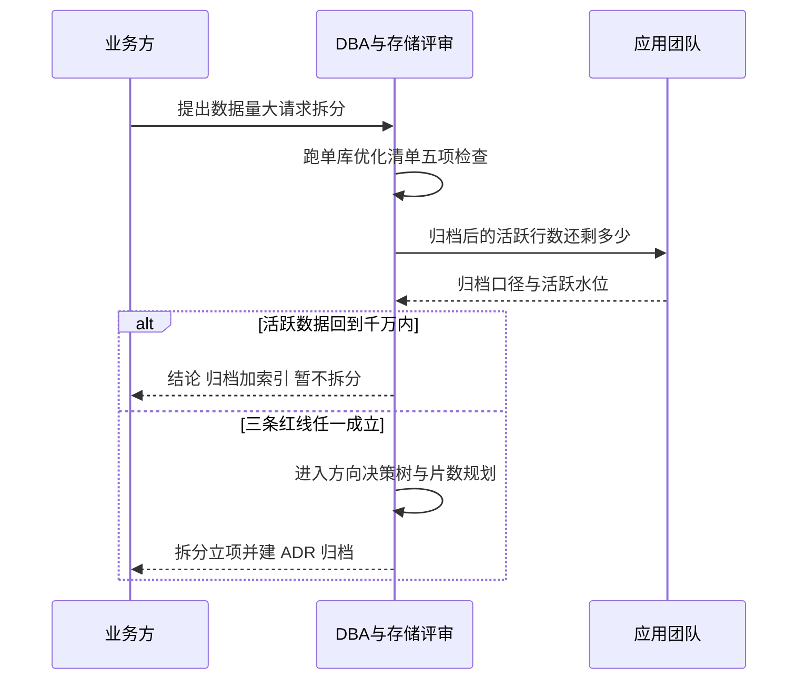
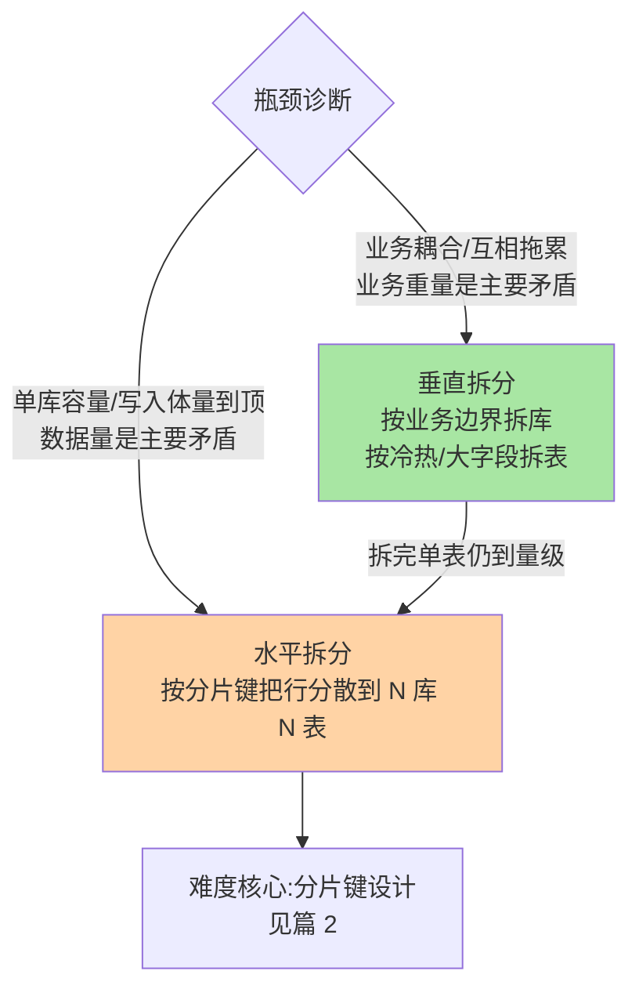
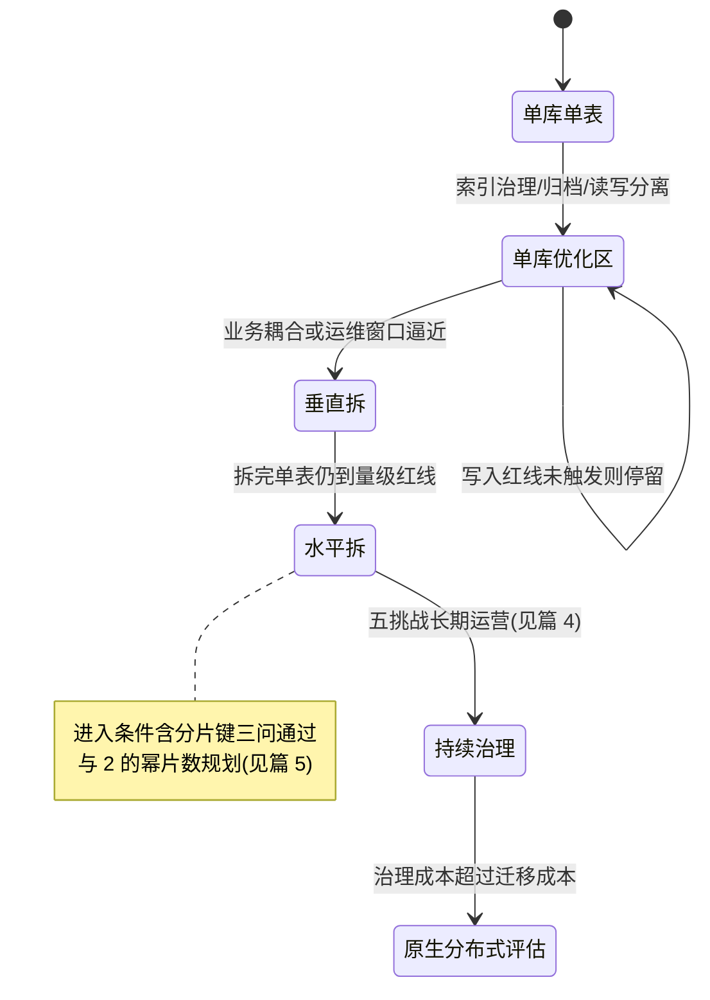
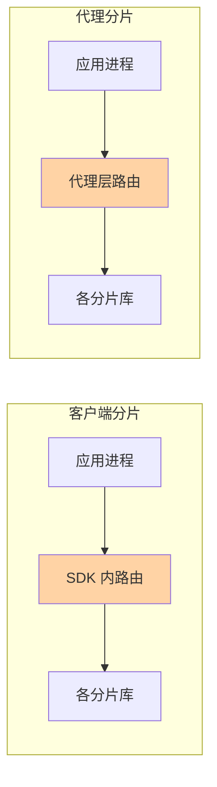

# 拆分方案选型：什么时候拆、往哪个方向拆

> 分库分表是「打破了才做」的手术：一旦拆开，跨片查询、分布式事务、运维复杂度全找上门。所以选型的第一问不是「怎么拆」，是「现在真的到了必须拆的量级吗」——这篇给出一套先诊断、再定方向、后选工具的完整决策链，并把「不同量级怎么想」的思考方式显式化。

## 一句话摘要

拆分决策三步走：**① 量级诊断**（先穷尽单库优化，到达量级红线才动手）；**② 方向选择**（垂直拆按业务边界与冷热分家，水平拆按行分散容量与写入压力）；**③ 工具选型**（客户端分片 SDK 与代理层两条路线）。**垂直拆解决「业务的重量」，水平拆解决「数据的体量」**——绝大多数大表最终需要的是水平拆，而水平拆的一切难度都源自分片键（下篇主题）与拆完之后的长跑（篇 4）。

## 🎯 本文核心

**核心一句话：拆分是单向门决策——先诊断量级（单库手段穷尽 + 红线触发），再定方向（垂直治业务重量、水平治数据体量），最后选工具（SDK vs 代理按团队形态）；为想象中的量级预支复杂度，是存储设计里最贵的乐观。**

决策链：单库优化清单（拆前必做）→ 量级红线（亿级/写瓶颈/运维窗口）→ 方向决策树（垂直 → 水平的经典路径）→ 中间件双路线取舍 → 「为拆而拆」事故的沉淀。本篇管「要不要拆、往哪拆」；键怎么选在篇 2，数据怎么搬在篇 3 与篇 6 的不停机 SOP，扩容的数学在篇 5，事故全景在篇 7。全文一句话可重构：「先证明必须拆，再决定怎么拆——顺序反了就是为拆而拆」。

## 前置阅读与相邻篇目

- 入门层篇 14《分库分表与扩展》：拆分的基本概念
- 本目录篇 2《分片键设计》：水平拆定方向后的第一个技术决策
- 本目录篇 5/6/7：拆完之后的扩容数学、迁移 SOP 与事故清单——本篇选型时要为它们预留设计空间

## 目标导向

本文是什么：拆分时机诊断、方向选择、中间件选型的决策方法论。功能是什么：给「要不要拆、怎么拆」一个可评审的决策过程。能得到什么：量级红线的判断维度、垂直/水平决策树、两类中间件架构的取舍表、参数级配置与执行手册。为什么用：容量规划评审、大表治理专项、新业务存储选型，必看。

## 一、量级诊断：先确认真的需要拆

拆分是代价最高的存储决策，动刀前把单库手段用尽：

```text
单库优化清单（拆分前必须做完）：
□ 索引治理完成（冗余清理 + 覆盖索引，见索引优化深度）
□ 冷热分离：历史数据归档到冷表/冷库，热表只剩活跃数据
□ 大字段外移：TEXT/JSON 拆到附表，主表行宽收敛
□ 读写分离承接读压力（复制链路治理见主从深度）
□ 写入削峰：批量异步化、热点行拆桶

量级红线参考（行业认知口径，按硬件实测）：
· 单表行数进入亿级、B+ 树高度 4 层成常态
· 单实例写入持续逼近硬件瓶颈、垂直扩容（更大规格）不再经济
· 单库容量逼近备份/DDL/复制的时间窗口上限
```

### 红线信号的追问链：为什么红线定在这里

- **质疑**：单表行数红线为什么是亿级而不是千万级？千万行的表难道没有拆的价值？
- **追问**：红线的底层机制是 B+ 树高度。InnoDB 16KB 页下，3 层 B+ 树约承载 2000 万行量级（业内认知口径，随行宽浮动）——3 层意味着一次主键查找 3 次页访问，且整棵树可以被缓冲池缓存；4 层之后根到叶路径变长、缓冲命中率下降，性能拐点出现。所以红线本质不是行数，是「树还能不能整体装进内存」。
- **再追问**：那把内存加到更大规格，4 层树不也装得下？为什么要动架构？
- **打破砂锅**：装得下树，装不下写。亿级红线的另一半在写入路径——redo log 刷盘节奏、主从复制回放、DDL 与备份的锁窗口，都不随内存扩大而改善。容量红线可以用钱买，写入红线与运维窗口红线买不到：三条红线**任一触发**才构成拆分的充分条件，只有行数到亿而写入空闲的表，归档后往往能退回舒适区。

### 诊断的时序：评审会前后的动作顺序



诊断的机制要点：归档改变的是「存量基数」，索引改变的是「读路径成本」，两者都不提高「写入吞吐上限」——这正是写入红线无法被单库手段消解的原因。**跳级拆分是过度设计**：千万行的表拆成 32 片，换来的是跨片查询、分布式 ID、双倍运维，收益却接近零。

## 二、方向选择：垂直与水平解决两种病



### 垂直拆的两层动作

- **垂直拆库**：订单、商品、用户各归各库——解决业务耦合（一个业务拖垮连接池、互相抢锁），顺带把总容量分摊。它几乎零风险，业务边界清晰的中大型系统第一步都该做垂直拆
- **垂直拆表**：宽表按访问频率分家（热字段主表、冷字段附表）、大字段外移——行宽下降让每页装更多行，缓存命中率上升

### 水平拆的唯一性与代价

水平拆表/库：同一张表按分片键把行散到多库多表——唯一能同时解决「容量」与「写入」的方案，代价是查询路由与跨片事务。两者组合是常态：**先垂直解耦、后水平扩容**是业内演进的经典路径，每一级只解决上一级解决不了的瓶颈：



### 为什么不选：三个常见替代方案

- **为什么不选「跳过垂直直接水平」**：水平拆把查询路由、分布式 ID、跨片事务一次性引入，如果业务耦合还没解开，同一个业务的数据散落后连「归拢到同片」的优化空间都没有（分片键难以覆盖强关联业务）。垂直拆是低风险的前置手术，它不解决体量，但让水平拆的分片键有业务边界可依。
- **为什么不选「更大规格的单机」**：垂直扩容（scale up）短期有效且零改造，但成本非线性上涨，且写入红线与运维窗口红线不随规格消失——它是「买时间」不是「解问题」。
- **为什么不选「新建系统直接上原生分布式数据库」**：分布式数据库把分片复杂度下沉到存储层，方向本身成立；但它是订阅费换自建复杂度的经济学决策——存量系统迁移成本、团队认知成本、价格曲线都要算。它出现在演进路线的末端（篇 4 的路线图），不是拆分决策的起点。

## 三、中间件选型：客户端 SDK vs 代理层

两条路线的**机制**差异在「路由发生在哪一层」：SDK 在应用进程内解析 SQL 并路由，代理在独立进程拦截转发——原理不同，架构形态与取舍随之：



| 维度 | 客户端分片（如 ShardingSphere-JDBC） | 代理层分片（如 ShardingSphere-Proxy） |
|---|---|---|
| 架构位置 | SDK 嵌入应用进程 | 独立代理进程，应用连代理 |
| 性能 | 少一跳网络，延迟低 | 多一跳转发 |
| 语言生态 | 绑定语言（Java 为主） | 语言无关，异构系统友好 |
| 运维 | 无独立组件 | 代理集群的部署/扩容/监控 |
| 升级 | 随应用发版，灰度慢 | 代理独立升级，全局快 |
| 复杂查询支持 | 应用侧解析 | 代理侧统一，管控强 |
| 故障域 | 随应用进程，无新增单点 | 代理集群自身是新增故障域 |

**取舍口诀**：技术栈统一、追求极致延迟 → 客户端；异构技术栈、重管控运维 → 代理；两者同源（ShardingSphere 双形态并存）时可**按团队形态混用**。自研分片中间件在业内已是「历史遗产」多于「新建选项」——生态成熟度是选型的压倒性权重。

### 为什么不选自研分片中间件

自研的隐性账单：SQL 方言解析、归并排序、路由元数据管理、跨版本兼容——每一项都是 ShardingSphere/Vitess 用十年社区迭代磨平的坑。自研真正的适用面只剩「分片语义极简 + 安全管控特殊」的少数场景，而它的维护成本在核心成员离职后指数上升。这不是技术自卑，是复杂度承接方的算术：**能买到的通用复杂度不自己养**。

### 团队形态两问

- 应用团队有没有能力承接分片心智（路由规则评审、不带键查询治理）？→ 有则 SDK 可行
- 有没有中间件团队承接代理运维（代理高可用、扩容、监控）？→ 有则 Proxy 可行
- 两个都没有，就是时机未到——先做归档与垂直拆，把水平拆的决策留给有承接方的那个季度

## 四、不同量级的思考：量级演进驱动解法

- **十万级（单库舒适区）**：约束来自 B+ 树 3 层结构与缓冲池的友好区间——这一档的核心问题是「怎么让索引与缓冲池命中更多」，而不是「数据放哪里」。思考方式：索引驱动——覆盖索引与冷热分离就能把 P99 稳在毫秒级，任何拆分动作都是负收益。
- **百万级（单库优化区）**：约束来自行宽与页分裂带来的写放大——这一档的核心问题是「写路径还有多少压缩空间」，而不是「要不要上分片」。思考方式：写入驱动——批量合并、热点行拆桶、读写分离，把写瓶颈往后推一个量级。
- **千万级（优化与拆分的分界区）**：约束来自 DDL、备份与复制窗口随数据量线性膨胀——这一档的核心问题是「单实例的运维窗口还撑不撑得住」，而不是「分多少片最优雅」。思考方式：窗口驱动——归档把活跃行数压回百万档；归档压不动的才进拆分评审，且第一次拆就按 2 的幂定片数（翻倍扩容只搬一半的数学前提见篇 5）。
- **亿级（拆分必然区）**：约束来自单实例容量与写入吞吐的物理上限——这一档的核心问题是「拆分引入的每一份复杂度由谁承接」，而不是「还要不要拆」。思考方式：架构驱动——分片键、逻辑槽、迁移 SOP、平台化运维必须作为整体方案立项，单项上线等于埋雷（承接方清单见篇 4 的五挑战）。

**自下而上与触发升级**：这一阶梯不是规划出来的，是被瓶颈顶出来的——每一档的解法都在上一档的延长线上失效：索引收益随数据量摊薄，归档只压存量不提高写入上限，垂直拆完单表仍会到亿级。触发升级的信号永远是「当前手段的边际收益归零」，而不是「隔壁团队拆了」。跳级（十万级直接水平拆）为想象量级预支复杂度，恋级（亿级还靠加索引）把手术拖成慢性病——两个方向都是失衡。

## 五、参数级配置清单：拆分方案的关键参数

| 配置项 | 默认值 | 分档推荐 | 为什么 |
|---|---|---|---|
| 逻辑分片数 | 无默认，自定 | 千万级 256 起 / 亿级 1024 起，恒取 2 的幂 | 2 的幂让翻倍扩容只迁一半（篇 5 的数学），1024 槽把扩容降级为映射调整 |
| 路由算法 | 行表达式/取模 | hash 取模 + 偶数倍扩容路线 | 均匀分布 + 扩容确定性；裸 `key % N` 在键值分布不均时放大倾斜 |
| 单片舒适行数 | 无官方值 | 按行宽实测，业内认知 500 万-1000 万行/片 | 对齐 3 层 B+ 树缓冲友好区，给翻倍扩容留一档余量 |
| `sql-show`（ShardingSphere 5.x，公开口径） | `false` | 灰度期 `true`，稳定后回 `false` | 核对实际路由分片；生产常开有日志量与敏感信息代价 |
| `allow-range-query-with-inline-sharding`（公开口径） | `false` | 保持 `false` | 范围查询走 inline 路由 = 隐性全片广播，显式拒绝逼设计方走异构库 |
| `max-connections-size-per-query`（公开口径） | `1` | 归并查询确认后再调大 | 每次归并占用连接数，盲目调大耗尽连接池 |
| 绑定表配置 | 空 | 订单/订单子表显式绑定 | 避免关联查询路由成笛卡尔积广播 |

> 数字口径：`sql-show` 等中间件参数默认值以 ShardingSphere 官方文档为准（公开口径）；行数红线与单片舒适区为行业认知口径，决策按硬件与行宽实测校准。

## 六、步骤级操作：从诊断到落地的执行手册

### Step 1 量级诊断

- 前置条件：拿到目标表的行数、行宽、增长曲线、读写比、备份/DDL 窗口耗时
- 操作：跑「单库优化清单」五项，输出归档后的活跃行数与三条红线的命中情况
- 验证：五项清单每项有结论（已做/不适用/做了之后水位多少）；三条红线命中任一才继续
- 回退：红线未命中 → 出「归档 + 索引」治理工单，拆分流程终止

### Step 2 方向决策

- 前置条件：Step 1 通过；业务边界图（哪些域互相拖累）在手
- 操作：按决策树先垂直后水平；确定分片键候选（移交篇 2 评审）
- 验证：决策树每个分支有归因记录；垂直拆的域边界有业务方签字
- 回退：垂直拆阶段本身可独立交付；水平拆决策若分片键三问无解 → 回到归档与读写分离方案

### Step 3 片数与中间件

- 前置条件：分片键候选通过三问评审；团队形态两问有答案
- 操作：按「当前量级 × 增长 ÷ 单片舒适容量」取 2 的幂；按团队形态选 SDK/Proxy；定逻辑槽映射方案
- 验证：片数计算过程可复算；扩容推演（2 倍与 4 倍）有书面结论
- 回退：片数与中间件决策写入 ADR 后才允许进入迁移；未归档前任何片数承诺无效

### Step 4 评审与 ADR 归档

- 前置条件：Step 1-3 全部有书面产出
- 操作：评审会过四要素——量级假设、分片键理由、片数与映射方案、再平衡预案（指向篇 6 的迁移与篇 7 的事故预案）
- 验证：ADR 入库，链接进团队决策索引
- 回退：评审否决 → 回 Step 1 重新诊断，禁止带病进入迁移阶段

## 七、事故推演：两次「拆错了顺序」的复盘

**事故一：为想象量级预支 64 片。** 某系统核心表 3000 万行，团队提前规划「亿级未来」，按用户 ID 拆了 64 片。一年后线上暴露的问题：运营后台按时间维度拉报表全片广播聚合；分布式 ID 接入改造；分片扩容（64→128）的再平衡方案论证了一个季度没落地。排查归因发现：这张表在做好归档与索引后，真实活跃数据从未超过 4000 万行——拆分决策时的量级假设从未被验证。复盘沉淀：**拆分红利按「当前量级」兑现，拆分成本按「片数」计**。

**事故二：归档没做就上手术台。** 另一团队在诊断阶段跳过归档清单，直接对一张 2 亿行的流水表做水平拆。迁移中途发现存量回灌极慢，排查发现大半是三年前的冷数据——如果先归档，需要搬迁的存量不到 6000 万行（业内常见比例，个案口径）。复盘结论写进了团队的拆分评审 checklist：**归档是拆分的前置手术，评审先过「归档关」**——把归档后的活跃行数算给评审会看，多数「到量级」的表归档后回到舒适区。

三条沉淀：

1. **量级假设必须被验证而不是被想象**：ADR 里的量级假设要附增长曲线与归档口径，一年后评估「拆错了没」才有依据
2. **片数设计要留「逻辑层」**：固定大逻辑片数（512/1024）映射到可变物理实例，把「扩容」变成「映射调整」——这条路在选型时就该定，别等分完再论证（翻倍扩容的位级机制见篇 5）
3. **拆分决策要写 ADR**：量级假设、片数理由、再平衡方案一并归档；事故模式的完整清单见篇 7

## 八、与相邻篇目的边界

- 篇 2《分片键设计》：本篇定「往哪个方向拆」，键怎么选是水平拆后的第一决策，两篇合起来才是完整方案
- 篇 3/篇 6：本篇的 Step 3 片数决策完成后，数据怎么搬是迁移 SOP 的事——七阶段决策口径在篇 3，六阶段工程 SOP 与回退路径在篇 6
- 篇 5：片数恒取 2 的幂的数学理由（32 到 64 只搬一半）在篇 5，本篇只引用结论
- 篇 7：拆分与迁移的十八种翻车姿势在篇 7，本篇事故推演只保留选型语境的两例
- 篇 4：拆完之后的五挑战（跨片查询/分布式事务/扩容/键索引语义/运维）在篇 4 收束

> 💡 **实战提示**
> - 💡 拆分评审先过「归档关」：把历史数据归档后的活跃行数算给评审会看——多数「到量级」的表归档后回到舒适区，归档永远是拆分的前置手术
> - 💡 第一次做水平拆就定逻辑分片映射（1024 逻辑槽起步）：它把未来的「扩容」从数据迁移降级为映射调整，事后补设计等于二次拆分
> - 💡 中间件选型做「团队形态两问」：应用团队能不能承接分片心智（→ SDK）？有没有中间件团队承接代理运维（→ Proxy）？两个都没有就是时机未到
> - 💡 拆分 ADR 四要素：量级假设、分片键理由、片数与映射方案、再平衡预案——一年后评估决策质量全靠它
> - 💡 片数恒取 2 的幂并写成硬规范：它让扩容永远有「只搬一半」的数学捷径可走（篇 5），非 2 的幂片数会把这个捷径永久锁死

## 你们可能会问

**Q1：分库和分表必须一起做吗？**
不必。只分表解决单表 B+ 树体量，但实例容量与写入仍集中；只分库解决容量写入但单表仍大。**先分表（同库内）验证分片键设计，再演进到分库**是风险更低的渐进路径——库内分表已经能暴露路由与跨片查询的全部问题，且故障半径小。

**Q2：分片数怎么定？**
「当前量级 × 预期增长 ÷ 单片舒适容量」向上取整到 2 的幂，再配逻辑分片映射留余量。舒适容量业内口径单表千万级内——按行宽与硬件实测校准，不背通用数字。为什么强调 2 的幂：翻倍扩容时只有一半数据需要迁移且去向可预计算（篇 5 的位级证明），非 2 的幂扩容退化为全量重分布。

**Q3：拆分后还能回退吗？**
物理上可以反向合并（数据搬回），但业务上几乎不可逆——应用已依赖分片路由语义。**把拆分当单向门决策，门前的量级诊断就要更认真**。真正可回退的是「决策过程」：ADR 归档让一年后的复盘有据可查，而不是靠记忆吵架。

**Q4：云厂商的分布式数据库要不要直接用？**
新建系统优先评估托管分片能力（PolarDB-X 类、Vitess 类托管），它把路由、扩容再平衡产品化；存量系统是「自管分片的延续成本 vs 迁移订阅费」的经济学题。判断信号见篇 4 的 Q3：治理成本超过迁移成本时切换。

## 自测三问

1. 拆分前必须做完的单库优化清单有哪些？为什么归档排第一？
2. 垂直拆与水平拆各解决什么病？为什么不选跳过垂直直接水平？
3. 客户端与代理两条路线的取舍口诀是什么？片数为什么恒取 2 的幂？

## 5W 速记卡

| 维度 | 一句话 |
|---|---|
| What（是什么） | 拆分选型 = 量级诊断 + 方向决策树 + 中间件双路线的三段决策链 |
| Why（为什么） | 拆分是单向门且代价最高——先证明必须拆，再决定怎么拆 |
| When（什么时候用） | 三条红线（亿级树高/写瓶颈/运维窗口）任一触发；什么时候不用：单库清单没做完之前 |
| Who（谁承接） | 诊断归 DBA 与存储评审，分片心智归应用团队（SDK）或中间件团队（Proxy） |
| How（怎么做） | 归档关 → 红线确认 → 垂直先行 → 2 的幂片数 + 逻辑槽 → ADR 归档 |

## 开放问题

- 分布式数据库（原生分片 + 分布式事务）与「MySQL + 分片中间件」两条路线的竞争持续——业务无感分片一旦成熟到价格可接受，自建分片的工程价值将系统性重估。
- Serverless 形态的「按需自动分片」已有云厂商试点，容量规划这门手艺的半自动化程度在快速上升。

## 🎯 核心带走

- **核心一句话**：拆分 = 单向门决策——量级诊断先行（穷尽单库手段），垂直治业务重量、水平治数据体量，工具按团队形态选；逻辑分片映射与 2 的幂片数在第一次拆分时就定
- **决策链**：优化清单 → 量级红线 → 方向树 → SDK/Proxy 取舍 → ADR 归档
- **哪里会坏**：为想象量级预支 64 片、归档没做就上手术台、扩容方案临时论证、非 2 的幂片数锁死扩容捷径
- **边界**：本篇管「要不要拆、往哪拆」；键在篇 2，ID 与迁移在篇 3/篇 6，扩容数学在篇 5，事故全景在篇 7，拆完之后的五挑战在篇 4

## 📌 数据与事实声明

- 写于 2026-09-25（2026-09-08 初版，本次按专题层全标准重写），工具口径以 ShardingSphere 5.x 与主流云分布式数据库公开文档为准
- 量级红线（亿级/4 层树/千万舒适区）与单片舒适行数为行业认知口径，决策需按硬件与行宽实测校准；中间件参数默认值标注为公开口径
- 事故推演为高频案例模式的匿名化复述，不含真实公司与内部信息
- 免责：产品能力以各官方文档为准

## 📚 参考资料

| 类型 | 标题 | 来源 |
|---|---|---|
| 开源项目 | Apache ShardingSphere（JDBC/Proxy 双形态） | shardingsphere.apache.org |
| 开源项目 | Vitess（CNCF，分片中间件） | vitess.io |
| 实战书 | 《高性能 MySQL（第 4 版）》规模化章 | 公开出版 |
| 系列内互指 | 篇 5 扩容数学 / 篇 6 迁移 SOP / 篇 7 事故清单 / 篇 4 五挑战 | 本目录 |
| 社区沉淀 | 各大厂公开的分库分表演进文章 | 技术社区公开文章 |
