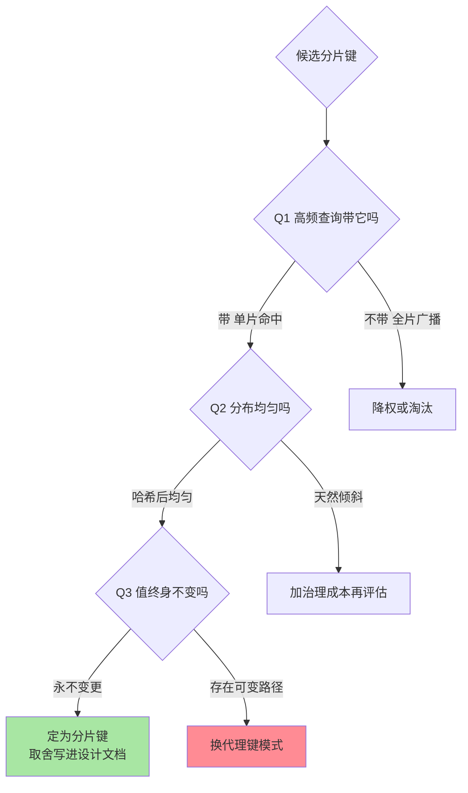
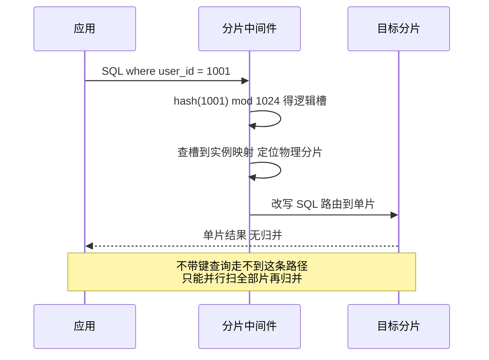
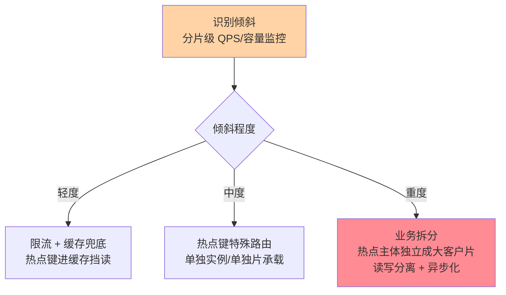
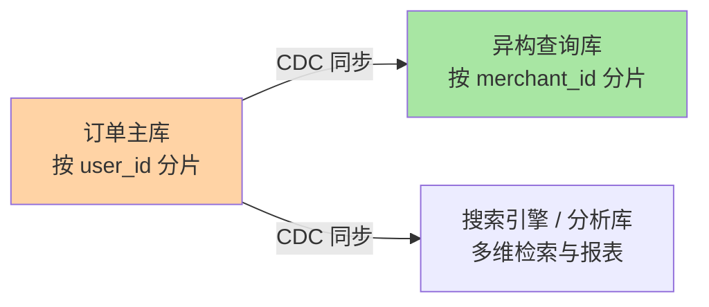

# 分片键设计：数据分布与查询路由的总开关

> 分片键一旦选定就几乎不可更改——它同时决定数据落在哪、查询走哪片、热点如何分布。这篇讲透选键三原则、三种路由算法的取舍、倾斜治理与跨片查询的分层解法，把「最重要的存储设计决策」变成可评审、可验证、可回退的流程。

## 一句话摘要

分片键设计的铁律是**三问定键**：① 高频查询带不带它（带 = 路由到单片，不带 = 全片广播）；② 分布均不均匀（哈希后各片数据量与流量是否均衡）；③ 值稳不稳定（键值永不变更，变更 = 数据搬家）。**没有完美分片键，只有「为最高频查询维度牺牲其他维度」的取舍**——跨维度查询靠异构索引补齐，这是分片设计的终极平衡术。

## 🎯 本文核心

**核心一句话：分片键同时决定「数据落在哪、查询走哪片、热点如何分布」——三问定键（高频带键？分布均匀？值终身不变），选不出完美键就为最高频维度牺牲其余，跨维度靠异构索引补；键选错 = 全系统为它陪葬。**

决策链：三问定键（订单表三候选实测推演）→ 三种路由算法取舍 → 倾斜治理三层（限流/特殊路由/业务拆分）→ 跨维度三层解法（避免/异构/溢出）→ 「换键搬家」事故的沉淀。键的选取还反过来约束片数规划（恒取 2 的幂，翻倍扩容只搬一半的数学见篇 5）与迁移流程（换键搬家走篇 6 的 SOP）。全文一句话可重构：「键是分片体系的宪法，设计时把取舍写进文档，运行时靠异构与治理补维度」。

## 前置阅读与相邻篇目

- 本目录篇 1《拆分方案选型》：水平拆的决策语境与片数规划
- 入门层篇 5：索引的最左前缀——分片键与索引键在思维上同构（都是「检索路径的第一段」）
- 本目录篇 6/7：换键搬家的执行 SOP 与事故清单

## 目标导向

本文是什么：分片键选型、路由算法、倾斜与跨片查询的完整方法论。功能是什么：给「键选谁、怎么路由、歪了怎么办、别的维度怎么查」一套答案。能得到什么：三问定键法、哈希/范围/查找表三种路由的取舍表、异构索引的分层解法、参数级配置与评审 SOP。为什么用：分片方案评审、热点问题归因、跨片查询优化，必看。

## 一、三问定键：把取舍摆在桌面上



以订单表为例走一遍三问：

```text
候选分片键：user_id / order_id / create_time

Q1 高频查询带它吗？
  · C 端「我的订单」按 user_id 查 → user_id 得分最高
  · 风控按 order_id 单号查 → order_id 得分高但频率低一档
  · 运营按时间拉报表 → 谁当键它都是广播

Q2 分布均匀吗？
  · user_id 哈希：大商户与小用户各占一用户 → 大 V 用户下单量
    是均值百倍 → 流量倾斜（数据量均匀、流量不均匀）
  · order_id 哈希：天然均匀
  · create_time 范围：当前月片滚烫、历史片冷 → 时间倾斜

Q3 值会变吗？
  · user_id：订单归属永不变 → 合格
  · 手机号当键：换号即搬家 → 不合格
```

结论（业内最常见的落点）：**C 端主导的订单表用 user_id 哈希**——用「运营按时间查变成广播」换取「最高频的 C 端查询路由到单片」。这个取舍要写进设计文档，让所有后来者知道「为什么我的查询是广播」。

### 定键的追问链：user_id 为什么赢过 order_id

- **质疑**：order_id 哈希分布更均匀、和路由天然绑定，为什么不选 order_id 当分片键？
- **追问**：看查询分布而非理论均匀度。C 端「我的订单」是系统 QPS 最高的读路径——键选 order_id 意味着最高频查询变成全片广播；键选 user_id 则让它单片命中。分布均匀性可以用哈希函数保证 user_id 也做到（数据量层面），真正牺牲的只是「同一用户的订单集中在一片」这个无关紧要的属性。
- **再追问**：同一用户的订单集中一片，不会造成这个用户的数据热点吗？
- **打破砂锅**：会，但那是「流量倾斜」问题（第三节治理），不是「路由算法」问题——把键换成 order_id 并不能让大 V 的下单压力消失，只是把它摊给所有片、同时毁掉 C 端查询路径。**选键的底层原理是：路由算法解决分布，键的语义决定查询路径，两者不能互相替代**。

## 二、三种路由算法：一张取舍表

| 算法 | 路由规则 | 优势 | 代价 |
|---|---|---|---|
| 哈希取模 / 一致性哈希 | hash(key) → 片 | 分布均匀、路由简单 | 扩容再平衡复杂（一致性哈希缓解） |
| 范围分片 | 按键区间切 | 范围查询友好、易理解 | 天然热点（最新区间最热） |
| 查找表（映射服务） | 键 → 片的显式映射 | 灵活、可定向迁移 | 多一次查找 + 映射服务可靠性 |

业内主流是**哈希族**：`hash(user_id) % 逻辑片数`，配合「大逻辑片数 + 映射到物理实例」（篇 1 的结论）让扩容变成映射调整——并且片数恒取 2 的幂，让翻倍扩容时每行去向可预计算、只迁一半（位级机制见篇 5）。路由算法的演进主线是「扩容成本递减」：裸取模全量再平衡 → 一致性哈希部分迁移 → 查找表只改映射。范围分片留给「时间序列 + 冷热分明」的表（日志、账单归档），热点用「最新片拆更细」或「历史自动降温」对冲。

### 一次带键查询的路由路径



### 为什么不选：三个路由反方案

- **为什么不选组合键（user_id + time）**：组合键只能优化「两维同时给定」的查询（哈希后仍单一落点），单维查询照样广播——它不解决维度冲突，只收窄特定场景，还让路由表达复杂化。维度冲突的通用解仍是异构索引。
- **为什么不选 create_time 范围分片承载订单**：最新区间滚烫是范围分片的机制性热点——写入永远打在当前片，扩的是「历史容量」不是「写入能力」。时间维度只在「写完即冷」的日志/账单表上是好键。
- **为什么不选查找表做主路由**：每次路由多一次查找（哪怕有缓存），映射服务自身成为可用性关键路径。业内把它用于「定向迁移与大客户隔离」的控制面，数据面主路由仍用计算型哈希。

## 三、倾斜治理：数据均匀 ≠ 流量均匀

哈希解决了数据量均匀，**流量倾斜**仍会来：头部主播的店铺、爆款商品、大客户的账号——单片流量可以是均值百倍（行业认知口径）。分层治理：



关键认知：**倾斜是业务形态的投影，不是技术缺陷**——治理上限由业务决定（大促头部商品就是全民访问），技术能做的是「识别早、隔离好、降级稳」。与限流系列的「热点参数限流」互为上下游：接入层挡读流量，存储层做物理隔离。

### 一次大促热点片的排查复盘

某次大促预热，监控告警单片 QPS 是均值的 80 倍。排查路径：先看分片级报表定位到单个物理实例 → 再按热点键统计定位到一个爆款商品 → 复盘结论是「商品表用 merchant_id 哈希，数据均匀但该商户流量是均值百倍」。治理动作走了中度层：该商户定向路由到独立实例 + 店铺页读走缓存。复盘写进规范：**倾斜监控必须出「片级报表」，片级可见才谈得上片级治理**——全局平均 QPS 在这场事故里是纯粹的噪音。

## 四、跨维度查询：异构索引是终极答案

用 user_id 分片后，「商家查订单」「风控按单号查」「运营按时间拉报表」全是跨片广播。解法分层：

```text
第一层：能避免就避免
  · 低频后台查询 → 并行扫所有片聚合（接受秒级延迟，不优化）
第二层：异构一份「按另一维分片」的索引库
  · 订单按 user_id 分片（主库）→ 同步一份到「按 merchant_id 分片」
    的查询库（商家侧查询走它）→ 数据由 binlog/CDC 同步
第三层：复杂检索溢出到专用引擎
  · 多维筛选/全文 → 同步进 Elasticsearch（互指本仓库 ES 系列）
    /宽表进 ClickHouse 类分析库（运营报表）
```



**Trade-off 核心**：主库分片键只为最高频维度服务，其余维度用「异构副本 + 最终一致」换——一致性代价（同步延迟秒级）与维护代价（多一套同步链路）是显式付出的。业内成熟系统几乎都是「主库 + N 个异构查询库」的组合形态，单一组件服务所有维度是不存在的理想。异构链路的可靠性即「跨维度查询的正确性」，它的延迟阈值与校验方式见下方参数表与篇 7 的事故清单。

## 五、不同量级的思考：量级演进驱动解法

- **十万级（无分片键概念）**：约束来自单表索引即可覆盖全部查询维度——这一档的核心问题是「索引顺序怎么对齐查询」，而不是「数据按哪个维度切」。思考方式：索引驱动——最左前缀就是你的「分片键」，代价远低于真分片。
- **百万级（分片键提前设计期）**：约束来自表虽未拆但查询形态已定型——这一档的核心问题是「哪个维度会成为未来的高频路径」，而不是「现在拆多大」。思考方式：查询画像驱动——按访问日志统计维度频率，为将来分片预演三问，避免拆时才发现无键可选。
- **千万级（键与片数联定期）**：约束来自归档后仍单表偏大、水平拆进入视野——这一档的核心问题是「键的取舍如何写进文档并约束所有新查询」，而不是「哈希函数选哪个」。思考方式：治理驱动——SQL 评审立「带键第一问」，广播查询白名单机制先于拆分上线。
- **亿级（异构体系常态期）**：约束来自多维度查询与主库路由的矛盾全面显性化——这一档的核心问题是「异构链路的延迟与一致性怎么度量、坏了怎么发现」，而不是「再加一个从库行不行」。思考方式：架构驱动——主库 + N 异构库的组合形态、片级监控报表、CDC 延迟告警作为整体立项。

**自下而上与触发升级**：键的设计常被误解为「拆的时候才想」——实际上查询形态在百万级就定型了，分片键只是把既成事实显式化；每一档的动作都依赖上一档留下的查询画像与评审纪律。触发升级的信号是「跨维度查询进慢查 Top」与「单片流量偏离一个量级」，而不是行数本身。

## 六、参数级配置清单：分片键相关的关键参数

| 配置项 | 默认值 | 分档推荐 | 为什么 |
|---|---|---|---|
| 逻辑槽数（取模因子） | 自定 | 恒取 2 的幂，1024 槽起步 | 翻倍扩容只迁一半且去向可预计算（篇 5），非 2 的幂锁死捷径 |
| 哈希函数 | 取模/行表达式 | `hash()` 族而非裸 `key % N` | 键值分布不均时裸取模放大倾斜 |
| `allow-range-query-with-inline-sharding`（公开口径） | `false` | 保持 `false` | 范围条件走 inline 路由 = 隐性广播，显式拒绝逼设计走异构库 |
| 分片键索引 | 无 | 分片键列必须建索引 | 路由到单片后仍是普通查询，无索引退化为片内全扫 |
| 一致性哈希虚拟节点数 | 依实现 | 每物理节点 100-200（业内认知） | 抑制节点数少时的分布抖动；不解决流量倾斜 |
| CDC 同步延迟告警阈值 | 依平台 | 秒级（如 5s，业内认知口径） | 异构索引的一致性上界；超阈 = 跨维度查询结果过期 |
| 热点键限流阈值 | 无 | 按压测单片容量定，接热点参数限流 | 倾斜治理第一层的自动挡；阈值过高等于没有 |

> 数字口径：中间件参数默认值以 ShardingSphere 官方文档为准（公开口径）；虚拟节点数、CDC 阈值为行业认知口径，按业务压测校准。

## 七、步骤级操作：分片键评审 SOP

### Step 1 候选收集

- 前置条件：近 30 天查询日志的维度频率统计、业务演进路线图（有没有换绑/合并/过户类需求）
- 操作：列出全部候选键，逐一过三问（高频带键？分布均匀？值终身不变？）
- 验证：每个候选有一张三问评分卡，含查询占比数据
- 回退：全部候选 Q3 不合格 → 启用代理键模式（内部 ID 当键，可变标识降为二级索引）

### Step 2 取舍确认

- 前置条件：Step 1 产出生存候选 ≥1 个
- 操作：明确「为哪个维度牺牲哪些维度」，广播查询清单初稿（哪些查询会变广播、频率多少）
- 验证：取舍结论 + 广播清单写入设计文档并评审通过
- 回退：牺牲维度不可接受 → 回 Step 1 换候选或重新划分业务边界（篇 1 的垂直拆）

### Step 3 落地与验证

- 前置条件：键与片数（2 的幂）确定、中间件参数表定稿
- 操作：建表（分片键列 + 索引）、配置路由规则、灰度期开 `sql-show` 核对路由
- 验证：抽样 SQL 核对路由分片正确；广播查询白名单登记齐全；片级监控报表上线
- 回退：路由错片 → 灰度期回滚到旧表/单库；已全量则触发篇 6 的数据修复流程

### Step 4 运行期重审

- 前置条件：片级监控与慢查 Top 常态化运行
- 操作：三条重审信号任一出现即拉回评审——单片 QPS 与均值差一个量级、广播查询进慢查 Top、业务出现换绑/合并/过户需求
- 验证：重审结论（继续/治理/换键）有 ADR 记录
- 回退：确需换键 → 按篇 6 迁移 SOP 走「双写 + 回灌 + 校验 + 灰度」全流程，事故预案对齐篇 7

## 八、事故推演：一次「换键」引发的数据搬家事故

某系统早期用「手机号」做用户表分片键（业务注册即绑定）。一年后业务支持换绑手机号——**键值变更触发数据搬家**：迁移脚本跨片搬运 + 双写校验 + 应用层路由缓存刷新，牵动三周工程。期间一次缓存未刷新导致新号查不到、旧号查到他人数据的串号投诉，线上排查两天才定位到「路由缓存刷新漏了一个边缘服务」。复盘沉淀写进了选键规范。

三条沉淀：

1. **身份类键值必须「终身不变」**：选键时问「业务演进中有没有任何路径会改它」——换绑、合并、过户类业务是键值稳定性的天然杀手
2. **「代理键」模式是兜底**：业务标识可变的系统，用稳定的内部 ID（注册即生成、永不变更）当分片键，可变标识只做二级索引/异构库
3. **迁移类操作自带监控**：键值变更 = 小规模「搬家」，双写 + 校验 + 灰度的一整套迁移纪律（篇 3 的七阶段、篇 6 的六阶段 SOP）同样适用，翻车姿势的完整清单在篇 7

## 九、与相邻篇目的边界

- 篇 1：拆分方向与片数规划在此，本篇只承接「键怎么选」
- 篇 3：全局 ID 与分片键职责正交（ID 管唯一、键管路由），ID 机制在篇 3 与分布式 ID 系列
- 篇 5：片数恒取 2 的幂与翻倍扩容只迁一半的位级证明在篇 5，本篇只引用结论
- 篇 6：换键搬家、扩容迁移的执行 SOP 在篇 6，本篇只给触发条件
- 篇 7：广播查询、双写不一致等事故的完整清单在篇 7

> 💡 **实战提示**
> - 💡 分片键写进表设计文档的第一行：所有查询设计先对「分片键维度」对齐——业内把「带不带分片键」作为 SQL 评审第一问
> - 💡 不带键的查询走白名单：跨片查询显式登记（频率、超时、是否可走异构库），禁止匿名广播在生产横行
> - 💡 倾斜监控出「片级报表」：容量/QPS/慢查按分片维度，热点键进单独告警——片级可见才谈得上片级治理
> - 💡 代理键模式做兜底判断：业务标识只要存在「可变路径」（换绑/改名/过户），就用不可变内部 ID 当键，可变标识降级为二级索引
> - 💡 重审信号制度化：三条重审信号（流量偏离一个量级/广播进慢查 Top/换绑类需求出现）写进值班巡检项，不靠人肉记忆

## 你们可能会问

**Q1：能不能用组合键（user_id + time）兼顾两个维度？**
组合键只能优化「两维同时给定」的查询（哈希后仍单一落点），单维查询照样广播——它不解决维度冲突，只收窄特定场景。维度冲突的通用解仍是异构索引（第四节的分层解法）。

**Q2：一致性哈希解决了什么、没解决什么？**
解决「扩容时只迁移部分数据」；不解决流量倾斜（键值分布问题与路由算法无关）。把它当「扩容友好」技术而非「热点治理」技术——热点要靠第三节的倾斜治理三层。

**Q3：分片键和分表后每片的主键怎么共存？**
业内默认：片内主键 = 全局分布式 ID（篇 3 展开），分片键作为普通索引列存在——两者职责正交：ID 管唯一性，分片键管路由。别用「ID 哈希当路由」把两件事焊死，除非一开始就按 ID 分片且确定不改。

**Q4：查询既不带 user_id 也不带 order_id 怎么办？**
先问频率：低频后台 → 走并行广播 + 白名单；高频业务 → 说明查询画像漏了，回评审桌重议键或补异构库。最危险的是「高频且无键且没人登记」——它是慢查染名人堂的常驻选手（篇 7 事故清单的常客）。

## 自测三问

1. 三问定键是哪三问？订单表为什么业内默认选 user_id 而不是 order_id？
2. 数据量均匀为什么还会有倾斜？倾斜治理的三层动作是什么？
3. 跨维度查询的三层解法是什么？异构索引付出的一致性代价是什么？

## 5W 速记卡

| 维度 | 一句话 |
|---|---|
| What（是什么） | 分片键 = 数据分布 + 查询路由 + 热点分布的总开关，三问定键 |
| Why（为什么） | 键一旦选定几乎不可更改——选错 = 全系统陪葬，换键 = 数据搬家 |
| When（什么时候用/不用） | 水平拆立项即启动键评审；什么时候不用：单库优化没穷尽前不碰（篇 1） |
| Who（谁承接） | 存储评审定键，应用团队守「带键第一问」，监控平台出片级报表 |
| How（怎么做） | 三问评分卡 → 取舍写文档 → 2 的幂片数 + hash 路由 → 白名单与片级监控 → 重审信号制度化 |

## 开放问题

- 分布式数据库把「二级索引全局化」做成内核能力（索引表自动分布），应用侧「异构索引」的工程量有望被产品吸收——两条路线的成本分界在持续移动。
- 多租户 SaaS 的分片键常取 tenant_id，租户间体量悬殊（超大同租户）催生「租户级动态迁移」能力，调度式分片管理是活跃方向。

## 🎯 核心带走

- **核心一句话**：分片键 = 分布 + 路由 + 热点的总开关——三问定键，为最高频维度牺牲其余，跨维度靠异构索引；键值必须终身不变
- **决策链**：三问定键 → 路由算法取舍 → 倾斜三层治理 → 跨维度三层解法 → 换键事故教训
- **哪里会坏**：可变键值搬家、大 V 流量倾斜、匿名广播查询、裸取模放大倾斜、高频无键查询无人登记
- **边界**：本篇管「键怎么选」；拆分时机在篇 1，全局 ID 与迁移在篇 3/篇 6，扩容数学在篇 5，事故清单在篇 7，架构全景在篇 4

## 📌 数据与事实声明

- 写于 2026-09-25（2026-09-08 初版，本次按专题层全标准重写），机制口径以 ShardingSphere 5.x 文档与分布式数据库公开资料为准
- 「大 V 流量百倍倾斜」「虚拟节点 100-200」为行业认知口径；中间件参数默认值标注为公开口径
- 事故推演为高频案例模式的匿名化复述，不含真实公司与内部信息
- 免责：产品能力以各官方文档为准

## 📚 参考资料

| 类型 | 标题 | 来源 |
|---|---|---|
| 开源项目 | Apache ShardingSphere（分片/路由文档） | shardingsphere.apache.org |
| 关联系列 | 本仓库《深入理解 Elasticsearch 系列》（异构检索） | docs/data/elasticsearch/ |
| 实战书 | 《高性能 MySQL（第 4 版）》规模化章 | 公开出版 |
| 系列内互指 | 篇 5 扩容数学 / 篇 6 迁移 SOP / 篇 7 事故清单 / 篇 3 分布式 ID | 本目录 |
| 社区沉淀 | 各大厂公开的分片键设计实践 | 技术社区公开文章 |
