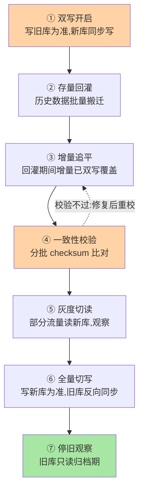
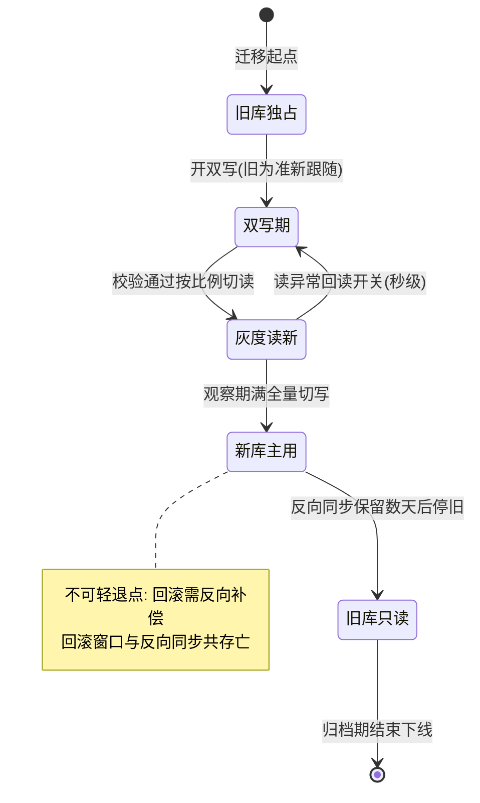
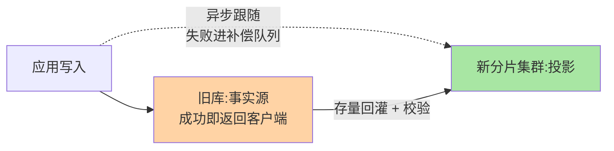
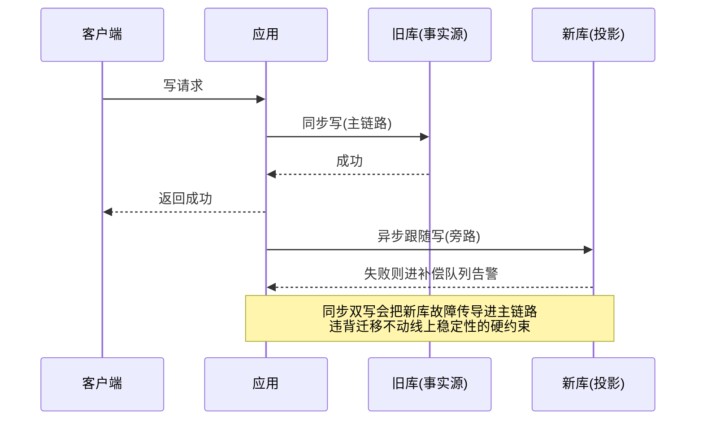

# 分布式 ID 衔接与平滑迁移：拆分的临门两脚

> 分片键定了、工具选好了，还差两脚临门：**主键换成全局唯一的分布式 ID**，以及**存量数据无痛搬到新分片**。前者是选型题（机制深挖互指分布式 ID 系列），后者是流程题——双写、回灌、校验、灰度切换，每一步都有翻车姿势。这篇把两脚都落地。

## 一句话摘要

分库分表后自增主键跨片必冲突，**分布式 ID 是入场券**——业内主流是「号段模式」（DB 批量发号，简单可靠）与「雪花模式」（时间戳 + 机器号，本地发号无依赖），选型互指本仓库分布式 ID 系列的正式定义篇。**存量迁移的工业标准是七阶段双写流程**：双写开启 → 存量回灌 → 增量追平 → 一致性校验 → 灰度切读 → 全量切写 → 停旧观察，每阶段有明确的进入/退出条件与回滚点——**迁移的本质是「把一次大切换拆成七次可回滚的小切换」**；工程执行的六阶段落地版与回退路径细节在篇 6，十八种翻车姿势在篇 7。

## 🎯 本文核心

**核心一句话：迁移 = 把一次不可逆的大切换拆成七次可回滚的小切换——旧库始终是事实源、新库是投影，直到校验过关才反转；跳过任何一阶段（尤其校验）等于拆掉它挡住的那类事故的防线。**

流程链：ID 入场券（号段/雪花 vs UUID 出局）→ 七阶段与各自的回滚点 → 双写三细节（以谁为准/写次序/ID 映射表）→ 校验三件套（行数/内容/业务抽样）→ 切写不可轻退点 → 跳过校验的事故剧本。全文一句话可重构：「阶段不可压缩，窗口可以前置；成功率不等于一致性」。

## 前置阅读与相邻篇目

- 本目录篇 1/2：拆分决策与分片键——迁移的目标形态
- 关联正式定义篇：`architecture/system-design/distributed-id` 系列（ID 机制深挖在那边，本文只做分片语境的选型衔接）
- 本目录篇 5：扩容型迁移（32 到 64 只搬一半）与本篇重构型迁移的边界
- 本目录篇 6/7：六阶段工程 SOP 与事故清单

## 目标导向

本文是什么：分片语境下的 ID 选型衔接 + 存量数据迁移全流程。功能是什么：给「ID 怎么换、数据怎么搬、出了问题怎么回」一套可执行方案。能得到什么：两类 ID 的分片适配要点、七阶段迁移 SOP、校验与回滚的工程细节、参数级配置。为什么用：分库分表落地、历史库改造、云迁移项目，必看。

## 一、分布式 ID：分片语境下的选型衔接

单表内自增 ID 在分片后失去全局唯一性，各片独立自增必然撞号。选型口径（机制深挖互指分布式 ID 系列，此处只讲与分片的适配面）：

| 方案 | 发号方式 | 分片适配性 | 注意点 |
|---|---|---|---|
| 号段模式 | 应用向 DB 批量取号段，内存分发 | 依赖一个「发号库」，弱化分库部署复杂度 | 号段长度权衡迁移高峰的耗尽速度 |
| 雪花模式 | 本地按时间戳 + 机器号生成 | 无中心依赖，与分片完全解耦 | 机器号分配与时钟回拨治理 |
| UUID | 本地随机 | 无依赖但无序——聚簇插入恶化（特性层篇 1 的页分裂代价） | 生产主键基本排除 |

两条分片特有考量：**① ID 与路由的模块边界要清晰**——ID 只管唯一，路由只认分片键，别用「ID 哈希当路由」把两件事焊死（除非一开始就按 ID 分片且确定不改）；**② 趋势递增保护聚簇**——雪花/号段天然趋势递增，与 B+ 树顺序插入友好；这是 UUID 出局的根本原因。

### 追问链：UUID 到底坏在哪一层

- **质疑**：UUID 无序就无序，索引建好不就行了？为什么业内谈之色变？
- **追问**：问题出在 InnoDB 聚簇索引的底层机制——数据行按主键顺序物理存放，UUID 随机主键意味着每次插入落在树的随机位置：页写满就分裂、随机位置触发随机 IO、缓冲池被大量「半满页」稀释。
- **再追问**：写放大能有多大？量级推演一下。
- **打破砂锅**：公开的存储圈共识是随机主键的插入性能可达顺序主键的数分之一到数量级差距（业内认知口径，随负载浮动），且页分裂带来的碎片让体积膨胀、备份变慢。它不是「慢一点」，是写入路径的系统性恶化——这就是为什么迁移换 ID 必须换成趋势递增的雪花/号段，而不是「随便什么全局唯一」。

## 二、迁移七阶段：把大切换拆成七次小切换

口径说明：本篇七阶段是**决策口径**的切分（每个阶段对应一类风险与回滚点）；工程执行口径把「建库（DDL + 自增错开）」独立成阶段，形成篇 6 的六阶段 SOP——两套切分是同一条状态机，执行时以篇 6 的操作手册为准。

每阶段的进入/退出条件与回滚点：

| 阶段 | 进入条件 | 退出条件 | 回滚方式 |
|---|---|---|---|
| ① 双写 | 新库就绪、双写开关可灰度 | 双写成功率 100% 且有监控 | 关开关回单写旧库 |
| ② 回灌 | 双写稳定运行 | 存量搬迁完成、时间戳水位记录 | 删新库数据重来 |
| ③ 追平 | 回灌完成 | 追平延迟 < 阈值并稳定 | 同② |
| ④ 校验 | 追平稳定 | 分批 checksum 差异清零 | 不通过则修数重校 |
| ⑤ 切读 | 校验通过 | 灰度读无异常反馈 | 读开关回旧库（秒级） |
| ⑥ 切写 | 灰度读稳定满一个观察期 | 写入成功率 + 业务指标正常 | **写开关回旧库 + 反向补偿**（最重回滚点） |
| ⑦ 停旧 | 切写稳定满观察期 | 无回滚诉求、归档完成 | 已过回滚窗口，走正向修复 |

**阶段⑥是全流程的「不可轻退点」**：切写后旧库已不是事实源，回滚需要把期间的写反向同步回旧库——业内做法是切写后保留「反向同步链路」数天，回滚窗口与反向同步共存亡。

### 切写前后：事实源的状态机

## 三、双写的三个工程细节

双写链路的架构原则一句话：**旧库是事实源、新库是投影**——上下游职责不对称，迁移才不会把线上稳定性拖下水：

1. **以谁为准**：双写期间**写旧库为准、新库异步跟随**（不是同步双写）——同步双写把新库故障传导给主链路，违背「迁移不动线上稳定性」的设计初衷。新库写失败记补偿队列，不阻塞业务
2. **写次序**：先旧后新，且旧库成功即返回——「新库是投影」的心智贯穿双写期
3. **迁移期间的新表结构**：新库分片表的主键换分布式 ID，旧库仍是自增——**回灌时 ID 映射表（旧 ID → 新 ID）必须落库**，关联表（子表外键）随映射表批量改写。这是存量迁移里最容易漏的一环，漏了就是关联断裂

### 为什么不选：三个迁移反方案

- **为什么不选同步双写**：把「新库可用性」耦合进「旧库主链路」，新库任何抖动直接打穿线上写入——迁移的第一原则是不动线上稳定性，同步双写从架构上违反它。
- **为什么不选「先迁移后换 ID」**：换 ID 本身是二次搬家——回灌时统一换发新 ID（映射表一次生成）是零边际成本；先搬完再换 ID 意味着再走一遍双写回灌校验全流程。
- **为什么不选亿级存量停机迁移**：「停写 → 搬 → 切」在数据量小（千万内）且停机窗口可得时反而更简单可靠；亿级存量搬迁以小时计，停机窗口不可得，必须走双写七阶段。

## 四、一致性校验：迁移动作的「结算依据」

校验三件套（原理与主备校验同源，互指本目录 HA 篇 3 的 pt-table-checksum）：

- **行数校验**：按分片 + 时间分块计数比对——最粗但最快，先跑它兜住大方向
- **内容校验**：分块 CRC/哈希比对——发现「数量对但内容漂」的静默差异（双写 bug 的典型产物）
- **抽样业务校验**：按业务语义抽单（订单金额、状态机终态）——技术校验之外的最后一道业务保险

**量级演进视角**：千万行以下可以全量校验；亿级存量必须「分块 + 并发 + 低峰窗口」三件套，且校验本身可能跑数天——**校验窗口要写进迁移计划的关键路径**，不是「回头补一下」的杂项。

## 五、不同量级的思考：量级演进驱动解法

- **十万级（停机搬完区）**：约束来自存量体量以分钟计即可搬完——这一档的核心问题是「挑一个低峰停机窗口」，而不是「设计双写状态机」。思考方式：窗口驱动——导出导入加切换，简单方案的可执行性优先于方案的优雅性。
- **百万级（简化双写区）**：约束来自搬迁以小时计、停机开始变得昂贵——这一档的核心问题是「双写能不能用最简形态跑通」，而不是「要不要上迁移平台」。思考方式：脚本驱动——双写开关加批量回灌脚本加人工核对，两三个人一天级完成。
- **千万级（流程纪律区）**：约束来自搬迁跨天、手工核对开始不可信——这一档的核心问题是「每个阶段有没有准入与回退」，而不是「迁移工具选哪个」。思考方式：状态机驱动——七阶段切分、每阶段验收标准与回滚点成文，校验三件套成为强制关卡。
- **亿级（平台工程区）**：约束来自校验本身跑数天、任一手工环节都是单点——这一档的核心问题是「迁移的平台化程度够不够、观测是否片级可见」，而不是「再加几个人值班」。思考方式：架构驱动——迁移平台编排原子步骤、CDC 增量链路、分块并发校验、回滚演练作为整体工程立项。

**自下而上与触发升级**：迁移方案的重量随量级上台阶，但「校验不可省」「旧库事实源」「回滚窗口与观察期成正比」三条纪律在任何档位都不变——变的是执行载体（人肉 → 脚本 → 平台），不变的是流程骨架。触发升级的信号是「搬迁时长开始影响业务窗口」与「人工核对开始漏差异」，而不是「别人都用平台」。

## 六、参数级配置清单：迁移与 ID 的关键参数

| 配置项 | 默认值 | 分档推荐 | 为什么 |
|---|---|---|---|
| 号段长度（step） | 依实现（常见百至千，公开口径） | 迁移高峰调大 + 动态步长 | 高峰耗尽过快会击穿发号库；动态号段按流量自适应 |
| 雪花位数分配 | 标准 41 时间戳 + 10 机器号 + 12 序列（公开口径） | 保持标准分配 | 41 位约 69 年时间余量；改位数 = 改时间余量与并发上限的契约 |
| 机器号分配方式 | 自定 | 集中分配器/注册中心租约 | 手工分配重复即撞号，撞号 = 主键冲突 |
| 时钟回拨容忍 | 依实现 | 小回拨等待/大回拨拒发（业内通行策略） | 回拨发号会产生重复 ID，宁拒发不重复 |
| 校验分块大小 | 自定 | 1 万行/块（业内认知口径） | 太碎调度开销大，太大失败重跑成本高 |
| 追平延迟阈值 | 自定 | < 1s 稳定后才准入校验 | 延迟不收敛说明增量链路有积压，校验结果是噪声 |
| 双写异步线程池 | 无 | 按峰值写入 × 异步系数压测 | 队列打满 = 投影缺失扩大补偿压力 |
| 切写后反向同步保留 | 无 | 数天，与观察期等长（业内惯例） | 回滚窗口 = 反向同步覆盖时长 |

> 数字口径：雪花位数与号段模式机制以公开资料为准（公开口径）；分块大小、阈值类参数为行业认知口径，按业务压测与窗口实测校准。

## 七、步骤级操作：迁移七阶段执行手册（决策口径）

### 阶段①② 双写与回灌

- 前置条件：新分片集群 DDL 就绪（自增/ID 方案定稿）、双写开关灰度能力就绪、回灌脚本限速参数确认
- 操作：开双写（旧为准异步跟随）→ 观察双写成功率 → 启动存量回灌（记录时间戳水位）
- 验证：双写成功率持续 100% 且补偿队列清零；回灌水位推进有日报
- 回退：关双写开关回单写旧库；回灌数据作废删除重来

### 阶段③④ 追平与校验

- 前置条件：回灌完成、追平延迟监控上线
- 操作：等追平延迟 < 1s 并稳定 → 跑行数校验 → 内容校验 → 业务抽样校验
- 验证：分批 checksum 差异清零；抽样业务单据字段级一致；校验报告归档
- 回退：差异定位到双写 bug → 修复后重校；数据损坏 → 修数重校，**禁止带着差异进入切读**

### 阶段⑤⑥ 切读与切写

- 前置条件：校验报告通过、读开关/写开关灰度能力就绪、回退预案演练过
- 操作：灰度切读（白名单 → 小比例 → 全量，观察指标）→ 观察期满全量切写（写新库为准，旧库反向同步）
- 验证：灰度期错误率与延迟与基线持平；切写后反向同步链路延迟可见
- 回退：读异常秒级回读开关；切写后异常回写开关 + 反向补偿——**这是最重的回滚点，演练过才算数**

### 阶段⑦ 停旧与归档

- 前置条件：切写稳定满观察期（数天）、无回滚诉求
- 操作：旧库置只读 → 保留可查归档期（按月计）→ 旧库下线
- 验证：只读后无写入流量残留；归档查询通道可用
- 回退：已过回滚窗口，异常走正向修复（新库为准修数），不再回切

## 八、事故推演：一次跳过校验的切写事故

某团队为赶大促窗口，把七阶段压缩成「双写三天 → 直接全量切写」，跳过了④校验（认为双写成功率 100% 足够）。切写两天后客服反馈批量订单缺附件——线上排查归因发现：双写中间某小时新库写入失败未进补偿队列（监控盲区），该时段附件关联全部缺失。回滚已过窗口（旧库停更），只能靠日志修复数据，工程量数倍于当时一次校验。复盘会给出了本目录后来流传最广的一句话：**「双写成功率 100%」≠「数据一致」**——成功率度量「调用成功」，校验度量「结果一致」，两个指标之间隔着补偿队列的可靠性。

三条沉淀：

1. **阶段不可压缩，窗口可以前置**——赶时间的正确姿势是「提前开始迁移」，不是「删减流程」；七阶段的每一环都有它挡住的事故形态（完整翻车清单见篇 7）
2. **回滚窗口与观察期成正比**——切写后的观察期是最后的退路，用观察期换排期，账算不过来
3. **校验三件套不可替代**——行数兜大方向、内容抓静默漂移、业务抽样保语义，缺任何一件就有一类差异穿透到线上

## 九、与相邻篇目的边界

- 篇 1/2：拆分方向与分片键是迁移的目标形态，本篇不重复其决策
- 篇 5：扩容型迁移（2 的幂翻倍、只搬一半、ID 不变）是本篇重构型迁移的轻量特例——新分片承接旧数据原样搬迁，不需要换 ID。两类迁移共享同一套演进纪律：校验不可省、旧库事实源、回滚窗口与观察期成正比
- 篇 6：本篇七阶段是决策口径；执行 SOP（含建库阶段、回退路径细节、命令级操作）以篇 6 六阶段为准
- 篇 7：双写不一致、自增冲突、ID 映射丢失等十八种翻车姿势在篇 7，本篇只保留选型与流程语境的一例

> 💡 **实战提示**
> - 💡 迁移排期原则「窗口可以前置、阶段不可压缩」：赶大促的正确姿势是提前两个月启动，不是删掉校验——每个阶段都有它挡住的特定事故形态
> - 💡 切写观察期与反向同步共存亡：切写后保留旧库反向同步链路数天，回滚窗口 = 观察期长度，写进迁移预案
> - 💡 ID 映射表单独建库管理：回灌生成的旧 ID → 新 ID 映射是关联表改写的枢纽，丢失 = 关联断裂，它的可靠级按核心元数据对待
> - 💡 什么时候走停机迁移：数据量小（千万内）+ 停机窗口可得——「停写 → 搬 → 切」的简化版反而比双写更不容易出错，别为了「高级」硬上双写
> - 💡 用读流量给新库做免费压测：切读先于切写——读是低风险验证（错了回读开关），写是高风险切换（回滚要反向补偿）

## 你们可能会问

**Q1：能不能不停机迁移？**
本文七阶段就是不停机方案——双写保证增量不丢，回灌处理存量。业内说的「停机迁移」是中小数据量下「停写 → 搬 → 切」的简化版，代价是停机窗口；亿级存量没得选，必须走双写。

**Q2：迁移期间业务能感知吗？**
理想状态零感知：双写在异步链路上完成，切读切写是路由层变化。能被业务感知的迁移（报错率上升、延迟变大）本身就是异常信号——「迁移不动线上稳定性」是流程设计的硬约束。

**Q3：分布式 ID 切换要不要和数据迁移一起做？**
一起做成本最低：回灌时统一换发新 ID（映射表一次生成），避免「先迁移后换 ID」的二次搬家。但双库并行期两套 ID 体系并存，映射表是枢纽——这也解释了为什么映射表必须落库且不可丢。

**Q4：扩容（如 32 片扩 64 片）也要走七阶段吗？**
不需要——那是篇 5 的翻倍扩容场景：2 的幂翻倍只迁一半且去向可预计算，ID 与分片键都不变，是「数据均衡搬运」不是「架构重构」。七阶段针对的是「换 ID、换分片规则、换存储」这类重构型迁移。

## 自测三问

1. 雪花与号段两种 ID 的分片适配性差异是什么？UUID 为什么出局（追问到聚簇索引那层）？
2. 七阶段各自的回滚方式是什么？哪个阶段是「不可轻退点」，为什么？
3. 双写为什么「以旧为准、异步跟随」而不是同步双写？校验三件套各挡什么问题？

## 5W 速记卡

| 维度 | 一句话 |
|---|---|
| What（是什么） | 拆分落地两脚：分布式 ID 入场券 + 七阶段双写迁移状态机 |
| Why（为什么） | 自增主键跨片必撞号；大切换必须拆成可回滚的小切换 |
| When（什么时候用/不用） | 重构型迁移（换 ID/换规则/换存储）走全流程；扩容型走篇 5；千万内可停机走简化版 |
| Who（谁承接） | 迁移平台/脚本承接执行，DBA 把关校验，应用团队承接双写改造 |
| How（怎么做） | 旧库事实源异步双写 → 回灌换 ID（映射表落库）→ 追平 → 三件套校验 → 灰度切读 → 观察期满切写 → 停旧归档 |

## 开放问题

- 云数据库与分布式数据库提供「逻辑库到物理分片」的透明迁移产品，七阶段流程正被平台化为「一键迁移 + 分阶段回滚」——自建迁移工程的经验价值向「校验与对账设计」收拢。
- CDC 生态（binlog 订阅类）让异构迁移（MySQL → 分片集群 → 湖仓）共用一条变更流，「迁移」与「数据总线」的基础设施正在合流。

## 🎯 核心带走

- **核心一句话**：迁移 = 七次可回滚的小切换；旧库是事实源、新库是投影，校验过关才反转——双写成功率 100% ≠ 数据一致
- **流程链**：ID 入场券 → 七阶段（各有回滚点）→ 双写三细节 → 校验三件套 → 切写不可轻退点
- **哪里会坏**：跳过校验直接切写、同步双写传导故障、ID 映射表丢失、压缩阶段赶窗口
- **边界**：本篇管「怎么搬」；拆分决策在篇 1、分片键在篇 2，扩容型迁移在篇 5，执行 SOP 在篇 6、事故清单在篇 7，ID 机制深挖在分布式 ID 正式定义篇（本文零重复）

## 📌 数据与事实声明

- 写于 2026-09-25（2026-09-08 初版，本次按专题层全标准重写），流程口径综合公开的迁移实践与工具文档；七阶段为业内通用模式的归纳
- 雪花位数分配与号段模式机制以公开资料为准（公开口径）；阈值类参数为行业认知口径
- 事故推演为高频案例模式的匿名化复述，不含真实公司与内部信息
- 免责：具体工具行为以官方文档为准

## 📚 参考资料

| 类型 | 标题 | 来源 |
|---|---|---|
| 关联系列 | 本仓库《从零开始认识分布式 ID 系列》 | docs/architecture/system-design/distributed-id/ |
| 开源项目 | Apache ShardingSphere（数据迁移/弹性伸缩模块） | shardingsphere.apache.org |
| 开源项目 | 各类 CDC 工具（binlog 订阅迁移链路） | 公开项目文档 |
| 实战书 | 《高性能 MySQL（第 4 版）》规模化章 | 公开出版 |
| 系列内互指 | 篇 5 扩容数学 / 篇 6 六阶段 SOP / 篇 7 事故清单 | 本目录 |
