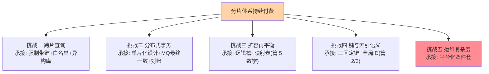
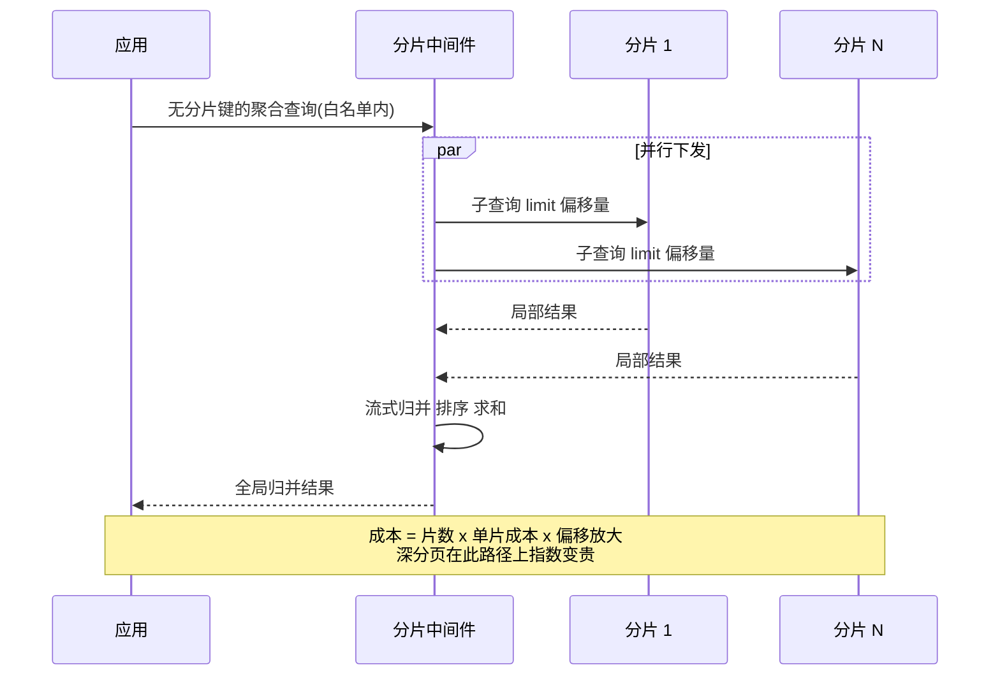
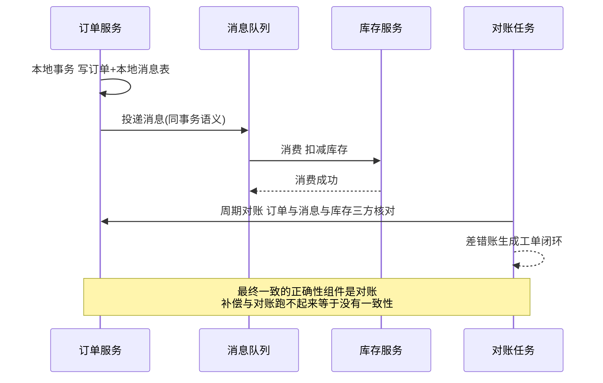
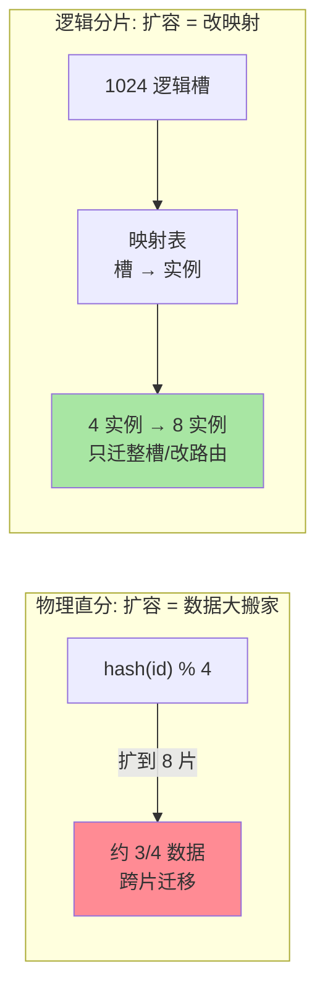
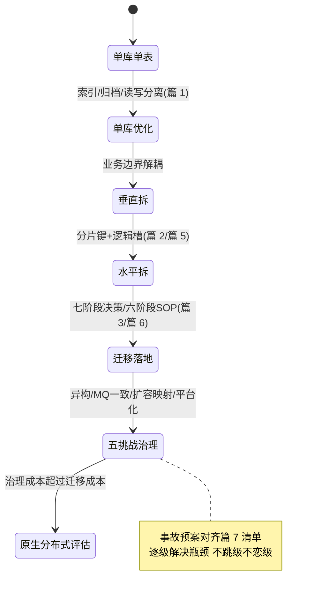

# 分库分表架构全景：拆完之后的五个核心挑战

> 本目录前三篇解决了「要不要拆、键怎么选、数据怎么搬」。本篇是架构级收束：**拆完之后的生活**——跨片查询、分布式事务、扩容再平衡、运维平台化，五个挑战各有架构级答案；最后把全系列收成一张决策总图。与前三篇零重复：篇 1 的拆分时机、篇 2 的定键、篇 3 的迁移流程、篇 5 的扩容数学、篇 6 的迁移 SOP、篇 7 的事故清单都不再复述，只做全景收束。

## 一句话摘要

分库分表的难度不在「拆」而在「拆完之后」：**跨片查询**靠「强制带键 + 异构兜底」、**分布式事务**靠「能避开就避开，避不开按一致性等级选型」、**扩容**靠「逻辑分片 + 映射表」把搬数据降级为改映射（数学细节见篇 5）、**运维复杂度**靠平台化对冲——四个挑战的答案共同指向一个原则：**分片引入的每一份复杂度，都要有显式的架构组件承接，没有组件承接的复杂度会变成事故**（事故形态见篇 7）。

## 🎯 本文核心

**核心一句话：分库分表不是「到亿级的动作」而是一种「持续付费的架构形态」——五挑战（跨片查询/分布式事务/扩容/键与索引/运维）就是它的年费账单；每项挑战的架构答案是固定的，选型只是决定「谁来承接这个组件」。**

决策链：三问总览（何时拆/怎么拆/拆了怎么管——前两问链回篇 1/2）→ 三种架构形态（SDK/代理/托管）→ 五挑战逐一给架构答案 → 演进路线图。全文一句话可重构：「拆是手术，养是长跑——五挑战就是长跑的补给清单」。

## 前置阅读与相邻篇目

- 篇 1《拆分方案选型》：拆分时机与中间件双路线（本文不再重复其决策与事故）
- 篇 2《分片键设计》：三问定键与异构索引（本文只引用其结论）
- 篇 3《分布式 ID 衔接与平滑迁移》+ 篇 6：迁移七阶段决策口径与六阶段执行 SOP（本文只讲拆完后的扩容增量）
- 篇 5/篇 7：翻倍扩容的位级数学 / 迁移事故全景清单

## 目标导向

本文是什么：分片体系运行期的架构全景与治理方法论。功能是什么：把「拆完之后」的隐性成本显式化，给出每个挑战的承接组件。能得到什么：三形态承接方对照、五挑战架构答案、演进路线图、参数级配置与治理 SOP。为什么用：分片体系评审、运维平台立项、原生分布式数据库切换评估，必看。

## 一、三种架构形态：复杂度由谁承接

| 形态 | 路由位置 | 复杂度承接方 | 适用 |
|---|---|---|---|
| 客户端 SDK | 应用进程内 | 应用团队（心智 + 升级随发版） | 技术栈统一、延迟敏感 |
| 代理层 | 独立代理进程 | 中间件团队（部署/扩容/监控代理集群） | 异构技术栈、重管控 |
| 云托管/原生分布式 | 平台存储层 | 云厂商（SLA 定价换运维） | 新建系统优先评估 |

三形态跑的是同一套分片语义，差异只在「五挑战里的运维部分由谁扛」——选型前先回答「团队有谁」，再回答「技术要什么」（篇 1 的结论，此处收束为一句话）。

## 二、五挑战总览：年费账单的五个科目



## 三、挑战一：跨片查询——能避免就避免，避不开就分层

分片后查询分三档处理：

```text
第一档：带分片键 → 单片命中，最优路径（应用层设计保证）
第二档：跨片但可聚合 → 并行查各片 + 归并（LIMIT/ORDER BY 全局归并，COUNT 求和）
        代价：深分页全局归并要取「前 N 页偏移量」的行数，成本随偏移暴涨
第三档：跨片且复杂（多维筛选/全文/报表）→ 不在分片集群做
        → 异构到 ES / ClickHouse / 数仓（篇 2 的异构索引结论，这里是其架构落位）
```

**架构纪律**：第二档查询必须白名单登记并限流——归并查询的成本 = 片数 × 单片成本，是「片数越多越贵」的放大器；第三档是异构链路的职责边界，混进分片集群做就是事故入口。



### 一次归并查询拖垮集群的复盘

某运营后台的「全量订单分页导出」没有登记白名单，大促后第一个工作日集中使用——线上告警显示全部物理实例 CPU 同步飙升，排查发现是同一类深分页归并查询并发了数十个，每个都在取「前 10 万行偏移」。复盘动作：归并查询全量登记 + 偏移上限 + 导出类需求迁到数仓链路。复盘结论进了架构纪律：**归并查询的成本模型要写进评审 checklist，无登记的归并查询发现即治理**（同类事故在篇 7 有完整条目）。

## 四、挑战二：分布式事务——先问「能不能不分布式」

分库后本地事务失效，但**第一反应不是选分布式事务方案，而是重新审视业务边界能否让事务单片化**（分片键把同一业务的强关联数据放同片——篇 2 分片键的架构意义）。避不开时的选型：

| 方案 | 一致性 | 性能 | 复杂度 | 适用 |
|---|---|---|---|---|
| XA / 2PC | 强一致 | 差（同步阻塞） | 中 | 金融强一致（业内实际少用） |
| TCC | 最终一致（业务补偿） | 好 | 高（三接口开发） | 资金类核心链路 |
| SAGA | 最终一致（状态机补偿） | 好 | 中 | 长流程事务 |
| MQ + 本地消息表 | 最终一致 | 好 | 中 | 异步解耦场景 |

**业内默认**：互联网业务默认 MQ 最终一致 + 对账兜底；强一致需求优先靠「业务设计单片化」消化，其次才是 TCC。一致性等级是**按资金风险定价的决策**，不是技术偏好。



### 为什么不选：事务方案的替代路线推演

- **为什么不选 XA 撑高并发**：两阶段提交的同步阻塞与锁窗口在热点行场景按并发数放大（追问链见下），且协调器单点让可用性上限被锁死——强一致的溢价只有资金级场景付得起。
- **为什么不选「所有跨库操作都上 TCC」**：Try/Confirm/Cancel 三接口的开发与验收成本数倍于普通接口，非资金链路用它属于过度设计——MQ 最终一致 + 对账兜底在大多数场景更便宜且可观测。
- **为什么不选「应用层手写两阶段提交」**：把 2PC 的协调逻辑散落在业务代码里，等于把 XA 的黑盒拆成 N 份更不可控的黑盒——不如把一致性语义交给 TCC/SAGA 的显式补偿模型。

### 追问链：为什么 XA 在互联网并发下退场

- **质疑**：XA 提供数据库级的强一致，为什么业内实际少用？强一致难道不是最安全？
- **追问**：看 XA 的底层机制——两阶段提交在整个事务期间持有锁并同步等待协调者，参与者越多、单笔事务越慢、锁窗口越长；协调者是单点，第二阶段失联即悬挂。
- **再追问**：锁窗口长一点能有多大代价？推演一个并发场景。
- **打破砂锅**：热点行场景下，锁窗口从毫秒涨到几十毫秒，吞吐按锁持有时间倒数下跌——大促秒杀类写入直接排队雪崩。业内用血泪投票出的取舍是：**把一致性的复杂度从基础设施显式搬到业务层（TCC/SAGA/本地消息表），换来锁窗口消失与可观测的补偿路径**。「复杂度搬家」听起来变丑了，但它把黑盒变成了可以监控、可以演练、可以对账的显式组件——这就是架构设计里的设计思想：宁可复杂度显式，不要正确性黑盒。

## 五、挑战三：扩容再平衡——用逻辑层把搬家变改表



物理直分的扩容成本（再平衡期间的双写、校验、路由切换）随片数平方级上涨——底层机制是重分布的映射对撞数量随片数相乘；逻辑分片把「扩容」拆成「整槽搬迁」（可分批低峰）+「映射切换」（秒级）。**这个设计必须在第一次拆分时就定**（篇 1 事故的核心教训），事后补逻辑层等于二次拆分。为什么翻倍扩容恰好只迁一半、每行去向为什么可以预计算——这个位级机制是整篇的数学地基，见篇 5《翻倍扩容的数学本质》；把整槽搬迁跑成标准动作的流程与回退路径在篇 6。

## 六、挑战四：键与索引的分片语义（链回收束）

三个已在篇 2/3 定型、这里收束成纪律的结论：①分片键三问定键、终身不变；②全局唯一性交给分布式 ID（趋势递增护聚簇），分片键退为普通索引列，两者职责正交；③每个分片内的二级索引只保证「片内有序」——跨片排序/唯一约束一律靠业务层或异构组件，**别指望数据库在片间维护任何全局有序性**。

### 追问：唯一性约束在分片后去哪了

- **追问**：单表时代的唯一索引（如手机号唯一）分片后还成立吗？
- **再追问**：各片只保证片内唯一——两个手机号可能落在不同片，数据库层不再有任何机制拦截。
- **打破砂锅**：全局唯一性必须上移到「能看见全部分片」的层：发号器分配（ID 类）、分布式锁或带唯一槽位的注册表（标识类）、异构库聚合校验（异步兜底）。把它留在数据库层就是留一个静默重复的口子——这类数据正确性事故的典型形态收录在篇 7。

## 七、挑战五：运维复杂度——平台化是唯一的对冲

分片把运维动作乘以片数：备份（各片独立 + 全局一致性快照点）、DDL（N 片顺序变更 + 版本一致校验）、监控（单片水位 + 全局聚合双层）、故障切换（单分片主备切换 + 集群视角影响面）。

**平台化四件套**：变更编排（DDL 按「从库先行 → 逐片低峰 → 校验」自动推进）、监控聚合（片级报表 + 跨片全局视图）、容量再平衡自动化（逻辑槽迁移任务化）、元数据中心（路由映射 + 分片拓扑单源）。没有平台承接的分片集群，运维成本会在第三次扩容前后压垮团队——这是业内自建分片体系最普遍的死因。

### 一次「没人敢动的分片」的复盘

某体系运行三年后审计发现：两台物理实例的分片规则与文档不一致，路由映射只存在于一个老版本配置文件里，无人能解释。排查历时两周（对照 binlog 历史与路由日志反推），最终确认是一次口头执行的临时扩容没有回写元数据。复盘把结论写成了组织纪律：**元数据中心是分片拓扑的唯一真相源，任何路由变更必须走平台留痕**——文档与记忆都不是承接方，平台才是。

## 八、不同量级的思考：量级演进驱动解法

- **十万级（无五挑战）**：约束来自单实例运维模型完整覆盖全部工作——这一档的核心问题是「把单库运维做扎实」，而不是「预建分片治理体系」。思考方式：运维基线驱动——备份恢复演练与监控告警齐备，就是这一档全部的「平台」。
- **百万级（挑战萌芽期）**：约束来自读写分离引入复制链路这个新组件——这一档的核心问题是「新组件的监控与故障切换有没有纳入运维视野」，而不是「要不要拆」。思考方式：组件台账驱动——每引入一个组件（从库/缓存/异构库）就登记它的监控、巡检与回退手段。
- **千万级（半挑战期）**：约束来自归档、异构查询库等旁路链路成体系——这一档的核心问题是「跨组件的数据流有没有对账」，而不是「片级监控要不要上」。思考方式：链路驱动——主库到异构库的每条 CDC 链路有延迟水位与差异率告警，治理先于拆分。
- **亿级（五挑战全量期）**：约束来自运维动作乘以片数的乘法效应全面兑现——这一档的核心问题是「平台化四件套的覆盖度与演练频率」，而不是「再招几个运维」。思考方式：平台驱动——变更编排、片级监控、再平衡自动化、元数据中心缺一不可，且每季度用影子槽位演练扩容与回退。

**自下而上与触发升级**：五挑战不是拆分当天出现的——它们随组件数量增长逐个萌芽，每一档的治理动作都是为下一档买保险。触发升级的信号是「运维动作开始按片数相乘」（第二份从库、第一条异构链路、第一次扩容），而不是行数过线。

## 九、参数级配置清单：治理五挑战的关键参数

| 配置项 | 默认值 | 分档推荐 | 为什么 |
|---|---|---|---|
| 归并查询并发上限 | 无 | 白名单 + 每查询并发 1-2（业内惯例） | 归并成本 = 片数 × 单片成本，并发叠加即集群雪崩 |
| 深分页偏移上限 | 无 | 单查询偏移上限（如 1 万，业内认知口径） | 全局归并取偏移行的成本随偏移暴涨，超限走数仓 |
| MQ 对账频率 | 无 | 资金链路小时级 / 普通业务天级 | 最终一致的正确性组件；频率按资金敏感度定价 |
| DDL 逐片并发 | 无 | 串行（并发 1）起步 | N 片同时变更 = N 倍故障半径，串行可控可中断续跑 |
| 逻辑槽迁移限速 | 依工具 | 低峰窗口 + 按从库 IO 压测定速 | 迁移流量打满主库 IO 即影响线上 |
| 反向同步/对账保留期 | 无 | 与切写观察期等长（数天） | 回滚窗口 = 观察期长度（篇 3 结论的运行期延续） |
| 元数据中心 | 无 | 平台单源 + 变更留痕 | 路由映射唯一真相源，文档与记忆不可承接 |

> 数字口径：并发与频率类参数为行业认知口径（业内惯例），按业务压测与窗口实测校准；工具类默认值以各官方文档为准。

## 十、步骤级操作：五挑战治理落地 SOP

### 挑战一治理（跨片查询）

- 前置条件：片级监控上线、慢查 Top 按分片维度可见
- 操作：归并查询全量登记（频率/耗时/业务方）→ 设并发与偏移上限 → 导出与报表需求迁异构链路
- 验证：白名单外归并查询为零；登记查询的耗时 P99 在预算内
- 回退：异构链路异常 → 白名单查询临时降频，禁止回流分片集群裸跑

### 挑战二治理（分布式事务）

- 前置条件：业务边界图明确哪些事务已单片化、MQ 与对账基建就绪
- 操作：避不开的事务按一致性等级选型（默认 MQ 最终一致）→ 对账任务上线 → 差错账工单闭环流程建立
- 验证：对账差异率低于阈值且有告警；一次差错从发现到闭环的演练通过
- 回退：补偿失败积压 → 冻结新流程切人工核账，先修补偿链路

### 挑战三治理（扩容）

- 前置条件：逻辑槽与映射表方案就位（篇 1 决策）、迁移 SOP 可执行（篇 6）
- 操作：影子槽位预演整槽搬迁与映射切换 → 真实扩容按分批低峰执行
- 验证：预演数据一致性与路由切换秒级完成；正式扩容业务零感知
- 回退：映射切换异常 → 回切映射表（秒级）；数据异常 → 按 SOP 回滚整槽

### 挑战五治理（运维平台化）

- 前置条件：片数 ≥4 或第三次扩容前启动（业内最普遍死因的时间窗）
- 操作：四件套按「监控聚合 → 元数据中心 → 变更编排 → 再平衡自动化」顺序立项 → 每季度演练
- 验证：路由变更全部平台留痕；一次真实 DDL 全程平台推进无人工直连
- 回退：平台故障期间冻结变更，人工操作需双人复核 + 事后回写——冻结优于裸奔

## 十一、演进路线图：把全系列收成一张图



演进的关键纪律：**每一级只解决上一级解决不了的瓶颈**——跳级（单库直接水平拆）与恋级（量级到顶还靠加索引）都是架构失衡。

> 💡 **实战提示**
> - 💡 什么时候给归并查询设白名单：片数超过 4 就该建「跨片查询登记表」——频率、耗时、业务方三要素登记，无登记的归并查询发现即治理
> - 💡 MQ 最终一致的对账频率按「资金敏感度」定价：核心资金链路小时级对账 + 差错账工单闭环，普通业务天级兜底
> - 💡 DDL 平台化的最小可用版：分片顺序脚本 + 每片校验 + 中断续跑——三个能力齐了，N 片 DDL 才从「高危操作」降级为「常规操作」
> - 💡 扩容演练纳入年度例行：用影子槽位预演整槽搬迁与映射切换，真实扩容时才不是第一次跑这套流程
> - 💡 元数据中心是唯一真相源：任何路由变更走平台留痕——文档会过期、记忆会离职，平台留痕不会

## 你们可能会问

**Q1：五挑战里哪个最先杀死团队？**
经验答案是运维复杂度——它不爆雷但持续消耗人力，等团队意识到时通常已积累两三个「没人敢动的分片」（第七节的复盘就是典型形态）。运维平台化的投入要在第一次水平拆时同步启动，不是「稳定后再补」。

**Q2：分布式事务为什么业内不推荐 XA？**
同步阻塞 + 协调器单点 + 运维黑盒，性能与可用性代价在互联网并发下不可接受；TCC/Saga 把一致性的复杂度显式化到业务代码里——「复杂度从基础设施搬到业务层」是行业用血泪投票出的取舍（追问链见第四节）。

**Q3：什么信号说明该评估原生分布式数据库了？**
五挑战的治理成本超过迁移成本时：异构链路维护人力持续上涨、扩容频率高于年一次、跨片事务需求持续增长——此时「复杂度下沉到存储层」的订阅费开始低于自建复杂度。是经济学决策，不是技术潮流决策。

**Q4：本篇和篇 5/6/7 怎么分工？**
本篇给五挑战的架构答案与承接组件；篇 5 给挑战三的数学地基（为什么翻倍只搬一半），篇 6 给迁移的执行 SOP 与回退路径，篇 7 给全部事故形态的发现与修复清单——四篇合起来是「拆完之后」的完整生存手册。

## 自测三问

1. 五挑战分别由什么组件承接？为什么没有组件承接的复杂度会变成事故？
2. 分布式事务的选型顺序是什么？XA 为什么在互联网并发下退场？
3. 平台化四件套是哪四件？为什么元数据中心必须是唯一真相源？

## 5W 速记卡

| 维度 | 一句话 |
|---|---|
| What（是什么） | 分库分表架构全景 = 三形态承接方 + 五挑战的架构答案 + 演进路线图 |
| Why（为什么） | 拆是手术养是长跑——分片引入的每份复杂度都要有显式组件承接 |
| When（什么时候用/不用） | 第一次水平拆时同步启动治理（尤其平台化）；什么时候不用：单库阶段预建全套治理是过度设计 |
| Who（谁承接） | 应用团队（带键纪律）、中间件团队（代理与平台）、DBA（校验与对账）、平台（变更与元数据） |
| How（怎么做） | 白名单限归并 → MQ 最终一致 + 对账 → 逻辑槽扩容 → 键索引语义收束 → 平台化四件套 + 季度演练 |

## 常见误区

- **「分库分表是常态」**：它是量级逼出来的最后手段——多数系统的正确答案是归档 + 索引 + 读写分离（篇 1）
- **「片数越多越分散越安全」**：五挑战的成本全部随片数增长，片数按「当前量级 × 增长」算，不为想象扩容
- **「分片后索引不重要了」**：片内查询仍靠索引，且分片键本身要建索引——分片解决「数据放哪」，不解决「怎么找」
- **「MQ 最终一致 = 不需要对账」**：最终一致的对账是正确性组件不是可选件——补偿与对账跑不起来的一致性方案等于没有一致性

## 开放问题

- 原生分布式数据库把五挑战逐个下沉为内核能力（全局索引、分布式事务、在线扩容），自建分片体系的工程价值边界随产品成熟度持续收缩
- Serverless 化存储让「片数」变成平台内部概念，容量规划从架构题退化为配置题——这门手艺的半衰期值得从业者清醒评估

## 🎯 核心带走

- **核心一句话**：拆完之后才是长跑——五挑战（跨片查询/分布式事务/扩容/键索引语义/运维）每项都要有显式组件承接，运维平台化是最先要启动的那件
- **决策链**：三形态定承接方 → 五挑战架构答案 → 演进路线图（逐级解决瓶颈，不跳级不恋级）
- **哪里会坏**：归并查询无白名单、XA 撑并发、物理直分扩容、平台化欠账、元数据失真
- **边界**：本篇是分库分表系列的收束——拆分时机在篇 1、键在篇 2、迁移在篇 3/篇 6、扩容数学在篇 5、事故清单在篇 7；七篇合起来是一套完整可评审的方案

## 📌 数据与事实声明

- 写于 2026-09-25（2026-09-09 初版、2026-09-10 重构为五挑战收束，本次按专题层全标准重写），机制以 MySQL 8.0 生态为基准
- 工具口径以 ShardingSphere 5.x、Vitess 与主流云分布式数据库公开文档为准；并发/频率类参数为行业认知口径
- 事故推演为高频案例模式的匿名化复述，不含真实公司与内部信息
- 免责：产品能力以各官方文档为准

## 📚 参考资料

| 类型 | 标题 | 来源 |
|---|---|---|
| 开源项目 | Apache ShardingSphere（JDBC/Proxy/弹性伸缩） | shardingsphere.apache.org |
| 开源项目 | Vitess（CNCF，分片中间件） | vitess.io |
| 实战书 | 《高性能 MySQL（第 4 版）》规模化章 | 公开出版 |
| 系列内互指 | 篇 1 选型 / 篇 2 分片键 / 篇 3 迁移 / 篇 5 扩容数学 / 篇 6 SOP / 篇 7 事故清单 | 本目录 |
| 社区沉淀 | 各大厂公开的分库分表演进与对账实践 | 技术社区公开文章 |
| 系列导航 | MySQL 系列目录 | `docs/data/mysql/index.md` |
