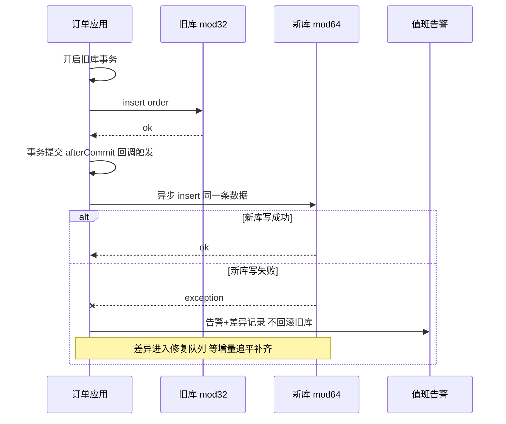
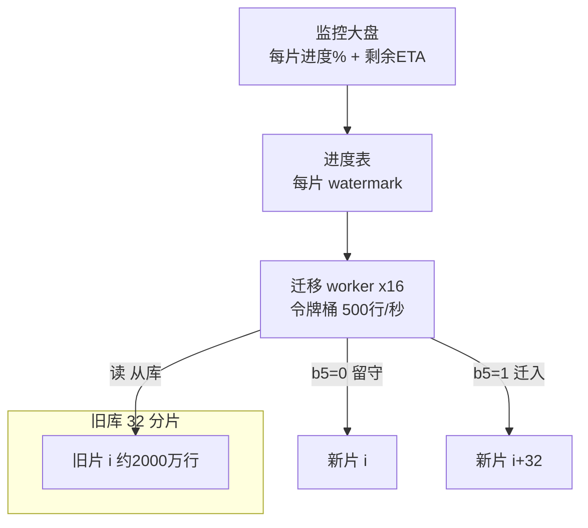
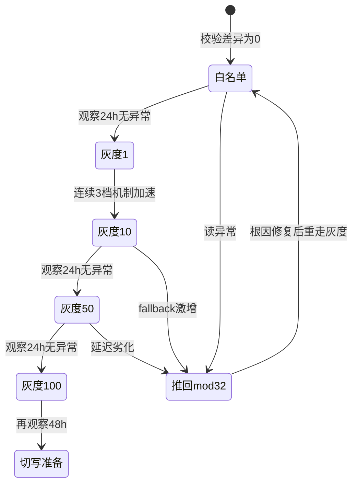
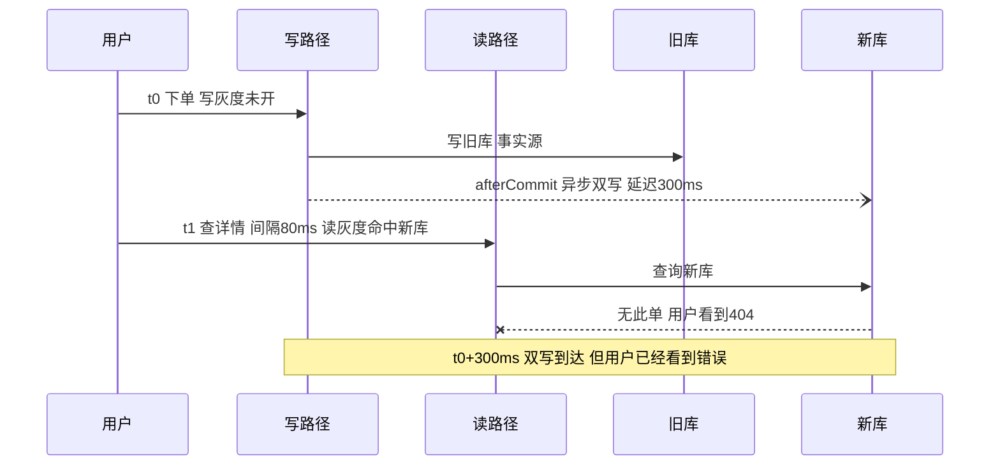

# 实战推演：32 到 64 不停机扩容全流程代码级

> 篇 1-4 给了设计原则（选型/分片键/分布式 ID/架构全景），篇 5 给了翻倍的数学，篇 6 给了六阶段 SOP，篇 7 给了十八种事故清单——但把它们全部读完，你仍然可能不敢动手：**SOP 是理想路径，清单是别人的事故，中间缺的是一次自己从头到尾走一遍的经验**。这篇就是那次演练：以一个电商订单系统为贯穿场景，在分库分表从拆到扩的演进路上，从「第 0 天容量告警」推演到「第 30 天旧库退役」，每一步都有代码、有参数、有验证动作，还有五个真实发生过的翻车现场与修复。

> **本文核心**：不停机扩容的本质是**用 30 天的工程纪律，买一次零感知的容量翻倍**——前 17 天（双写/全量/增量/校验）解决「数据在新库齐不齐」，后 13 天（灰度/切写/只读）解决「流量搬家过程中用户感知不感知」。全流程只有一条主线：**旧库始终是事实源，直到新库被证明与它完全一致、且流量已全部搬家**。五个事故（双写不一致/唯一约束冲突/lag 增长/缓存 key 错配/在途丢失）全部源于在某一步偷了这条主线的懒——每个修复动作都能回指到底层机制上。

## 一句话摘要

32→64 不停机扩容按 30 天节奏推演：第 0 天容量告警确认扩容；第 1-3 天方案评审（为什么是 64 不是 48——看篇 5）、路由热切换改造、afterCommit 双写代码、新库 DDL 与 ID 水位抬升；第 4-10 天全量迁移（按分片对并行、限速 500 行/秒、b5 掩码判断去向）；第 11-14 天 Canal 订阅 binlog 增量追平（lag < 1s 验收）；第 15-17 天三层校验（COUNT + 分块 checksum + 差异修复）；第 18-25 天灰度切读（白名单 → 1% → 10% → 50% → 100%，写先读后）；第 26-30 天切写、旧库只读、归档复盘。五个高发事故给出症状→排查→根因→修复的完整实修。

## 🎯 本文核心

**贯穿场景（示例假设）**：一个电商订单系统，订单表按 `user_id` 哈希分成 32 张 order 表、分布在 4 个 MySQL 实例上，单表约 2000 万行，日增订单 50 万。业内常见的经验红线是「单表 2000 万行」——这个数字不是硬性阈值，而是 B+ 树层高、缓冲池命中率与 DDL 时长在千万级开始同时劣化的公开口径共识（业内认知）。第 0 天，红线告警响了。

整个 30 天的生命周期全景（每一步的准入条件与回退路径在对应小节展开）：


**核心洞察**：把 30 天切成两半看——前半段（第 1-17 天）是**数据工程**，风险是「新库数据不齐」，兜底手段是校验与增量追平；后半段（第 18-30 天）是**流量工程**，风险是「搬家过程中用户踩到不一致」，兜底手段是灰度比例与秒级回退。两半的工程语言完全不同：前半段跟 binlog 和 checksum 打交道，后半段跟配置中心和监控大盘打交道——**用同一种思维做两半，是扩容失败的第一大根因**。

## 5W 速记卡

| 维度 | 一句话 |
|---|---|
| What | 32→64 翻倍扩容 30 天全流程：规划/双写/全量/追平/校验/灰度/收尾 |
| Why | 单表 2000 万行红线触发；翻倍扩容只搬一半（篇 5 的数学），是不停机方案里最省的 |
| When | 告警当天启动规划，全流程约 30 天，其中灰度切读独占 8 天 |
| Where | 配置中心（开关）、迁移 worker（数据）、Canal（增量）、监控大盘（验收） |
| How | 事实源不切换主线 + 每阶段前置/验证/回退三件套 + 五大事故实修 |

## 一、第 0 天：发现——容量告警与扩容决策

### 1.1 告警与容量盘点

监控报了两个信号：订单表单表行数逼近 2000 万（业内认知经验红线），且慢查询日报里 `ORDER BY created_at` 类查询的扫描耗时环比抬升 40%。DBA 跑了一轮容量盘点确认家底：

```sql
-- 容量盘点：各分片行数 + 表空间 + 最大自增/ID 水位（示例假设）
SELECT table_name, table_rows,
       ROUND(data_length / 1024 / 1024) AS data_mb,
       ROUND(index_length / 1024 / 1024) AS index_mb
FROM information_schema.tables
WHERE table_schema = 'order_db' AND table_name LIKE 'order_%'
ORDER BY table_rows DESC;

-- 单表水位：主键最大值决定迁移与号段抬升的基准
SELECT MAX(id) AS max_id, COUNT(*) AS cnt
FROM order_db.order_0;
```

结论：32 片分布均匀（分片键设计合格的直接收益，见篇 2），单表 1900-2100 万行，总数据约 6.4 亿。按日增 50 万（示例假设）推算，**单表到达 3000 万红线只剩约 6 个月**——扩容必须现在启动，因为 30 天流程 + 1 个月观察期之后，还要给下一轮扩容留缓冲。

### 1.2 为什么是 64，不是 48 或 96

方案评审的第一个问题：为什么翻倍？篇 5 的数学在这里兑现——`hash(user_id) % 32 == i` 的数据，在 mod 64 下只会落到第 i 片或第 i+32 片，**迁移比例恰好 50%，且每一行的去向可以用第 6 位（掩码 32）提前算出来**。底层原理：模 2 的幂取模只看哈希值的低位，翻倍只是多看一位。若选 48：48 不是 2 的幂，新旧分片不存在位级映射，等于全量重分布 6.4 亿行——迁移时长、双写窗口、风险全部翻倍以上。**约束来源是模运算的位级性质，不是工具能力**——这条在评审会上要讲透，否则「48 片更省资源」的声音一定会上来。

## 二、第 1-3 天：规划——方案评审、路由改造与双写代码

### 2.1 评审会上敲定的四个决定

1. **分片数保持 2 的幂**：32 → 64，数据流向 = 每个旧片 i 拆向新片 i（留守）与新片 i+32（迁入），可全量预计算。
2. **事实源约定**：迁移全程旧库是事实源，新库任何问题都不紧急回滚，旧库任何数据丢失才是 P0。
3. **开关全部进配置中心**：双写开关、灰度比例、路由版本，回退秒级生效，禁止发版式回滚。
4. **迁移窗口避开大促**：30 天日历摊开，确认没有重叠的大促/封网期（篇 7 运维层事故 16 的预防动作）。

### 2.2 路由改造：为热切换留出开关

路由从硬编码 mod 32 改为「配置中心下发分片总数 + 本地原子引用」的模式。改造本身很小，但它是灰度切读的地基：

```yaml
# 路由配置（配置中心下发，示例假设）
sharding:
  route:
    totalShards: 32          # 切换时改为 64，秒级生效
    hashFunction: murmur64   # 哈希函数迁移期间禁止更换（篇 5 约束二）
    grayReadPercent: 0       # 灰度切读比例 0-100
    grayWhitelistVersion: v1 # 白名单版本号
```

关键纪律：**哈希函数与分片键在迁移期间冻结**。篇 2 讲过键值终身不变是三问定键的底线，迁移期间连哈希函数本身也一并冻结——`murmur64` 换成 `crc32`，位级映射全部作废，等于重做方案。

### 2.3 双写代码：afterCommit 模式

双写的唯一正确姿势：旧库事务提交成功后，再异步写新库；新库写失败只告警 + 记差异，绝不回滚旧库。

```java
/**
 * 订单双写服务：旧库事务提交后再异步写新库（afterCommit 模式）
 * 纪律：新库写失败只告警不回滚旧库——旧库是事实源，差异由增量追平修复
 */
@Service
public class OrderDualWriteService {

    private final OrderOldRepository oldRepo;         // 路由 mod 32
    private final OrderNewRepository newRepo;         // 路由 mod 64
    private final AlarmClient alarmClient;            // 值班群告警
    private final DualWriteDiffRecorder diffRecorder; // 差异记录 供追平修复

    @Transactional(transactionManager = "oldTxManager")
    public void createOrder(Order order) {
        oldRepo.insert(order);                        // 1. 事实源先写 事务内
        TransactionSynchronizationManager.registerSynchronization(
            new TransactionSynchronization() {
                @Override public void afterCommit() { // 2. 旧库提交成功才碰新库
                    try {
                        newRepo.insert(order);        // 3. 新库写同一条数据
                    } catch (Exception e) {
                        // 4. 失败不抛：旧库已提交 回滚无处安放
                        diffRecorder.record(order, "INSERT", e);
                        alarmClient.warn("dual_write_fail",
                            "order=" + order.getId() + ", err=" + e.getMessage());
                    }
                }
            });
    }
}
```

为什么不是「事务内同步写两边」？双写没有分布式事务保证，跨库协同的复杂度指数级（篇 6 模式一的坑）。afterCommit 把一致性责任从「事务」转移给「增量追平」——这是整个方案里最重要的设计取舍。



### 2.4 新库 DDL 与 ID 水位抬升

新库 64 张表按「与旧库同构」建表，但**ID 水位必须抬升**：本例主键日常由号段模式发号（篇 3），表上保留 AUTO_INCREMENT 作为历史兜底路径——评审时它被标记为「永不触发」，于是没人给它设起点（这个忽略会在第 6 天炸出事故二）。

```sql
-- 新库建表：结构与旧库完全一致 AUTO_INCREMENT 抬到安全水位（示例假设）
-- 安全水位 = 旧库 max_id + 日增 50 万 x 30 天 = max_id + 1500 万
CREATE TABLE new_db.order_32 (
  id          BIGINT UNSIGNED NOT NULL COMMENT '号段模式分布式ID 兜底自增',
  user_id     BIGINT UNSIGNED NOT NULL,
  amount      BIGINT NOT NULL DEFAULT 0 COMMENT '订单金额 单位分',
  status      TINYINT NOT NULL DEFAULT 0,
  coupon_id   BIGINT NOT NULL DEFAULT 0 COMMENT '切读前必须核对的列 篇6叙事二',
  created_at  DATETIME NOT NULL DEFAULT CURRENT_TIMESTAMP,
  updated_at  DATETIME NOT NULL DEFAULT CURRENT_TIMESTAMP ON UPDATE CURRENT_TIMESTAMP,
  PRIMARY KEY (id),
  UNIQUE KEY uk_user_id (user_id, id),
  KEY idx_user_created (user_id, created_at)
) ENGINE = InnoDB AUTO_INCREMENT = 17500000 DEFAULT CHARSET = utf8mb4;
```

前置检查清单：新旧 `SHOW CREATE TABLE` 逐列 diff（含默认值与字符集）、索引一致、AUTO_INCREMENT 水位 ≥ 旧库 max + 1500 万。验证不过不进双写。

## 三、第 4-10 天：全量迁移——分片对并行与限速

### 3.1 迁移脚本核心逻辑：分批、限速与 b5 判断

每个分片对（旧片 i → 新片 i + 新片 i+32）一个 worker，按主键窗口分批扫描旧库，用 b5 掩码判断每行去向（篇 5 的位级数学落进代码就是一行，穿透到底就是「取模看低位」这一条原理）：

```java
/**
 * 分片对全量迁移 worker：主键窗口分批 + 令牌桶限速 + b5 判断去向
 * b5 = 哈希值第 6 位（掩码 32）：0 留守新片 i  1 迁入新片 i+32
 */
public class ShardPairMigrator implements Runnable {

    private static final long MASK_B5 = 32;          // 0b100000 翻倍位判断
    private final long shardId;                      // 旧片 i
    private final RateLimiter limiter;               // 500 行/秒 令牌桶
    private final long batchSize = 2000;             // 每批行数
    private volatile long watermark = 0;             // 断点水位 落迁移元数据库

    @Override public void run() {
        while (true) {
            List<Order> batch = oldRepo.scanByIdRange(shardId, watermark, watermark + batchSize);
            if (batch.isEmpty()) break;              // 本片扫描完毕
            for (Order o : batch) {
                long h = murmur64(o.getUserId());
                long target = (h & MASK_B5) == 0 ? shardId : shardId + 32;
                newRepo.insertIgnore(target, o);     // 幂等写 唯一键冲突即跳过
                limiter.acquire();                   // 限速 保护旧库读压力
            }
            watermark = batch.get(batch.size() - 1).getId();
            progressRepo.save(shardId, watermark);   // 断点续传 崩溃后从水位重跑
        }
    }
}
```

### 3.2 分片对并行与进度监控

32 个分片对、16 个 worker 并行，理论吞吐 16 × 500 = 8000 行/秒，3.2 亿行（只搬一半）净搬约 11 小时——但实际排期是 7 天，因为**每晚只开低峰 6 小时窗口**，且要留重跑缓冲。限速不是慢，是把「对旧库的读压力」压到从库可承受的水平（迁移读全部走旧库从库，限速同时保护主从延迟）。



进度监控看三个数：每片 watermark 占 `MAX(id)` 的百分比、当前吞吐与限速值的偏差（突降 = 旧库从库压力或锁等待）、ETA。**任何一片进度卡住 10 分钟即告警**——全量迁移最大的坑不是慢，是「以为在搬其实停了」。

### 3.3 为什么每批 2000 行

批大小是三重权衡：太小则网络往返占比高；太大则单批事务大、新库 undo 膨胀、且失败重试代价高。2000 行 × 200 字节 ≈ 400KB/批，落在新库单事务的舒适区（公开口径常见值为 1000-5000 行，业内认知）。跑前必须先在预发环境用真实数据量压测——参数表见第十节。

## 四、第 11-14 天：增量追平——binlog 订阅与 lag 收敛

### 4.1 Canal 订阅配置

全量迁移开始时（第 4 天）双写已在运行，但双写只覆盖「应用写入路径」；库存对账、运营补单等旁路写入只能靠 binlog 订阅兜住。Canal 把自己伪装成旧库的一个从库，订阅 32 张表的变更投递到 MQ：

```yaml
# Canal 实例配置（示例假设）：订阅旧库 binlog 增量投递 MQ
canal:
  server_id: 1001                          # 伪装从库的 server id 不得与真实从库冲突
  instance:
    order_migration:
      canal.instance.master.address: old-cluster-vip:3306
      canal.instance.dbUsername: canal_reader   # 仅需 REPLICATION SLAVE/CLIENT 权限
      canal.instance.filter.regex: order_db\\.order_.*   # 只订阅 32 张订单表
      canal.instance.filter.query.ddl: true  # 迁移窗口禁 DDL 出现即告警
      canal.mq.servers: mq-cluster:9876
      canal.mq.topic: order_binlog_topic
      canal.mq.partitionHash: .*\\.user_id   # 按分片键哈希分区 保住同键有序
      canal.mq.canalBatchSize: 50            # 投递批大小
# 消费端三条纪律：
# 1. 幂等写入 INSERT ... ON DUPLICATE KEY UPDATE 位点重放不产生脏数据
# 2. 位点每分钟回写迁移元数据库 崩溃后从位点续传
# 3. lag = 当前时间 - binlog事件时间 告警阈值 5s 持续 10 分钟
```

### 4.2 lag 监控与追平验收

验收标准与篇 6 一致：**lag < 1 秒持续 30 分钟**才能进校验阶段。lag 的计算必须用「binlog 事件时间戳 vs 消费完成时间戳」，不能用队列堆积量——堆积量在低峰期会给你虚假的安全感。追平机制的调优动作是把 lag 从分钟级压到秒级：先收紧分区与并发（见事故三），再观察旧库写入高峰时段 lag 的爬升斜率，确认消费吞吐 > 峰值写入吞吐后，才允许进入下一阶段。

## 五、第 15-17 天：数据校验——三层比对与差异修复

### 5.1 校验 SQL：COUNT、checksum、差异定位

三层校验由浅入深，逐层收窄范围（完整策略见篇 6 阶段⑤）：

```sql
-- 第一层 全量 COUNT：旧片 i vs 新片 i + 新片 i+32 应相等
SELECT 'old' AS side, COUNT(*) AS cnt FROM order_db.order_0
UNION ALL
SELECT 'new_stay',  COUNT(*) FROM new_db.order_0
UNION ALL
SELECT 'new_moved', COUNT(*) FROM new_db.order_32;

-- 第二层 分块 checksum：按主键分块 CRC32 比对 快速定位不一致区间
SELECT
  FLOOR(id / 200000) AS chunk_no,
  COUNT(*) AS rows_cnt,
  SUM(CRC32(CONCAT_WS('#', id, user_id, amount, status, updated_at))) AS chunk_crc
FROM order_db.order_0
GROUP BY FLOOR(id / 200000)
ORDER BY chunk_no;
-- 新库对 order_0 与 order_32 跑同一 SQL 按 chunk_no 对齐比对 rows_cnt 与 chunk_crc

-- 第三层 差异行定位：对不一致 chunk 逐行比对 以旧库为准生成修复清单
SELECT o.id, o.user_id, o.amount, o.status
FROM order_db.order_0 o
LEFT JOIN (
  SELECT id, user_id, amount, status FROM new_db.order_0
  UNION ALL
  SELECT id, user_id, amount, status FROM new_db.order_32
) n ON n.id = o.id
WHERE n.id IS NULL OR n.amount <> o.amount OR n.status <> o.status
LIMIT 1000;
```

### 5.2 差异修复纪律

修复只有一条规则：**以旧库为准重写新库**，禁止「两边各改一半」——那会产生第三种不一致。资金相关字段（amount）抽样比例提到 10% 且必须定向覆盖热点用户（篇 6 叙事三的教训：随机抽样会漏热点）。差异率 > 0.01% 时不允许逐条手修，必须回到增量追平查根因——**校验是发现问题的最后手段，不是修数据的常规手段**。

## 六、第 18-25 天：灰度切读——阶梯放量与回退预案

### 6.1 灰度开关代码：配置中心推送 + 路由热切换

```java
/**
 * 读路由热切换：配置中心推送灰度比例 本机按 userId 尾号桶判定读新还是读旧
 * 纪律：比例默认只升不降 回退必须显式推 0 不允许本机各自为政
 */
@Component
public class GrayReadRouter {

    private final AtomicReference<GrayConfig> ref = new AtomicReference<>(GrayConfig.OFF);

    /** 配置中心监听：推送 grayReadPercent 秒级生效 无需发版 */
    @PostConstruct
    public void watch() {
        ConfigCenter.subscribe("grayReadPercent", v ->
            ref.set(GrayConfig.parse(v)));           // 例 "10" = 10% 读新库
    }

    public Order queryOrder(long userId, long orderId) {
        GrayConfig cfg = ref.get();
        if (cfg.whitelist.contains(userId)) {        // 白名单优先 客服排障入口
            return newRepo.queryByNewRoute(orderId); // mod 64
        }
        if (userId % 100 < cfg.percent) {            // 0-99 尾号桶 比例即桶数
            try {
                return newRepo.queryByNewRoute(orderId);
            } catch (Exception e) {                  // 新库读异常 计数+降级回旧库
                metrics.increment("gray_read_fallback");
                return oldRepo.queryByOldRoute(orderId);
            }
        }
        return oldRepo.queryByOldRoute(orderId);     // mod 32
    }
}
```

### 6.2 每档观察什么、怎么回退

白名单（运营 + 客服账号池 500 个 uid，示例假设）→ 1% → 10% → 50% → 100%，每档观察 ≥ 24 小时。观察五项：新库读延迟 P99 与旧库差值（要求持平）、`gray_read_fallback` 计数趋势、用户反馈工单量、双写成功率（仍需 > 99.9%）、binlog lag（读切走后写入压力不变，lag 不应波动）。



回退动作只有一个：配置中心把 `grayReadPercent` 推回 0，秒级生效。**回退演练必须在白名单阶段做一次真推**——没演练过的回退按钮等于没有。

### 6.3 写先读后的铁律

灰度有一条顺序铁律：**写路由的灰度比例必须 ≥ 读路由的灰度比例**。读灰度命中新库的用户，其写入必须已经落在新库（或至少双写同步可见），否则「下单后立刻查详情」会查不到——这就是事故五的根因。实现上：写灰度先开到下一档、观察稳定后再开读灰度到同一档，读永远追着写走。

## 七、第 26-30 天：收尾——切写、旧库只读与复盘

### 7.1 切写与旧库只读的顺序

灰度 100% 后读已全在新库，但写仍是「旧库为主 + 双写新库」。收尾的顺序（每步之间观察 24 小时）：

1. **写路由切到新库**（mod 64），同时双写方向反转：新库写完 afterCommit 补写旧库——旧库数据保持最新，作为最后的回退保险。
2. **反向双写稳定 48 小时**后，停旧库辅助写入，旧库转只读。此刻事实源才正式切换——这是第 27 天，距离告警那天整整 27 天。
3. **旧库保留只读 30 天**（应对「翻旧单」类长尾读与审计），之后归档到冷存储并下线实例。

### 7.2 复盘产出

复盘必须产出三类资产：①本次实际参数 vs 参数表推荐值的偏差表（回写第十节）；②五个事故的修复补丁清单（回写篇 7 清单的治理列）；③下一轮 64→128 的启动条件（单表水位回到 2000 万）——**扩容不是一次性项目，是架构演进周期里的固定节拍**，这次的所有产出都是下一次的输入。

## 八、五个真实问题：症状→排查→根因→修复

> 以下五个问题来自业内高频迁移事故的匿名化归纳与公开实践口径（细节为示例假设），是篇 7 清单里五个条目的「实修手册」——清单告诉你有哪十八种翻车姿势，这里逐帧还原其中五种怎么发现、怎么修。

### 问题一：双写不一致——afterCommit 的时机错了

| 环节 | 内容 |
|---|---|
| 症状 | 第 16 天校验发现新库比旧库多 3000+ 行「幽灵订单」，集中在某晚 22:00-22:05 |
| 排查 | 幽灵单按时间窗聚合 → 调该窗口应用日志与旧库 binlog 比对 → 发现旧库事务在 insert order 之后因库存扣减失败**回滚**，但新库无对应回滚 |
| 根因 | 双写初版代码把新库写在旧库**事务内**同步执行——旧库回滚时新库已提交，跨库无协同，回滚无处传播 |
| 修复 | 改 afterCommit（第 2.3 节代码）：只有旧库提交成功才写新库；幽灵单按修复清单以旧库为准清理；上线后双写差异计数归零观察 48h |

### 问题二：唯一约束冲突——自增起点未错开

| 环节 | 内容 |
|---|---|
| 症状 | 第 6 天全量迁移批量报 `Duplicate entry '8361200' for key 'PRIMARY'`，迁移 worker 中断 |
| 排查 | 冲突 id 全部落在 0-1500 万区间 → 查新库 binlog 发现这批 id 来自「双写期写入的新订单」→ 追代码发现号段服务故障时的**兜底路径**用了 AUTO_INCREMENT，而新库 DDL 忘了抬起点 |
| 根因 | 评审时兜底路径被标记「永不触发」，AUTO_INCREMENT 默认从 1 起步；双写第 1 天号段服务抖动 30 秒，1200 单走了兜底，从 1 开始发号，与全量迁移搬来的历史 id 撞号 |
| 修复 | 新库 DDL 补 `AUTO_INCREMENT = 旧库max + 1500 万`；**删除代码里的自增兜底路径**（冷路径不该存在）；冲突区间订单以旧库为准覆盖；全量迁移加「起点校验」前置断言防复发 |

### 问题三：增量 lag 增长——Canal 单线程瓶颈

| 环节 | 内容 |
|---|---|
| 症状 | 第 11 天开增量追平，lag 从 2 秒一路爬到 40 秒；全量迁移夜间窗口运行时更糟 |
| 排查 | 看 Canal 投递侧：MQ topic 分区数 = 1，Canal 单线程顺序投递；看消费侧：单消费者串行 upsert，实测吞吐 8000 行/秒；看旧库：日峰值写入 12000 行/秒——**消费吞吐 < 写入吞吐，lag 必然单调增长** |
| 根因 | 订阅链路吞吞吐被单线程 + 单分区锁死：`partitionHash` 没配，全部事件挤进一个分区，并行度 = 1 |
| 修复 | `partitionHash` 按 user_id 拆 16 分区（同键保序不破坏一致性）；消费端 16 并发 + 500 行批量 upsert；lag 回落到 0.5 秒并扛住晚高峰。沉淀：**追平验收前先做「峰值写入吞吐 vs 消费吞吐」的余量测算，余量 < 2 倍不进追平** |

### 问题四：缓存 key 分片后缀错配

| 环节 | 内容 |
|---|---|
| 症状 | 灰度 10% 时客服反馈：部分用户「刚改的收货地址刷新后又变回旧的」，概率与灰度比例正相关 |
| 排查 | 抓异常请求的 Redis 访问记录：同一订单同时存在 `order:detail:{id}:s7` 与 `order:detail:{id}:s39` 两个 key → 溯源发现 key 尾缀由路由模块拼接，切读后**读路径算出 mod 64 的下标（39），写路径失效旧缓存仍用 mod 32 的下标（7）** |
| 根因 | 缓存 key 模板把「分片下标」编进了 key——分片下标是路由的内部实现，路由版本切换后写删失效与读回填用了不同版本的下标，缓存层出现「双写分裂」 |
| 修复 | 缓存 key 与路由解耦：key 只含业务 id，不含分片下标（分片是存储位置，不是数据身份）；改造期内无法一步到位的存量 key，用「双删 + 短 TTL 48h」过渡；沉淀：**缓存 key 里禁止出现任何会因扩容而变化的量** |

### 问题五：路由切换瞬间的在途请求丢失

| 环节 | 内容 |
|---|---|
| 症状 | 灰度 10% 上线后 5 分钟内，用户反馈「下单成功但详情页 404」，共 23 单（示例假设） |
| 排查 | trace 串联：写请求落在旧库（写灰度未开）+ afterCommit 异步双写新库**延迟 300ms**；读请求按读灰度直接打新库——下单到查询间隔 80ms，读的时候新库还没有这条单 |
| 根因 | 读灰度与写灰度同时开闸，违反「写先读后」：命中读新库的用户，其写还在走「旧库主写 + 异步补新」，双写的异步窗口成了「写后读不到」的窗口 |
| 修复 | 读灰度比例永远 ≤ 写灰度比例（写先升档，读跟随）；对「写后 1 秒内读」的请求增加**读未命中回源旧库**的兜底；灰度关键路径的双写改「同步等待新库 ack」为可选开关（代价是写延迟 +30ms，仅在灰度档位切换窗口开启） |

切写瞬间在途请求的时间线（问题五的场景还原）：



## 九、步骤级操作总表：30 天执行清单

| 阶段 | 前置 | 操作 | 验证 | 回退 |
|---|---|---|---|---|
| 第 0 天 发现 | 监控覆盖行数与水位 | 容量盘点 SQL | 确认红线与剩余时间 | 无需回退（决策项） |
| 第 1-3 天 规划 | 评审会结论 | 路由开关化改造 + 双写代码 + 新库 DDL | 新旧 schema 逐列 diff + 双写压测 | 关双写开关（秒级） |
| 第 4-10 天 全量 | 双写稳定 ≥ 24h | 16 worker 分片对并行 + 限速 | 每片 COUNT 比对 + 进度无卡点 | 停脚本清新库重跑（幂等） |
| 第 11-14 天 追平 | 全量完成 + 位点就绪 | Canal 订阅 + 幂等消费 | lag < 1s 持续 30 分钟 | 停订阅从位点重放 |
| 第 15-17 天 校验 | lag 达标 | 三层比对 + 差异修复 | 差异 = 0（含资金定向抽样） | 以旧库为准重写后重校 |
| 第 18-25 天 灰度 | 校验通过 + 回退演练过 | 白名单→1%→10%→50%→100% | 每档五项指标 24h 平稳 | 推回比例 0（秒级） |
| 第 26-30 天 收尾 | 灰度 100% 观察 48h | 切写 + 反向双写 + 旧库只读 | 反向双写差异 = 0 + 旧库零写入 | 恢复反向双写切回旧库主写 |

## 十、参数级配置清单

| 配置项 | 默认值 | 本次推荐值 | 为什么 |
|---|---|---|---|
| 双写开关 | false | 逐实例放量开启 | 配置中心控制，回退秒级 |
| 双写异常告警阈值 | 无 | 失败率 > 0.1% 人工介入 | 双写差异靠追平修复，趋势异常即根因信号 |
| 迁移批大小 | 1000 行 | 2000 行 | 单批 400KB，事务与网络往返的平衡点 |
| 迁移限速 | 不限速 | 500 行/秒/worker | 保护旧库从库读压力与主从延迟 |
| 迁移 worker 并发 | 1 | 16（分片对并行） | 32 对数据 16 worker 两轮跑完 |
| Canal MQ 分区数 | 1 | 16（按 user_id 哈希） | 并行度 = 分区数，单分区是 lag 瓶颈 |
| lag 告警阈值 | 无 | 5 秒持续 10 分钟 | 追平验收线 1 秒，5 秒即预警 |
| checksum 抽样比例 | 1% | 1% + 资金字段 10% 定向 | 随机抽样漏热点，资金类定向加严 |
| 灰度每档观察时长 | 无 | ≥ 24 小时 | 覆盖一个完整的写入峰谷周期 |
| ID 水位余量 | 无 | 日增量 × 30 天 | 覆盖全流程 + 观察期的发号空间 |

## 十一、追问链（质疑者三连）

- **追问一**：双写 + binlog 订阅两条增量链路，数据会不会互相打架？——不会，前提是消费端全部幂等。双写先到先写，binlog 后到用 `ON DUPLICATE KEY UPDATE` 覆盖为旧库的最终值——**两条链路不是冗余，是「速度」与「完备」的互补**：双写保证秒级可见（撑住写后读），binlog 保证旁路写入不丢（撑住最终一致）。
- **再追问**：为什么校验要等追平 lag < 1 秒才开始？校验本身又不改数据。——因为校验是「对移动靶拍照」：lag 大的时候旧库变更还没流到新库，拍出来的差异全是「时间差噪声」，你会把噪声当事故排查一整天。**lag < 1 秒不是校验的前置仪式，是让「差异」重新具有语义的前提**。
- **打破砂锅**：全流程最危险的是哪一天？——不是数据最乱的迁移期，是第 26 天切写。前面每一步回退都是「退回旧状态」，切写之后旧库只剩反向双写这条细线保命，**回退成本从秒级跳到小时级**。所以收尾段的每一步都要 24 小时观察间隔，且切写动作放在业务低峰 + 值班满编的工作日白天——凌晨切写、值班只有一个人的「勇气操作」是切写事故的标准前奏。

## 十二、反方案分析

- **为什么不用云厂商 DTS 全托管**：DTS 能覆盖全量 + 增量，但本方案的三处定制它给不了——①b5 预计算的分片对映射（DTS 按表同步，不理解分片对拓扑）；②灰度切读的应用层开关（DTS 管不到应用路由）；③资金字段的定向 checksum。全托管适合标准场景，**扩容的核心难点恰恰全在非标准处**。
- **为什么不用一致性哈希，一劳永逸免迁移**：一致性哈希把「扩容搬一半」变成「扩容搬 1/N」，但代价是路由层永久复杂化 + 数据分布倾斜治理 + 每次查询多一跳。32→64 用翻倍数学只需要掩码一行，**为五年后才发生的第 4 次扩容预支复杂度，不如把每次翻倍的迁移流程做熟练**——流程熟悉后，翻倍扩容是 30 天节奏化作业，不是冒险。
- **为什么不只靠 binlog 订阅、砍掉应用层双写**：binlog 链路是异步的，秒级 lag 在「写后立即读」场景必现脏读；砍掉双写意味着灰度期所有读都要回源判断，逻辑更绕。双写买的是「新库准实时可见」，这是灰度切读的体验前提——不是冗余，是分层。

## 十三、不同量级的思考：扩容节奏的档位差异

- **十万级（单表 < 500 万行）**：这一档的核心问题是「值不值得扩」，而不是「怎么扩」——约束来源是数据量太小、单库优化空间远未穷尽（索引/归档/读写分离），思考方式是「克制驱动」：先穷尽单库手段，扩容是最后手段（篇 1 的诊断优先）。
- **百万级（单表 500 万-2000 万行）**：这一档的核心问题是「把扩容做成可重复的演练」，而不是「一次性救援」——约束来源是量级已够到红线但窗口充裕，思考方式是「剧本驱动」：SOP + 参数表 + 演练，把 30 天流程压缩到一周内跑完预发验证。
- **千万级（本篇场景，单表 2000 万上下）**：这一档的核心问题是「不停机窗口内的一致性管理」，而不是「搬数据本身」——约束来源是业务不能停、双写与追平的 lag 控制、灰度的体验保障，思考方式是「状态机驱动」：每阶段准入/验证/回退，事实源不切换，本篇全流程就是这一档的展开。
- **亿级（单表过亿/总分片 128+）**：这一档的核心问题是「平台化与自动化」，而不是「再跑一次 SOP」——约束来源是人工执行在几十个分片对 × 多表 DAG 面前不可靠，思考方式是「平台驱动」：迁移平台接管编排/校验/修复流水线，人只做准入审批——这也是头部团队自研迁移平台的公开动因（公开口径）。

**自下而上与触发升级**：先测单表行数与写入 TPS 定档，再选思考方式；升级信号是「下一档的方案跑不动当前量级」——脚本超时升脚本驱动，SOP 执行漏洞率上升升平台驱动，团队基建的演变速度决定升档节奏。档位之间不跳跃：没有做过状态机驱动的千万级，直接上亿级平台化会把平台做成空壳。

## 十四、设计思想：全流程围绕「事实源不切换」组织

三十个步骤、五个子系统、上百个参数，靠什么把它们组织成一条不散的线？答案是单一设计原则：**事实源不切换，直到被证明**。双写期旧库是事实源（新库写失败只告警）、校验期旧库是事实源（差异以旧库为准修复）、灰度期旧库是事实源（回退推回 mod 32 读旧库）——直到反向双写差异归零、旧库转只读的那一刻才反转。这个原则把「什么时候可以胆大」和「什么时候必须胆小」变成了机械判断：**凡旧库还是事实源的阶段，新库怎么折腾都有退路；凡事实源已切换的阶段，每个动作都要观察窗口**。

第二个设计思想是**把一致性从「事务」降级为「最终一致 + 校验兜底」**：拒绝跨库分布式事务，接受双写的短暂不一致，用增量追平收敛、用三层校验证明收敛完成。这一机制的代价是秒级不一致窗口，收益是复杂度可承受——分库分表场景里，强一致事务的复杂度会吞噬整个项目，而秒级窗口对订单场景的体验损耗为零。**设计取舍的正确姿势不是选最强的，是选复杂度可承受的最强**。

## 十五、什么时候用 / 不用

- ✅ 用：2 的幂分片数的翻倍扩容（32→64→128），数据量在千万到亿级、无法接受停机
- ✅ 用：借扩容窗口同步做硬件换代/机房搬迁（双写目标可以是新机房的同构库）
- ❌ 不用：分片数不是 2 的幂、或哈希函数需要更换——先回篇 5 补数学，方案不成立
- ❌ 不用：数据量小到停机 30 分钟可接受（单表 < 500 万）——停机迁移一天搞定，比 30 天流程的人力便宜
- ❌ 不用：没有对账/校验基础设施、没有配置中心的团队——先补基建，否则全流程裸奔

## Trade-off：复杂度换连续性的账本

30 天流程买的是「业务零感知的容量翻倍」，账本上每一项都有对价：双写买写后读体验（付 30ms 延迟与告警噪音）、限速买旧库稳定（付迁移拉长到 7 天）、灰度买风险隔离（付 8 天观察成本）、反向双写买最后的回退能力（付切写后 48 小时的双倍写放大）。**这个方案的复杂度下限是「三层校验 + 一条热回退路径」，再往下省就是赌博**；上限则要警惕——没有大促压力的团队把灰度拉到一个月以上，维护双写的心智成本会反噬。复杂度与收益的平衡点：灰度总时长 ≤ 10 天，全流程 ≤ 45 天。

## 开放问题

- 存算分离架构（TiDB/OceanBase 类）里「扩容 = 元数据操作」，本篇的双写/追平/校验三件套是否会被整体简化——存储底层机制的演变会重写迁移形态，但「校验」是否还保留独立地位值得关注（我认为应该保留：元数据迁移同样有位点和一致性问题）
- 反向双写是否可以被 binlog 反向订阅替代——理论可行，但切写窗口的短暂双向写会让位点管理变成环，值得在预发推演一次

## 你们可能会问

**Q1：双写期间新库的写入压力是不是翻倍？旧库会不会被双写拖垮？**
旧库写压力不变（它本来就是主写），新库承受全部写入 + 迁移读。被拖垮风险最大的是旧库**从库**（迁移扫描走从库），所以限速按从库余量定。真正的写放大发生在反向双写期（第 26 天后），但那时旧库已无读流量，只读兜底可以降配。

**Q2：全量迁移期间双写的新订单，会被全量迁移覆盖成旧版本吗？**
不会，靠「迁移只碰存量 + upsert 幂等」的组合：迁移 worker 按 id 窗口扫历史数据，双写新订单的 id 在水位之外；即使区间重叠（兜底发号事故），`insertIgnore`/`ON DUPLICATE KEY UPDATE` 也保证后到的 binlog/双写数据以旧库值为准覆盖。顺序纪律：**双写先开、全量后跑、增量收尾**，不可乱序。

**Q3：30 天里哪一段可以压缩？哪一段绝对不能压？**
能压：全量迁移（加窗口加 worker）与校验（工具并行化）。不能压：灰度每档 24 小时（要覆盖完整的业务峰谷周期，压了等于没观察）与切写后的 48 小时反向双写观察（这是最后的安全网）。经验法则：**数据阶段的工期可以买算力换，流量阶段的工期只能用日历换**。

**Q4：为什么反向双写只有 48 小时，不也观察 7 天？**
因为反向双写期间新旧两库都在承受全量写，且旧库已无读流量、配置上属于「待退役资源」——观察窗口拉长只会增加双倍写放大的风险暴露面。切写的前置是灰度 100% 已稳定 7 天，新库的可靠性已经被充分证明，48 小时足够验证「反向链路」本身。

## 💡 实战提示

- 💡 双写、灰度、路由版本三个开关全部进配置中心，并在白名单阶段真推一次回退——没演练过的回退按钮等于没有
- 💡 迁移限速值按「旧库从库余量」倒推，不是按「最快搬完」正推——迁移读压力打爆从库，主从延迟会替你按下暂停键
- 💡 新库 DDL 与旧库逐列 diff（含默认值/字符集/索引），AUTO_INCREMENT 水位与号段服务的水位**同时抬**——两条发号路径留一条不抬就是撞号事故
- 💡 缓存 key 禁止携带分片下标等「会因扩容变化的量」——key 表达数据身份，路由表达存储位置，两者混写必翻车
- 💡 追平验收前先算「峰值写入吞吐 vs 消费吞吐」余量，小于 2 倍不进追平——lag 单调增长的根因永远是吞吐倒挂，不是偶发抖动
- 💡 切写放在业务低峰 + 值班满编的工作日白天，每步之间留 24 小时观察——收尾段是回退成本最高的一段，节奏比速度重要

## 自测三问

1. b5 判断（掩码 32）为什么能决定每一行去新片 i 还是 i+32？如果分片数改成 48 这还成立吗？
2. 双写为什么必须在 afterCommit 里写新库？「事务内同步写两边」差在哪一步？
3. 灰度切读为什么必须「写先读后」？违反它会复现本篇哪个事故？

## 🎯 核心带走

- **核心一句话**：不停机扩容 = 用 30 天工程纪律买一次零感知的容量翻倍——前半程管数据一致（双写/全量/追平/校验），后半程管流量无感（灰度/切写/只读），主线只有一条：旧库是事实源，直到新库被证明
- **五个事故五个教训**：双写不一致→afterCommit 时机；唯一约束冲突→发号水位同抬；lag 增长→吞吐余量测算；缓存 key 错配→key 与路由解耦；在途丢失→写先读后
- **哪里会坏**：最危险的不是数据最乱的迁移期，是回退成本最高的切写期——收尾段节奏放慢，观察窗口不压缩
- **边界**：只适用于 2 的幂翻倍 + 哈希函数冻结；小数据量直接停机迁移；无校验基建的团队先补基建
- **复利**：本次的参数偏差表、事故修复补丁、启动条件，就是下一轮 64→128 的全部输入——扩容是节拍，不是项目

## 📌 数据与事实声明

- 写于 2026-09-25（分库分表深度系列第 8 篇）；贯穿场景（32 分片/2000 万行/日增 50 万/30 天节奏）为教学推演的示例假设，非真实系统
- 「单表 2000 万行」经验红线、批大小 1000-5000 行、lag 秒级验收等为业内公开实践口径（业内认知），非硬性标准
- 五个事故为业内高频迁移事故的匿名化归纳，非特定公司事件；工具版本与配置项以官方文档为准

## 📚 参考资料

| 类型 | 标题 | 来源 |
|---|---|---|
| 系列内 | 篇 1 拆分方案选型 / 篇 2 分片键设计 | 本目录 ./1_拆分方案选型-深度.md ./2_分片键设计-深度.md |
| 系列内 | 篇 3 分布式 ID 与平滑迁移 / 篇 4 架构全景 | 本目录 ./3_分布式ID衔接与平滑迁移-深度.md ./4_分库分表架构全景与选型决策-深度.md |
| 系列内 | 篇 5 翻倍扩容数学 / 篇 6 六阶段 SOP / 篇 7 事故清单 | 本目录 ./5_翻倍扩容的数学本质：32到64只搬一半-深度.md ./6_不停机迁移全流程：六阶段SOP与回退路径-深度.md ./7_迁移事故清单与全面治理-深度.md |
| 开源工具 | Canal（binlog 订阅） | github.com/alibaba/canal |
| 开源工具 | DataX（离线同步）/ gh-ost（在线 DDL） | github.com/alibaba/DataX · github.com/github/gh-ost |
