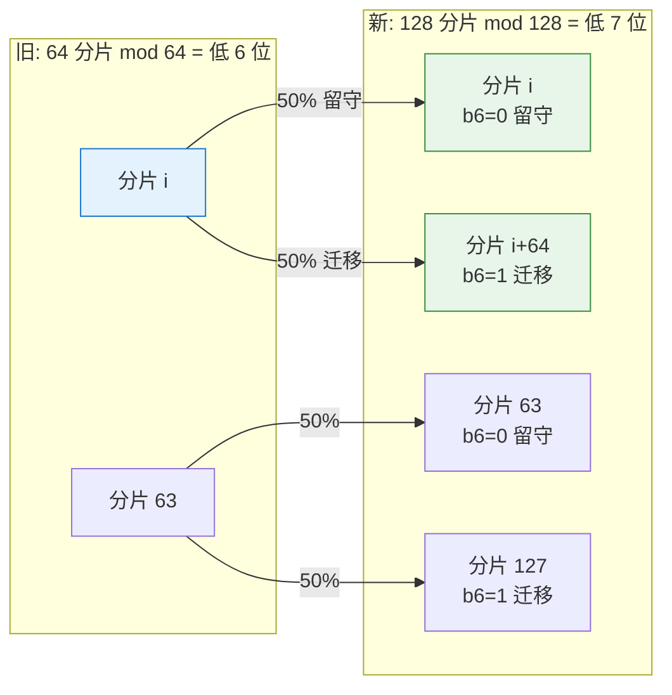
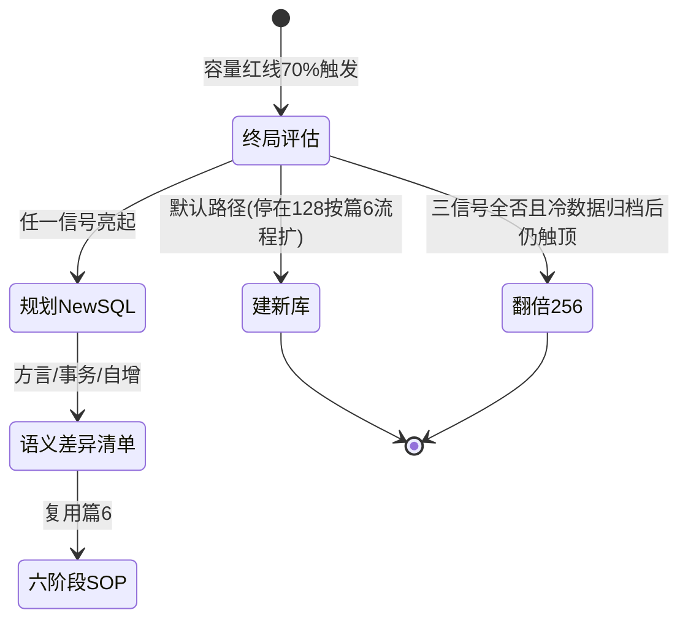
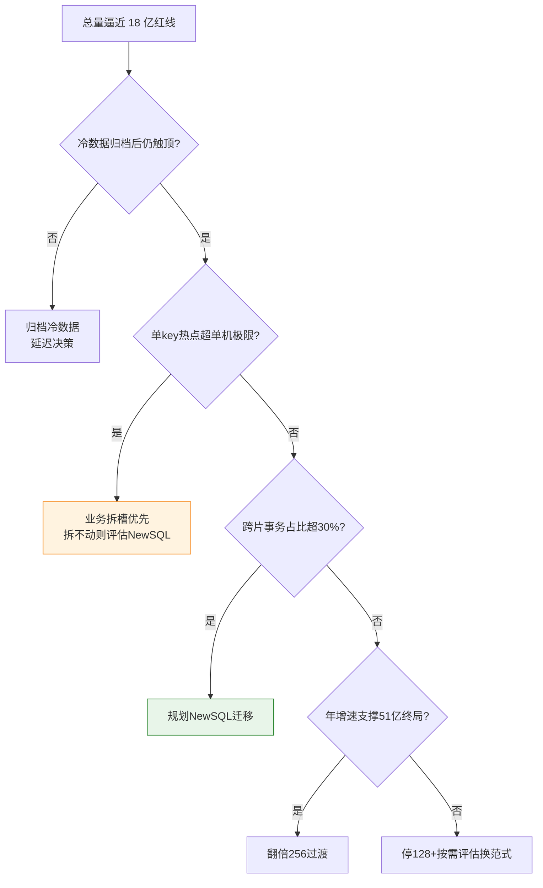
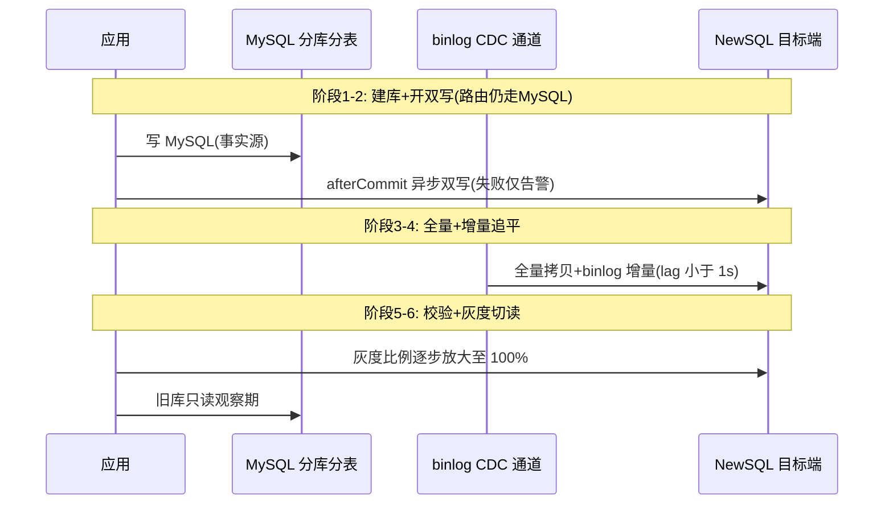

# 128 张表的容量终局与 NewSQL 迁移决策

> 篇 5 讲透了翻倍扩容的数学——32 到 64 只搬一半，且 64 到 128 完全同构。本篇回答递归的下一层问题：**翻倍到 128 之后呢？** 128 张表是绝大多数业务分库分表的「事实终点」：容量天花板可以精确算出来（单片 2000 万行 × 128 = 25.6 亿行，业内认知口径），继续翻倍的边际收益快速衰减；而热点、跨片事务、运维面这三类问题，翻倍根本解决不了。这篇给出**停在 MySQL 还是迁移 NewSQL 的选型分界**，以及迁移要用的双写方案。

> **本文核心**：翻倍扩容是递归，但**递归的终局不是无限翻倍，而是换范式**。分库分表解决的是「单机容量与写入不够」，代价是「跨片一致性 + 应用层复杂度」；当跨片事务占比、热点分布、多存储运维面任何一个逼近临界值，继续翻倍只是把复杂度再乘以 2。选型分界收敛为三个信号：**单行热点超单机极限、跨片事务占比超 30%（业内认知口径）、运维团队扛得住 NewSQL 学习曲线**——三条同时满足时，换范式的收益才会覆盖迁移成本；缺任何一条，停在 128 继续走篇 5/篇 6 的翻倍 SOP 仍是更便宜的选择。

## 一句话摘要

64→128 的扩容与 32→64 完全同构：第 7 个哈希位决定留守或迁移到 i+64，恰好 50% 迁移、成对并行、工具原样复用（只改常量）。128 张表的容量天花板是单片 2000 万行 × 128 = 25.6 亿行（按业内单表健康线推算）；触顶后有三条路——归档冷数据、翻倍 256、迁移 NewSQL——其中**翻倍 256 通常只应作为过渡**，因为边际成本（实例数翻倍、跨片查询更散、运维面翻倍）已超过边际收益。停止翻倍转 NewSQL 的三个分界信号：单行热点超单机极限（翻倍无效）、跨片事务占比 >30%（补偿式一致性复杂度爆炸）、运维团队有能力接管分布式数据库。迁移执行上，MySQL→NewSQL 与 MySQL→PG 同构：复用篇 6 的六阶段 SOP，双写 + binlog/CDC 增量 + 校验 + 灰度切流，差异集中在 SQL 方言、事务模型与自增语义三类「语义差异清单」。

## 🎯 本文核心

**组织主线**：递归的最后一档（64→128 只改常量）→ 128 的容量天花板推演（25.6 亿怎么算、为什么是终点）→ 停止翻倍的三个分界信号（热点/跨片事务/运维曲线）→ NewSQL 双写迁移方案（与 MySQL→PG 同构、差异在语义清单）→ 递归终局的范式判断（换范式而不是无限翻倍）。

## 5W 速记卡

| 维度 | 一句话 |
|---|---|
| What | 64→128 同构递归 + 128 的容量终局推演 + 停止翻倍转 NewSQL 的选型分界 |
| Why | 翻倍解决容量，不解决热点/跨片事务/运维面——这三个问题到 128 张表时开始主导 |
| When | 总量逼近 25.6 亿（70% 红线约 18 亿触发规划）或三类信号任一出现 |
| Where | 应用路由层不变（仍 2 的幂掩码），存储层从自研分片换为数据库内置分片 |
| How | 三信号评估 → 六阶段双写迁移（复用篇 6 SOP）→ 语义差异清单先行 → 灰度切流 |

## 一、64 到 128：与 32 到 64 完全同构，只改一个常量

### 1.1 位级推理一句话

篇 5 已证明：`hash(key) % 64` 相同的 key，在 `mod 128` 下只会落在 i 或 i+64，由哈希值**第 7 位（b6）**唯一决定——b6=0 留守、b6=1 迁移，比例恰好各半。这个底层原理在 32→64→128→256 每一档都原样成立——同一条数学机制支撑了整条递归链。64→128 没有任何新数学，只有三个工程动作：

```java
// 扩容前: 64 分片
int shard = hash(userId) & (64 - 1);    // 取低 6 位

// 扩容后: 128 分片 —— 只改掩码常量
int shard = hash(userId) & (128 - 1);   // 取低 7 位
// 数据就绪后经配置中心推送 routeVersion+=1, 应用热加载生效(篇 10 展开热切换机制)
```

### 1.2 数据流向与递归状态机



迁移单位仍是「分片对」（旧 i → 新 i 与 i+64），64 对之间零数据交叉，可分批灰度并行。篇 5 的预计算映射脚本、篇 6 的六阶段 SOP、校验器，**64→128 原样复用——这是递归设计的最大馈赠**。唯一新增的是一个前置状态：



**设计思想**：把「终局评估」做成状态机的第一个状态而不是事后的感想——**扩容决策的顺序是「先问要不要扩，再问怎么扩」**，顺序颠倒是许多团队在 128 张表上继续堆到 256 之后才开始反思的原因。

## 二、128 张表的容量天花板推演

### 2.1 算术很朴素，含义不朴素

按业内认知口径的单表健康线（2000 万行 / 单库 500GB 量级）：

| 分片数 | 单片容量红线 | 总量天花板 | 70% 红线触发点 | 对应动作 |
|---|---|---|---|---|
| 32 | 2000 万行 | 6.4 亿行 | ≈4.5 亿 | 规划 64（篇 5） |
| 64 | 2000 万行 | 12.8 亿行 | ≈9 亿 | 规划 128 |
| 128 | 2000 万行 | 25.6 亿行 | ≈18 亿 | 终局评估 |
| 256 | 2000 万行 | 51.2 亿行 | ≈36 亿 | 通常不建议（见 2.2） |

### 2.2 为什么 256 通常不是下一档

翻倍的数学在 128→256 依然成立（第 8 个哈希位，50% 迁移），但**工程账开始倒挂**，三个代价随实例数线性放大：

- **运维面翻倍**：128→256 意味着数据库实例数、备份窗口、监控面板、故障域全部翻倍——DBA 人数不翻倍时，人均故障域扩大是可靠性劣化的隐形推手
- **查询更散**：无分片键查询的扇出从 128 到 256，归并延迟与资源消耗同步上升；范围查询跨越的分片数翻倍
- **单片密度骤降**：若业务年增速没那么快，256 片会把每片数据摊薄到远低于健康线——批量扫描要走更多片，事务局部性变差

触顶后的三条路按优先级：**先归档**（冷数据分离通常能再省 30%-50% 容量，公开口径）、**再评估三信号**（下一节）、**翻 256 只在年增速明确支撑时作为过渡档**。



## 三、什么时候应该停止翻倍：三个分界信号

### 3.1 信号一：单行热点超单机极限

分库分表下**同一个 key 永远落同一个分片**——这是路由的确定性，也是热点的宿命。大 V 账号、爆款商品这类单 key 写热点，翻倍后依然在同一片（哈希不变，去哪不变）。更残酷的是：**NewSQL 的自动分裂对单行热点同样无效**——region 分裂以 range 为单位，一行数据再热也只是一行。所以信号一的处置顺序是：

1. **业务拆槽**：把一行拆成 N 槽（如计数器拆 64 个子行随机写、读时聚合），分库分表和 NewSQL 都适用
2. 拆槽治不了（强一致的单点状态，如秒杀库存扣减的原子行）→ 走队列削峰或业务限流
3. 热点是**范围型**（递增 ID、时间段）造成实例级不均而非单 key → NewSQL 的自动调度有优势，分库分表要手工重片

### 3.2 信号二：跨片事务占比 >30%（业内认知口径）

买家与卖家不在同一片、订单与库存不在同一片——跨片事务在分库分表下只有两条路：业务补偿（本地消息表/对账修复）或引入分布式事务中间件。补偿式一致性的工程复杂度与跨片占比**非线性增长**：占比 10% 时逐个改造写路径可控，占比 30% 时几乎每个核心链路都带补偿逻辑，代码可读性与故障排查成本同时爆炸。NewSQL 的原生分布式事务（Percolator 变体/乐观事务）把跨片一致性下沉到存储层——这套机制的设计哲学是「复杂度交给数据库，应用侧写回普通事务」——**占比越高，换范式的收益越大**。这个 30% 不是精确常数，是业内多年实践归纳的经验分界（公开口径），低于它时补偿改造更便宜。

### 3.3 信号三：运维团队能扛 NewSQL 学习曲线

NewSQL 不是「更高级的 MySQL」：region 调度、副本 placement、PD/TMS 元数据服务、热点均衡、版本升级节奏、生态工具链，每一个都是新的知识域——理解这些机制需要重建一整套底层知识图谱。分界判断很朴素：**团队至少要有 2-3 人做过半年以上 NewSQL 生产运维（或有强厂商支持兜底），否则迁移等于把分库分表的复杂度换成一类更陌生的复杂度**。三个信号的判定是「与」关系——只缺容量时归档与翻倍更便宜；三信号同时亮起，才是换范式的完整理由。

### 3.4 TiDB 与 OceanBase 怎么选（公开口径）

| 维度 | TiDB | OceanBase |
|---|---|---|
| 架构形态 | 存算分离，TiDB 计算 + TiKV 存储 + PD 调度 | 原生分布式，Paxos 多副本单机化 |
| MySQL 兼容 | 协议高度兼容，方言差异清单管理 | 兼容模式依赖版本，需逐项核验 |
| 热点治理 | region 手动/自动分裂 + 热点调度 | 分区 + 副本均衡 |
| 典型场景 | HTAP 混合负载、大容量在线库 | 金融级强一致、高压缩比存储 |

选型结论取决于团队已有运维经验、生态工具链与厂商支持密度——**两家都是合格答案，真正的错误答案是「三信号不全就上」**。

## 四、迁移怎么做：与 MySQL 到 PG 同构的双写方案

### 4.1 六阶段 SOP 原样复用，换目标端

篇 6 的六阶段（建库→双写→全量→增量追平→校验→灰度切读）对 MySQL→TiDB/OceanBase 迁移**完全适用**——变化只在目标端的建库方式与同步通道：



与 MySQL→PG 的同构性体现在流程骨架完全一致；**异构性集中在一张「语义差异清单」**——这是异构迁移区别于同构扩容的唯一新增件，也是多数迁移事故的源头。

### 4.2 语义差异清单（迁移前逐项核验）

| 差异类别 | 具体表现 | 核验方式 | 处置 |
|---|---|---|---|
| 自增语义 | MySQL 连续自增 vs auto_random 打散/中心化分配 | 比对两端 ID 序列 | 按需改 auto_random shard 位或保留中心化分配 |
| 事务模型 | 乐观事务冲突重试、大事务限制（txn-total-size-limit 默认 100MB 量级，公开口径） | 大批量写入压测 | 应用侧加重试与大事务拆分 |
| SQL 方言 | 部分函数/隐式类型转换/锁语义差异 | 全量 SQL 审计扫描 | 改写或降级为兼容写法 |
| 隔离级别 | 默认快照隔离 vs RR 的细微差异 | 并发用例回归 | 补充防丢失更新校验 |

### 4.3 参数级配置清单

| 配置项 | 默认值参考 | 分档推荐 | 为什么 |
|---|---|---|---|
| CDC 同步限速 | 500 行/秒 | 在线业务 500 / 冻结窗口 2000 | 控制对源端读压力 |
| 校验抽样比例 | 1% | 资金类 10% + 热点 key 100% | 全量 checksum 太贵（同篇 6 口径） |
| 灰度切流批次 | 白名单→1%→10%→100% | 每档观察 ≥24h | 逐级放大爆炸半径 |
| 双写开关 | 配置中心下发 | 紧急回滚秒级生效 | 回退能力的生命线 |
| 乐观事务重试 | 3 次 | 高冲突写路径 10 次上限 | 冲突重试转应用退避 |

### 4.4 步骤级操作：NewSQL 迁移最小执行序

| 步骤 | 操作 | 验证 | 回退 |
|---|---|---|---|
| 前置 | 语义差异清单逐项核验 + 全量 SQL 审计 | 审计报告差异清零或已改写 | 暂停立项 |
| 建目标端 | 建 TiDB/OB 集群 + 表结构映射 + auto_random 策略 | schema 比对工具全列一致 | 删集群重来 |
| 双写 | 应用接双写开关（afterCommit） | 双写成功率 >99.9% | 关开关秒级退出 |
| 全量+增量 | CDC 全量拷贝 + binlog 增量追平 | lag <1s 持续 30min | 位点回放 |
| 校验 | 全量 COUNT + 抽样 checksum | 差异 = 0 | 以 MySQL 为准修复 |
| 灰度切读 | 白名单→1%→10%→100% | 每档读延迟 P99 持平 | 推回 MySQL 秒级 |
| 收尾 | MySQL 转只读 → 30 天归档 | 观察期无异常 | 恢复双写重新观察 |

## 五、三则实践叙事（业内高频模式的匿名化归纳）

**叙事一：翻倍治不了的热点。** 某内容平台 128 张表后，大 V 主页写入打满单个实例 CPU。排查：实例级监控显示 3 个实例承载了 60% 写入，慢日志定位到几张计数器表；根因是超级节点的计数写恒定落同一分片。团队先讨论翻 256，数学推演一盆冷水：同一个 key 翻倍后仍在同一片。修复：计数器拆 64 槽随机写 + 读时聚合。复盘结论：**热点是分布问题不是容量问题——先拆槽再谈扩容，换 NewSQL 也救不了单行**。

**叙事二：跨片事务占比失守。** 某交易系统 128 张表，跨片事务（买家卖家不同片）占比从 18% 涨到 34%——本地消息表加补偿逻辑散布在 40 多个写路径，一次大促前的补偿积压引发超时风暴。排查：按写路径统计补偿逻辑覆盖率与积压时长相关性；修复：立项迁移 NewSQL，把跨片一致性下沉存储层，迁移后补偿代码删除约七成（公开口径的典型降幅）。复盘结论：**跨片事务占比是「补偿复杂度」的先行指标，30% 是工程上该停下来换范式的信号**。

**叙事三：双写期的语义差异事故。** 某系统迁移 NewSQL 双写期，对账系统突然报出数万条「差异」。排查：差异行内容其实一致，差异在 **id 顺序**——MySQL 端自增连续，NewSQL 端打散存储，对账脚本按 id 排序做差集，两端口径不同导致误报。修复：对账改为按业务主键比对 + 迁移前补齐语义差异清单。复盘结论：**双写迁移的新增风险不在流程（篇 6 SOP 已覆盖），在两端语义的细微错位——清单要前置到立项阶段**。

## 六、追问链（质疑者三连）

- **追问一**：128 到 256 数学上完全成立，为什么不默认继续翻？——数学成立不等于工程划算：运维面与扇出查询翻倍是确定性成本，而容量收益只在年增速匹配时兑现。翻倍的本质是「用运维面换容量」，当换来的容量五年都用不满，这笔交易就是负的。终局评估状态存在的意义就是把这笔账放在扩容之前算。
- **再追问**：迁移 NewSQL 期间双写，MySQL 写成功、NewSQL 写失败，跨两端的事务谁来兜？——与篇 6 同一个答案：**MySQL 是唯一事实源**，NewSQL 失败仅告警，由 CDC 增量追平补齐；灰度切读 100% 且观察期结束前，NewSQL 永远是「副本」。不追求跨端分布式事务——那是把旧复杂度带进新范式。
- **打破砂锅**：NewSQL 会不会也有终局？——会有。region 热点、跨 region 延迟、存算分离下的成本模型都是新的边界；终局思维要迭代：**每一代存储方案都只解决上一代的核心矛盾，同时引入自己的一组新约束**。真正的工程纪律不是「找到终局方案」，而是保持「当前方案的边界清单」随时可查。

## 七、反方案对照：为什么不用它们

- **为什么不用「继续翻倍 + 分布式事务中间件」硬扛**：中间件能补跨片事务，但把一致性成本转移到中间件运维与性能损耗上；且热点、运维面两个信号完全没解。三信号全亮时，这是「用两个补丁修一个范式」。
- **为什么不用「业务按租户手工拆库」替代 NewSQL**：手工拆库把分片从存储层搬回业务层，跨租户查询与再均衡全部人工化——等于放弃存储层的自动分片能力，规模再上一个量级时二次返工。
- **为什么不是「直接一步到位上 NewSQL」**：三信号不全时迁移是负收益——学习曲线、生态迁移、双写窗口风险都是真实成本；停在 128 走篇 5/篇 6 的成熟 SOP 更便宜也更稳。**范式的切换要由问题驱动，不由技术先进性驱动**。

## 八、不同量级的思考

- **十万级（总量 <1000 万行 / QPS 万级以下）**：这一档的核心问题是「要不要分库分表」，而不是「扩容与迁移」——单库 + 读写分离 + 冷热分离大概率就是终局。约束来源是**成本与运维复杂度**，思考方式是**诊断驱动**：慢查询日志与单表行数是唯一要盯的指标，够用就不拆。
- **百万级（总量 1-10 亿行 / QPS 十万级）**：这一档的核心问题是「翻倍节奏与业务增速的匹配」，而不是「一次到位」——约束来源是**容量红线的提前量**（70% 触发下一档规划），思考方式是**流程驱动**：按篇 6 SOP 一次一档，每档验证再进下一档。
- **千万级（总量 10-25 亿行 / 128 张表区间）**：这一档的核心问题是「停在 128 还是换范式」，而不是「继续翻 256」——约束来源是**跨片事务占比与热点分布**（翻倍解决不了的两类问题开始主导），思考方式是**终局驱动**：三信号逐条评估，NewSQL 进入候选池。
- **亿级（总量 >25 亿行 / 突破 128 表天花板）**：这一档的核心问题是「存储层的自动分片能力」，而不是「应用层的分片算法」——约束来源是**多存储运维面与一致性需求**，思考方式是**范式驱动**：迁移 NewSQL 或按业务单元化拆分，不再依赖应用层翻倍。

**自下而上与触发升级**：先量出总量、增速与跨片事务占比，落在哪一档就用哪一档的思考方式；触发升级的信号是——容量红线逼近、跨片事务占比越界、或单 key 热点超单机极限，任何一条出现，就该把「下一档翻倍」与「换范式」放上同一张决策表做对比，而不是默认递归到 256。

## 九、你们可能会问

**Q1：25.6 亿这个天花板是硬限制吗？超了会怎样？**
不是硬限制，是**体验劣化的工程边界**（业内认知口径）：单表超过健康线后 B+ 树层高增加、buffer pool 命中率下降、DDL 与备份窗口膨胀，性能是渐进劣化而非突然崩溃。正确用法是把它当**规划触发器**：逼近 70% 就启动终局评估，而不是等到崩溃。

**Q2：NewSQL 迁移完成后，篇 5/篇 6/篇 7 那套东西白学了吗？**
没白学。第一，存量 MySQL 分库分表会长期存在，扩容 SOP 仍是刚需；第二，NewSQL 的 region 均衡与分库分表的数据再分布**思想同源**（都是分片与再均衡），理解了位级迁移的原理再看 region 调度是降维理解。学习不是被替换，是被继承。

**Q3：三信号里运维曲线这条太主观了，怎么客观化？**
用三个可观测项替代：团队是否有 NewSQL 生产事故的值班与处置记录、是否有完整的备份恢复演练、厂商支持响应是否达到现有 MySQL 的 SLA。三项都有记录，学习曲线就算「扛得住」；没有记录就先在非核心业务试点半年。

## 十、什么时候用 / 不用

- ✅ 三信号同时满足（热点拆槽治不了 + 跨片事务占比 >30% + 运维曲线可扛）→ 立项迁移 NewSQL
- ✅ 仅容量触顶、其他信号安静 → 先归档冷数据，再按篇 5/篇 6 走翻倍 SOP
- ✅ 已有异构迁移经验（做过 MySQL→PG）→ 复用双写流程，边际成本低，可提前进入评估
- ❌ 三信号任一不满足 → 不迁移；技术先进性不是理由，问题驱动才是
- ❌ 团队没有 NewSQL 生产运维记录 → 先试点，不在核心库上交学费

## Trade-off：停在 128 与换范式的一张对照表

| 取舍维度 | 停在 128（归档+按需翻倍） | 迁移 NewSQL |
|---|---|---|
| 确定性成本 | 翻倍时的运维面扩大 | 学习曲线 + 双写窗口风险 + 生态迁移 |
| 跨片一致性 | 业务补偿（复杂度随占比涨） | 存储层原生事务（复杂度下沉） |
| 热点治理 | 全靠业务拆槽 | 范围热点自动均衡，单 key 仍需拆槽 |
| 回退能力 | 篇 6 热回退成熟 | 回退即迁回 MySQL，成本极高 |

取舍的本质：**停在 128 买的是「成熟与可控」，换范式买的是「一致性与自动化的上限」**——支付的货币分别是「运维面」与「学习曲线」，三信号就是判断哪种货币你付得起的依据。

## 💡 实战提示

- 💡 终局评估做成扩容状态机的第一个状态（先问要不要扩，再问怎么扩），写进扩容 SOP 的准入检查
- 💡 每季度量一次跨片事务占比——它是补偿复杂度的先行指标，涨过 25% 就该启动评估而不是等 30%
- 💡 热点先拆槽再谈扩容：翻倍和换 NewSQL 都救不了单 key 写热点，拆槽才是第一修复
- 💡 异构迁移立项第一件事是语义差异清单（自增/事务/方言/隔离级别），清单没清零不进入双写
- 💡 翻 256 只在年增速明确支撑 51 亿终局时作为过渡档——否则它是「把今天的决策推给明天的运维」

## 开放问题

- 存算分离与 Serverless 化（按需扩缩容）可能让「容量规划」本身降维——届时 25.6 亿天花板变成账单问题而不是架构问题，分库分表知识体系的长期价值向「分片思想」收敛
- HTAP 场景下在线库与分析库的边界移动（TiDB 列存副本等形态），可能让「迁移 NewSQL」与「迁移分析集群」合并为同一个决策

## 自测三问

1. 停止翻倍转 NewSQL 的三个信号是什么？为什么是「与」关系而不是「或」关系？
2. 128 张表的 25.6 亿天花板怎么算出来的？为什么翻 256 通常不是默认下一档？
3. MySQL→NewSQL 迁移与 MySQL→PG 迁移的「同构」和「异构」分别指什么？

## 🎯 核心带走

- **核心一句话**：64→128 只改常量（同构递归），但递归的终局是换范式——翻倍解决容量，不解决热点、跨片事务与运维面；这套分片机制的演进终点是让存储层接管分片
- **三信号分界**：单行热点超单机极限（先拆槽）、跨片事务占比 >30%（补偿复杂度拐点）、运维曲线扛得住——三条同时满足才立项迁移
- **迁移执行**：篇 6 六阶段 SOP 原样复用，唯一新增件是「语义差异清单」（自增/事务/方言/隔离级别）
- **哪里会坏**：热点翻倍无效就上 NewSQL（也无效）、跨片占比失守继续堆补偿、双写期忽略两端语义错位
- **边界**：停在 128 买成熟可控，换范式买一致性上限——由问题驱动，不由技术先进性驱动

## 📌 数据与事实声明

- 写于 2026-09-25（扩容迁移深度系列第 4 篇）；模运算位级性质为数学事实，单表 2000 万健康线、跨片事务占比 30% 分界为业内认知与公开口径的经验值，非精确常数
- 三则实践叙事为业内高频模式的匿名化归纳，非特定公司事件
- 免责：TiDB/OceanBase 的架构与默认参数随版本演进，以官方文档为准

## 📚 参考资料

| 类型 | 标题 | 来源 |
|---|---|---|
| 系列内 | 篇 5 翻倍扩容数学本质 / 篇 6 六阶段 SOP / 篇 7 事故清单 | 本目录 |
| 系列内 | 篇 10 分片路由中间件改造（热切换机制） | 本目录 |
| 官方文档 | TiDB 文档（事务模型/auto_random/region 调度） | pingcap.com/docs |
| 官方文档 | OceanBase 文档（分区与副本均衡） | en.oceanbase.com/docs |
| 关联篇 | 《数据库架构演进：单机到分布式 NewSQL》 | data/整合层 |
