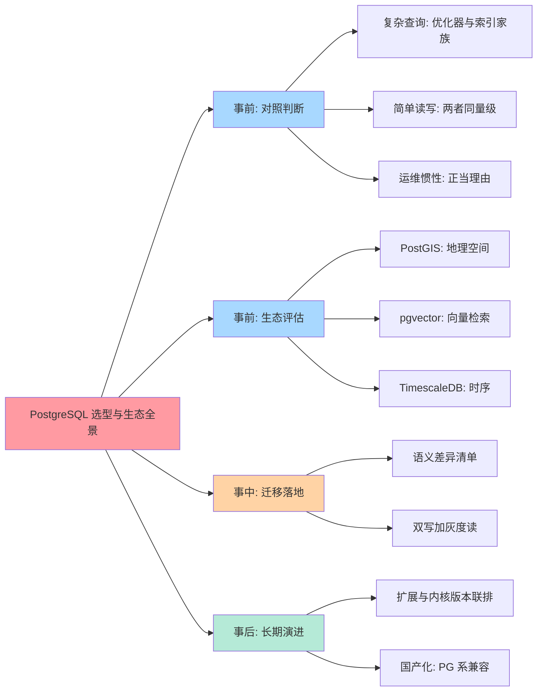
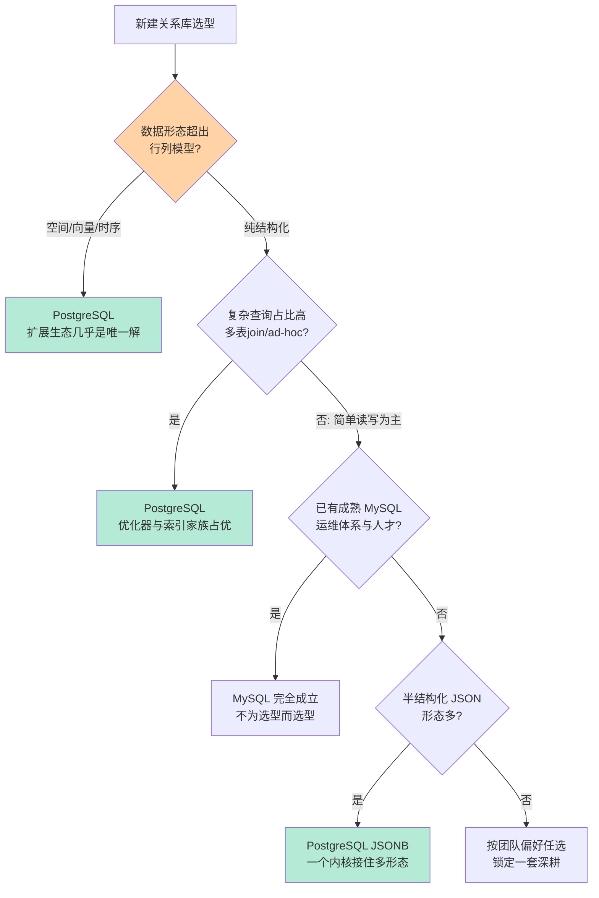
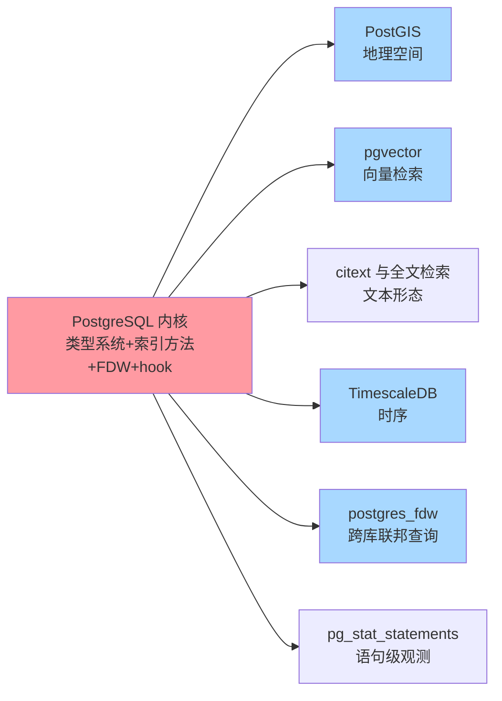
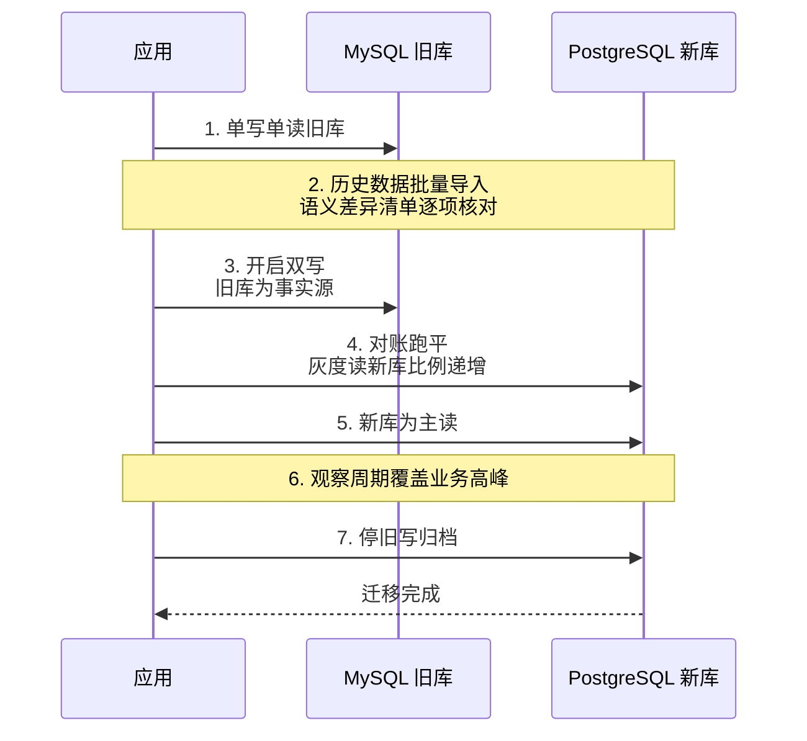
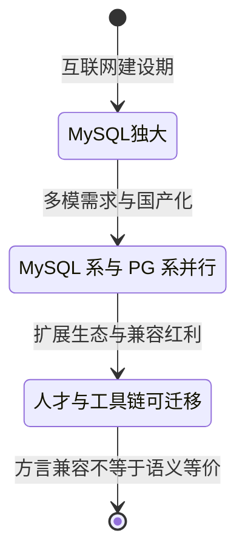

# PostgreSQL 选型与生态全景：什么时候选它，什么时候坚持 MySQL

> 一句话：PG 与 MySQL 的选型判断锚在「查询复杂度 × 数据形态 × 迁移账」三个字眼——复杂查询、多模数据（JSONB/空间/向量/时序）要一个内核接住时 PG 几乎是唯一解；而简单读写为主、已有成熟 MySQL 运维体系与人才池，仍是坚持 MySQL 的正当理由；「扩展即微服务」是 PG 十年尺度上最大的护城河。

## 🎯 本文核心

**核心一句话：选 PG 不是选一个「功能更多的关系库」，是选一个「内核 + 扩展挂钩点」的平台——判断主线是查询复杂度（优化器与索引家族能否接住）× 数据形态（JSONB/空间/向量/时序是否要一个内核接住）× 迁移账（从 MySQL 双写迁移的语义差异清单），而国产化语境下 PG 内核系的普及正在把「懂 PG」变成一笔可迁移的长期资产。**

组织主线（本篇五段全挂这条线）：MySQL vs PG 决策树 → 扩展生态全景 → 迁移路径 → 国产化语境 → 量级验证。

## 一句话摘要

PG 的主场是**复杂查询 + 多模数据形态**：优化器对 join 重排与子查询的自由组合、GIN/GiST/BRIN 构成的索引家族、JSONB 二进制存储 + GIN 索引、以及 PostGIS/pgvector/TimescaleDB 这条「扩展即微服务」的生态带——让一个内核接住过去要三四个组件才接得住的负载。MySQL 的主场同样真实：简单读写为主的 OLTP、起步更早的复制与运维生态、更大的人才池（公开口径）。两者在「简单点查点写」上性能同量级（业内认知），差距在复杂查询与数据形态上拉开。本文给出决策树、扩展全景图、双写迁移路径（含语义差异清单与事故复盘）、国产化语境下的 PG 系图谱，以及四个量级档的思考方式换挡。

## 一、全景脑图：选型的四层展开

按方法论主线展开成一张全景脑图——从事前对照判断出发，经生态评估、事中迁移落地，最终落到长期演进：

读图方法：事前两步（对照判断/生态评估）决定「选不选」，事中（迁移落地）决定「迁得动吗」，事后（演进/国产化）决定「十年后会不会后悔」——选型评审里最常被跳过的恰是第四层，而最贵的学费也交在那里。

入门层的全景与定位见 [PostgreSQL 是什么与全景](../../入门层/从零开始认识PostgreSQL系列/1_PostgreSQL是什么与全景-入门.md)，本篇在其上收束为选型决策。

## 二、MySQL vs PostgreSQL：决策树与边界

### 先破两个反直觉误区

**误区一：「MySQL 快、PG 慢」。**反直觉的真相是：简单点查点写两者在同一个量级（业内认知，具体随硬件与版本浮动），差距出现在**复杂查询**上——PG 优化器原生支持 hash join / merge join / bitmap scan 的自由组合与 join 顺序重排，加上 GIN/GiST/BRIN/部分索引/表达式索引构成的索引家族（机制细节见 [索引家族全景](../../特性层/深入理解PostgreSQL核心机制系列/3_索引家族全景：Btree之外-特性.md) 与 [查询优化器与执行计划深度](../../特性层/深入理解PostgreSQL核心机制系列/4_查询优化器与执行计划深度-特性.md)），对多表 join、ad-hoc 分析、混合过滤这类负载是代差级优势。MySQL 8.0 才补齐 hash join 与 CTE（公开口径），历史上复杂分析一直是它的短板。

**误区二：「选 MySQL 保守不会错」。**保守确实不容易错，但会错在「用补丁换省事」：在 MySQL 旁边堆搜索引擎、缓存层、多条同步管道去模拟 PG 一个内核能接住的负载——每种数据形态一条链路，每条链路一层一致性缺口。组件账最终比迁移账贵，这是选型评审里最常见的「省小钱花大钱」。

追问一层：既然 PG 优化器更强，为什么互联网线上 OLTP 场景 MySQL 占比依然更高（公开口径）？机制穿透到底层看：OLTP 的主战场是「简单语句 × 高并发」，此时优化器的差距不起作用，起作用的是连接模型（MySQL 线程模型连接开销低于 PG 进程模型，机制差异见 [进程模型与存储架构](../../特性层/深入理解PostgreSQL核心机制系列/1_进程模型与存储布局深度-特性.md)）、复制生态的成熟时间差与人才池规模——选型从来不是 benchmark 题，是生态匹配题。再追问一层：那「简单负载选 MySQL」是不是永远成立？不成立。它只在**团队还没有别的绑定约束**时成立；一旦数据形态开始分化（地理、向量、时序、JSON 文档），「简单负载」这个前提本身就开始失效，决策树要重走。

### 选型决策树

### 关键差异对照表

| 维度 | MySQL | PostgreSQL | 选型含义 |
|---|---|---|---|
| 复杂查询 | 8.0 后补齐 hash join/CTE（公开口径） | 优化器 join 重排 + 多种 join 算法原生支持 | 查询越复杂，PG 优势越大 |
| 索引家族 | B-tree 主导 + 全文 | GIN/GiST/BRIN/Hash/部分/表达式 | 过滤形态多样时 PG 代差明显 |
| JSON | JSON 类型 + 函数 | JSONB 二进制 + GIN 索引 | 文档形态重则 JSONB 优先 |
| DDL | 隐式提交，部分在线 | 事务性 DDL，可回滚 | 发布窗口紧张时 DDL 语义值钱 |
| MVCC 实现 | undo log 回滚段 | 元组内版本 + VACUUM | 高频更新表要管膨胀（见特性层） |
| 生态惯性 | 运维工具与人才池更大（公开口径） | 扩展生态与平台化能力更强 | 看团队补哪个短板更便宜 |

MVCC 与 VACUUM 的机制差异与膨胀治理是迁移后最容易翻车的暗坑，机制细节见 [MVCC 与 VACUUM 深度](../../特性层/深入理解PostgreSQL核心机制系列/2_MVCC与VACUUM深度-特性.md)。

反方案分析：如果分析需求只是「几张固定宽表的定时聚合」，用「MySQL + 同步管道 + OLAP 引擎」的补丁组合完全成立，不必为此迁库；这个反方案失效的条件是——查询形态**多变**（今天地理、明天向量、后天全文），每来一种形态就多一条同步链路和一个组件，此时「一个内核接住」的总拥有成本才反超。

## 三、扩展即微服务：PG 生态全景

### 扩展地图

| 扩展 | 解决什么 | 典型场景 |
|---|---|---|
| PostGIS | 几何/地理类型 + 空间索引 + 空间函数 | 附近的人、电子围栏、路径计算 |
| pgvector | 向量类型 + 相似度距离 + 近似索引 | 语义检索、推荐召回 |
| TimescaleDB | 时序分区、压缩、连续聚合 | 监控指标、设备数据 |
| citext | 大小写不敏感文本类型 | 邮箱/用户名唯一约束 |
| postgres_fdw | 把远程 PG 库当本地表查询 | 微服务间只读联邦 |
| pg_stat_statements | 语句级耗时统计 | 性能治理的第一入口 |

设计思想（为什么 PG 的扩展能做到「即插即用」而很多数据库的插件只是「外挂 API」）：底层的原理是**挂钩点深度**——PG 开放了自定义类型、自定义索引访问方法（GiST/SP-GiST 框架）、FDW 接口和一堆内核 hook，扩展不是「调 API 取数据回来自己算」，而是把类型与算子**注入内核的执行与索引路径**。PostGIS 的几何字段可以直接建 GiST 索引、参与优化器代价估算、和普通字段一样出现在执行计划里——这是「类型系统 + 索引方法 + 优化器」三层联动的结果。所谓「扩展即微服务」，指的就是用进程内扩展替代「独立部署一套服务 + 一条同步链路」的架构：少一个组件、少一条链路、少一层一致性缺口。JSONB 如何一个内核接住多种数据形态，入门层有更轻量的展开（[JSONB 扩展性与生态选型](../../入门层/从零开始认识PostgreSQL系列/4_JSONB扩展性与生态选型-入门.md)）。

追问一层：扩展跑在内核进程里，会不会拖垮稳定性？机制上确实存在连坐面——扩展代码运行在数据库进程内，扩展崩溃会波及所在进程。但 PG 的进程模型天然收窄了爆炸半径（每连接一进程，单个进程崩溃不影响实例全局，机制见特性层进程模型篇）。工程纪律随之而来：扩展要选维护活跃的、升级要与内核版本联排验证、生产上锁定经过验证的版本组合。

一段业内常见复盘（匿名化）：某团队装了时序扩展后长期只升内核不升扩展，两年后做安全加固大版本升级时，扩展与内核不兼容，回滚窗口被迫拉长一整晚。复盘结论入档：**扩展清单要当「第二套依赖」管理**——内核有版本台账，扩展也要有，且每次升级演练两者必须联排。事故的根因不是扩展质量，是依赖管理漏了一层。

## 四、从 MySQL 到 PostgreSQL：双写迁移路径

### 步骤级操作：最小闭环

| 步骤 | 命令/动作 | 验证 | 回退 |
|---|---|---|---|
| 1. 差异评估 | 建语义差异清单（见下表）逐项核对 | 清单每项有结论 | 项目叫停重估 |
| 2. Schema 转换 | 类型映射 + 索引重建脚本 | 试导全量无报错 | 脚本回滚重写 |
| 3. 历史数据导入 | pgloader 类工具批量导（公开工具） | 行数与抽样校验一致 | 重导幂等 |
| 4. 开启双写 | 写路径改造，旧库为事实源 | 对账任务差异为零 | 切回单写旧库 |
| 5. 灰度读 | 读比例递增切到新库 | 延迟与正确性达标 | 读比例回退 |
| 6. 收尾 | 停旧写、旧库归档 | 监控无异常 | 归档可恢复 |

双写阶段的时序骨架（每一步都有独立验证与回退点）：

追问一层：为什么双写阶段必须「旧库为事实源」？因为正确性责任在任何时刻都要有唯一承担者——新库在验证完成前不承担正确性责任，冲突时以旧库为准，回退才永远有退路。反过来「双写互信」是事故温床：两库各说各话时没有裁判，业务读到谁都以为自己对。

### 语义差异清单（迁移前逐项核对）

| 差异点 | MySQL 行为 | PG 行为 | 迁移动作 |
|---|---|---|---|
| 自增主键 | auto_increment | identity/sequence | 建表语句重写 |
| 时间类型 | datetime 无时区语义 | timestamptz 带时区语义 | 明确存储与展示时区 |
| 无符号整型 | unsigned 支持 | 无对应类型 | 上调有符号位宽 |
| 标识符引用 | 反引号 | 双引号 | SQL 生成层改造 |
| 大小写比较 | 默认排序规则不敏感 | 默认大小写敏感 | 用 citext 或统一大小写策略 |
| GROUP BY 宽松列 | 历史上允许非全分组列 | 严格 SQL 标准 | 补全分组列或聚合 |

两段业内常见复盘（匿名化）：一是**时区事故**——迁移后报表时间整体偏移了时区差，根因是 datetime 的「无时区」语义被无意识地映射到 timestamptz 的「带时区」语义，写入端与展示端各按本地时区解释同一份数据；结论：时间类型迁移前先冻结「存储时区 + 展示时区」两个约定。二是**大小写事故**——登录校验与唯一约束依赖了 MySQL 排序规则的大小写不敏感行为，迁到 PG 后两个仅大小写不同的账号并存，撞上重置密码的查询歧义；结论：凡是「标识符」语义的列，迁移清单里必须显式决定大小写策略，citext 只是方案之一，不是默认答案。

💡 **实战提示 1**：迁移报告里把「语义差异清单」当第一交付物——类型映射工具能解决语法，解决不了语义；时区、排序规则、宽松分组这三类隐性语义差异，是双写跑平后仍会在生产爆雷的Top来源（业内认知）。

💡 **实战提示 2**：双写改造尽量收敛到数据访问层一处——散落在业务代码里的双写必然漏写；访问层统一拦截才有「一次改、全局生效」和对账的统一切面。

💡 **实战提示 3**：PoC 阶段用生产流量的真实采样回放，不要用均匀造数——PG 优化器对数据分布敏感（代价估算依赖统计信息），造数压测会得出与真实分布完全相反的索引与计划结论。

## 五、国产化语境下的 PG 系

公开口径下，国内主流国产库里有相当比例走 PG 内核系路线（openGauss 系、金仓系等），另有 MySQL 兼容系并存。对选型的实际含义有三层：一是**人才与工具链可迁移**——PG 系语法、协议、运维技能大体沿用，团队从社区 PG 切到 PG 系国产库的学习曲线远低于换一个异构内核；二是**生态上溯**——PG 扩展生态的很多能力在国产化形态里有对应承接，选型时先查目标产品的扩展兼容清单再定方案；三是**兼容是方言级不是无缝级**——「兼容 PG 语法」不等于「PG 语义全部等价」，第四节的语义差异清单在国产化迁移里同样要过一遍。

反方案分析：为什么不「换库时顺手把应用 SQL 全部重写成目标方言」？短期看最干净，长期看最贵——重写把数据库差异固化进了业务代码，下一次迁移成本翻倍；更稳的路径是**访问层隔离方言**（SQL 模板收口 + 方言适配层），让「换库」重新变回一个存储层工程问题。

## 六、不同量级的思考：架构约束驱动解法

- **十万级（单机余量内）**：这一档的核心问题是「这个量级真的需要为选型开一场评审吗」，而不是「MySQL 还是 PG 谁更强」。约束来源是单机容量的宽裕度：两个引擎任一都绰绰有余，组件数量本身就是最大的成本，选团队更熟的那套。
- **百万级（查询形态开始分化）**：这一档的核心问题是「查询形态和数据形态开始分化了吗」，而不是「要不要急着动架构」。约束来源是优化器与索引家族开始承压：复杂查询占比上升、JSON/空间/向量形态出现时，PG 的边际收益从这一档开始显现；形态没分化就留在原体系。
- **千万级（补丁链路的总账）**：这一档的核心问题是「为补能力挂的组件链路总共几条」，而不是「单点性能还能压榨多少」。约束来源是一致性缺口与值班带宽：每多一条同步链路多一层缝隙、多一份夜间告警，扩展接住 vs 外挂组件的账在这一档拉开。
- **亿级（架构路线主导）**：这一档的核心问题是「分库分表、分区 + 垂直扩展、还是分布式形态」的路线选择，而不是「还选哪个单机引擎」。约束来源是物理写放大与跨分片事务：数据库选型降级为路线的子问题，PG 分区能力与分布式扩展形态（公开生态）进入候选，路线错了换引擎也救不回来。

思考方式总结：十万级靠「克制引入」，百万级靠「形态核对」，千万级靠「总拥有成本核算」，亿级靠「架构路线匹配」——约束来源从单机余量一路走到物理定律与组织带宽，思考方式必须跟着换挡。

**自下而上与触发升级**：先测档位再定结论——数据量、复杂查询占比、数据形态种类、运维人力四个实测值决定实际站在哪一档，不预支上一档的复杂度，也不滞留在下一档的侥幸里。触发升级的信号：复杂查询延迟超标、新的数据形态出现、补丁组件数量增加、DDL 锁表开始影响发布节奏——任一信号出现，选型结论必须随档重估；锚点始终是约束来源，业务增长只是信号。

## 七、参数级配置清单

上线与 PoC 前就要定下的关键配置（默认值为公开口径，以所用版本官方文档为准；迁移前锁定为基线，否则压测失去对照组）：

| 配置项 | 默认值 | 分档推荐 | 为什么进清单 |
|---|---|---|---|
| shared_buffers | 128 MB | 专机约 25% 物理内存 | 共享页缓存的总闸，影响全部读写路径 |
| effective_cache_size | 4 GB | 50%-75% 物理内存 | 优化器代价估算的缓存假设，配错导致计划劣化 |
| work_mem | 4 MB | 排序/聚合重的负载上调 | 每排序节点独立分配，过低触发落盘排序 |
| max_connections | 100 | 高并发配连接池层 | 进程模型下每连接一进程，直连数必须收敛 |
| autovacuum_vacuum_scale_factor | 0.2 | 高频更新表调到 0.01-0.05 | 决定死元组回收时机，配大必膨胀（机制见特性层） |
| random_page_cost | 4.0 | SSD 存储约 1.1 | 随机读代价假设，影响优化器是否选索引 |

## Trade-off：每条路线都在交换什么

选 PG 交换的是「生态惯性换能力上限」——放弃更大的既有运维体系与人才池，换复杂查询与多模形态的内核级答案；坚持 MySQL 交换的是「能力上限换确定性」——放弃一个内核接住一切的想象，换成熟生态的每一步都有人踩过；扩展路线交换的是「组件数量换耦合深度」——扩展与内核同进程，省了链路也绑死了版本组合；国产化路线交换的是「迁移确定性换供应安全」——方言兼容降低学习曲线，但语义等价仍要自己验证。没有全能答案，只有「你最缺什么、最富余什么」的匹配题。

## 开放问题与我的判断

值得讨论的未定论方向：一是 pgvector 类进程内向量检索与专用向量数据库的边界——我的判断是「中小规模 + 已有 PG」场景进程内方案占优，超大规模与极致召回场景专用引擎仍有空间，两者长期共存；二是 HTAP 形态会不会抹平「PG 系 vs 分析引擎」的边界——方向明确但成熟度爬坡中，生产上仍建议按 OLTP 与分析分库的保守路线；三是 PG 的进程模型在高并发连接场景的成本会不会被线程化改造（公开的社区讨论方向）实质性改善——值得每年重估一次。

## 你们可能会问

**Q1：团队只会 MySQL，新项目直接上 PG 风险大吗？**
风险不在 PG 本身，在「没有人对它的夜间告警负责」。可操作的折中：数据形态与查询复杂度确实匹配 PG 时上，但配套两件事——先在小流量服务上养出第一版运维手册，再推广；或者直接选 PG 系云托管，把部署与备份的运维账先外包出去。

**Q2：MySQL 也在补能力（窗口函数、CTE、JSON），还有必要迁 PG 吗？**
用决策树重走而不是站队：如果诉求是「偶尔的复杂查询」，8.0 之后大概率够用，不必迁；如果诉求是「多模形态 + 索引家族 + 扩展生态」的组合，补丁式演进追不上形态分化的速度——差距不在单个功能，在挂钩点架构。

**Q3：从 MySQL 迁 PG 最容易漏掉什么？**
语义而不是语法。类型映射工具满天飞，但「datetime 的无时区语义」「排序规则的大小写行为」「宽松 GROUP BY」这三类隐性语义没人替你查——它们在双写对账里全是对得上的（数据一致），只在特定业务行为上爆雷。第四节清单逐项过，是唯一靠谱的防线。

**Q4：PG 扩展装得越多越好吗？**
相反。扩展是进程内耦合，每多一个扩展多一份版本联排与升级风险，第三节的复盘事故就是反面教材。纪律：扩展清单保持最短，能不用就不装，装了就进依赖台账；「扩展即微服务」的收益来自**少部署外部组件**，不是「多装几个扩展」。

## 5W 速记卡

| 维度 | 一句话 |
|---|---|
| What | PG = 内核 + 扩展挂钩点平台，复杂查询与多模形态的内核级答案 |
| Why | 优化器 + 索引家族 + 扩展生态让一个内核接住过去要多个组件的负载 |
| When | 数据形态分化、复杂查询占比高、需要空间/向量/时序能力时 |
| Where | OLTP 与轻分析混合库、GIS 应用、向量检索、国产化 PG 系路线 |
| Who | 愿意养一套 PG 运维能力（或直接买托管）的团队 |

## 自测三问

1. 简单点查点写该选谁？（答：两者同量级，按团队生态与运维惯性定，不为选型而选型）
2. 「扩展即微服务」的机制根基是什么？（答：类型系统 + 索引方法 + 优化器三层挂钩点，扩展注入内核执行路径）
3. 双写迁移为什么旧库必须是事实源？（答：正确性责任唯一化，冲突有裁判，回退有退路）

## 🎯 核心带走

- **决策树第一问是数据形态**：空间/向量/时序形态出现，PG 扩展生态几乎是唯一解；纯结构化 + 简单读写，MySQL 完全成立
- **性能差距在复杂查询不在简单读写**：优化器 join 重排与索引家族是代差优势；benchmark 比不出生态匹配度
- **扩展即微服务的本质**：进程内扩展替代「外部组件 + 同步链路」，省组件也绑死版本组合——扩展清单要当第二套依赖管理
- **迁移的雷在语义不在语法**：时区、大小写、宽松分组三类隐性语义差异，双写对账查不出来，只有清单能防
- **失效点**：为「功能多」而迁库、扩展当插件随便装、语义清单跳过直接双写——三个最贵的错误

## 📌 数据与事实声明

- 优化器与索引能力对比、生态占比均为公开文档与业内认知口径，具体随版本演进变化
- 配置默认值为公开口径，以所用版本官方文档为准；量级阈值为经验参考线，以实测压测为准
- MySQL、PostgreSQL、PostGIS、pgvector、TimescaleDB、openGauss 等均为开源项目或产品名，非商业推荐；国产库兼容性表述为公开资料的泛化概括，具体以厂商文档为准

## 📚 参考资料

| 资料 | 说明 |
|---|---|
| PostgreSQL 官方文档 | 配置参数默认值与扩展机制的权威口径 |
| PostgreSQL 扩展生态官方站点（PostGIS/pgvector/TimescaleDB） | 各扩展能力与版本兼容口径 |
| MySQL 8.0 官方文档 | hash join/CTE 等能力演进的口径 |
| 《Designing Data-Intensive Applications》 | 存储引擎与事务模型的系统化框架 |
| 本仓库 PostgreSQL 入门层/特性层系列 | 机制细节的正源（进程模型/MVCC/索引/优化器） |
