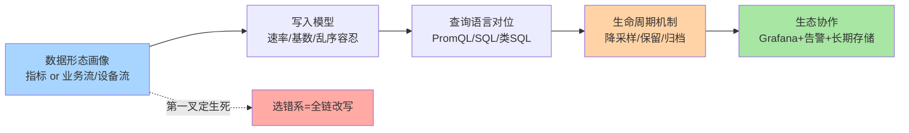
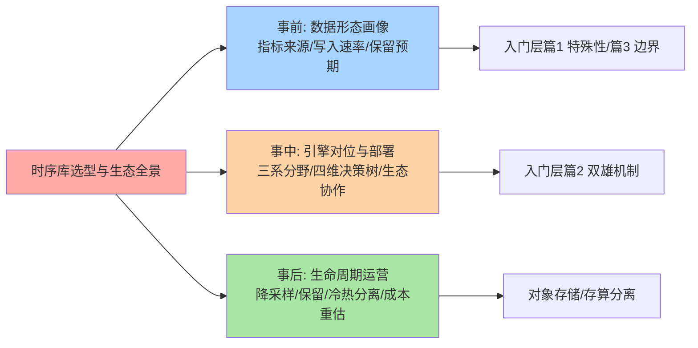
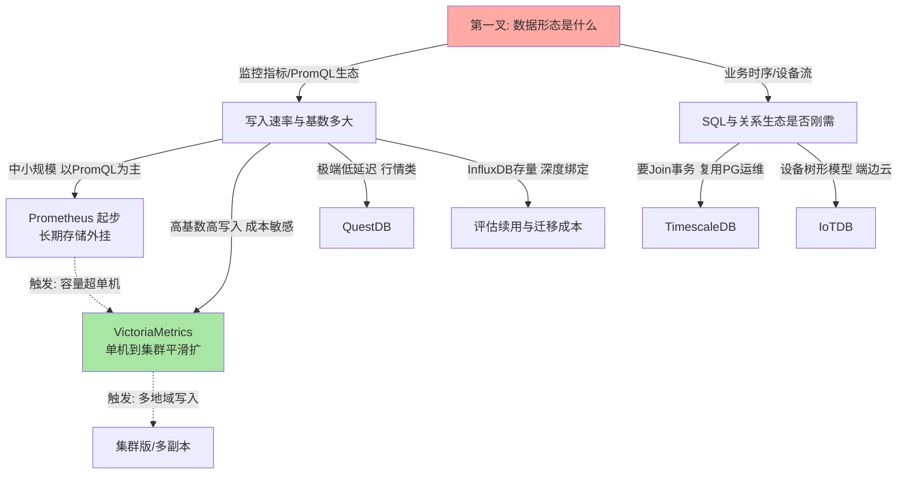
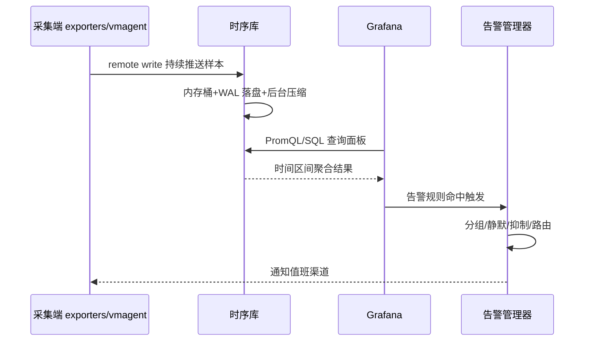
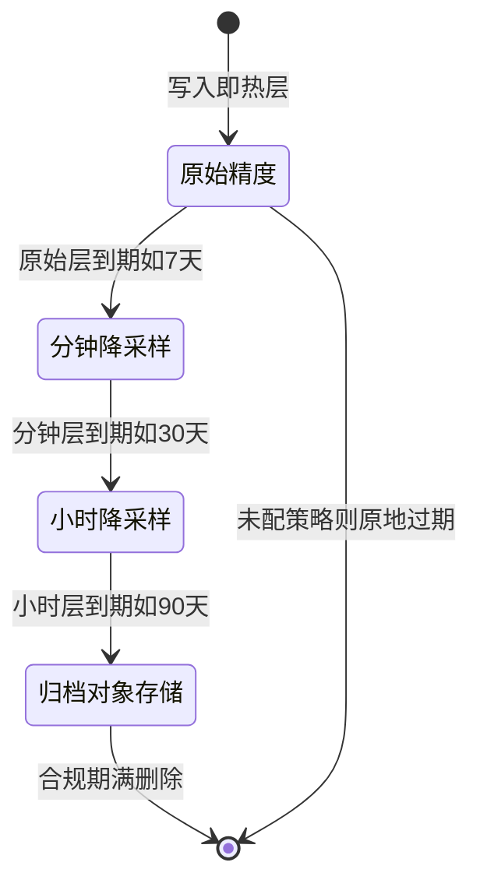

# 时序数据库选型与生态全景：从六强对位到数据生命周期设计

> 一句话：时序库选型不是「哪个引擎最快」，而是「哪个引擎的写入模型、查询语言与生命周期机制，和你数据形态的物理约束最对位」——六款主流引擎各占一个生态位，决策树只问四个维度（写入速率/查询模式/保留策略/集群规模），而生命周期设计（降采样/保留/冷热分离）决定三年后的总成本。

> **本文核心**：时序库生态的对位逻辑 = 三系分野——「监控生态系（Prometheus/VictoriaMetrics）」「通用分析系（InfluxDB/QuestDB）」「生态搭车系（TimescaleDB 借 PostgreSQL、IoTDB 借工业物联网）」；选型决策树的第一叉不是性能而是**数据形态**：PromQL 生态的指标走监控系，SQL 刚需走搭车系，极端写入走专用列存。机制上所有引擎共享同一条底层约束：**时间是唯一不可修改的物理轴**——谁把这个轴上的压缩、分块、过期做到极致，谁就在自己的生态位上赢。

机制坐标一图（深度主线全挂这条链）：

组织主线：生态全景六强对位 → 四维选型决策树 → 与监控系统的生态协作 → 降采样与保留策略 → 长期存储与冷热分离 → 验证/事故/追问/反方案/量级/参数/步骤。入门层系列三篇（《时序数据库是什么与特殊性》《Prometheus 与 VictoriaMetrics 双雄》《场景选型与边界》）已铺过概念与双雄机制，本篇把它们装配成一张可执行的选型地图。

## 一句话摘要

时序数据库选型的完整决策链：①**生态全景**——Prometheus（监控事实标准、拉取采集、PromQL）、VictoriaMetrics（Prometheus 兼容、高压缩高性价比、单机到集群平滑）、InfluxDB（老牌通用、生态绑定深、内核路线转向 Arrow/DataFusion）、QuestDB（极致写入低延迟、SQL、行情类负载）、TimescaleDB（PostgreSQL 扩展、完整 SQL 与事务生态）、IoTDB（Apache 顶级项目、树形设备模型、端边云协同）——三系分野（公开口径，数据截至 2026-09）；②**选型决策树**四维输入：写入速率定单机或集群、查询模式定语言生态、保留策略定生命周期设计、集群规模定架构档位；③**生态协作**——Grafana 数据源与告警规则的兼容性是隐性选型维度，remote write 已成为采集侧事实协议（公开口径）；④**生命周期设计**——原始精度→降采样→归档的三层漏斗决定长期成本；⑤**长期存储**——冷热分离与存算分离把多年数据的存储成本压到全精度常驻的十分之一量级（业内认知）。

## 5W 速记卡

| 维度 | 一句话 |
|---|---|
| What | 六款主流时序库的三系定位 + 四维选型决策树 + 生命周期三层漏斗 |
| Why | 时序负载的物理约束（只追加/按时间聚合/近热远冷）决定选型逻辑与业务库完全不同 |
| Who | 为监控指标、业务埋点、设备数据选存储的团队 |
| When | 新建监控体系、数据量逼近单机瓶颈、监控成本重估、长期存储立项时 |
| Where | 入门层篇 1-3 讲原理与边界（互指），本篇装配成选型与生态全景 |

## 一、生态全景：三系分野与六强对位

六款引擎的对位表（公开口径，数据截至 2026-09；版本与特性以各自官方文档为准）：

| 引擎 | 系别 | 定位一句话 | 查询语言 | 部署形态 |
|---|---|---|---|---|
| Prometheus | 监控系 | 监控生态事实标准，拉取采集+告警闭环原生 | PromQL | 单机+外挂长期存储 |
| VictoriaMetrics | 监控系 | Prometheus 兼容的高压缩高性价比后端 | MetricsQL（兼容 PromQL） | 单机到组件化集群 |
| InfluxDB | 通用系 | 老牌通用时序，工具链与社区存量深 | InfluxQL/Flux | 单机/云版，内核路线多次演进 |
| QuestDB | 通用系 | 极致写入低延迟的列存 SQL 引擎 | SQL+行协议兼容 | 单机为主 |
| TimescaleDB | 搭车系 | PostgreSQL 扩展，SQL/事务/运维全复用 | 完整 SQL | 现有 PG 体系内 |
| IoTDB | 搭车系 | 工业物联网原生，树形元数据+端边云协同 | 类 SQL | 端/边/云多形态 |

### 全景脑图：选型全流程一张图（四色语义）

### 怎么读这张表：三系的基因差异

**监控系的基因是「生态」**：数据模型面向告警场景（时间线+标签集），查询语言 PromQL 已成为监控领域的事实标准（公开口径），换引擎的最大成本不是性能迁移而是 PromQL 表达式与告警规则的改写——所以监控系内部换引擎（Prometheus 与 VictoriaMetrics 互换）成本低，跨系迁移成本高。**通用系的基因是「负载」**：面向高写入的业务时序与设备流，SQL 或类 SQL 降低分析门槛，但监控生态集成要靠数据源插件补。**搭车系的基因是「复用」**：不发明新世界，把时序能力塞进已有生态——TimescaleDB 的赌注是「你的团队已经在运维 PostgreSQL」，IoTDB 的赌注是「工业设备天然是树形结构（电厂→机组→传感器）」，树形元数据让百万测点的元数据管理比扁平标签模型更省心。入门层篇 2 已拆过双雄的存储引擎差异，这里不再重复机制，只保留选型视角的定位差。

## 二、选型决策树：四维输入定引擎

### 维度一：写入速率——单机天花板在哪

写入速率是第一硬件约束：现代单机时序引擎在 NVMe 与充足内存下扛每秒百万级样本点是业内认知水位，超过之后走向两个分叉——监控系换 VictoriaMetrics 集群版（组件化拆分写入/查询/存储），通用系按分片键分区。比速率更早爆的是**基数**（时间线总数）：一条高基数标签（如按用户 ID 打标签）能让时间线数爆炸，内存索引先于磁盘被打穿——基数治理（收敛标签设计）优先于引擎更换，这条在入门层篇 3 的边界讨论里已有铺垫。

### 维度二：查询模式——语言生态比引擎快慢更重要

四类查询形态各有所长：即时查询与告警（PromQL 生态最顺手）、长区间聚合分析（列存引擎+SQL 占优）、关联业务库 Join（TimescaleDB 独占——同实例内 Join 业务表是搭车系独有的能力）、设备树形浏览（IoTDB 的路径查询）。选型的正确问法不是「谁查询快」，而是「你的查询九成落在哪一类」——为 5% 的场景付出 100% 的架构复杂度，是时序选型最常见的过度设计。

### 维度三：保留策略——保留多久决定生命周期设计

保留两周与保留三年的选型完全不同：短保留下任何引擎都够用（默认过期机制覆盖），长保留必须把「降采样+归档」纳入选型硬指标——引擎是否原生支持多精度分层（记录规则/连续聚合/存储层降采样三选一）、是否支持对象存储归档，直接决定三年总成本。这一维度经常被低估：写入层选得再好，没有生命周期设计，磁盘成本会按线性曲线惩罚你三年。

### 维度四：集群规模——架构档位与升级触发

单机（中小规模+短保留）→ 主备/双写（可用性要求）→ 组件化集群（写入过单机上限）→ 多集群联邦（多业务域/多地域）。关键纪律是**升级触发条件前置**：磁盘增速超预算、查询 P95 越线、单机内存到顶——三个信号写进监控，触发即升档，不到触发条件不引入分布式复杂度（反方案分析 §九展开）。

## 三、与监控系统的生态协作

时序库不是孤岛——监控体系的完整链路是「采集端→时序库→可视化→告警→值班响应」，选型时引擎在这条链上的**协议兼容性**比引擎本身的吞吐更值得评估：

三个协作要点：①**remote write 已是采集侧事实协议**（公开口径）——采集端一次配置，后端可替换，这是「先定采集、后选存储」策略的技术底气；②**Grafana 数据源兼容性是隐性选型维度**——面板查询语法不兼容意味着全量面板重写，评估引擎时先跑通「核心十个面板」再谈上线；③**告警规则迁移是跨系迁移最贵的部分**——PromQL 告警规则的语义（for 持续时长、subquery 等）在 SQL 系引擎里要用连续聚合+定时任务重新表达，语义等价性要逐条验证。

## 四、降采样与保留策略设计

降采样的底层原理：把原始精度（如 15 秒一个点）按时间窗口聚合（均值/最大/最小/总和）压成低精度序列（1 分钟/5 分钟/1 小时）。查询「最近 7 天趋势」根本不需要 15 秒精度——降采样让存储量与查询扫描量同时下降一到两个数量级（业内认知）。数据点的完整生命周期是一个状态机：

设计四原则：①**分层精度对齐查询场景**——告警用原始精度、周报用 5 分钟、年报用 1 小时，先盘查询场景再定分层，反过来拍精度表必然分层过剩或不足；②**聚合函数要保真**——最大值和最小值不可逆（降采样后无法还原瞬时尖峰），对尖峰敏感的指标（如延迟 P99）在降采样层要保留 max 或分位数，只存 mean 的降采样层对告警回溯是坑；③**查询自动落层**——理想形态是查询层按时间范围自动路由到对应精度（存储层原生降采样或视图封装），让「查旧数据要换表名」的复杂度不暴露给使用者；④**乱序与回填要预留**——降采样任务重跑（历史数据修正）时幂等性要有保障，否则降采样层的聚合值与原始层对不上账。

## 五、长期存储：对象存储与冷热分离

保留期超过一年，本地盘常驻全精度数据的成本曲线就不可接受了——冷热分离的架构是把「热查询」与「冷保存」拆开：

三条实现路线：①**存算分离架构**（新一代集群形态的方向，公开口径）——存储块直接落对象存储，计算节点无状态弹性伸缩，本地盘只做缓存；②**外挂长期存储组件**（监控系经典形态）——热数据在本地，过期的原始块打包上传对象存储，查询层按时间范围透明回源；③**归档到通用列式格式**（Parquet 类+对象存储生命周期规则）——用极低的成本满足合规保留，代价是回溯查询要走临时导入。路线选择的定价依据是「冷数据被查的频率」：月级以上才查一次的走路线三，季度内有回溯诉求的走路线一或二。对象的存储成本量级：对象存储单价通常比同容量 NVMe 云盘低一个数量级（业内认知，按各云公开定价），这就是冷热分离的经济学根基。

## 六、demo 验证点与报错

选型报告落地前的五道验证关（每道都要有可复现命令与预期输出）：

1. **写入压测关**：用目标标签模型灌入生产形态的样本流 30 分钟，观察写入延迟 P99 与压缩后磁盘增速——预期输出是「写入无失败样本、磁盘增速与容量公式偏差 <20%」
2. **兼容探针关**：核心 10 个面板查询 + 5 条告警规则逐条跑，比对查询结果与现网引擎的一致性——不一致的点（聚合语义差异/时区处理）逐条记录
3. **基数爆炸报错关**：故意灌入高基数标签序列，验证引擎的防护机制（最大时间线数限制）是否生效，报错信息是否可定位到具体指标名
4. **乱序样本关**：注入迟到数据，验证乱序容忍策略（接受窗口/拒绝策略）与监控计数，避免「静默丢点」
5. **故障注入关**：杀存储节点/断 remote write，验证恢复时间与采集端积压回放——回放期间样本时间戳的保留是硬验证点

高频报错三则：基数超限报错（表现为新时间线被拒收，旧曲线还在——监控容易漏报）、磁盘打满只读（引擎转只读模式，写入端堆积）、查询超时（长区间+高精度组合——回到降采样层设计）。

## 七、事故叙事三则

**叙事一：单机 Prometheus 硬扛两年数据，内存先于磁盘崩盘。**某平台初期用单机 Prometheus 存全量指标未配保留策略，两年后时间线数涨到千万级（业内认知量级），表现为查询越慢、最终实例 OOM 重启循环——排查发现内存大头是时间线索引而非样本数据，磁盘反而不满。复盘沉淀：**保留策略与基数治理是运维纪律不是可选项**——未配 retention 的单机 Prometheus 等于定时炸弹，容量公式必须把「时间线数」当第一等输入。

**叙事二：降采样层只存均值，告警回溯丢尖峰。**某团队为省磁盘把 30 天前的数据统一降采样成 1 分钟均值，一次线上故障复盘时需要回看当时的延迟尖峰，发现降采样层里峰值被均值抹平，原始层早已过期——事故证据链断在存储层。复盘沉淀：**降采样聚合函数按指标语义逐类定**（延迟类保 max/分位数、计数类保 sum），「一套均值打天下」的降采样是证据毁灭行为。

**叙事三：标签设计失控引发基数雪崩，remote write 反压拖垮采集。**某服务把用户 ID 放进指标标签，一次营销活动后时间线数一夜暴涨一个量级，时序库内存告警、拒绝新时间线，上游 remote write 积压反压，采集端开始丢样本——排查链条从「查询变慢」最终定位到「一条标签」。复盘沉淀：**基数要有预算与准入**（标签白名单+时间线数告警提前到 70% 水位），新服务上线前标签设计过评审——基数事故的恢复成本远高于事前一次设计评审。

## 八、追问链：把「兼容性」问穿一层

- **追问一：为什么不用 Prometheus 直接扛长期存储，而要外挂组件？**——Prometheus 的本地存储设计目标是「监控自身的窗口」（默认 15 天保留，公开口径），它的压缩与索引为「近期高频查」优化；长期存储的诉求是「低成本+可回溯」，两者物理上矛盾。替代方案是外挂（ Thanos 类或 VictoriaMetrics）：把「热查」与「冷存」交给各自最优的机制。如果不外挂而是硬调大保留期，单机内存与磁盘的双重压力会让查询延迟非线性恶化。
- **再追问：为什么不用关系库分表扛时序，省一套引擎？**——关系库的 B+ 树索引为随机点查设计，时序负载是「持续追加+按时间范围扫」，用行存+二级索引扛写入洪流，索引维护成本先崩；除非数据量在十万级点/天以下（入门层篇 1 拆过这条推导），否则「省一套引擎」省下的是部署成本、赔上的是写入与压缩的量级差距。
- **打破砂锅：为什么降采样不在查询时实时聚合，而要预计算？**——查询时聚合的时间复杂度是「全精度扫描量」，预计算把它换成「存储空间+写入时的一次计算」。降采样本质是把计算成本从「每次查询」摊销到「一次写入」——这是时序场景「写多读少且查询模式可枚举」特性下的经典预计算收益；只有查询模式完全不可预估的即席分析场景，实时聚合才是正解。

## 九、反方案分析：三个「想当然」的代价

- **为什么不上来就上分布式集群版**：分布式的成本是运维复杂度+至少三节点资源+组件间网络心智，中小规模场景单机的性能天花板远在业务天花板之上——「先单机、触发条件到了再集群」是成本纪律，跳过单机验证直接集群化的团队，最终都在分布式调试上还债
- **为什么不用日志平台顺手存指标**：日志引擎（全文索引系）存指标看似「一套平台全管」，代价是索引膨胀（指标的点密度远高于日志事件）与聚合查询性能的量级差距——指标走时序专用压缩，存储效率高出一个数量级（业内认知），混用的平台成本最终以「双倍资源」收场
- **为什么不用定时任务把数据搬到数据仓库当长期方案**：数仓适合「T+1 分析」，不适合「按需回溯原始精度」——搬运链路的时效性、幂等性与 schema 演进都是额外维护面；合规归档用对象存储+列式格式更薄，回溯分析才进数仓

## 十、设计思想：两条值得迁移的设计哲学

- **设计思想一：兼容标准协议是生态扩张的破壁机。**VictoriaMetrics 等后起引擎不约而同选择「先兼容 Prometheus 读写协议再谈差异」，为什么这么设计——协议兼容把「换数据库」的决策成本从「改采集端+改查询端+改告警规则」压缩到「改一个 endpoint」，新引擎得以直接嫁接到存量生态上参与比价。这条设计哲学的反面是自建协议系的生态墙：引擎再快，迁移成本挡住了大多数试用。可迁移的判断：**选型时把「协议兼容性」当作架构资产评估，把自己系统的出口协议标准化当作低成本扩张的杠杆**。
- **设计思想二：把生命周期做成一等公民而非外挂脚本。**时序数据的本质是「每个数据点从写入那一刻就带着到期日」——TimescaleDB 的连续聚合、Prometheus 的保留机制、对象存储的生命周期规则，都在表达同一件事：保留与降采样不是运维脚本，是数据模型的一部分。设计取舍在于「模型内建」（语义一致、跨引擎不可移植）与「外挂编排」（可移植、但一致性要自己保证）之间——新一代引擎普遍选择内建，因为它消除了「脚本失败导致降采样断档」这类最隐蔽的故障面。这条哲学迁移到任何带 TTL 语义的系统（缓存、日志、消息）都成立：**过期策略进模型，不进 crontab**。

## 十一、不同量级的思考：写入速率定义的四个档位

- **十万级点/秒以下——监控驱动**：约束来源是单机资源与运维心智——一台 16C64G 级别的单机引擎配本地 NVMe 扛住这一档的写入与短保留是业内认知水位，上集群只会把问题从「调参」升级成「分布式调试」。这一档的核心问题是「保留期内装不装得下、查询超不超时」，而不是「架构够不够分布式」。思考方式是「监控驱动」：盯住写入速率、压缩后磁盘增速、查询 P95 三条曲线，越线才动架构。
- **百万级点/秒——公式驱动**：约束来源是压缩比与内存索引的物理上限——每秒百万点意味着日增样本千亿级字节量按压缩比倒推磁盘增速（业内认知），内存按活跃时间线数估算，公式算错就是三天后磁盘打满。这一档的核心问题是「容量公式与压缩实测是否对齐」，而不是「参数抄谁的推荐值」。思考方式是「公式驱动」：写入速率×压缩比×保留天数出磁盘预算，活跃序列数×单序列内存成本出内存预算，两条预算线进告警。
- **千万级点/秒——分片驱动**：约束来源是单机写入上限与副本同步带宽——这一档必然走向组件化集群（写入按标签哈希拆分到多个存储节点），每个分片内部仍是单机问题。这一档的核心问题是「分片间负载是否均衡、超高基数序列是否打穿单分片」，而不是「集群节点数够多」。思考方式是「分片驱动」：按均衡性好的标签拆分写入，对不可再分的单个热点序列单独治理（预聚合或降频采集）。
- **亿级样本/天或多地域——架构驱动**：约束来源是机房电力、网络带宽与跨地域复制的物理极限——单集群到顶后问题变成「按业务域拆多集群+采集分层（边缘先聚合再上报）」，写入端先降量比存储端扩容便宜一个量级（业内认知）。这一档的核心问题是「哪些数据值得全精度入库」，而不是「哪个引擎更快」。思考方式是「架构驱动」：采集分层、存储分层、查询路由三层一起设计，任何单点优化都已失效。

**自下而上与触发升级**：先用单机验证（监控驱动），写入越线升集群档并切换公式驱动，分片不均再上分片治理，亿级靠采集端架构降压——升级信号依次是「磁盘增速超预算」「分片热点告警」「单集群写入到顶」，每个信号对应一次思考方式的切换；跳档提问（十万的量问架构问题）只会买到过剩复杂度。

## 十二、参数级配置清单（ADR-0012）

以下为跨引擎的通用参数框架（默认值以 Prometheus 生态公开口径为参考，具体以所用版本文档为准）：

| 配置项 | 默认值参考 | 分档推荐 | 为什么 |
|---|---|---|---|
| 数据保留期 | 15 天（Prometheus 公开口径） | 监控 30-90 天+外挂长期存储；业务时序按合规定 | 默认值是「监控自窗口」定位，不是容量规划 |
| 降采样精度分层 | 无默认（需自建） | 原始 7-30 天→1m 90 天→1h 一年以上 | 分层对齐查询场景，存储量降一两个数量级 |
| 最大时间线数限制 | 部分引擎无默认限制 | 按内存公式定上限+70% 水位告警 | 基数雪崩的唯一硬闸，无限制等于裸奔 |
| remote write 队列/并发 | 单队列默认值偏保守 | 高吞吐场景多队列分片+积压告警 | 队列是写入反压的缓冲带，积压即容量信号 |
| 查询最大时间范围/步长 | 引擎各有上限 | 面板层限定最小步长+范围上限 | 防「长区间×高精度」打穿查询内存 |
| 乱序样本容忍窗口 | 引擎各异（部分默认拒绝） | 按采集链路最大延迟定，带监控计数 | 窗口过小静默丢点，过大增内存排序压力 |
| 副本数 | 单机无副本 | 集群 2 副本起，跨机房再议 | 时序可重采集与不可重采集（业务流）定价不同 |
| 对象存储生命周期规则 | 无默认 | 热层到期自动转低频/归档存储类 | 冷数据的成本曲线靠存储类分级压 |

## 十三、步骤级操作（ADR-0012）

1. **前置**：数据形态画像表（指标来源/写入速率/时间线基数/保留需求/查询形态五列）+ 容量公式两个预算（磁盘/内存）算清，产出选型评审单
2. **部署**：按 §二决策树定引擎后，先在影子环境跑 §六五道验证关，核心面板与告警规则全量迁移试跑一周
3. **验证**：双跑期比对（新旧引擎同期数据逐指标抽样比对聚合结果），兼容探针全绿+写入压测达标后才切流
4. **回退**：采集端 remote write 双写设计（切换只需改配置回指旧引擎）；已切流后的回退要评估「回退窗口内新引擎数据」的补偿导出——双写保留期建议不少于两周
5. **运营**：容量月审（磁盘/内存/时间线数三条预算线）+ 降采样任务成功率监控 + 基数增速周报（新时间线增量 Top 指标）

## 业内惯例

- 监控体系惯例：Prometheus 兼容生态起步，容量或成本到点再评估 VictoriaMetrics 类后端；告警规则随引擎走兼容层，不轻易跨系
- 迁移惯例：双写两周以上+聚合结果抽样比对，切流按「非核心指标→核心指标」灰度；旧引擎数据保留到合规期满再下线
- 成本惯例：容量按「压缩后」估算而非原始点数；长期存储立项前先做降采样收益测算（通常先省一半再谈归档）
- 治理惯例：指标命名与标签设计走规范评审（标签白名单），新增指标接入走准入——基数是预算资源不是免费品

## 你们可能会问

**Q1：Grafana 直接接云厂商托管监控服务，还需要自建时序库吗？**
托管服务省运维，代价是成本可控性与数据主权（查询自由度、导出限制、按量计费的不可预期）。判据是规模与定制深度：指标量小、以标准主机/容器监控为主的团队，托管更快；指标量大、有业务自定义指标与长期回溯诉求的，自建（或自管集群版）的成本曲线在规模化后更优——两条路都先用「三年总成本」公式算，不要凭直觉。

**Q2：PromQL 学了会不会白学（引擎换了语言就废）？**
PromQL 已是监控领域事实标准（公开口径），主流监控系引擎都以兼容它为卖点，学它的迁移保值率高。真正的风险在「通用系引擎的专有查询语言」——选型时把「查询语言的可迁移性」列为硬指标：SQL 系互迁移成本低，专有语言要评估社区存量和工具链宽度。

**Q3：指标、日志、链路追踪要不要统一到一个存储里？**
统一信号存储（可观测性一体化的方向）的收益是关联分析体验，代价是单引擎对三类负载都「够用但非最优」。务实路线：采集层统一协议（OpenTelemetry 类标准，公开口径），存储层按负载特性分引擎，查询层做关联视图——「协议统一、存储专业、呈现关联」是当前工程上的收敛解。

**Q4：边缘设备/弱网环境的数据怎么进时序库？**
端边云三层：端侧轻量形态（IoTDB 的端侧部署为代表，公开口径）本地缓存与预处理，边缘节点聚合降频，云端全量入库——边缘先降采样能砍掉一个量级的上行带宽。选型时把「断网续传+时间戳保真」列为硬验证点，弱网场景丢点方式（丢新还是丢旧）要按业务语义定。

## 十四、什么时候用 / 不用

- ✅ 用监控系（Prometheus/VictoriaMetrics）：指标监控、告警驱动、PromQL 生态、成本敏感的高基数量场景
- ✅ 用搭车系（TimescaleDB/IoTDB）：SQL 与业务库 Join 刚需、复用现有 PG 运维、工业设备树形模型
- ✅ 用通用系（QuestDB/InfluxDB）：极端写入低延迟（行情类）、已有深度生态绑定
- ❌ 不用时序库：需要事务与随机更新的业务状态数据（那是关系库的领地）；十万级点/天以下的玩具量（脚本+关系库足够）
- ❌ 不做：没有容量公式与基数预算就上生产；没有降采样设计就承诺多年保留

## Trade-off：专用、搭车与托管的三角

时序存储的每个决策都在「性能—生态—运维成本」三角里定位：专用引擎买性能与压缩（付出独立运维与生态孤岛成本），搭车系买生态复用（付出极限性能上限），托管服务买运维省心（付出成本可控性与数据主权）。**三角的支点是数据形态画像**——写入速率、保留期、查询模式三列画出来，最优点自然浮现；跳过画像谈三角，每个选择都是玄学。这套「画像定支点」的方法与通用数据库选型（互指 data 整合层数据库体系系列）完全同构，时序只是把「生命周期成本」的权重推到了最大。

## 跨周期视角：五年后的时序生态

三条演化线：①**采集协议收敛**——OpenTelemetry 类标准统一指标/日志/追踪的采集与语义约定（公开口径的趋势方向），存储引擎的「采集绑定」优势被削弱，竞争焦点转向存储与查询本身；②**存算分离常态化**——对象存储为底的弹性架构从新一代引擎的卖点变成标配，本地盘部署的心智逐步退场；③**查询层 AI 化**——异常检测与根因定位对时序库提出「向量邻接+时序聚合混合查询」的新接口需求，时序库与向量能力的交汇是值得关注的方向。方法论层面的启示：**决策树四维（速率/模式/保留/规模）的框架长存，维度里的具体引擎五年一换**——这正是「记约束、忘产品名」的选型学习法。

## 开放问题

- 流式聚合的边界：采集端预聚合（agent 侧降频）与存储端降采样的职责线在哪，随采集层算力普及会持续移动
- 时序库与数据湖的融合：Icebreaker 式开放表格式上的时序查询（公开口径的社区方向）会不会把「长期存储」从时序库职能中剥离
- 高基数实时 OLAP 与时序库的边界：以「可聚合维度建模」的分析型负载，到底归时序库还是归 OLAP 引擎，业界尚无收敛答案

## 💡 实战提示

- 💡 容量公式两个预算（磁盘=速率×压缩比×保留；内存=活跃时间线×单序列成本）写进选型文档——没有公式的选型是拍脑袋
- 💡 基数治理优先于换引擎——时间线爆炸时换库只是把雪崩换个地方发生
- 💡 降采样聚合函数按指标语义逐类定——延迟类保 max/分位数，均值打天下等于毁灭事故证据
- 💡 迁移走「双写两周+抽样比对」——remote write 协议兼容是双写的技术底气
- 💡 升级触发条件（磁盘增速/P95/内存水位）提前写进监控——到线升档，不到线不加分布式复杂度

## 自测三问

1. 三系分野的划分依据是什么？为什么跨系迁移比系内迁移贵？
2. 降采样四原则里「聚合函数保真」防的是哪类事故？
3. 四个量级档各自的思考方式是什么？升级触发信号依次有哪些？

## 🎯 核心带走

- **核心一句话**：时序选型 = 数据形态画像 → 三系对位 → 四维决策树（速率/模式/保留/规模）→ 生命周期三层漏斗——第一叉选错系，全链改写
- **三系**：监控系（生态/PromQL）、通用系（负载/写入）、搭车系（复用/SQL 或设备模型）
- **哪里会坏**：基数雪崩（内存先崩）、降采样丢尖峰（证据断链）、无保留策略（磁盘线性惩罚）
- **成本线**：降采样先省一半，归档对象存储再降一个量级（业内认知）——生命周期设计决定三年总成本
- **量级迁移**：十万级监控驱动、百万级公式驱动、千万级分片驱动、亿级架构驱动

## 📌 数据与事实声明

- 写于 2026-09-25；引擎定位与特性描述为公开口径，数据截至 2026-09，以各引擎官方文档为准；「压缩率」「成本量级」「单机水位」等数字为业内认知或公开定价口径，按自有负载实测校准
- 事故叙事为业内高频时序运维事故模式的匿名化叙事，非特定公司事件
- 免责：默认值与版本路线随演进变化，以对应版本文档为准

## 📚 参考资料

| 类型 | 标题 | 来源 |
|---|---|---|
| 官方文档 | Prometheus 存储与 retention 配置 | prometheus.io/docs |
| 官方文档 | VictoriaMetrics 集群架构与容量规划 | docs.victoriametrics.com |
| 官方文档 | TimescaleDB 压缩与连续聚合 | docs.timescale.com |
| 官方文档 | Apache IoTDB 端边云协同架构 | iotdb.apache.org 官网 |
| 官方文档 | InfluxDB 3.0 内核与 QuestDB 文档 | 各自官方文档站 |
| 系列内 | 入门层三篇：特殊性/双雄机制/场景边界 | 本仓库 timeseries/入门层 |
| 关联篇 | 数据库全景与选型决策树 | 本仓库 data/整合层 |
