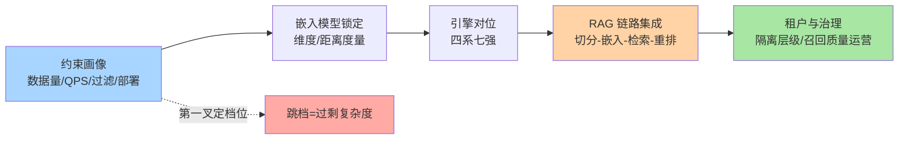
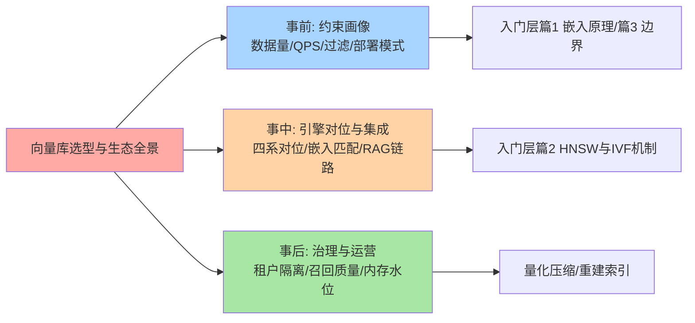
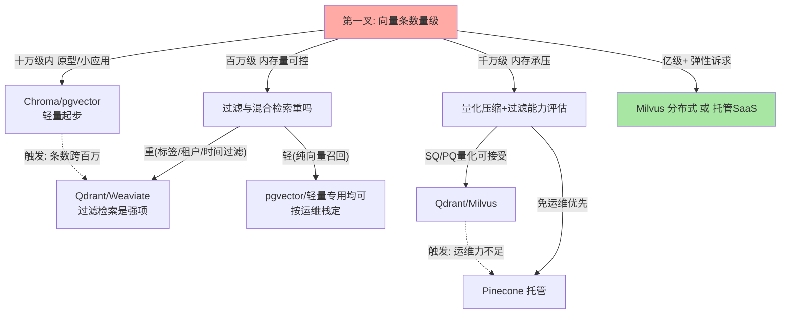
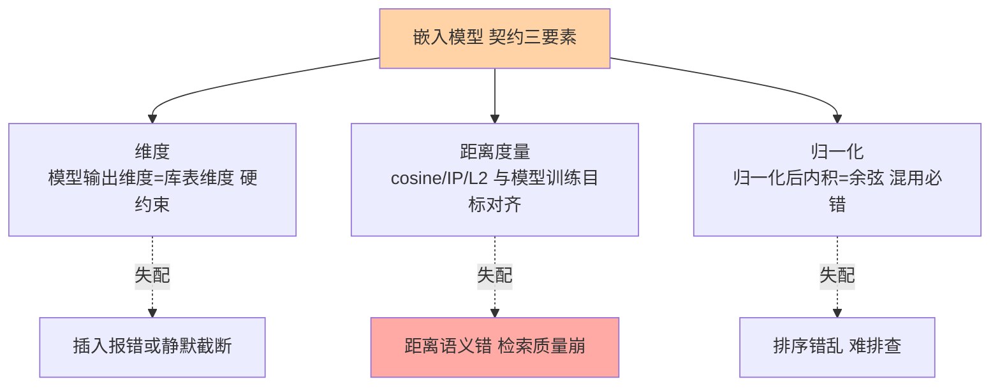
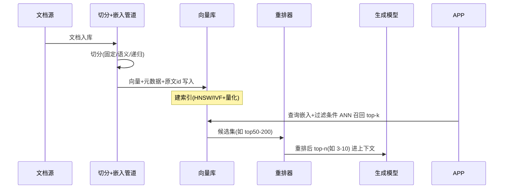
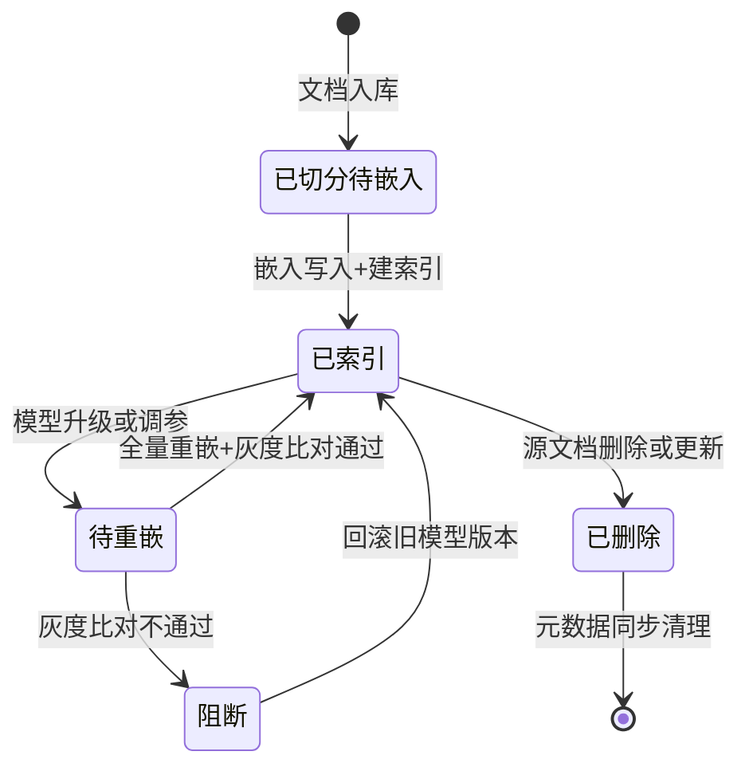
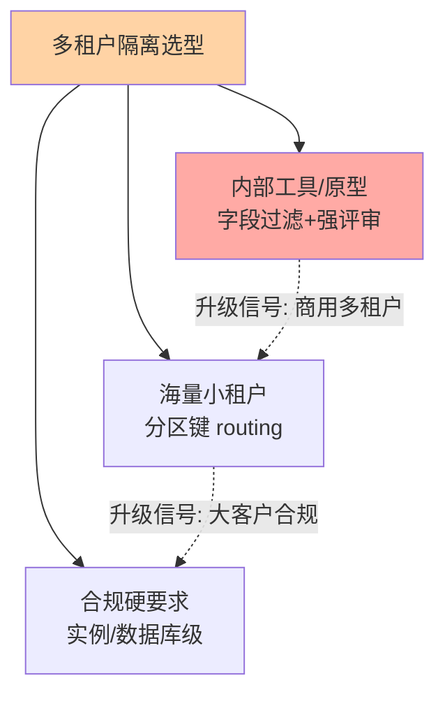

# 向量数据库选型与生态全景：从七强对位到 RAG 全链集成

> 一句话：向量库选型不是「谁的索引最快」，而是「数据量、QPS、过滤需求、部署模式四个约束落在哪个生态位上」——七款主流产品分四系（分布式专用/轻量专用/托管 SaaS/生态搭车），而检索质量的真相是**链路属性**：切分、嵌入、检索、重排四环相乘，向量库只是其中一环，选型要按整条 RAG 链路定价。

> **本文核心**：向量库生态的对位逻辑 = 四系分野——「分布式专用系（Milvus）」「轻量专用系（Qdrant/Weaviate/Chroma）」「托管 SaaS 系（Pinecone）」「生态搭车系（pgvector/Redis）」；选型决策树的第一叉是**数据量**：百万条以内轻量或搭车系即可，千万条进入索引经济学（量化压缩换内存），亿级才值得为分布式付出运维代价。机制底层是同一条物理约束：**高维近似检索（ANN）是内存与算力的交易市场**——索引结构、量化压缩、过滤策略全部在这笔交易里定价。

机制坐标一图（深度主线全挂这条链）：

组织主线：生态全景七强对位 → 四维选型决策树 → 嵌入模型与向量库的匹配 → RAG 全链集成 → 多租户与权限隔离 → 验证/事故/追问/反方案/量级/参数/步骤。入门层系列三篇（《向量数据库是什么与嵌入原理》《索引算法 HNSW 与 IVF》《场景选型与边界》）已铺过嵌入原理与索引机制，本篇把它们装配成一张可执行的选型地图。

## 一句话摘要

向量数据库选型的完整决策链：①**生态全景**——Milvus（开源分布式、存算分离、十亿级向量，公开口径）、Qdrant（Rust 单二进制、轻量、过滤检索强）、Weaviate（模块化、内置混合检索）、Chroma（嵌入式、原型起手）、Pinecone（全托管 SaaS、免运维、无自建）、pgvector（PostgreSQL 扩展、事务与 SQL 生态全复用）、Redis（缓存栈内向量检索、低延迟、内存成本高）——四系分野（公开口径，数据截至 2026-09）；②**选型决策树**四维输入：数据量定档位、QPS 定副本与缓存、过滤需求定混合检索能力权重、部署模式定自建/托管；③**嵌入匹配**——维度与距离度量是向量库与模型之间的硬契约，换模型等于全量重嵌；④**RAG 集成**——切分→嵌入→检索→重排的四环链路，向量库只负责「召回」，重排决定最终质量上限；⑤**多租户**——从实例级到字段过滤级的五档隔离，成本与隔离强度成反比。

## 5W 速记卡

| 维度 | 一句话 |
|---|---|
| What | 七款主流向量库的四系定位 + 四维选型决策树 + RAG 四环链路集成 |
| Why | 高维相似检索的物理约束（内存墙/近似换速度/过滤与召回的耦合）决定选型逻辑与关系库完全不同 |
| Who | 为语义搜索、RAG、推荐召回选存储的团队 |
| When | 新建语义检索/RAG 立项、数据量跨档位、嵌入模型升级、多租户改造时 |
| Where | 入门层篇 1-3 讲嵌入与索引原理（互指），本篇装配成选型与生态全景 |

## 一、生态全景：四系分野与七强对位

七款产品的对位表（公开口径，数据截至 2026-09；版本与特性以各自官方文档为准）：

| 产品 | 系别 | 定位一句话 | 部署形态 | 适用量级（业内认知） |
|---|---|---|---|---|
| Milvus | 分布式专用系 | 开源分布式，存算分离，十亿级向量 | 组件化集群（依赖消息队列/对象存储） | 千万到亿级+ |
| Qdrant | 轻量专用系 | Rust 单二进制，过滤检索与量化能力均衡 | 单机起步到集群 | 百万到千万级 |
| Weaviate | 轻量专用系 | 模块化，内置混合检索（BM25+向量） | 单机到集群/托管 | 百万到千万级 |
| Chroma | 轻量专用系 | 嵌入式，原型与本地开发友好 | 进程内/轻量服务 | 十万级以下起步 |
| Pinecone | 托管 SaaS 系 | 全托管免运维，无自建选项 | 纯托管 | 全量级覆盖 |
| pgvector | 生态搭车系 | PostgreSQL 扩展，事务/Join/运维全复用 | 现有 PG 实例内 | 千万级以内常见 |
| Redis | 生态搭车系 | 缓存栈内向量检索，极低延迟 | 缓存集群内 | 百万级热点集 |

### 全景脑图：选型全流程一张图（四色语义）

### 怎么读这张表：四系的基因差异

**分布式专用系的基因是「规模」**：Milvus 把存算分离做进架构基因（查询/写入/存储组件分离），十亿级向量的横向扩展是它的主场，代价是组件栈重——消息队列、对象存储、元数据服务一个不少，运维心智是全系最高。**轻量专用系的基因是「均衡」**：单二进制或轻服务起步，ANN 索引与过滤检索的核心能力不打折，千万级以内是它们与专用系的舒适区重叠带。**托管 SaaS 系的基因是「省心」**：运维面归零，代价是成本可控性、数据主权与迁移锁定。**生态搭车系的基因是「复用」**：pgvector 的赌注是「你的数据本来就该和业务表在一个事务里」，Redis 的赌注是「热点向量集值得住内存」——搭车系把向量检索变成已有基础设施的一个能力，而不是一套新系统。入门层篇 2 已拆过 HNSW 与 IVF 的索引机制，这里只保留选型视角。

## 二、选型决策树：四维输入定引擎

### 维度一：数据量——第一约束是内存墙

向量条数×维度×4 字节是原始向量内存的粗算底（768 维单条约 3KB，业内认知），再叠加索引结构开销（HNSW 邻接表）——千万级 768 维原始向量就是数十 GB 内存起步，这是「量级定档位」的物理根源。数据量决策的完整链条：量出条数与维度→算原始内存→叠加索引开销系数→对照单机内存预算→决定是否进入量化压缩或分布式。入门层篇 2 的索引机制在此变现为选型语言：HNSW 换召回与延迟、IVF+量化换内存，两笔交易的选择权就是档位的分界线。

### 维度二：QPS——副本、缓存与量化三角

QPS 决策的机制链：单副本检索吞吐受 CPU 核数与内存带宽约束→横向扩副本线性加吞吐→热点查询集用缓存削峰。三个常被忽略的点：①带过滤条件的 QPS 压测要按「最坏过滤组合」测（过滤选择性差时 P99 劣化远大于纯向量查询）；②量化压缩会降单核吞吐（反量化计算），高 QPS 场景要在「内存省」与「CPU 费」之间重算账；③嵌入计算本身是 QPS 链路的前置瓶颈——检索 QPS 上去之前，嵌入服务的吞吐先到顶。

### 维度三：过滤需求——混合检索能力定权重

RAG 场景九成需要「向量+元数据过滤」（按租户/时间/文档类型/权限过滤后再 ANN），过滤的实现机制决定性能与正确性：预过滤（先按标量筛再向量检索）在选择性高时快、低时慢；后过滤（先 ANN 再筛）可能凑不满 top-k；过滤属性是否建索引、过滤与 ANN 的联合优化（如按过滤条件选索引遍历策略）是各引擎的真正差异点（入门层篇 3 的边界讨论有铺垫）。选型动作：拿真实业务的过滤组合跑基准，不要信纯向量 benchmark——过滤是向量库评测里水分最大的部分。

### 维度四：部署模式——自建、托管与搭车

三选一的定价维度：**自建专用/轻量系**买可控性与成本（付出运维面），**托管 SaaS** 买免运维（付出成本曲线与数据主权），**搭车系**买「一套运维栈」（付出规模上限）。团队运维力的诚实评估是关键输入：没有专职运维的团队上组件化分布式集群，省下的钱会以故障工单的形式加倍还回去（事故叙事二佐证）。

## 三、嵌入模型与向量库的匹配关系

嵌入模型与向量库之间是**硬契约**关系——三处契约点任何一处失配，检索质量静默崩塌：

三条纪律：①**维度由模型定，向量库被动适配**——不同模型的输出维度不同（数百到数千维都有，公开口径常见模型从 768 到 3072 维量级），建表前先锁模型再定 schema；②**距离度量跟训练目标走**——模型文档声明的度量（多为余弦相似度）就是正确答案，自作主张换度量等于用错误的尺子量距离；③**归一化状态要在链路里显式管理**——归一化后的向量内积等价于余弦（数学恒等式），但「库内做了归一化、查询侧没做」的半吊子状态会产生最难排查的排序错乱。最深的一条推论：**换嵌入模型=全量重嵌+重建索引**，语义空间整体迁移，新旧向量不可混写——模型选型是比向量库选型更不可逆的决策，升级模型要按数据迁移项目级对待（事故叙事一佐证）。

## 四、与 RAG 架构的集成模式

向量库在 RAG 链路里的真实角色是「召回引擎」——完整链路四环相乘：

链路的另一面是向量条目的生命周期状态机——「文档更新与向量一致」的治理就挂在这台状态机上：

四环各自的失效面与集成要点：①**切分**决定召回粒度——切太碎语义不完整（单块无信息量），切太粗召回不精准（一块混多个主题），固定窗口+重叠是保守起点，语义切分是质量升级；②**嵌入**是全链路的语义地基——嵌入模型的语义覆盖边界（如领域术语）直接封顶检索质量，模型不行后面全白搭；③**检索**环节向量库负责——混合检索（BM25 关键词+向量语义双路召回再融合）对专有名词、编号类查询是显著补强，这也是 Weaviate 类内置混合检索的选型加分项；④**重排**是质量的最后一道闸——ANN 召回是「快而糙」，交叉编码器类重排器把候选集精排出「准」的 top-n，召回数（如 50-200）与重排后进上下文数（如 3-10）是两个独立参数，分开调。链路治理要点：**文档更新与向量的一致性**（删除文档要同步删向量，更新要重嵌，幂等键用「文档 id+块序号+模型版本」组合）是 RAG 系统最常见的脏数据来源。

## 五、多租户与权限隔离

SaaS 化向量检索的必修课，五档隔离按强度与成本排序：

| 隔离档 | 机制 | 隔离强度 | 成本 | 适用 |
|---|---|---|---|---|
| 实例级 | 每租户独立集群 | 最强（网络/资源全隔离） | 最高 | 强合规大客户 |
| 数据库级 | 同集群不同 database | 强（逻辑全隔离） | 中高 | 中大租户 |
| 集合级 | 每租户一个 collection | 中（无资源隔离，元数据膨胀） | 中 | 租户数可控场景 |
| 分区级 | 分区键按租户路由 | 中低（同集合内物理分区） | 低 | 海量小租户主流解 |
| 字段过滤级 | 查询强制带租户过滤 | 软（依赖查询方自觉） | 最低 | 原型/内部工具 |

三条纪律：①**字段过滤级隔离不能承载商用租户边界**——「查询方忘带过滤条件」是必然发生的故障，不是小概率事件（事故叙事三佐证）；商用场景至少分区级，并在网关层强制注入租户条件；②**集合级隔离要算元数据账**——每集合一份索引与元数据，十万个租户=十万个 collection 的调度与内存开销，海量小租户用分区键（partition key 类机制，公开口径为各主流引擎通行能力）；③**权限校验在检索链路的位置要前置**——向量库内部的租户过滤是最后一道闸，应用层的鉴权（谁能查哪个租户）在其上游，两层都不能省。

## 六、demo 验证点与报错

选型落地前的五道验证关（每道都有可复现命令与预期输出）：

1. **召回质量关**：构造标注评测集（查询-期望结果对），对比各引擎 top-k 召回率——预期输出是「同索引参数下召回率差异 <2%（业内认知的引擎间合理差距）」，差距大先查距离度量与归一化配置
2. **过滤组合关**：按真实业务最坏的过滤组合（选择性最差的属性）压测 P99——纯向量 benchmark 达标而过滤组合崩掉的引擎直接淘汰
3. **内存实测关**：灌入目标量级数据，实测「原始向量+索引+元数据」三部分内存/磁盘占用，对照容量公式偏差 <20%
4. **故障注入关**：杀节点/中断索引构建，验证副本切换与索引重建的恢复时间，增量写入在重建期间不丢
5. **报错语义关**：故意灌维度不符向量（预期明确报错而非静默）、越界过滤字段（预期报错或空结果且可解释）、观察乱序与重复 id 的处理策略

高频报错三则：维度失配报错（模型换了 schema 没换——必须在写入层拦截）、过滤属性未建索引导致全扫（表现为带过滤查询 P99 数倍劣化）、内存打爆 OOM（量化没开或预算公式漏了索引开销）。

## 七、事故叙事三则

**叙事一：换嵌入模型未全量重嵌，新旧向量混写，检索质量静默劣化。**某语义搜索系统升级嵌入模型后，为省时间只对增量文档用新模型，存量向量未迁移——线上表现为「老文档越来越搜不到」，排查数周才发现是两个语义空间的向量在同一集合里被强行比距离（维度恰好相同的两个模型）。复盘沉淀：**模型版本进向量元数据，混写在校验层直接拒绝**——语义空间迁移是项目级工程，不是开关级变更。

**叙事二：轻量引擎硬扛分布式负载，索引重建拖垮线上。**团队为省运维成本用单机引擎承载逼近亿级的向量集，一次索引参数调优触发全量重建，重建期内存翻倍直接 OOM，线上检索中断——复盘发现该量级在单机引擎的舒适区之外，重建窗口与内存水位从未做过演练。复盘沉淀：**档位决策要看「最重运维动作」的可行性，不看「日常读写」的可行性**——日常跑得动不等于重建得住，跨档位的省运维最终以事故形式补课。

**叙事三：字段过滤软隔离上线商用租户，查询遗漏导致跨租户数据串访。**多租户早期用「约定查询必带租户过滤字段」的软隔离，某新接入的客户端漏带条件，A 租户检索返回了 B 租户文档——数据越权事故，等级最高的那一类。复盘沉淀：**租户边界必须落在存储层强制机制**（分区键路由或服务端强制注入过滤），「靠调用方自觉」的隔离设计等于没有隔离；修复后网关层统一注入+存储层分区路由双闸。

## 八、追问链：把「过滤」问穿一层

- **追问一：为什么不用关系库/搜索引擎的向量插件一站式搞定？**——插件形态（如关系库扩展）的真实边界在「量级与过滤复杂度」：千万级以内、过滤模式简单时，插件复用运维栈是正解；量级上去后，专用引擎在索引结构（专为 ANN 设计的图/量化结构 vs 通用索引外挂）与内存管理上的差距是量级性的。替代方案的评估公式：迁移成本 vs 性能差距 vs 触达量级的时间点——「插件起步、按量级迁移」是务实路线，但要预设迁移触发线，不要等到性能崩了再迁。
- **再追问：为什么重排不内置进向量库，要放应用层？**——重排器（交叉编码器类）的推理是算力密集型，与向量库的资源画像（内存带宽型）完全不同，内置会把两种异构负载塞进一套资源池互相干扰；分层架构（库管召回、服务管重排）让两者独立伸缩。如果不做重排会怎样——top-k 的排序精度受 ANN 近似误差影响，召回「进了前 50 但没排进前 5」的候选被浪费，RAG 上下文质量显著掉档；重排是用一次精排计算把「召回率」变现为「上下文质量」。
- **打破砂锅：为什么向量检索必须近似（ANN），不能像关系库那样精确？**——精确最近邻要全量算距离，复杂度随条数线性增长，亿级向量单查询就是亿次数值比较（入门层篇 1 的几何直觉）；ANN 的机制是把「距离计算量」换成「索引预计算+概率性召回」，用 95%+ 的召回率（业内认知的工程可接受水位）换三个数量级的延迟下降。这不是工程妥协而是问题重定义：语义检索场景里「差不多的近邻」就是业务语义本身——语义近没有唯一全序，「第 42 名还是第 43 名」对用户无感。

## 九、反方案分析：三个「想当然」的代价

- **为什么不上来就上分布式全家桶**：分布式向量库的组件栈（消息队列/对象存储/元数据服务）是真实的运维税，千万级以内单机或轻量集群的性能天花板远未触达——「先轻量、量级触发再迁移」的成本纪律与时序库选型同构；跳档的直接集群化的团队，都在组件调优上还债
- **为什么不用缓存库当主力向量存储**：缓存栈的向量能力上限明确（内存成本按条数线性、持久化与索引重建机制不如专用引擎成熟），它适合的是「热点小集」而非主力库——把亿级向量住进内存的价格，够买一套专用引擎加最好的 SSD 还有富余（业内认知的量级判断）
- **为什么不自研 Faiss 类索引服务**：开源索引库（Faiss 类）提供的是算法原语不是产品能力——持久化、增量更新、副本、过滤、多租户、监控全要自建，自研的真实成本是「一套存储系统」而非「一次集成」；除非检索是产品的核心竞争力且规模到了商业引擎的能力边界，否则自研是负期权

## 十、设计思想：两条值得迁移的设计哲学

- **设计思想一：ANN 是内存与算力的交易市场。**向量库的一切核心参数（索引类型、量化精度、候选集大小）都是同一笔交易的不同报价：HNSW 用内存买延迟与召回，IVF+PQ/SQ 量化用召回点数换内存存量，重排用计算买排序精度。为什么这么设计——高维距离计算没有 shortcut（维度灾难下剪枝理论失效），工程上唯一的自由度就是「预计算什么、在线算什么」。这条哲学的迁移价值：评估任何检索系统先问「它的交易报价表是什么」——参数调优就是在这张报价表上重新下单，而不是碰运气。
- **设计思想二：检索质量是链路属性不是库属性。**切分质量×嵌入质量×召回质量×重排质量的乘积才是最终效果——任何一环为零，乘积为零。为什么这样设计是行业共识而不是各家发明——语义检索的效果瓶颈长期在「表示层」（切分与嵌入）而非「检索层」，向量库厂商把混合检索与内置嵌入做进产品，本质是对「链路属性」的承认。设计取舍在于「一体化」（厂商全家桶，链路内部调优省心但锁定）与「分层组装」（各环节最优解自由组合但集成面自担）——RAG 框架层的成熟让分层组装的集成成本持续下降，这是当前的主流形态。

## 十一、不同量级的思考：向量条数定义的四个档位

- **十万级条以内——原型驱动**：约束来源是开发效率与迭代速度——pgvector/Chroma/轻量专用引擎单机形态完全覆盖（业内认知），索引参数用默认值即可，上分布式是负资产。这一档的核心问题是「检索质量评测集建起来没有、切分策略对不对」，而不是「引擎选哪个」。思考方式是「原型驱动」：快速跑通全链路，用真实查询调切分与嵌入，引擎此时是可替换件。
- **百万级条——召回驱动**：约束来源是内存开始有感与召回质量可度量——原始向量+索引开销在十 GB 级内存内（768 维业内认知估算），HNSW 的 M/ef 参数从默认值进入调优视野。这一档的核心问题是「召回率评测量化做了没有、P99 达不达标」，而不是「要不要量化压缩」。思考方式是「召回驱动」：建立标注评测集作为质量基准，参数变更以评测分数为准入。
- **千万级条——索引驱动**：约束来源是内存成本曲线与量化损耗——原始常驻进入数十 GB 到百 GB 级（业内认知），SQ/PQ 量化（4-32 倍压缩区间，公开口径）从可选项变成必选项，召回率与压缩比的交易要逐档实测。这一档的核心问题是「量化后召回掉几个点、业务接不接受」，而不是「哪个引擎跑分高」。思考方式是「索引驱动」：索引类型×量化档位×过滤模式的三维实测矩阵，按业务召回底线反推配置。
- **亿级条以上——架构驱动**：约束来源是单机内存与横向扩展协议——分片（数据水平拆）与副本（查询吞吐放大）职责分离：分片数量决定「查全」（每片都要扫）、副本数量决定「查快」（并行摊 QPS），两者的成本差数倍。这一档的核心问题是「分片与副本各要多少、跨片查询的尾延迟怎么治」，而不是「单机参数怎么调」。思考方式是「架构驱动」：分片键设计、副本拓扑、分层缓存（热点向量集驻内存）三层一起设计，引擎参数已非主要矛盾。

**自下而上与触发升级**：先原型跑通质量基线（原型驱动），百万级建评测集切召回驱动，千万级上量化实测切索引驱动，亿级做分片副本架构设计——升级信号依次是「内存预算击穿」「评测分数与延迟不可兼得」「单机重建窗口不可接受」，每个信号对应一次思考方式切换；十万的量问架构问题，买到的只有过剩复杂度。

## 十二、参数级配置清单（ADR-0012）

跨引擎的通用参数框架（默认值以主流引擎公开文档常见值为参考，具体以所用版本文档为准）：

| 配置项 | 默认值参考 | 分档推荐 | 为什么 |
|---|---|---|---|
| 距离度量 | cosine（多数模型口径） | 跟嵌入模型文档走，不自定 | 度量错=距离语义错，质量静默崩 |
| HNSW M（每点邻接数） | 16 上下（公开口径常见值） | 百万级 16；亿级或高维适当上调 | 邻接密度决定图连通性与内存开销 |
| HNSW ef_construction | 100-200 | 建库期上调、查询期无关 | 建图质量的一次性投入 |
| HNSW ef_search（查询期） | 与 top-k 挂钩的默认 | P99 不达标时逐步上调 | 查询期唯一旋钮：延迟换召回 |
| IVF nlist/nprobe | nlist 按条数开方量级 | 千万级 IVF+量化；nprobe 按召回底线调 | 聚类桶数与探查桶数是 IVF 双旋钮 |
| 量化压缩 | 默认关闭 | 千万级起 SQ8 类；内存极限用 PQ | 压缩比与召回损耗逐档实测 |
| top-k 召回数 | 10 上下 | RAG 场景召回 50-200 交重排器 | 召回与精排分离，两参数独立调 |
| 内存预留（索引重建） | 引擎各异 | 预留峰值 1.5-2 倍预算 | 重建是内存事故第一高发窗口 |
| 副本数 | 1 | 检索 SLO 硬的场景 2-3 | 副本买吞吐与可用性，存储翻倍定价 |

## 十三、步骤级操作（ADR-0012）

1. **前置**：锁定嵌入模型（维度/度量/归一化三要素写入 schema 契约）+ 数据量与最坏过滤组合画像 + 标注评测集（查询-期望结果对）先于引擎选型建好
2. **部署**：影子环境灌目标量级真实形态数据，按 §十二初配建索引，产出内存/磁盘实测对照容量公式
3. **验证**：§六五道关（召回质量/过滤组合/内存实测/故障注入/报错语义）全绿；评测集召回率与 P99 双达标后切流
4. **回退**：新旧 collection 版本化双存（别名切换机制，主流引擎通行能力，公开口径）；切流后旧 collection 保留不少于一个模型重嵌窗口；嵌入管道变更与引擎变更分开上线，各自可独立回退
5. **运营**：召回质量月评（评测集分数进看板）+ 内存水位与重建窗口演练季度化 + 慢查询归因（过滤未命中索引/ef 偏低/分片热点三查）

## 业内惯例

- 起步惯例：百万级以内用搭车系或轻量专用起步，预设「量级迁移触发线」写进架构文档，避免临时逃亡
- 评测惯例：检索质量以标注评测集为准（业务自建），不信通用 benchmark——过滤组合与领域术语让公开跑分失去参考性
- 迁移惯例：引擎迁移双写期+评测集分数比对+抽样人工盲测三重验收；嵌入模型升级单独立项，全量重嵌+灰度比对
- 治理惯例：向量元数据必带「模型版本+文档 id+块序号」组合键；租户边界落存储层强制机制，字段过滤仅限内部工具

## 你们可能会问

**Q1：RAG 框架（LangChain 类）自带向量库抽象，还要认真选型吗？**
框架抽象统一了接口，但没统一能力边界——过滤性能、混合检索质量、量化选项、租户机制在抽象层之下差异巨大且被隐藏。框架适合原型期「不选」，生产期要「穿透抽象」按 §二四维重新评估；尤其多租户与权限隔离，框架抽象目前普遍不覆盖，必须自己设计。

**Q2：嵌入模型该选开源自部署还是 API 服务？**
判据是数据敏感性与量级：敏感语料出域受限则自部署（开源模型质量已可满足多数场景，公开口径）；API 服务省运维且模型迭代跟手，但要注意「API 模型静默升级」对向量一致性的破坏——锁定模型版本号并把「版本变更通知」纳入供应商条款，否则一次升级=一次隐性全量重嵌。

**Q3：向量库要不要为 AI 应用的「记忆」场景单独建一套？**
会话记忆类数据（对话历史、用户偏好）量级小、更新频繁、生命周期短，多数场景关系库/缓存加字段过滤足够（十万级条以内档位）；上向量库的理由只在「需要语义检索历史对话」——先用档位决策树判断，不要因为「AI 应用」四个字就默认要向量库。

**Q4：多模态（图文混合检索）会改变选型结论吗？**
机制上不变（仍是嵌入+ANN+过滤），变的是嵌入模型侧：多模态模型输出的向量空间与纯文本模型不同，混模态检索要求同一模型统一编码。选型影响集中在维度（多模态维度更高、内存预算上调）与过滤需求（模态字段过滤必备），引擎层面结论通常不变——按四维决策树重算一遍即可。

## 十四、什么时候用 / 不用

- ✅ 用专用向量库：千万级以上、高 QPS、复杂过滤、多租户边界的语义检索/RAG 主力库
- ✅ 用搭车系（pgvector/Redis）：量级百万内、复用现有栈、向量与业务数据同事务诉求
- ✅ 用托管 SaaS：无运维力、快速验证期、成本弹性诉求
- ❌ 不用向量库：关键词精确匹配为主的检索（全文索引更合适）；量级十万条以内且无语义检索诉求（别为名词建系统）
- ❌ 不做：锁定嵌入模型前建 schema；商用多租户用字段过滤软隔离；无评测集就调参

## Trade-off：专用、搭车、托管的三角与链路定价

向量库选型的每个决策都在「性能—运维成本—锁定风险」三角里：专用引擎买性能与规模（付组件栈运维税），搭车系买复用（付量级上限），托管买免运维（付成本曲线与迁移锁定）。**三角的支点是量级与团队运维力的画像**——这也是本篇与时序库选型（互指 timeseries 整合层篇）最深的一处同构：两个领域都在用「档位思维」替代「跑分思维」。但向量库多一层独有定价：**检索质量是链路属性**——库内省下的召回点数，可能被链路上游更好的切分或下游重排加倍赚回来；向量库选型的投入产出比，永远排在切分与嵌入策略之后。

## 跨周期视角：五年后的向量生态

过去 5 年这个领域的重心演变轨迹是「索引算法竞赛 → 工程化与生态位竞争 → 治理能力竞争」，往后看三条演进线：①**索引能力下沉为基础设施**——向量索引作为引擎插件（关系库/搜索引擎/数据仓库纷纷内置，公开口径的普遍动作）让「专用向量库」的独占生态位收窄，独立价值向规模化与多租户治理上移；②**检索与生成一体化**——重排、改写、查询理解向链路中层下沉，「向量库+重排器+生成模型」的分界持续重画；③**磁盘索引成熟**——磁盘型 ANN 索引（ DiskANN 类路线，公开口径）把内存墙约束改写为「SSD 换内存」，量级档位的成本曲线整体下移。方法论长存的部分：**档位决策树、嵌入契约、链路定价**——引擎名五年一换，这三样的半衰期长得多。

## 开放问题

- 长上下文嵌入（万 token 级窗口，公开口径的新方向）会不会消解「切分」环节——大块嵌入与检索粒度的矛盾如何收敛，业界尚无定论
- 生成端反馈闭环：LLM 对召回质量的反馈（如引用采纳率）能否反哺检索参数调优，形成自动化的质量运营环
- 多租户的标准机制：分区键路由会不会像关系库的行级安全一样成为向量库的标准配置，还是永远分散在各家实现里

## 💡 实战提示

- 💡 先锁嵌入模型再建向量 schema——维度/度量/归一化是硬契约，模型版本写进每条向量元数据
- 💡 评测集先于引擎选型——没有标注评测集的调参与选型都是盲调
- 💡 过滤组合按最坏情况压测——纯向量跑分与真实过滤性能可以差出一个量级
- 💡 商用多租户隔离落存储层（分区键/库级）——字段过滤软隔离只配内部工具
- 💡 索引重建窗口按内存 1.5-2 倍预留并季度演练——重建是内存事故第一高发动作

## 自测三问

1. 嵌入模型与向量库的三处硬契约是什么？各自失配的表现？
2. 为什么说检索质量是链路属性？四环各自的失效面？
3. 四个量级档的思考方式与升级触发信号依次是什么？

## 🎯 核心带走

- **核心一句话**：向量库选型 = 约束画像 → 四系对位 → 四维决策树（数据量/QPS/过滤/部署）→ 链路集成与租户治理——数据量是第一叉，档位思维替代跑分思维
- **四系**：分布式专用（规模）、轻量专用（均衡）、托管 SaaS（省心）、生态搭车（复用）
- **哪里会坏**：嵌入模型混写（语义空间错乱）、过滤未建索引（P99 崩）、软隔离越权（数据串访）、重建窗口 OOM
- **契约三要素**：维度/距离度量/归一化——换嵌入模型=全量重嵌+重建索引
- **量级迁移**：十万级原型驱动、百万级召回驱动、千万级索引驱动、亿级架构驱动

## 📌 数据与事实声明

- 写于 2026-09-25；产品定位与特性描述为公开口径，数据截至 2026-09，以各产品官方文档为准；「内存占用」「压缩比」「召回率水位」等数字为业内认知或公开文档口径，按自有负载实测校准
- 事故叙事为业内高频向量检索事故模式的匿名化叙事，非特定公司事件
- 免责：默认值与产品能力随版本演进，以对应版本文档为准

## 📚 参考资料

| 类型 | 标题 | 来源 |
|---|---|---|
| 官方文档 | Milvus 架构与容量规划 | milvus.io/docs |
| 官方文档 | Qdrant 量化与过滤机制 | qdrant.tech/documentation |
| 官方文档 | Weaviate 混合检索 | weaviate.io/developers |
| 官方文档 | pgvector 索引类型与操作符 | github.com/pgvector/pgvector |
| 官方文档 | Redis 向量相似度检索 | redis.io/docs |
| 官方文档 | Pinecone 与 Chroma 文档 | 各自官方文档站 |
| 系列内 | 入门层三篇：嵌入原理/HNSW 与 IVF/场景边界 | 本仓库 vector/入门层 |
| 关联篇 | 数据库全景与选型决策树 | 本仓库 data/整合层 |
